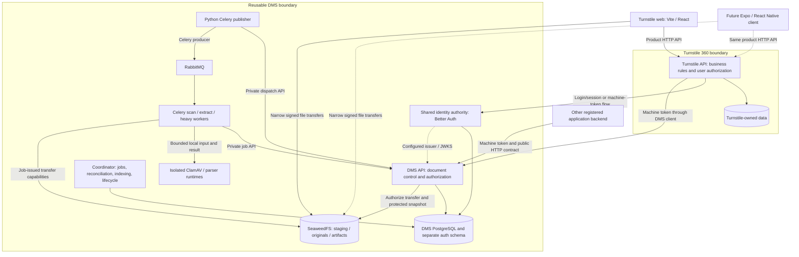
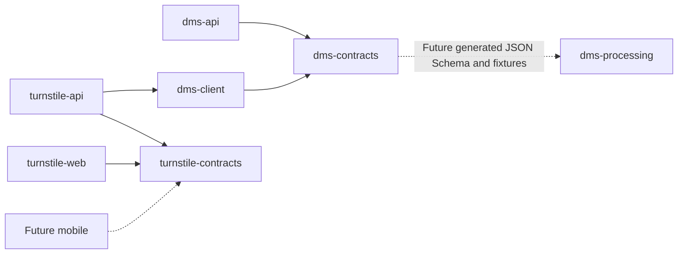
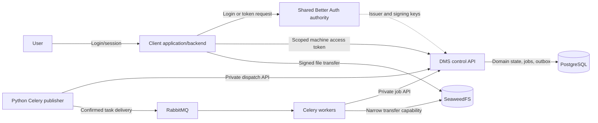
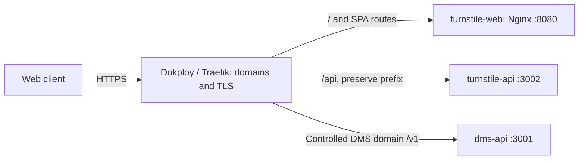

# Turnstile 360 and Thaarei DMS architecture

**Updated:** 2026-10-31

**Status:** Accepted technical design with workspace foundations implemented.

**Owner:** Thaarei. Confidential and proprietary under [LICENSE](LICENSE).

## Documentation ownership and reading guide

This is the single technical architecture reference for the reusable Document Management
System (DMS), Turnstile 360, their shared repository, and deployment. It consolidates the
accepted DMS technical design previously held in blueprint v1.4 and the accepted workspace
and future-mobile decisions. Consolidation does not change product scope or authorize
feature implementation.

| Document                                                                             | Owns                                                                                                                                                                                     |
| ------------------------------------------------------------------------------------ | ---------------------------------------------------------------------------------------------------------------------------------------------------------------------------------------- |
| [architecture.md](architecture.md)                                                   | Components, responsibilities, dependencies, data/work flows, technical contracts, selected stack, configured limits, security, deployment topology, recovery, and architecture decisions |
| [DMS product blueprint](docs/headless_dms_product_blueprint_v1.md)                   | Product promise, included/deferred scope, product correctness, deployment inputs, and product decision history                                                                           |
| [DMS functionality requirements](docs/headless_dms_functionality_requirements_v1.md) | Stable FR/NFR IDs and capability dependency order                                                                                                                                        |
| [Workspace standards](docs/standards/workspace.md)                                   | Coding, formatting, configuration, and verification conventions                                                                                                                          |
| [Workspace implementation plan](docs/workspace_implementation_plan.md)               | Workspace setup sequence, CLI provenance, and original validation                                                                                                                        |
| [Dokploy runbook](docs/runbooks/dokploy.md)                                          | Deployment commands and operator steps                                                                                                                                                   |
| [IN_PROGRESS.md](IN_PROGRESS.md)                                                     | Actual implementation, verification, active work, gaps, and agent handoffs                                                                                                               |

Keep technical design changes here and link from other documents. Update affected
requirements and runbooks when behavior or deployment steps change. Manifests, lockfiles,
and deployment files record executable versions/configuration; keep this document aligned
with them. Targets and configured defaults below are requirements, not measured capacity,
production-readiness, or compliance claims.

Navigation: [status](#implementation-status), [system picture](#system-context),
[repository](#repository-and-package-dependencies), [installed stack](#installed-toolchain-and-libraries),
[Turnstile](#turnstile-application-architecture), [DMS components](#module-and-contract-boundaries),
[identity](#tenancy-identity-and-authorization), [upload](#seaweedfs-storage-and-upload-protocol),
[processing](#processing-provenance-and-ai-readiness), [jobs](#durable-jobs-events-and-reconciliation),
[deployment](#development-and-current-deployment), [recovery](#backups-recovery-and-controlled-disposal).

## Implementation status

| Area                 | Current state                                                                                                   | Accepted target / remaining work                                                                      |
| -------------------- | --------------------------------------------------------------------------------------------------------------- | ----------------------------------------------------------------------------------------------------- |
| DMS API              | Nest/Fastify entry point, `/v1` identity, `/health/live`, eleven empty feature modules                          | Identity, document capabilities, coordinator, private operator/job APIs, database/storage integration |
| Turnstile API        | Separate Nest/Fastify entry point, `/api` identity, `/health/live`                                              | Product rules, user authorization, persistence, authenticated DMS consumption                         |
| Turnstile web        | Vite/React application name, local `/api` proxy                                                                 | Product screens and user interactions after requirements are agreed                                   |
| Python processing    | Installable package, identification command, reserved execution folders                                         | Publisher, Celery tasks, job/transfer clients, scanner/parser supervision and sandbox enforcement     |
| Shared packages      | Three buildable packages with empty exports                                                                     | Payload schemas, generated contracts/fixtures, typed HTTP operations                                  |
| Local infrastructure | PostgreSQL, RabbitMQ, SeaweedFS Compose definitions                                                             | Startup/persistence and storage/security compatibility verification; applications are not connected   |
| Production packaging | Four Dockerfiles and three-service Dokploy application Compose                                                  | Image/runtime checks, production stateful/processing services, deployed domains/TLS verification      |
| Quality              | Build, type, boundary, formatting, API identity/injection/runtime smoke checks configured and previously passed | Business/security/processor/recovery tests as capabilities are implemented                            |
| Mobile               | Architecture boundary only                                                                                      | Expo/React Native project is deferred; no mobile application or dependencies exist                    |

The current APIs have no authentication, document endpoints, database migrations, or
processing operations. A module name, folder, dependency declaration, or Compose file
does not establish a working feature. See [progress](IN_PROGRESS.md) for dated evidence;
container builds, infrastructure startup, remote CI, and Dokploy deployment remain
unverified at this revision. No source/data migration has started.

## System context

Turnstile 360 is one consumer of a reusable DMS. It has its own frontend, backend, and
business data. Other trusted application backends can consume the same DMS through its
public HTTP contract without using this repository or its TypeScript packages.

This diagram shows the target architecture. Arrows beyond current identity/liveness and
web entry-point behavior represent planned integrations.



Control requests pass through backends; normal file bytes transfer directly using
short-lived capabilities. Turnstile evaluates the user's business rights before calling
the DMS. The DMS independently enforces the registered application's tenant, scopes,
ownership/grants, lifecycle, and security state. A shared repository or host confers no
additional runtime trust.

## Repository and package dependencies

Existing paths below reserve ownership; empty directories are not implemented components.
Future process entry points and feature files are added with their capabilities.

```text
/
├── apps/
│   ├── dms-api/
│   │   ├── src/
│   │   │   ├── main.api.ts, bootstrap.ts, app.module.ts
│   │   │   ├── composition/               # future process composition
│   │   │   ├── infrastructure/            # current liveness controller
│   │   │   └── modules/
│   │   │       ├── platform-auth/ access/ enrollment/ audit/
│   │   │       ├── documents/ uploads/ storage/ policies/
│   │   │       └── processing/ search/ lifecycle/
│   │   ├── database/auth/{schema,migrations}/
│   │   ├── database/dms/{schema,migrations}/
│   │   └── test/
│   ├── dms-processing/
│   │   ├── src/turnstile_processing/
│   │   │   └── publisher/ tasks/ job_api/ transfers/ processors/ sandbox/
│   │   ├── tests/
│   │   └── pyproject.toml, uv.lock
│   ├── turnstile-api/
│   │   ├── src/
│   │   │   ├── main.ts, bootstrap.ts, app.module.ts
│   │   │   ├── infrastructure/ modules/
│   │   │   └── integrations/dms/
│   │   ├── database/{schema,migrations}/
│   │   └── test/
│   └── turnstile-web/
│       └── src/                           # App.tsx and main.tsx exist
│           └── app/ routes/ features/ components/ lib/ styles/
├── packages/
│   ├── dms-contracts/
│   │   ├── src/{public,internal,events,artifacts}/
│   │   └── generated/ fixtures/
│   ├── dms-client/src/
│   └── turnstile-contracts/src/
├── tooling/
│   ├── typescript/{base,library}.json
│   └── dependency-rules/config.cjs
├── scripts/{check-deploy,smoke-runtime}.mjs
├── deploy/
│   ├── compose.local.yaml, compose.dokploy.yaml
│   ├── nginx/nginx.conf
│   └── artifacts/
├── tests/system/
├── .github/workflows/workspace.yml
├── docs/                                  # scope, requirements, standards, runbooks
├── architecture.md
├── IN_PROGRESS.md
└── AGENTS.md
```

`apps/turnstile-mobile` is a possible future path and does not exist. `turnstile_processing`
is the current Python import name; its responsibility is reusable DMS processing.

| Package                        | Intended contents / consumers                                                                                                                    | Boundary                                                                                                                                          |
| ------------------------------ | ------------------------------------------------------------------------------------------------------------------------------------------------ | ------------------------------------------------------------------------------------------------------------------------------------------------- |
| `@thaarei/dms-contracts`       | Public DMS requests/responses, separate private job payloads, events, artifact schemas, errors/statuses; API/client and generated Python schemas | Schemas/types only; no Nest, database, Turnstile domain logic, or credentials. Keep private contracts separate from public exports as implemented |
| `@thaarei/dms-client`          | Typed HTTP calls, transport configuration, machine-token attachment, stable errors, idempotency-aware retries for trusted backends               | Depends on DMS contracts; no DMS repositories/services or Turnstile user authorization; never bundled into a frontend                             |
| `@thaarei/turnstile-contracts` | Product requests/responses, schemas, errors, pagination for Turnstile API, web, and future mobile                                                | Platform-independent; no DOM, Node-only runtime, UI framework, Nest, database, or DMS internal-job dependencies                                   |

The current manifest dependency graph is:



Internal dependencies use `workspace:*`. Packages export built `dist` files and Turborepo
builds dependencies before consumers. Applications never import another application's
source, repositories, migrations, or database tables. Contract packages cannot become a
shared business-layer or shared database package. Python interoperates through exported
language-independent contracts and the private HTTP API, without importing Nest code.

Dependency-cruiser in [config.cjs](tooling/dependency-rules/config.cjs) checks unresolved
imports, cycles, cross-application imports, framework/database coupling in contracts, and
browser/server imports. These checks cover the configured TypeScript import graph;
runtime trust, SQL ownership, Python behavior, and all future platform-specific rules
also require review and appropriate tests.

## Installed toolchain and libraries

Versions here are the repository's configured versions, not a claim about the newest
upstream release. See the [root manifest](package.json), [pnpm catalog](pnpm-workspace.yaml),
application manifests, [Python project](apps/dms-processing/pyproject.toml), and lockfiles.
The subsequent selected-technology section covers feature dependencies not yet installed.

| Area                       | Installed / configured selection                                                                 | Purpose                                                                                                   |
| -------------------------- | ------------------------------------------------------------------------------------------------ | --------------------------------------------------------------------------------------------------------- |
| JavaScript runtime         | Node 24.21.0                                                                                     | APIs, builds, CLI tools, direct `.mjs` repository scripts                                                 |
| Workspace                  | pnpm 12.16.1; Turborepo 2.11.10                                                                  | Workspace resolution, exact dependencies/lockfile, build/check/test task graph and caching                |
| TypeScript                 | 6.0.3, shared catalog                                                                            | Strict application/library compilation; compatibility pin for the installed Nest generator/compiler API   |
| API framework              | `@nestjs/common`, `core`, `platform-fastify` 12.3.2                                              | Both control/product APIs with Fastify; compatible plugins required                                       |
| Nest runtime support       | `reflect-metadata` 0.2.2; `rxjs` 7.8.1                                                           | Decorator metadata, dependency injection, framework reactive support                                      |
| Validation                 | Zod 4.6.7 in both APIs                                                                           | Current host/port validation; selected future shared payload schemas                                      |
| Web UI                     | React / React DOM 19.3.1                                                                         | Product presentation and interaction                                                                      |
| Web build                  | Vite 8.3.5; `@vitejs/plugin-react` 6.1.2                                                         | Frontend development server, React integration, production asset build                                    |
| API generation             | Nest CLI 12.0.11; schematics 12.0.12                                                             | CLI-generated modules/controllers/providers; no hand-built replacement for available scaffolding commands |
| JavaScript quality         | Biome 2.6.4; dependency-cruiser 18.7.0                                                           | Formatting/lint/import organization and architecture import checks; ESLint/Prettier are not configured    |
| API tests                  | Vitest 4.1.2; `@nestjs/testing` 12.3.2; `@swc/core` 1.16.21                                      | Identity tests and Fastify injection; SWC preserves legacy decorator metadata in tests                    |
| API test tooling           | Vite 8.0.0 in each API dev dependency                                                            | Test toolchain dependency, distinct from the web application's Vite pin                                   |
| Type declarations          | `@types/node` 24.19.2 at root/web and 24.0.0 in APIs; `@types/react` / `@types/react-dom` 19.3.0 | Compile-time Node/React declarations; do not add runtime behavior                                         |
| Repository YAML checks     | `yaml` 2.9.1                                                                                     | Parse deployment YAML and check build-context/Dockerfile paths                                            |
| Python runtime/build       | Python 3.13.18; uv / `uv_build` 0.13.6                                                           | Locked environment and Python source/wheel packaging                                                      |
| Python quality/tests       | Ruff 0.17.3; mypy 2.4.1; pytest 9.2.0, resolved in `uv.lock`                                     | Python format/lint/type checks; pytest available for future behavior tests                                |
| Infrastructure definitions | PostgreSQL 18.6-bookworm; RabbitMQ 4.3.7-management-alpine; SeaweedFS 4.51                       | Local Compose images pinned by digest; not connected to application code                                  |
| Application images         | Node 24.21.0-bookworm-slim; Python 3.13.18-slim; Nginx 1.30.2-alpine                             | Digest-pinned runtime/build bases in Dockerfiles; frontend uses an unprivileged Nginx process             |
| Delivery                   | Docker Compose; Linux server with Dokploy/Traefik; GitHub Actions workflow                       | Container deployment target, ingress/TLS, configured CI checks/image builds                               |

Python currently has no runtime dependencies. Better Auth/plugins, Drizzle/database
drivers, the S3 SDK, Celery and processing engines, OpenAPI generation, and OpenTelemetry
remain selected additions for their features. Do not describe them as installed or
operational. React Testing Library and Playwright are planned for real UI flows. No
additional UI component system, router, client-state/form library, mobile library, or
Turnstile domain dependency has been selected by this workspace.

## Turnstile application architecture

### Web and future mobile

`turnstile-api` is the shared product backend for Vite/React and a future Expo/React Native
client. Backend services own authoritative business rules, permissions, calculations,
workflow transitions, validation, and persistence. Clients submit intended changes; the
backend authorizes and applies them, then returns the resulting domain data/outcome.

Clients own presentation, navigation, forms, display formatting, and transient UI state.
They may repeat input validation for immediate feedback or show optimistic UI; they must
handle rejection and reconcile with the server result. Responses must not depend on DOM,
React components, or a particular screen layout. Both clients use the same business
authorization and product contracts. Maintain compatibility for deployed clients,
including mobile releases that update independently of the backend.

User login is supplied by the selected identity authority; product sessions/user context
are enforced by the Turnstile backend. Web uses the planned secure session boundary.
Native login/session storage and redirects will be specified when mobile is implemented;
do not assume browser cookies, expose service secrets, or create a second business backend.

### Backend composition and data ownership

Use feature-oriented Nest modules under `apps/turnstile-api/src/modules`. Keep controllers
focused on the HTTP contract, services on business use cases/policies and transaction
boundaries, and repositories on the application's own persistence. Add internal layering
only as implemented behavior needs it. Generate feature scaffolds with the Nest CLI.

```text
Web / future mobile
  -> Turnstile controller: request contract and user context
    -> Turnstile service/policy: business authorization, rules, state transitions
      -> Turnstile repository: owned business data
      -> integrations/dms: product-to-DMS translation
        -> @thaarei/dms-client -> authenticated DMS HTTP API
```

Turnstile owns its business tables/migrations under `apps/turnstile-api/database` and uses
separate runtime credentials/permissions from DMS/auth ownership. A shared PostgreSQL
host is possible; it does not grant cross-application SQL access. Physical Turnstile
database/schema naming and schemas are established during persistence implementation.

Keep document/version IDs and product reference mappings where required; the DMS owns
file bytes, security, document history, extraction, grants, and search. A file transfer
flow is: user action -> Turnstile authorization -> DMS session/capability -> client direct
transfer -> backend-mediated completion/status. Normal application operations and polling
remain through Turnstile's product API. Machine-token acquisition/caching, DMS error
translation, and bounded transport settings belong in the server integration boundary.

Business records and DMS operations cannot share one database transaction over HTTP.
Feature implementation must define idempotent linking, pending/failure outcomes, and
reconciliation for partially completed operations. Do not hold database transactions open
across file uploads or assume a DMS failure rolled back a product record.

The consumer backend checks user permissions before each document action and keeps DMS
machine credentials/enrollment keys private. An audit user identifier asserted to the DMS
does not delegate user permissions. Other applications consume the same DMS contract;
the DMS never imports Turnstile business rules.

### Product functionality boundary

Kids tracking, staff, and other Turnstile business areas require the product functionality
specification before defining feature modules, workflows, screens, permissions, or tables.
This architecture establishes their ownership and integration pattern without inventing
the functionality. No mobile application, business feature, or migration is added by
this documentation change.

## Selected architecture and technology

Use a modular monolith for the TypeScript control plane and shared authentication module, with independently deployed Python/Celery scanning and extraction workers. PostgreSQL owns authoritative domain state. RabbitMQ transports Celery tasks; SeaweedFS stores bytes. Keep the client application, DMS modules, Python processing code, and generated contracts in one monorepo with explicit package boundaries. Repository membership never supplies runtime trust or shared credentials.

| Layer                    | Selected default                                                                                   | Boundary / reason                                                                                             |
| ------------------------ | -------------------------------------------------------------------------------------------------- | ------------------------------------------------------------------------------------------------------------- |
| Control API              | TypeScript + NestJS, Fastify adapter                                                               | Explicit modules and dependency injection; no parser CPU work in request handlers                             |
| Validation/contracts     | Zod with generated JSON Schema and OpenAPI 3.1                                                     | One payload definition; validate exported schemas in Python                                                   |
| Database                 | PostgreSQL                                                                                         | Domain transactions, job state, outbox, audit, and initial search                                             |
| Queries/migrations       | Drizzle ORM + reviewed SQL migrations                                                              | Explicit constraints and query plans; no schema synchronization in production                                 |
| Object storage           | SeaweedFS OSS, S3 endpoint                                                                         | Owner-selected self-hosted default; small installation and distributed deployment path                        |
| Object client            | AWS SDK for JavaScript S3 client; bounded Python streaming transfers using job-issued capabilities | Explicit SeaweedFS endpoint/signing; workers need no general storage credentials                              |
| Work transport/execution | RabbitMQ OSS + Celery, JSON serialization and prefork processes                                    | Framework-managed execution/routing/retries; no custom AMQP consumer loop                                     |
| Domain coordination      | PostgreSQL-backed coordinator in the control-plane codebase                                        | Authoritative stage eligibility, result acceptance, outbox, reconciliation, indexing, and maintenance         |
| Task publishing          | Small Python publisher from the processing image, using Celery's producer API                      | Claims outbox deliveries through the private API; no hand-built Celery protocol in TypeScript                 |
| Malware scanner          | ClamAV daemon + managed signature updates                                                          | Separate security gate with explicit scan-coverage checks                                                     |
| PDF processing           | pypdfium2/PDFium                                                                                   | Native text and bounded page rendering in separate processes                                                  |
| OCR                      | Tesseract CLI; Pillow for bounded image decoding                                                   | CPU-capable, local execution; no model service required                                                       |
| Office/email text        | Apache Tika, isolated forked parser runtime                                                        | Bounded text/metadata extraction; no Office installation or converter required                                |
| Spreadsheet data         | python-calamine/Calamine; Python standard CSV parser for CSV/TSV                                   | Sheet/cell-oriented data; no formula execution or duplicate full-document parsing                             |
| Structured extraction    | Docling as an optional enabled profile with pinned, approved models                                | Layout/table artifacts only when requested and configured                                                     |
| Identity                 | Better Auth + OAuth Provider + JWT/JWKS plugins, PostgreSQL/Drizzle                                | Shared user login and machine tokens; configured external OAuth/OIDC issuer may replace the default authority |
| Authorization            | Local application ownership/grants and tenant isolation                                            | No separate policy service                                                                                    |
| Search                   | PostgreSQL FTS + GIN; pg_trgm for title/name                                                       | Avoid another durable search system                                                                           |
| Packaging                | Linux Docker Compose managed by Dokploy                                                            | Dokploy/Traefik supplies ingress and TLS; run one ingress stack                                               |
| Telemetry                | Structured logs, health endpoints, metrics, OpenTelemetry instrumentation                          | Operator-selected monitoring backend; no bundled Grafana requirement                                          |

SeaweedFS is the v1 storage backend. The DMS uses the S3 operations defined in [SeaweedFS storage and upload protocol](#seaweedfs-storage-and-upload-protocol); implementing or certifying alternative storage backends is outside v1. Use `weed mini` for the small self-hosted profile, with component separation available for an expanded deployment. [SeaweedFS small deployment](https://github.com/seaweedfs/seaweedfs/wiki/Quick-Start-with-weed-mini)

Keep RabbitMQ for durable task transport; do not choose a broker because of a storage vendor's notification protocol. Storage events are optional hints, so v1 does not depend on native SeaweedFS-to-broker integration.

Tika and Calamine are selected for the included Office/spreadsheet scope. Install Docling and its approved models only when the structured profile is enabled. Do not add Dramatiq alongside Celery, a Redis/Valkey result store, LibreOffice, OCRmyPDF/Ghostscript, PyMuPDF/MuPDF, OpenSearch, NATS, or Temporal to the selected default. Those additions are not required for the agreed functionality.

Use the NestJS Fastify adapter and compatible Fastify plugins, with exact package/container versions pinned in the implementation. Maintain the lockfile and bill of materials as part of ordinary dependency management. [NestJS adapters](https://docs.nestjs.com/techniques/performance)

The monorepo uses pnpm/Turborepo, Biome, and uv. Turnstile 360 is the consumer product: its Vite/React frontend and separate NestJS/Fastify backend live beside the reusable DMS and Python processing project. Turnstile business functionality and data migration are specified separately. The [workspace implementation plan](docs/workspace_implementation_plan.md) records setup provenance; [workspace standards](docs/standards/workspace.md) define coding rules. Workspace setup precedes capability implementation.

## Module and contract boundaries

The control plane has bounded modules for identity/access, documents/versions, uploads/storage, processing coordination, search, and lifecycle/audit. Modules share database transactions where needed and do not communicate through HTTP inside the monolith.

### DMS module responsibilities

These modules exist as empty Nest CLI-generated shells. The responsibilities below are
the target design, not completed implementations. Feature controllers, services, policies,
and repositories remain within their owning module; expose explicit provider interfaces
to other modules and coordinate cross-module atomic changes in the control plane.

| Module          | Owns                                                                                                                                          |
| --------------- | --------------------------------------------------------------------------------------------------------------------------------------------- |
| `platform-auth` | Better Auth authority, login/machine-client endpoints, auth persistence and signing-key integration; separate from DMS resource authorization |
| `access`        | Verified machine principal, tenant/application mapping, scope ceilings, resource grants and default-deny authorization                        |
| `enrollment`    | Bound enrollment-key issuance/activation/revocation and transactional nonsecret replay receipt                                                |
| `audit`         | Bounded attributable audit capture and authorized audit retrieval                                                                             |
| `documents`     | Stable document identity, immutable revisions/current pointer, metadata, tags, references and version/history behavior                        |
| `uploads`       | Single-file sessions, multi-file batches/items, completion/cancellation/expiry and snapshot workflow                                          |
| `storage`       | SeaweedFS S3 adapter, narrowly scoped capabilities, object identity, protected snapshots and exact-object operations                          |
| `policies`      | Versioned format/profile policy, quotas, reservations and admission limits                                                                    |
| `processing`    | Stage registry, jobs/attempts/fences, result acceptance, dispatch/outbox and processing status                                                |
| `search`        | Authorized metadata/FTS queries, source chunks and index-generation replacement                                                               |
| `lifecycle`     | Soft deletion/restore, generation invalidation, reference-aware cleanup and recovery-aware disposal                                           |

### Processes and Python boundaries

| Target process / area | Responsibility / privilege boundary                                                                                                                                           |
| --------------------- | ----------------------------------------------------------------------------------------------------------------------------------------------------------------------------- |
| DMS API               | Public control/auth interfaces and private operator/dispatch/job interfaces, with distinct authentication/authorization and ingress rules                                     |
| DMS coordinator       | Same TypeScript image/codebase, separate future process composition; stage scheduling, reconciliation, indexing and lifecycle maintenance using a narrowly privileged DB role |
| `publisher/`          | Python process using the Celery producer API; claim/confirm dispatch through the private API, without general DB/object access                                                |
| `tasks/`              | Celery scan, ordinary extraction and heavy execution entry points; fixed task registry and bounded execution                                                                  |
| `job_api/`            | Private job claim, lease heartbeat, result submission and accepted-outcome handling                                                                                           |
| `transfers/`          | Bounded streaming of job-authorized inputs/results; no general storage credentials                                                                                            |
| `processors/`         | Format-specific PDF/image/OCR/Office/spreadsheet/email adapters and optional structured profile                                                                               |
| `sandbox/`            | Trusted supervision and enforced OS/container isolation for untrusted parsing; bounded local input/output and no inherited secrets                                            |

Run API and coordinator processes from the same TypeScript application image. The coordinator persists eligible stages/jobs/outbox records and owns domain reconciliation, indexing, and maintenance. A Python publisher claims due dispatch records through the private API, publishes through Celery, and records confirmed delivery. Celery owns ordinary transient execution retries; the coordinator does not run a competing retry timer for the same attempt. Multiple instances use database locking/leases; there is no assumed singleton in memory.

Celery tasks use a private authenticated job API to claim valid attempts, obtain narrow transfer capabilities, and submit outcomes. Publisher and worker identities have distinct permissions. They receive no general database credentials and cannot implement publication rules. Public routes never expose internal job/dispatch endpoints. Celery's result backend is disabled; client-visible state and accepted artifacts remain in PostgreSQL/SeaweedFS. A broker acknowledgement or Celery task state is not a DMS publication decision.

Host one Better Auth authority in a separate platform-auth module of the TypeScript API. Use a dedicated PostgreSQL `auth` schema, database role, signing-key storage, and reviewed migrations. Use the supported Better Auth Fastify integration on auth routes, preserving request/response and cookie semantics; keep session guards scoped to those routes rather than replacing DMS bearer-token guards. A community NestJS wrapper is not required. The DMS domain module validates access tokens through its configured issuer/JWKS contract; it does not query user/session tables or accept browser cookies as machine authority. Consumer applications own login/recovery screens and business-session enforcement. Preserve this boundary when deploying the same modules separately later.



Author request, response, job, and event payload schemas once. Export JSON Schema and OpenAPI from the shared contract package. Zod transformations/refinements that cannot be represented faithfully in the exported schema are excluded from shared payload definitions; semantic domain checks remain explicit application logic. CI validates the same payload fixtures in TypeScript and Python. [Zod schema export](https://zod.dev/json-schema)

Job orchestration is deterministic code over a fixed stage registry. Tenant/application profiles select allowed stages and bounded settings; clients cannot submit executable code, arbitrary processors, storage destinations, or workflow graphs.

## Tenancy, identity, and authorization

### Deployment and principals

- The default self-hosted deployment serves one tenant with multiple applications. The schema and query boundaries remain tenant-aware from the start.
- The code and data model enforce tenant isolation from the start. Shared multi-tenant hosting is outside the initial single-tenant deployment profile and is an operational expansion, not a preliminary implementation stage.
- A registered application belongs to one tenant. A service operating for multiple tenants has separate registrations/credentials for each tenant in v1.
- Validate the token signature, allowed issuer/algorithm, audience, expiry, and configured client-identity claim. Map the verified issuer/client identity to an active registration; never authorize from caller-supplied tenant/application IDs.
- Better Auth is the selected shared authority for this product deployment. Use its OAuth Provider plugin for client credentials and resource-bound access tokens, with JWT/JWKS signing; disable the standalone session-JWT issuance endpoint for this authority. Administrators provision confidential DMS machine clients limited to the client-credentials grant and their machine-scope ceilings. User-login OAuth clients are separate and are not mapped as DMS machine registrations. Disable open signup and unauthenticated dynamic client registration.
- The authority issues and rotates client credentials. Local DMS registration supplies activation, immediate disablement, tenant/application mapping, and allowed-scope ceilings. Give each application and internal worker role a separate client; multi-tenant consumers use separate registrations. A DMS resource server needs verification keys, not an issuer-wide signing secret.
- User login uses secure, HttpOnly session cookies through the application backend; separately deployed OAuth login clients use authorization code with PKCE. Enforce trusted origins, CSRF protection, expiry, login/recovery rate limits, operator-controlled account recovery, and session revocation. Client secrets never enter browser code. Persist signing keys and coordinate rotation across API instances; do not depend on process-local sessions or rate-limit counters in a replicated deployment.
- A client backend checks its user's business permissions, then uses a cached short-lived client-credentials access token for the DMS audience. This token represents the application, not delegated end-user rights. Direct end-user tokens, arbitrary multi-issuer federation, and user token exchange are outside the v1 DMS contract. Reported end-user identifiers are bounded audit context asserted by the application, not authorization input.
- An operator may configure a supported external OAuth/OIDC issuer, including an existing Keycloak installation, instead of running the embedded authority. Use one selected authority per deployment by default; do not deploy both systems merely because they share a repository. Keycloak is Apache 2.0, so replacement is an application/operations choice rather than a mandatory-license saving.

[Better Auth OAuth Provider](https://better-auth.com/docs/plugins/oauth-provider), [Drizzle/auth schema integration](https://better-auth.com/docs/adapters/drizzle), [Keycloak administration](https://www.keycloak.org/docs/latest/server_admin/index.html)

### Thaarei enrollment and activation

An operator bootstraps the tenant/admin and provisions each intended OAuth client. A client is not granted DMS access merely because the authority issues it a token. Initial consumer activation additionally requires a high-entropy, single-use **Thaarei enrollment key** issued through supported operator tooling; there is no universal vendor secret shipped in the frontend or images.

Bind the key record to the deployment, tenant, expected issuer/client identity, expiry, and one permitted activation. Store only its digest and nonsecret audit/receipt metadata. `POST /v1/application-enrollments` requires a valid DMS-audience machine token plus `X-Thaarei-Enrollment-Key`. This is the explicit pre-registration exception: token verification and key binding apply before an active application exists; normal DMS operations still require active registration.

Consume the key, activate the one bound registration, and record audit plus a nonsecret idempotency receipt in one transaction. An authenticated identical retry returns the same registration outcome; a different client/request, expired unused key, or already-used key without the matching receipt cannot create another registration. Explicitly revoked keys fail even when a receipt exists, and a receipt never re-enables a suspended application. Default unused-key lifetime is 24 hours; a matching receipt remains available for the disclosed idempotency window. Never log the key or token.

Routine API calls require only the access token and current DMS policy; the enrollment key is not an extra header on every request. Credential rotation preserves the application registration and document ownership. Internal service identities are provisioned through private operator tooling with separate scopes. Enrollment controls initial registration; it is not a tamper-proof commercial-license mechanism against an administrator controlling the self-hosted deployment.

### Ownership and sharing

A document has one owning application. Same-tenant applications receive no access by default. The owner or tenant administrator may explicitly grant `READ`, `EDIT_METADATA`, or `ADD_VERSION` to another registered application. `READ` includes authorized original/history retrieval, extraction, and search; a reference alone provides none of these rights.

Only the owner or tenant administrator may change grants, delete/restore the logical document, or request reprocessing. API scopes are an additional ceiling, not a replacement for resource authorization. Cross-tenant grants and ownership transfer are unavailable in v1.

References are namespaced by tenant, creating application, source system, entity type, and entity ID. An application may link only within its registered source namespace and must already have access to the document. Linking or unlinking does not change ownership or grants. Applications remain responsible for business-record permissions and record existence.

Every public read and mutation checks current tenant/application/resource policy, including version history, artifacts, audit, polling, and search. Revocation stops new capabilities immediately; issued signed URLs may remain usable until expiry. Audit authorization issuance separately from actual retrieval.

Use composite tenant-aware foreign keys and uniqueness constraints. Enable PostgreSQL tenant row-level security with transaction-local tenant context and a runtime role that cannot bypass it; do not reuse an owner/superuser migration role for requests. Reset context with transaction boundaries under connection pooling. A separate narrowly privileged coordinator/maintenance role handles global job discovery and outbox scheduling and is unavailable to public request code. RLS supplements application grant checks. [PostgreSQL RLS](https://www.postgresql.org/docs/current/ddl-rowsecurity.html)

## SeaweedFS storage and upload protocol

### Required adapter contract

The SeaweedFS integration must provide SigV4 presigned PUT/GET, signed-header enforcement, exact upload-length enforcement, atomic create-only PUT, HEAD, source-conditional copy to a new key, read-after-write visibility, private bucket policies, CORS, range GET, and exact-key deletion. Implement these behaviors in the actual storage integration and cover them with its normal integration tests. Record SDK versions, endpoint style, and proxy configuration.

Use separate private staging, originals, and artifacts buckets. Upload signing credentials can only PUT into staging; they cannot read, list, copy from, or delete originals/artifacts, change ACLs, or configure buckets. Download signing credentials are read-only. The trusted snapshot coordinator can read staging and create original candidates. Parser identities cannot replace/delete originals. Maintenance deletion uses a separate identity.

Require signed `If-None-Match: *` on staging PUTs to prevent replacement and signed exact content length matching the session reservation. Browser transfers use the automatically supplied `Content-Length` for a known-size file rather than attempting to set a forbidden header in JavaScript. The actual browser, Node, and Python integrations must honor the same contract. Unbounded or overwriteable uploads are not an acceptable fallback. [SeaweedFS conditionals](https://github.com/seaweedfs/seaweedfs/wiki/S3-Conditional-Operations)

Configure authentication before exposing SeaweedFS: `weed mini` otherwise permits unauthenticated access when credentials are absent. Keep filer, volume, master, administrative, and non-S3 interfaces private. Disable or block automatic archive extraction and vendor-specific write extensions on the transfer ingress; test unsigned header/query injection. Do not expose a path that bypasses S3 authorization. [SeaweedFS authentication defaults](https://github.com/seaweedfs/seaweedfs/wiki/Quick-Start-with-weed-mini), [SeaweedFS S3 API](https://github.com/seaweedfs/seaweedfs/wiki/Amazon-S3-API)

### Upload and immutable publication

1. The consumer backend calls `POST /v1/uploads` with metadata, declared size/type, optional SHA-256, processing profile, and an idempotency key.
2. In a transaction, validate policy, reserve staging/candidate capacity, create the logical document if new, allocate a candidate revision and upload session, and persist a unique staging key. A logical document without a current version is not downloadable or searchable.
3. Return a short-lived signed single-PUT capability bound to that key, exact length, permitted content type, and create-only condition. The client uploads directly to SeaweedFS.
4. `POST /v1/uploads/{id}/complete` records completion intent and returns `202`. The reconciler independently discovers existing objects for persisted active sessions, so a missed callback cannot strand a valid upload.
5. HEAD verifies session/key identity and actual size. The coordinator creates a private, server-owned original candidate from the create-only source using a source ETag precondition and a new unpredictable destination key. Persist the chosen candidate with compare-and-swap. A retry never overwrites a candidate; abandoned copies are collected later.
6. Scan that candidate, not a mutable staging key. Stream its bytes to compute authoritative SHA-256, compare any declared hash, detect actual media type, and assess configured scan coverage. After the malware scan, use the sandbox for bounded format-specific checks: PDF/image page and dimension bounds, Office package/embedded-content rules, spreadsheet limits, and email nesting/attachment policy. Encryption, identified macros, unsupported embedded content, or incomplete required checks cannot receive a final pass. An S3 ETag is an object concurrency token, not an assumed cryptographic checksum.
7. On a security pass, a PostgreSQL transaction marks the version available, updates the current pointer only under the [version ordering rule](#versioning-deletion-and-retrieval-rules), increments the document revision, creates initial jobs, and records audit/outbox intent.
8. Publication changes database eligibility; it does not copy or rewrite the scanned bytes again. Download signing checks eligibility before issuing a URL to the same protected candidate object.
9. Schedule optional enrichment independently. Failures do not make the already-passed original unavailable. Retain actual size/hash/security evidence and clean staging only after all issued upload capabilities have expired plus the cleanup margin.

Object versioning is optional storage protection, not the v1 publication mechanism or a backup substitute. If enabled, persist and use exact storage version IDs. There is no cross-tenant content deduplication in v1.

### Multi-file batches

A batch groups independent files; it is not an archive, one combined document, or multipart transfer. `POST /v1/upload-batches` records a bounded manifest of immutable client item IDs, intended operations, and file descriptors. Manifest creation alone creates no document, reserves no physical bytes, and grants no upload authority. The normal session-creation API accepts `batchId`/`itemId` and admits each file independently when capacity is available. Each item binds to at most one upload/candidate operation; idempotent retries cannot create another document for that item.

Keep each file's upload/security/availability/processing outcome and retry guidance. Batch status exposes separate per-stage counts and a paginated item list, not an assertion that every file succeeded. A failure or admission delay in one item must not roll back successful files. Cancellation prevents new item sessions and cancels eligible pending sessions under the normal cancellation race rules; already-published documents remain intact. Closing/expiring a batch prevents new sessions and settles remaining unstarted items. Batch ownership is the creating tenant/application; grouping never changes document permissions. New-version items require the versioning capability and current access checks.

## Independent state machines and security coverage

| Concern              | States / transition rules                                                                                                 |
| -------------------- | ------------------------------------------------------------------------------------------------------------------------- |
| Upload               | `INITIATED -> OBJECT_VERIFIED -> SNAPSHOTTED -> COMPLETED`; terminal `EXPIRED`, `CANCELLED`, or `FAILED`                  |
| Security             | `PENDING -> SCANNING -> PASSED`, `REJECTED`, or `INCONCLUSIVE`; a controlled retry may reassess an inconclusive candidate |
| Version availability | `CANDIDATE -> AVAILABLE` only after `PASSED`; rejected candidates never become available                                  |
| Document lifecycle   | `ACTIVE -> SOFT_DELETED -> PURGING -> PURGED`; restore is allowed only from `SOFT_DELETED` before its deadline            |
| Processing run       | `QUEUED -> RUNNING -> SUCCEEDED`, `PARTIAL`, `FAILED`, `UNSUPPORTED`, `SKIPPED`, or `CANCELLED`                           |
| Search generation    | `PENDING -> BUILDING -> READY` or `FAILED`; failed replacement leaves the prior active generation intact                  |

A current version is a pointer to one available version, not another overloaded ready state. Upload `COMPLETED` means its version passed the security gate, even if a later revision is already current. Track the processing and indexing state separately. Terminal rejected/inconclusive uploads carry an explicit failure reason rather than appearing indefinitely pending.

A scan passes only when the file and assessed nested content satisfy configured type/size/coverage policies and the scanner reports no detection without a limit, timeout, truncation, encryption, or execution error. Record scanner engine/signature versions and time, assessed bytes, limits, and outcome. Keep `REJECTED` distinct from `INCONCLUSIVE`; neither allows publication.

Configure and test ClamAV's exceeded-limit and encryption alerts rather than accepting a nominal clean return for skipped content. Apply external deadlines in addition to scanner limits. Expose signature-age metrics and stop new publication when signatures exceed the configured freshness policy. Do not disable defensive limits to accommodate an unbounded upload. [ClamAV scanning configuration](https://raw.githubusercontent.com/Cisco-Talos/clamav/main/etc/clamd.conf.sample)

An assessment remains valid for existing available bytes until explicit reassessment/revocation or policy invalidation. The signature-freshness gate applies to new publications and historical restores; it does not automatically expire every existing document whenever signatures are updated. V1 has no periodic reassessment service or implicit assessment-age expiry. Record an explicit invalidation when a policy change requires reassessment.

Deleting, cancelling, or superseding work increments a persisted lifecycle/work generation. Every result must match the job's current attempt/lease token, version, and applicable lifecycle generation. Expired attempts cannot commit artifacts, publication, counters, or index updates. Duplicate submissions of an already-accepted result return its recorded outcome without repeating effects.

## Versioning, deletion, and retrieval rules

Allocate monotonically increasing revision numbers transactionally per document; gaps from failed candidates are allowed. Keep the last available current version while a candidate is uploaded/scanned. Binary bytes and assigned revision identity never change after creation; mutable availability, processing, and security evidence are separate records/state.

Auto-publication rule: an available candidate advances `currentVersionId` only when its revision number exceeds the current version's. If v3 passes before v2, v2 may become available in history but cannot replace v3. Enforce the comparison and pointer update in the same locked/conditional database transaction.

Restoring historical bytes creates a new highest-numbered candidate revision referencing the protected object. It goes through a current-policy security assessment before becoming available; reusing historical bytes does not imply historical signatures remain sufficient. The existing current version stays available during this assessment. Reference-aware collection protects shared historical objects.

Metadata and grant changes require the expected document revision/ETag. Downloads require current authorization, an active document, and an available version with a current security pass. Default to the current version; historical retrieval is explicit. The original filename is sanitized presentation metadata, never an object key.

Soft deletion immediately hides the document from normal listing/search/retrieval, stops new signed URLs, cancels pending work, and increments its lifecycle generation. Search still checks live lifecycle/grants even while asynchronous deindexing runs. Existing signed URLs are bounded by their expiry; immediate revocation of delivered bytes is not a v1 promise.

Restore checks the deadline, object existence/integrity, and current policy, then advances the lifecycle generation. Needed work is rescheduled under that new generation; old jobs cannot resume themselves. A restored document with an invalidated security assessment remains unavailable until reassessed. There is no restore after `PURGING` begins.

If security status later changes to rejected/inconclusive, stop new reads and hide its derived content immediately. Invalidate affected runs and apply the new assessment to every version sharing those bytes. V1 does not automatically select an older revision as a replacement current version; an authorized restore creates a new revision.

## Processing, provenance, and AI readiness

### Default processing profiles

- `secure-only`: Type/policy/integrity checks and malware scan; no extraction.
- `searchable` (default for extraction-supported types): The same security gate followed by format-routed text/data extraction, selective OCR, and indexing.
- `structured` (opt-in, when installed and enabled): The same security gate followed by configured Docling layout/table extraction for PDF/images, with text and structured artifacts. Reject an unsupported profile/format combination explicitly; do not silently substitute another profile.

Profiles, format policies, and processor configurations are versioned and operator-controlled. The selected engines are PDFium, Tesseract/Pillow, Tika, and Calamine, with Docling only for the enabled structured profile. Route one primary extraction path per file/run, with only the required OCR fallback; do not run every engine on every document. Tika OCR is disabled. The structured profile reuses the selected Tesseract OCR path where needed rather than installing another automatic OCR cascade.

### Supported-format and capability matrix

All listed families require a security pass before storage becomes ordinarily retrievable. Storage acceptance, security assessment, and extraction outcomes remain separate. Previews and searchable-PDF generation are deferred for every row.

| File family / initial allowlist                        | Text/searchable path                                                 | Data/structure behavior                                                                                     |
| ------------------------------------------------------ | -------------------------------------------------------------------- | ----------------------------------------------------------------------------------------------------------- |
| PDF: native, scanned, mixed                            | PDFium native text and bounded rendering; selective Tesseract OCR    | Page/region provenance; optional configured Docling layout/tables                                           |
| JPEG, PNG, TIFF, BMP, static WebP                      | Bounded Pillow decoding/orientation and Tesseract                    | TIFF pages retain order; optional configured Docling image layout                                           |
| UTF-8 TXT and Markdown                                 | Deterministic decoding/normalization; never execute or render markup | Source line/offset references                                                                               |
| UTF-8 CSV / TSV                                        | Bounded standard-library CSV parsing and normalized search text      | Row/column data; caller-declared delimiter policy; no formula execution                                     |
| DOC/DOCX, PPT/PPTX, ODT/ODP, RTF                       | Tika body/slide text and bounded metadata                            | Logical paragraph/slide references where available; no invented rendered page numbers                       |
| XLS/XLSX/XLSB, ODS                                     | Calamine through python-calamine; normalized cell search text        | Bounded sheets/rows/cells, types and available cached values; no recalculation, macros, or layout guarantee |
| EML / MSG                                              | Tika body, selected headers, and attachment inventory                | Attachments are assessed under nesting policy; no automatic import as separate documents                    |
| Other explicitly approved industrial/proprietary types | `secure-only` when their assessment policy can be completed          | Storage/retrieval only; no implied text, CAD/PLC interpretation, or preview support                         |

The default allowlist consists of the named families; additional storage-only types require explicit operator configuration and a defined assessment policy. File detection is not parser support. Actual deployed processors/profiles and policy restrictions are exposed through `/capabilities`. [Tika format coverage](https://tika.apache.org/docs/4.2.x/formats.html), [Calamine formats](https://github.com/tafia/calamine)

Macro-enabled Office content is outside the default policy, including macro payloads disguised by a different filename. Multi-page TIFF is supported within page/frame limits; other animated image variants are rejected. Containers such as Office/email still require bounded nested-content assessment even though general archive import is deferred. Encrypted or unassessable attachments prevent publication. Embedded images/objects that are security-assessed but not text-extracted must be reflected in extraction coverage; v1 does not promise OCR of every embedded Office/email image or attachment. Clients upload an attachment separately when independent extraction/versioning is needed.

Do not decide that a page is complete merely because it contains a short text header. If mixed-content coverage cannot be established, perform bounded OCR or report `PARTIAL` with page/region warnings. Spreadsheet formulas and cached results must be distinguished when available; unavailable/stale cached data is not a recomputed result. No profile guarantees exact tables, columns, handwriting, formula results, reading order, or business fields.

PDFium is not thread-safe; parallelize with processes, not concurrent PDFium calls from multiple threads. Limit Tesseract/OpenMP threads, page render dimensions, resident memory, scratch space, and wall time. [PDFium process guidance](https://pypdfium2.readthedocs.io/en/stable/python_api.html), [Tesseract outputs](https://tesseract-ocr.github.io/tessdoc/Command-Line-Usage.html)

Run Tika with a bounded forked-JVM pool in the isolated parser runtime; constrain heap, CPU, request/output sizes, embedded-content traversal, and deadlines. Expose only the internal required parsing surface, with per-request configuration, arbitrary fetch/emitter destinations, and optional ML/OCR routes disabled. Parser network egress is denied. Tika's internal process isolation does not replace container/OS isolation or grant access to application credentials. [Tika server isolation and limits](https://tika.apache.org/docs/4.2.x/using-tika/server/index.html)

### Result contract

Return document/version/run IDs, artifact schema version, processor/configuration/model versions, source SHA-256, language, format-appropriate source-unit coverage and warnings, completion time, and index status. Source units may be PDF/image pages, slides, paragraphs, sheets/cells, text lines, or email body/attachment references. Status and quality are separate. Use engine-specific confidence only; never fabricate universal confidence or missing text.

This example is a PDF run. Other families use the same common manifest with their actual source-unit type; page counters are not imposed on spreadsheets, Office text, or email. Unit IDs are scoped to the source version/run and their index/coordinate conventions are documented.

```json
{
  "schemaVersion": 1,
  "documentId": "doc_123",
  "versionId": "ver_004",
  "processingRunId": "run_002",
  "processor": "pdf-text-ocr",
  "processorVersion": "pinned-at-build-time",
  "profileVersion": "searchable_1",
  "sourceSha256": "<sha256-of-the-scanned-original>",
  "status": "PARTIAL",
  "languages": ["en"],
  "coverage": { "unitType": "page", "attempted": 20, "completed": 19 },
  "textArtifactId": "artifact_text_001",
  "warnings": [{ "sourceUnitId": "page_12", "code": "OCR_TIMEOUT" }],
  "searchIndexStatus": "PENDING"
}
```

Reprocessing creates a new run and immutable attempt-specific artifacts without changing original bytes. The latest requested valid generation may promote a successful/partial result according to the selected profile. Keep the previous successful active extraction until that promotion; a failed replacement does not clear working search. Index replacement is generation-aware and atomic from the query's perspective.

Maintain source-unit IDs, optional OCR word boxes/layout coordinates with documented units, and reproducible source/processor/model provenance. Structured results use versioned JSON artifacts and explicit table/layout coverage; they do not silently populate authoritative business fields. Element IDs are stable within a run; do not promise unchanged IDs across different parser versions. Downstream AI features consume this contract without rewriting document identity.

All extracted text remains untrusted content for downstream AI. Document text never grants tool permissions or changes DMS policy. Authorization remains deterministic, with filtering before content reaches an AI consumer. There is no automatic cloud fallback. [OWASP prompt injection guidance](https://cheatsheetseries.owasp.org/cheatsheets/LLM_Prompt_Injection_Prevention_Cheat_Sheet.html)

## Domain data and consistency constraints

| Aggregate / record                   | Responsibility                                                                                          |
| ------------------------------------ | ------------------------------------------------------------------------------------------------------- |
| Tenant / ConsumerApplication         | Namespace, verified identity mapping, pending/active/disabled state, scopes, policies, quotas           |
| EnrollmentRecord                     | Key digest, deployment/tenant/issuer/client binding, expiry, revocation/consumption, activation receipt |
| UploadBatch / UploadBatchItem        | Creating application, bounded manifest, per-file operation identity/outcomes, closure/expiry            |
| Document                             | Stable identity, owning application, current version, mutable metadata, lifecycle/revision              |
| DocumentVersion                      | Revision identity, storage reference, size/hash/type, availability and security references              |
| StorageObject                        | Provider/bucket/key, optional storage version, role, actual bytes/hash, reference and disposal state    |
| UploadSession                        | Bound key, expected identity/size, expiry, capability expiry, reservation, snapshot, outcome            |
| DocumentReference / ApplicationGrant | External links and explicit application permissions, kept separate                                      |
| SecurityAssessment                   | Object hash, scanner/signature/policy versions, coverage, outcome, time                                 |
| ProcessingRun / Job / Attempt        | Work generation, stage, dependencies, lease/fencing, attempts, result                                   |
| ProcessingArtifact / SearchChunk     | Immutable text/data/layout output, source-unit provenance, bounded text, index generation               |
| QuotaReservation / Usage             | Transactional admission reservations and measured storage/work usage                                    |
| IdempotencyRecord                    | Operation namespace, canonical request hash, resource identity/result, expiry                           |
| AuditEvent / OutboxEvent             | Durable actor/state-change evidence and atomic publication intent                                       |

Constraints and transactions must enforce:

1. Every tenant-owned record carries `tenant_id`; composite keys/FKs prevent cross-tenant references, including grants, jobs, chunks, and audit targets.
2. The current version belongs to the same tenant/document and is available. Revision numbers are unique per document.
3. Session completion, cancellation, quota adjustment, and result acceptance use persisted state checks, not process-local locks.
4. Availability/current-pointer changes, required job creation, audit, and outbox intent commit atomically.
5. A processing attempt is uniquely bound to its job/generation; accepted artifacts cannot be replaced by a later duplicate.
6. Normal DMS idempotency keys are unique within tenant/application/operation, with a canonical request-body hash. Enrollment uses deployment/verified issuer/client/operation plus the key's bound tenant until activation supplies the application identity. Keys never deduplicate across tenants, clients, or unrelated routes.
7. Storage deletion checks every version/artifact reference, recovery window, and disposal record. Soft deletion alone does not release physical-byte usage.
8. Audit rows have bounded payloads; no bytes, extracted text, secrets, tokens, or presigned URLs. Application roles cannot silently modify past audit entries; this is not a WORM compliance guarantee.
9. Indexes follow actual access paths: tenant/owner/grant, document/revision, job state/next-attempt time, session expiry, and outbox delivery state. Avoid speculative partitioning or indexing arbitrary JSON.
10. Enrollment consumption and activation have one transactional winner for the bound issuer/client; retries cannot activate a second registration or reactivate a disabled one.
11. Batch item IDs are unique within their owning batch. Session creation binds an item once; batch aggregation never supplies permission to another document.

Better Auth owns its user, session, account, OAuth-client, token, and signing-key tables in the separate `auth` schema. DMS tenant RLS rules do not get applied blindly to global identity tables. Separate roles and explicit identity-module authorization protect that schema; DMS records store verified identity mappings rather than foreign keys into mutable session state.

## Public API and consumer contract

Use `/v1` JSON/HTTP APIs. Public response schemas and examples are part of the release, not optional follow-up documentation. This table describes the selected surface; executable OpenAPI is produced during implementation from shared schemas.

| Method                   | Endpoint                                          | Behavior                                                                                                      |
| ------------------------ | ------------------------------------------------- | ------------------------------------------------------------------------------------------------------------- |
| `POST`                   | `/application-enrollments`                        | Activate the bound consumer with verified machine token plus one-time Thaarei key; return a nonsecret receipt |
| `POST`                   | `/upload-batches`                                 | Create a bounded file manifest without granting transfer authority                                            |
| `GET`                    | `/upload-batches/{id}`                            | Authorized aggregate stage counts and paginated per-item outcomes                                             |
| `POST`                   | `/upload-batches/{id}/close`                      | Close to new sessions; settle unstarted items without undoing published files                                 |
| `DELETE`                 | `/upload-batches/{id}`                            | Cancel unstarted/eligible pending items; completed publications remain intact                                 |
| `POST`                   | `/uploads`                                        | Create a new document candidate/session; `201` with transfer capability                                       |
| `POST`                   | `/documents/{id}/versions/uploads`                | Create a new revision candidate/session                                                                       |
| `GET`                    | `/uploads/{id}`                                   | Upload, security, candidate availability, expiry, and failure details                                         |
| `POST`                   | `/uploads/{id}/complete`                          | Persist completion intent; `202` with status location                                                         |
| `POST`                   | `/uploads/{id}/refresh`                           | Reauthorize a nonterminal session and reissue bounded transfer capability                                     |
| `DELETE`                 | `/uploads/{id}`                                   | Cancel an eligible session; cannot undo completed publication                                                 |
| `GET`                    | `/documents`                                      | Authorized current document listing with bounded filters/cursor                                               |
| `GET`, `PATCH`, `DELETE` | `/documents/{id}`                                 | Read, guarded metadata update, soft delete                                                                    |
| `POST`                   | `/documents/{id}/restore`                         | Restore logical record before its deadline                                                                    |
| `GET`                    | `/documents/{id}/versions`                        | Authorized revision history and per-version status                                                            |
| `POST`                   | `/documents/{id}/versions/{versionId}/restore`    | Create a new security-gated revision from historical bytes                                                    |
| `GET`                    | `/documents/{id}/download?versionId=...`          | Short-lived capability for the current or explicit available version                                          |
| `GET`                    | `/documents/{id}/processing?versionId=...`        | Run history, active run, coverage, and indexing status                                                        |
| `POST`                   | `/documents/{id}/versions/{versionId}/reprocess`  | Create a processing run; `202`                                                                                |
| `GET`                    | `/documents/{id}/content?versionId=...&runId=...` | Authorized extraction manifest and bounded artifact capabilities                                              |
| `GET`                    | `/search`                                         | Authorized current-version search with bounded query/filter parameters                                        |
| `POST`, `DELETE`         | `/documents/{id}/references[/{referenceId}]`      | Create or remove an authorized external reference                                                             |
| `PUT`                    | `/documents/{id}/permissions`                     | Guarded replacement of same-tenant application grants                                                         |
| `GET`                    | `/documents/{id}/audit`                           | Owner/admin audit access with pagination                                                                      |
| `GET`                    | `/capabilities`                                   | Active format/profile/limit/language and contract capabilities                                                |

Tenant/operator bootstrap, enrollment-key issuance/revocation, OAuth-client provisioning, application disablement, and policy configuration use supported private operator tooling/admin APIs. Only the guarded enrollment operation is callable before an active consumer registration exists. Identity endpoints live under the configured auth base URL, separate from `/v1` DMS routes. Their login, token, discovery, and JWKS contracts belong to the selected authority. Client/enrollment secrets are shown only through their controlled issuance path, never stored in the DMS registration record or general API responses.

### Retry, consistency, and pagination

- Require bearer authentication and idempotency keys for enrollment, batch/session creation, completion, batch closure, restore, and reprocessing operations. Enrollment also requires its bound unused key or matching consumed-key receipt. Same key/body returns the same operation/resource identity; different body returns `409 IDEMPOTENCY_CONFLICT`. Concurrent in-progress requests receive a retryable conflict. The default idempotency window is 24 hours, disclosed to clients.
- Persist nonsecret operation results/resource IDs, not signed URLs, in the idempotency ledger. On replay, reauthorize and return current operation state; mint a fresh capability only if the same session remains eligible. An expired/cancelled session does not become active again through replay.
- A repeated storage PUT may return `412` because the create-only object already exists. The client checks the session and completes/polls the existing upload rather than treating this as permission to overwrite or create another document. Changing bytes requires a new session.
- Guard metadata, permissions, logical deletion, and restore with `If-Match`; stale revisions return `412`. Allocate version numbers under database concurrency control. Cancellation versus completion has one transactional winner; return the recorded outcome.
- `202` responses provide `Location`, a status resource, and `Retry-After`. Default client polling starts at two seconds with bounded exponential backoff and jitter. Document all terminal outcomes; no broker access is required.
- Normal GETs expose state and resource revisions, never imply immediate search readiness. Publish availability, processing, and indexing separately.
- Use keyset cursors bound to tenant/application, filters, and sort order, with a stable ID tie-breaker. Reauthorize every page. Listings are live views and do not promise a frozen multi-page snapshot during concurrent edits.
- Return stable error codes and request/trace IDs. Distinguish retryable availability errors from policy, authorization, scan-coverage, unsupported-format, concurrency, and quota errors. Follow HTTP `413` for size limits, `429` for rate/work admission, and `503` for infrastructure pressure, with retry guidance where useful.
- Capability responses use `Cache-Control: private, no-store`. No capabilities in logs, telemetry, events, or browser analytics. Browser origins and transfer headers are explicitly allowed in CORS.

Ship login/backend-session and machine-token examples, Thaarei enrollment/rotation/revocation examples, browser single-file/batch transfer through a consumer backend, a standalone backend integration, and contract fixtures validated from Python as well as TypeScript. Examples must never put service credentials or enrollment keys in browser code. SDK packaging and webhooks remain deferred.

## Durable jobs, events, and reconciliation

Use Celery over RabbitMQ with `document.scan`, `document.extract`, and `document.heavy` queues and explicit dead-letter destinations. Heavy work is OCR and enabled Docling layout/table processing. Fixed task names accept a versioned envelope containing job/dispatch IDs and generation, not file bytes or caller-selected code. Indexing, lifecycle maintenance, and stage eligibility remain in the control plane. Celery replaces custom AMQP consumption/process-pool/retry plumbing; it does not replace domain handlers or security boundaries.

RabbitMQ is at-least-once transport. Declare durable queues, persistent messages, publisher confirms, mandatory publishing, and returned-message handling for initial publication and Celery retry publication. A confirmation alone does not prove routing. The Python publisher records outbox delivery only after routing/confirmation checks; a crash before that record permits duplicate dispatch. Use Celery's producer API and task protocol, not an arbitrary JSON envelope published directly from NestJS. [RabbitMQ confirms](https://www.rabbitmq.com/docs/confirms), [Celery task protocol](https://docs.celeryq.dev/en/stable/internals/protocol.html)

Configure Celery for JSON-only accepted content, prefork execution, late acknowledgements for idempotent tasks, explicit per-queue concurrency, and a prefetch multiplier of one for long tasks. Normally a task returns after the private API accepts its result or terminal outcome; transient failure uses a confirmed Celery retry. Celery can acknowledge child-process termination even with late acknowledgement, so database reconciliation must recover the lost attempt. Do not enable unbounded worker-loss requeue loops. No Celery result store, chord-based domain workflow, or additional scheduling framework is required. [Celery task acknowledgement/retry behavior](https://docs.celeryq.dev/en/stable/userguide/tasks.html), [configuration](https://docs.celeryq.dev/en/stable/userguide/configuration.html)

The coordinator transactionally creates jobs/outbox intent; publishing occurs outside that transaction. A task claims the current job/dispatch generation through the private API. Duplicate delivery cannot create a second active attempt. Leases carry opaque fencing tokens and heartbeats; expired attempts cannot commit. Celery task IDs and retry counters do not replace persisted execution budgets or fences. On shutdown, stop taking work, finish within grace or let the attempt expire safely.

Celery is the ordinary transient-execution retry owner, using bounded exponential backoff/jitter. The private API records retry eligibility, next eligible time, and remaining attempt/elapsed budget. The reconciler recovers missing retries or lost attempts only after their recorded deadline and a recovery grace period, issuing a new fenced dispatch generation; it does not run another normal retry schedule alongside Celery. Malformed content, rejected types, and policy failures are terminal. Controlled redrive is an authorized new action against current policy/lifecycle, not blind replay of a poison message.

Internal domain events carry schema/event IDs, tenant, document/version/run identity, aggregate revision, occurred-at and trace context. They contain references, not bytes, extracted text, secrets, or capabilities. Consumers deduplicate event IDs and reject stale aggregate revisions where state order matters. A work message has a job ID and contract version, not authority to select arbitrary tenant/object destinations.

V1 internal handlers/bindings are fixed in code, not a subscription-management framework. Create delivery work only for enabled handlers; record state-change audit even when no handler subscribes. A required configured handler with a missing binding is an error. An event with no configured subscriber does not create an undeliverable outbox backlog.

The reconciler discovers expired attempts, overdue retry/dispatch recovery, incomplete sessions/batches, missing delivery, and uncommitted artifacts using bounded indexed database scans. It rechecks authoritative state and fences any recovered dispatch. Full object inventories are a slower audit tool, not the regular upload-completion mechanism.

Storage notifications may later reduce discovery latency, but they never authorize publication, replace persisted sessions, or establish exactly-once behavior. External notifications in v1 are polling only. Signed webhook delivery is a separate future contract with tenant-scoped subscriptions, replay protection, secret rotation, and delivery history.

Bound operational history: expire idempotency records after their disclosed 24-hour window, delivered outbox records after seven days, and successful attempt details after 30 days. Keep failed work until resolution or recorded operator acknowledgement, with alerts on backlog growth. Default audit retention is 90 days, configurable before release for actual requirements. Preserve version/security/artifact provenance for as long as referenced content exists; history cleanup must not remove active job, deduplication, recovery, or disposal evidence prematurely.

Retain closed/expired batch operational details for 30 days after all started upload sessions terminate; document/version records and their provenance survive independently. Expired/revoked/consumed enrollment secrets and receipts follow the disclosed replay/audit retention rules, without deleting the active registration's identity mapping.

## Limits, admission control, and performance

These are the configured v1 policy defaults, not measured maximum capacities. Operators can lower them; changes must preserve the documented scan, memory, transfer, and processing bounds. `/capabilities` publishes effective values.

| Limit / policy                               | Initial default                                                                                                                            |
| -------------------------------------------- | ------------------------------------------------------------------------------------------------------------------------------------------ |
| File size                                    | 50 MiB, single PUT only                                                                                                                    |
| PDF pages / TIFF pages                       | 100 per file                                                                                                                               |
| Multi-file batch                             | 100 items; 24-hour lifetime for starting sessions; existing sessions retain their own bounded expiry                                       |
| Open batches / manifest size                 | 4 per application, 16 per tenant; 256 KiB per manifest, with no file bytes                                                                 |
| Decoded image/render dimensions              | 25 million pixels per page/image                                                                                                           |
| Office/email nesting and expansion           | At most 5 embedded levels, 100 embedded items, and 100 MiB cumulative expanded content per file; lower engine limits still apply           |
| Spreadsheet/CSV data                         | 100 sheets and 1 million visited cells per file; 32 KiB per cell; count sparse declared ranges and fail boundedly before unsafe allocation |
| Metadata payload                             | 16 KiB; bounded keys/values/arrays                                                                                                         |
| Total extracted text/artifact output         | 25 MiB per processing run                                                                                                                  |
| Active upload sessions                       | 4 per application, 16 per tenant                                                                                                           |
| Queued enrichment jobs                       | 100 per tenant before admission backpressure                                                                                               |
| Worker concurrency, small profile            | 2 scan, 1 ordinary extraction, 1 heavy OCR/layout task; a shared CPU/RAM budget may lower these ceilings                                   |
| Tika fork concurrency, small profile         | 1 parser fork within the ordinary-extraction budget; explicit JVM heap/CPU limits                                                          |
| Extraction deadline                          | At most 60 seconds per rendered/OCR page and 10 minutes per document; Office/spreadsheet/email operations also obey the document deadline  |
| Execution recovery budget                    | At most 3 executions per job within a 30-minute execution/retry window; queue wait is reported separately                                  |
| Machine access token / unused enrollment key | At most 5 minutes / 24 hours; enrollment is single-use                                                                                     |
| Upload session / PUT capability              | 24 hours / at most 15 minutes, never beyond session expiry                                                                                 |
| Download capability                          | At most 2 minutes                                                                                                                          |
| Scanner signature age                        | At most 48 hours before publication stops                                                                                                  |
| Restore window                               | 30 days after soft deletion                                                                                                                |

Reserve declared staging and candidate-copy bytes transactionally before signing an upload. Finalize against actual bytes, release unused reservations once, and include versions/artifacts/quarantine/staging in usage accounting. Retained bytes remain charged until actually removed. Reject inaccurate sizes rather than treating reservation as permission to exceed the upload bound.

Gate uploads and processing on free storage, scratch-disk space, worker capacity, and maximum pending work. Rate-limit transfer ingress as well as metadata APIs. Never rely only on a post-upload HEAD check to enforce size. A tenant's queued-work cap applies to reprocessing too.

Use round-robin tenant/application selection and a per-tenant running-work cap when more than one tenant is enabled. Separate scanning capacity from enrichment so long OCR jobs cannot prevent otherwise valid originals from becoming available. Limit broker prefetch and native-library threads to the available CPU/memory budget.

Measure API p50/p95, database plans/connection saturation, upload completion-to-availability, queue age, extraction/index lag, CPU-seconds/page, peak RSS, scratch usage, artifact bytes, and error/timeout rates by document class. Queue age is more useful for user experience than queue depth alone.

The demand target is **200,000 documents/month**: approximately 6,667/day and 4.63/minute over a 30-day continuous month, or 18.94/minute over 22 eight-hour working days. These are average arrivals, not measured throughput or burst limits. Record pages/file, OCR share, formats, arrival peaks, allowed backlog/processing delay, and operating hours with deployment sizing. A 200,000-page month and a 200,000-document month are different workloads.

Size CPU work using documents × pages/document × OCR fraction × measured CPU-seconds/page, divided by available processing seconds and target utilization, plus scanning/native extraction/layout/storage overhead. Bound parser/model threads and resident memory as well as Celery task count. Long work scales by adding heavy workers; a JVM/model pool must fit its own memory allocation. The small-host profile is a starting package configuration, not a guarantee for every 200,000-document mix.

The metadata latency requirement is p95 below 300 ms for normal metadata requests under the declared operating workload. Original availability, per-class processing duration, queue age, and search lag are reported separately. Ordinary product performance checks verify the configured operating mix without introducing a preliminary architecture trial. A document count alone does not require a cache or separate search cluster.

## Search and content visibility

Store bounded source-unit/chunk text with tenant, document/version, run generation, language, and page/slide/sheet-cell/line/email provenance as appropriate. Cap chunks below PostgreSQL FTS vector/position limits; do not build one unbounded vector for an entire document or spreadsheet. [PostgreSQL text-search limits](https://www.postgresql.org/docs/current/textsearch-limitations.html)

Default results include active documents' current available versions and active extraction generations only. Apply live grants, lifecycle, and security predicates inside the database query before selecting results, snippets, counts, or pagination state. Do not fetch a broad result set and filter it in application memory. Historical text search is deferred; explicit version content/history retrieval remains available.

Index title, filename, supported tags/filters, and extracted text. JSON metadata is not an unrestricted indexed schema. Use English FTS only for the initial language contract; Unicode storage alone does not establish Tamil/Hindi search quality. Additional languages require explicit tokenization and relevance tests.

Build replacement index generations without clearing active results; switch only when the permitted new generation is ready. Deleted/revoked/unsafe content disappears from query eligibility synchronously, even when physical deindexing is asynchronous. Track visible `indexStatus` and generation so consumers can distinguish an original being available from its text being searchable.

## Security and privacy controls

- Expose only the required control/auth endpoints and signed transfer ingress over TLS. Login/token/discovery/JWKS endpoints are distinct from private identity administration. Keep PostgreSQL, RabbitMQ, clamd, Tika/parser interfaces, and SeaweedFS internal interfaces private.
- Validate actual content type, filenames, file signatures, parser output, nesting/expansion limits, and processing bounds across PDF/image, Office, spreadsheet, text, and email families. Reject unsupported active content/macros and block external-link resolution, formula execution, document scripts, and remote-resource fetching. Antivirus is one defensive layer, not content sanitization.
- Default downloads to `attachment` with sanitized filenames, safe response types, and `nosniff`. Future inline previews require a separate origin without application credentials and a separate threat assessment.
- Run workers as nonroot with read-only base images, limited CPU/RAM/PIDs/scratch, restricted system calls, and explicit network policy. Separate trusted transfer/job supervision from untrusted parsers; parsers receive local files without inherited credentials or external network. A plain child process alone is not the security boundary. Enforce these constraints in the actual worker runtime; do not mount a Docker socket into a parser container.
- Scanner, publisher, ordinary extraction, and heavy-processing identities have distinct private API permissions. Broker access is private and scoped; arbitrary task publication must not become an alternate authorization path. An extraction result cannot assert a security pass or publish an original.
- Pin images/dependencies, monitor vulnerabilities, verify artifacts, and record source/model/language-pack provenance. Updates run corpus and safety regressions before promotion.
- Keep client/enrollment secrets, credentials, and capabilities out of exceptions, traces, events, audit payloads, and URL logs. Bound audit context and minimize personal data. Current deletion/cleanup rules cover text, spreadsheet, and structured artifacts; any future export includes their current authorization/provenance boundaries.
- Configure host/volume encryption and encrypted backups for the default installation, with operator-controlled keys and a tested recovery path. Require encrypted service transport across hosts or untrusted networks; document the trusted network boundary in a single-host installation. KMS integration is optional rather than a mandatory service.
- Maintain a threat model for unsigned-header injection, presigned replay, cross-app/tenant access, scanner bypass/limits, malicious PDFs/images, parser SSRF, stale jobs, and capability leakage.

## Self-hosted packaging and scale path

### Supported profiles

| Profile                        | Contents / acceptance                                                                                                                                                                               |
| ------------------------------ | --------------------------------------------------------------------------------------------------------------------------------------------------------------------------------------------------- |
| Local development              | Same SeaweedFS product and API contracts as the deployment target; isolated test data and test identity configuration                                                                               |
| Small self-hosted installation | Linux Docker Engine/Compose OSS: API with Better Auth module, coordinator, Python publisher/Celery worker roles, isolated Tika/parsers, ClamAV, PostgreSQL, RabbitMQ OSS, SeaweedFS `mini`, ingress |
| Optional structured profile    | Add pinned Docling/model artifacts and a bounded heavy-worker resource allocation; disabled capabilities are not advertised                                                                         |
| Expanded deployment            | Same application images/contracts; separate durable services and worker hosts, distributed storage/HA configured for the required recovery/availability budget                                      |

The default small profile is one host with 8 vCPU, 16 GiB RAM, and SSD-backed persistent volumes. Explicitly allocate memory/CPU to PostgreSQL, storage, scanner, Tika JVM, API, and worker roles; optional model processing needs additional budget or lower concurrent work. The profile is not an HA or guaranteed 200,000-documents/month promise. Persistent capacity includes historical versions, temporary snapshot duplication, retained deletes, artifacts, and backup headroom. Backups must survive loss of this host. No Docker Desktop subscription, commercial broker/storage edition, hosted auth platform, or paid monitoring service is required.

Provide separate liveness, API readiness, and processing-readiness checks. Database or authorization failures block affected requests; a stale scanner or stopped extraction worker reports degraded processing and blocks its unsafe transitions without unnecessarily hiding already available originals. Alert on signature age, oldest pending job/outbox item, dead letters, backup lag, free capacity, repeated reconciliation failures, and authentication errors. Metrics endpoints are private or authenticated.

A self-hosted installation must let an operator install from the versioned Compose/environment reference, bootstrap user/admin and machine identities, issue/revoke Thaarei enrollment keys, activate applications, configure TLS/CORS/volumes/format profiles, inspect diagnostics, upload/retrieve files and batches, and perform backup/restore from the runbook. Supply supported private operator commands/APIs for client creation, scope control, credential/key rotation, suspension, account recovery, and session revocation. Consumer login/recovery screens are application functionality; a full IAM or DMS management console is not required. Do not depend on a developer workstation, cloud account, silent telemetry, or runtime model download.

Bundle/prefetch pinned Tesseract language data, the Tika distribution, and the model artifacts for any enabled Docling profile; record checksums, licenses, notices, and redistributable dependencies. Document verified offline ClamAV signature updates. An offline deployment still needs timely signature updates and does not bypass the freshness gate. Disable model auto-downloads and unapproved remote inference endpoints. [Docling offline operation](https://docling-project.github.io/docling/usage/advanced_options/)

Scale extraction workers first when CPU/memory/queue-age measurements justify it. Scale stateless API/coordinator processes with bounded database pools, then database/storage resources according to observed bottlenecks. Additional SeaweedFS volume capacity does not by itself provide metadata/master HA: use the documented multi-component topology when availability requires it. RabbitMQ quorum queues and PostgreSQL HA belong to the expanded profile; the initial installation has no HA promise. [SeaweedFS deployment path](https://github.com/seaweedfs/seaweedfs/wiki/Quick-Start-with-weed-mini), [RabbitMQ quorum queues](https://www.rabbitmq.com/docs/quorum-queues)

Upgrades use pinned manifests, reviewed SQL migrations, backups, compatible worker/event schemas, and a documented application rollback boundary. Treat destructive schema changes as a separate migration after compatible application rollout. Never run schema synchronization or unreviewed destructive migrations at startup.

## Backups, recovery, and controlled disposal

Back up PostgreSQL, including the platform-auth schema, with a tested base-backup/WAL recovery procedure. Back up both SeaweedFS object data and required filer/master metadata/configuration, using a documented consistent procedure or a verified logical object backup plus metadata manifest. Record identity/policy configuration, recoverable signing/encryption keys, enrollment/activation history, enabled processor/model configuration, and a manifest of object hashes and backup coverage. External-authority deployments also need that authority's recovery procedure. Storage replicas/versioning are not independent backups.

The small-profile recovery requirements are **RPO at most 24 hours and RTO at most 4 hours** for the documented operating data volume and hardware. These are requirements for the implemented solution, not claims about unimplemented software. Keep a seven-day database recovery window and a 30-day soft-delete restore window.

Database and object recovery must share a documented recovery point. Before exposing a restored API, verify all objects needed by the chosen database state exist in the restored store and match expected identity/hash. Do not select a newer database recovery point than object-backup coverage permits.

A disposal worker records a decision, rechecks live references/recovery policy, and performs idempotent exact-key/version deletion. No automatic bucket/volume lifecycle rule may bypass this decision for originals or committed artifacts. Account for shared objects created by historical restore. Audit both requested and completed disposal.

Physical purge is delayed beyond the restore deadline by the oldest retained database recovery horizon, object-backup lag, and a safety margin. With 30 days restore, seven days recovery history, at most one day backup lag, and one day margin, the default earliest purge is 39 days after soft deletion. Longer retained backups or delayed backup completion extend this; the backup catalog, not a hard-coded 39-day cron, determines eligibility. Unpublished staging and abandoned attempts have separate short cleanup policies after all capabilities expire.

Retained backups expire through their own documented policy; physical removal from the live store does not promise immediate erasure from every backup. A future legal hold overrides disposal and requires a separate supported governance feature.

After recovery, discard broker authority over business state: rebuild/reconcile dispatch from current PostgreSQL jobs/outbox records and reject stale generations. Run an application-level restore drill covering original/history retrieval, extraction, grants, pending work, and deletion. A green database restore command alone is insufficient.

## Development and current deployment

### Local development

Normal development runs application watch processes directly on the Linux/WSL host.
Infrastructure runs in Docker Compose when needed. This keeps local application feedback
fast while retaining the selected self-hosted PostgreSQL, broker, and storage products.
Untrusted parser execution belongs in the isolated processing runtime when implemented.

| Command / service    | Runs where | Current behavior                                                                                        |
| -------------------- | ---------- | ------------------------------------------------------------------------------------------------------- |
| `pnpm dev`           | Host       | Turborepo starts both Nest watch processes and Vite; it does not start infrastructure or Python workers |
| `pnpm dev:turnstile` | Host       | Turnstile API at `127.0.0.1:3002`, Vite at `localhost:5173`; Vite proxies `/api` to the backend         |
| `pnpm dev:dms`       | Host       | DMS API at `127.0.0.1:3001`, public prefix `/v1`                                                        |
| `pnpm infra:up`      | Docker     | Local PostgreSQL, RabbitMQ and SeaweedFS using `deploy/compose.local.yaml` and the root local `.env`    |
| `pnpm infra:down`    | Docker     | Stops/removes local infrastructure containers while preserving named volumes                            |

Both APIs expose `/health/live` outside their application prefix. Defaults work without
application `.env` files; an override is loaded from each API's own working directory.
Each owning process validates its settings. The root `.env` is infrastructure-only.
`VITE_*` variables are public build-time values and must never contain secrets.

Shared packages build once before application development starts. Automatic shared-package
rebuilding and affected API restart are not configured; rebuild packages and restart
affected applications after shared-code changes. This is tracked as DEV-001 in
[progress](IN_PROGRESS.md). No Docker-based app hot-reload workflow is configured.

### Linux, Dokploy, Traefik, and Nginx

The deployment target runs the stack in containers on a Linux server managed by Dokploy.
The current [Dokploy Compose](deploy/compose.dokploy.yaml) declares only the three running
JavaScript applications. Stateful services and processing roles are added with their
capabilities; the local infrastructure file is not a complete production installation.



Give `/api` routing priority over `/` on the Turnstile domain. Nginx serves the compiled
Vite HTML/JavaScript/CSS and SPA fallback from the frontend image; Traefik owns ingress
and TLS. Nginx is inside the application container and does not proxy the product API
or require a separate host installation. Private job/operator endpoints must not become
public merely because the DMS API domain is routed; implement route-specific access and
network controls when those endpoints are introduced. Storage transfers require their
own controlled authenticated S3 ingress when implemented.

Docker build contexts are the repository root, including when Compose is under `deploy`.
Backend multi-stage builds install from the frozen lockfile, build the filtered dependency
graph, then use `pnpm deploy --prod` for isolated runtime directories. Runtime images use
nonroot users. The Python image packages the processing CLI, which currently exits and
is absent from long-running Compose services. Future worker/coordinator commands must
use compatible images/contracts with explicit resources and shutdown behavior.

The application Compose exposes container ports without publishing host ports or running
another Traefik. Configure Dokploy domains/networks, secrets and environment mapping
explicitly. Keep databases, brokers, scanner/parser endpoints and internal SeaweedFS
interfaces private. Persistent data and off-host backups must survive app redeployment.
See the [Dokploy runbook](docs/runbooks/dokploy.md) for operator steps; the complete target
profile, sizing, upgrades and health semantics are defined above.

## Engineering and verification architecture

Shared TypeScript configuration is in `tooling/typescript`: strict mode, checked indexed
access, exact optional properties, override/return/fallthrough checks and strict property
initialization. Node applications/packages use ESM/NodeNext with explicit `.js` relative
imports; Vite uses bundler resolution. ES2023 is the emitted JavaScript target, separate
from the TypeScript compiler version. TypeScript 6.0.3 is intentional; moving to another
compiler major requires compatible Nest generators/builds.

Biome owns JavaScript/TypeScript format/lint/import checks; Python uses Ruff and strict
mypy. Keep Nest injected classes as runtime value imports for decorator metadata; the
Biome type-import rule is disabled for those APIs. Contract semantic/domain validation
remains in backend use cases even when schemas are shared. Detailed coding conventions
are maintained in [workspace standards](docs/standards/workspace.md).

The `.cjs` dependency-rule file selects CommonJS only for that tool's configuration.
The `.mjs` files in `scripts` are directly executable Node ESM checks, with no extra
TypeScript runtime/build. Neither directory is an application service. `check-deploy.mjs`
parses YAML and checks Dockerfile paths, while `smoke-runtime.mjs` starts compiled API
entry points on temporary ports, checks identity/liveness over HTTP, then stops them.

The [CI workflow](.github/workflows/workspace.yml) installs pinned tools/locked dependencies,
runs Biome/boundary/TypeScript/Python/deployment checks, builds all seven projects, runs
API/Python entry-point tests, Fastify injection and compiled-runtime smoke checks, and
validates both Compose files. A separate matrix is configured to build all four images.
Adding this workflow does not prove remote execution or container/deployment success.

Turborepo orchestrates project tasks and dependency-first builds; dev/live tasks are
uncached. Python remains a uv-managed project exposed to Turbo through its package task
wrapper. Generated JSON Schema/OpenAPI and cross-language fixtures will be validated in
CI as contracts are introduced. Add real UI, security, storage, concurrency, processing,
recovery and load coverage with their implemented behavior and requirements.

Liveness currently proves process response only. Future readiness separates API
dependencies from processing capability. A scanner/enrichment outage must report its
degraded state and block unsafe transitions without hiding already authorized available
originals. Structured logs exist at the server boundary; application metrics, trace
instrumentation and operational dashboards are planned, not completed telemetry.

## Architecture maintenance and details still to define

The accepted DMS component choices, policies and defaults are defined in this file.
Implementation must still supply exact feature dependency/model versions, runtime
configuration and operator commands. Do not silently add services or advertise disabled
profiles. Record reasons for material product, security, cost or compatibility changes
here and in the affected product requirements; routine implementation choices do not
require a new architecture-selection exercise.

| Detail                                                                                                    | Established when                                                            |
| --------------------------------------------------------------------------------------------------------- | --------------------------------------------------------------------------- |
| Turnstile business capabilities, user roles, screens, data model and migration source                     | Product functionality and migration scope are agreed                        |
| Executable contract schemas/OpenAPI, private route paths, operator commands and DB migrations             | Their DMS capability is implemented in requirement order                    |
| Concrete auth integration, cookie/origin/proxy settings and production issuer/client configuration        | Shared identity and the product login boundary are implemented              |
| Native auth, secure session storage, redirects and release compatibility                                  | Mobile work is explicitly authorized                                        |
| Production domains, stateful-service topology/roles, isolated parser enforcement and resource allocations | Deployment capabilities and the documented workload are configured/verified |
| Storage conditional/header enforcement, actual parser coverage, capacity and restore objectives           | Integration, security, workload and recovery verification are performed     |

This consolidation preserves the selected architecture and does not add business features,
database changes, mobile code or migration. Actual completion/verification stays in
[IN_PROGRESS.md](IN_PROGRESS.md); product requirements retain their stable IDs.

| Date       | Architecture record                                                                                                                                                                                                                |
| ---------- | ---------------------------------------------------------------------------------------------------------------------------------------------------------------------------------------------------------------------------------- |
| 2026-10-31 | Consolidated blueprint v1.4 technical sections, workspace boundaries, selected/installed stack, Turnstile web/future-mobile design, and deployment picture into this file; prior product decisions remain in the blueprint history |

## Ownership and distribution

The selected solution must run as a commercial B2B product without mandatory paid commercial licenses or hosted subscriptions. Prefer permissive licenses for application-linked libraries. Open source still has license conditions; paid-license avoidance is not a promise of no attribution, source-availability, or redistribution obligations. RabbitMQ and the separately run ClamAV are explicit service-level copyleft exceptions, with their obligations retained.

| Selected component                       | Upstream license / distribution treatment                                                                                                                                        |
| ---------------------------------------- | -------------------------------------------------------------------------------------------------------------------------------------------------------------------------------- |
| Better Auth and OAuth Provider           | MIT; retain notices; no hosted/enterprise product required                                                                                                                       |
| Celery                                   | BSD-3-Clause; selected instead of LGPL-3.0-or-later Dramatiq                                                                                                                     |
| SeaweedFS OSS                            | Apache-2.0; use the OSS distribution and supported OSS features                                                                                                                  |
| PostgreSQL                               | PostgreSQL License; preserve required notices                                                                                                                                    |
| pypdfium2 / PDFium                       | Apache-2.0 or BSD-3-Clause wrapper; BSD-style PDFium plus bundled dependency licenses; include the complete binary notices                                                       |
| Tesseract / selected tessdata_fast data  | Apache-2.0; retain engine and language-artifact provenance/notices                                                                                                               |
| Pillow                                   | MIT-CMU in the current upstream release; inventory the pinned release and its codec/font dependencies                                                                            |
| Apache Tika / python-calamine / Calamine | Apache-2.0 / MIT / MIT respectively; inventory the packaged Java/native transitive dependencies                                                                                  |
| Optional Docling                         | MIT code; separately approve and pin every model/data artifact and runtime dependency                                                                                            |
| RabbitMQ OSS                             | MPL-2.0; preserve notices and applicable covered-source availability when distributed                                                                                            |
| ClamAV daemon                            | GPL-v2; preserve notices and fulfill corresponding-source/distribution requirements; communicate through its daemon protocol rather than linking proprietary code with libclamav |

Do not bundle proprietary/commercial-only editions or models with noncommercial/research-only restrictions. PyMuPDF/MuPDF and a Ghostscript-based conversion pipeline are excluded from the default; their stronger-copyleft/commercial alternatives are unnecessary for the selected paths. Grafana is operator-supplied if desired, rather than a bundled AGPL dependency. This preference does not imply copyleft software prohibits commercial use, nor does container separation remove distribution obligations.

As ordinary implementation/release work, pin package/image/model versions and hashes, retain a software bill of materials, and ship `THIRD_PARTY_NOTICES`, license texts, and required covered-source access/offer materials with customer distributions. Inventory TypeScript/Python dependencies, OS/JVM/native libraries, image codecs/fonts, OCR data, scanner signatures, and models, including optional profiles. Check hosted operation and customer redistribution separately; do not label the full stack license-free from top-level project licenses alone. Thaarei-owned application code and documentation are confidential and proprietary under the repository LICENSE; no open-source license is granted for that material. Third-party components retain their own licenses. No assembled distribution has yet been audited.

[Better Auth license](https://github.com/better-auth/better-auth/blob/main/LICENSE.md), [OAuth plugin license](https://github.com/better-auth/better-auth/blob/main/packages/oauth-provider/package.json), [Celery license](https://github.com/celery/celery/blob/main/LICENSE), [Dramatiq license](https://dramatiq.io/license.html), [PDFium build licenses](https://github.com/pypdfium2-team/pypdfium2#licensing), [MPL distribution guidance](https://www.mozilla.org/en-US/MPL/2.0/FAQ/), [ClamAV linking/license guidance](https://docs.clamav.net/manual/Development/libclamav.html#license), [Docling code/model licenses](https://github.com/docling-project/docling#license)

## Official implementation references

References carried forward from the accepted blueprint, where they were recorded as reviewed on 2026-10-30–31. This documentation consolidation does not revalidate upstream pages or select new dependency versions. Links to `latest`, `current`, default branches, and project wikis may change. Record pinned artifact versions in the actual implementation. These sources support documented capabilities and technical rules; they are not performance results or a distribution-wide license audit for this product.

- [SeaweedFS OSS project and licence](https://github.com/seaweedfs/seaweedfs)
- [SeaweedFS small deployment and authentication defaults](https://github.com/seaweedfs/seaweedfs/wiki/Quick-Start-with-weed-mini)
- [SeaweedFS S3 capability list](https://github.com/seaweedfs/seaweedfs/wiki/Amazon-S3-API)
- [SeaweedFS conditional operations](https://github.com/seaweedfs/seaweedfs/wiki/S3-Conditional-Operations)
- [NestJS HTTP adapters](https://docs.nestjs.com/techniques/performance)
- [Zod JSON Schema export](https://zod.dev/json-schema)
- [Drizzle SQL migrations](https://orm.drizzle.team/docs/migrations)
- [Better Auth OAuth Provider, machine clients, scopes, and resource verification](https://better-auth.com/docs/plugins/oauth-provider)
- [Better Auth Drizzle adapter and auth schema](https://better-auth.com/docs/adapters/drizzle)
- [Better Auth Node handler integration](https://better-auth.com/docs/integrations/express) and [community-maintained NestJS integration](https://better-auth.com/docs/integrations/nestjs)
- [OAuth client credentials](https://www.rfc-editor.org/rfc/rfc6749.html#section-4.4) and [current security practices](https://www.rfc-editor.org/rfc/rfc9700.html)
- [PostgreSQL row security](https://www.postgresql.org/docs/current/ddl-rowsecurity.html)
- [PostgreSQL full-text search](https://www.postgresql.org/docs/current/textsearch.html) and [limits](https://www.postgresql.org/docs/current/textsearch-limitations.html)
- [RabbitMQ delivery acknowledgements and publisher confirms](https://www.rabbitmq.com/docs/confirms)
- [RabbitMQ quorum queues](https://www.rabbitmq.com/docs/quorum-queues)
- [Celery tasks, retries, and acknowledgement behavior](https://docs.celeryq.dev/en/stable/userguide/tasks.html)
- [Celery message protocol](https://docs.celeryq.dev/en/stable/internals/protocol.html) and [configuration](https://docs.celeryq.dev/en/stable/userguide/configuration.html)
- [ClamAV scanning configuration](https://raw.githubusercontent.com/Cisco-Talos/clamav/main/etc/clamd.conf.sample)
- [pypdfium2 API and process/thread constraints](https://pypdfium2.readthedocs.io/en/stable/python_api.html)
- [Tesseract CLI and output formats](https://tesseract-ocr.github.io/tessdoc/Command-Line-Usage.html)
- [Tesseract license](https://github.com/tesseract-ocr/tesseract/blob/main/LICENSE) and [tessdata_fast license](https://github.com/tesseract-ocr/tessdata_fast/blob/main/LICENSE)
- [Pillow license](https://pillow.readthedocs.io/en/stable/about.html#license)
- [Tika format coverage](https://tika.apache.org/docs/4.2.x/formats.html), [isolated server configuration](https://tika.apache.org/docs/4.2.x/using-tika/server/index.html), and [license](https://github.com/apache/tika/blob/main/LICENSE.txt)
- [Calamine formats/license](https://github.com/tafia/calamine) and [python-calamine license](https://github.com/dimastbk/python-calamine/blob/master/LICENSE)
- [OWASP file upload controls](https://cheatsheetseries.owasp.org/cheatsheets/File_Upload_Cheat_Sheet.html)
- [OWASP prompt injection controls](https://cheatsheetseries.owasp.org/cheatsheets/LLM_Prompt_Injection_Prevention_Cheat_Sheet.html)
- [Docling supported formats](https://docling-project.github.io/docling/usage/supported_formats/) and [offline/model configuration](https://docling-project.github.io/docling/usage/advanced_options/)
- [PostgreSQL license](https://www.postgresql.org/about/licence/), [RabbitMQ OSS licensing](https://www.rabbitmq.com/), and [Grafana licensing](https://grafana.com/licensing/)
- [PyMuPDF/MuPDF licensing](https://pymupdf.readthedocs.io/en/latest/about.html#license-and-copyright)
