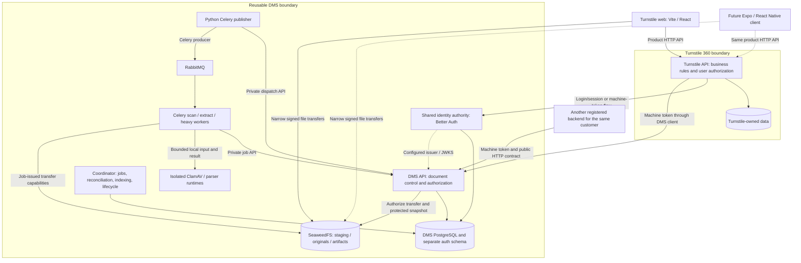
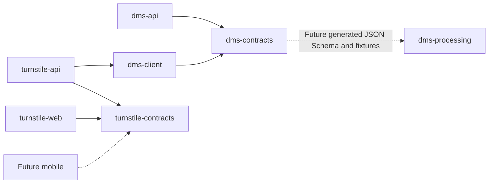
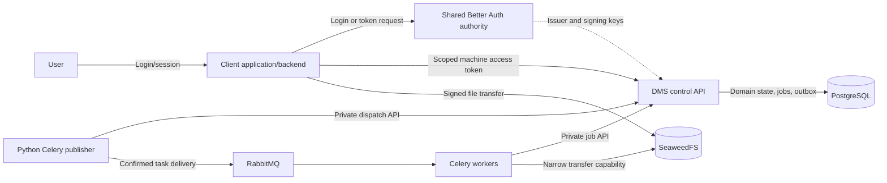
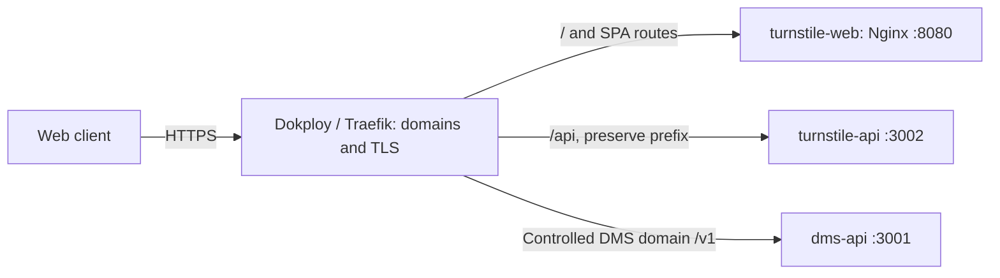

# Turnstile 360 and Thaarei DMS architecture

**Updated:** 2026-11-01

**Status:** Accepted technical design with workspace foundations implemented.

**Owner:** Thaarei. Confidential and proprietary under [LICENSE](LICENSE).

## Documentation ownership and reading guide

This is the single technical architecture reference for the reusable Document Management
System (DMS), Turnstile 360, their shared repository, and deployment. It consolidates the
accepted DMS technical design previously held in blueprint v1.4 and the accepted workspace
and future-mobile decisions. Consolidation does not change product scope or authorize
feature implementation.

| Document                                                                             | Owns                                                                                                                                                                                     |
| ------------------------------------------------------------------------------------ | ---------------------------------------------------------------------------------------------------------------------------------------------------------------------------------------- |
| [architecture.md](architecture.md)                                                   | Components, responsibilities, dependencies, data/work flows, technical contracts, selected stack, configured limits, security, deployment topology, recovery, and architecture decisions |
| [DMS product blueprint](docs/headless_dms_product_blueprint_v1.md)                   | Product promise, included/deferred scope, product correctness, deployment inputs, and product decision history                                                                           |
| [DMS functionality requirements](docs/headless_dms_functionality_requirements_v1.md) | Stable FR/NFR IDs and capability dependency order                                                                                                                                        |
| [Onboarding specification](docs/onboarding_specification.md)                         | Accepted ONB-R01–12 product scope and acceptance; delivery packages remain in the linked implementation plan                                                                             |
| [Workspace standards](docs/standards/workspace.md)                                   | Coding, formatting, configuration, and verification conventions                                                                                                                          |
| [Workspace implementation plan](docs/workspace_implementation_plan.md)               | Workspace setup sequence, CLI provenance, and original validation                                                                                                                        |
| [Dokploy runbook](docs/runbooks/dokploy.md)                                          | Deployment commands and operator steps                                                                                                                                                   |
| [IN_PROGRESS.md](IN_PROGRESS.md)                                                     | Actual implementation, verification, active work, gaps, and agent handoffs                                                                                                               |

Keep technical design changes here and link from other documents. Update affected
requirements and runbooks when behavior or deployment steps change. Manifests, lockfiles,
and deployment files record executable versions/configuration; keep this document aligned
with them. Targets and configured defaults below are requirements, not measured capacity,
production-readiness, or compliance claims.

Navigation: [status](#implementation-status), [system picture](#system-context),
[repository](#repository-and-package-dependencies), [installed stack](#installed-toolchain-and-libraries),
[Turnstile](#turnstile-application-architecture), [DMS components](#module-and-contract-boundaries),
[identity](#tenancy-identity-and-authorization), [upload](#seaweedfs-storage-and-upload-protocol),
[processing](#processing-provenance-and-ai-readiness), [jobs](#durable-jobs-events-and-reconciliation),
[deployment](#development-and-current-deployment), [recovery](#backups-recovery-and-controlled-disposal).

## Implementation status

| Area                 | Current state                                                                                                                                           | Accepted target / remaining work                                                                              |
| -------------------- | ------------------------------------------------------------------------------------------------------------------------------------------------------- | ------------------------------------------------------------------------------------------------------------- |
| DMS API              | Nest/Fastify, persisted authority, managed clients, machine guard, transactional enrollment, local-first disablement and bounded audit                  | Real client/customer provisioning, document/resource grants, storage and private job APIs                     |
| Turnstile API        | Nest/Fastify, OIDC BFF, live permissions, audited organization/setup, protected private grants and backend readiness enforcement                        | Document workflows and real deployment setup                                                                  |
| Turnstile web        | Login/recovery/reset, live session/readiness entry, resumable onboarding/waiting, canonical Settings and safe logout with typed configuration transport | Further product screens and coordinated customer rollout                                                      |
| Python processing    | Installable package, identification command, reserved execution folders                                                                                 | Publisher, Celery tasks, job/transfer clients, scanner/parser supervision and sandbox enforcement             |
| Shared packages      | Typed DMS client, auth/capability DTOs, executable onboarding contracts/time-zone list and generated DMS/onboarding OpenAPI                             | Remaining feature contracts and cross-language fixtures                                                       |
| Local infrastructure | PostgreSQL, bounded Mailpit capture, RabbitMQ and SeaweedFS Compose definitions                                                                         | API PostgreSQL integration verified with disposable fixtures; broker/storage compatibility remains unverified |
| Production packaging | Four built images, isolated runtime checks and three-service Dokploy application Compose                                                                | Production stateful/processing services and actual container DNS, deployed domains/TLS verification           |
| Quality              | Build, type, boundary, formatting, API identity/injection/runtime smoke checks configured and previously passed                                         | Business/security/processor/recovery tests as capabilities are implemented                                    |
| Mobile               | Architecture boundary only                                                                                                                              | Expo/React Native project is deferred; no mobile application or dependencies exist                            |

AUTH-01–07 implement authentication foundations, the persisted authority, managed distinct
OAuth clients, the Turnstile BFF/user boundary, DMS machine enrollment and the typed
cross-service capability request, login/recovery UI and local operational verification.
Real deployment client registrations, document endpoints
and processing operations remain pending. A module name, folder, dependency declaration, or Compose file
does not establish a working feature. See [progress](IN_PROGRESS.md) for dated evidence;
PostgreSQL migrations, role isolation and authority/session persistence are verified for AUTH-02; application image builds and isolated runtime checks are verified in AUTH-07. Full
infrastructure compatibility, remote CI and actual Dokploy deployment remain unverified. No source/data migration has started.

## System context

Turnstile 360 is one consumer of a reusable DMS. It has its own frontend, backend, and
business data. Other trusted application backends can consume the same DMS through its
public HTTP contract without using this repository or its TypeScript packages.

### Customer deployment and application model

Each customer installation serves **exactly one customer tenant**. For example, MRR is
the tenant; Turnstile 360 is one registered application under MRR. MRR may register other
systems with the same DMS, each with its own application identity, credentials, scope
ceiling, and document ownership. Applications may live in other repositories and use
different frameworks. Their deployment location does not grant DMS access.

```text
MRR customer installation — one tenant: MRR
  Shared DMS
    Registered application: Turnstile 360 backend
      Clients: Turnstile web and future mobile
    Registered application: another MRR system backend
    Registered application: additional MRR systems as provisioned
```

Turnstile has one configured customer context per installation. Its web and future mobile
clients use the same product backend and DMS application registration; a new frontend
client does not by itself require another DMS application registration. Another independent
system requires its own registration and guarded activation. Shared tenant membership
does not grant access to another application's documents; explicit grants are required.

Another customer receives a separate installation with its own tenant configuration,
application credentials, database state, and storage namespace. Reuse the product code
and deployment definitions across customers without sharing customer data or credentials.
This product has no SaaS tenant selection, customer self-onboarding, or provisioning of
multiple customer tenants in one installation. Shared multi-customer hosting would require
an explicit future scope/architecture decision. Tenant IDs remain internal ownership,
integrity, audit, and recovery boundaries; they do not imply a multi-tenant SaaS runtime.

This diagram shows the target architecture. Arrows beyond current identity/liveness and
web entry-point behavior represent planned integrations.



Control requests pass through backends; normal file bytes transfer directly using
short-lived capabilities. Turnstile evaluates the user's business rights before calling
the DMS. The DMS independently enforces the registered application's tenant, scopes,
ownership/grants, lifecycle, and security state. A shared repository or host confers no
additional runtime trust.

## Repository and package dependencies

Existing paths below reserve ownership; empty directories are not implemented components.
Future process entry points and feature files are added with their capabilities.

```text
/
├── apps/
│   ├── dms-api/
│   │   ├── src/
│   │   │   ├── main.api.ts, bootstrap.ts, app.module.ts
│   │   │   ├── composition/               # future process composition
│   │   │   ├── infrastructure/            # current liveness controller
│   │   │   └── modules/
│   │   │       ├── platform-auth/ access/ enrollment/ audit/
│   │   │       ├── documents/ uploads/ storage/ policies/
│   │   │       └── processing/ search/ lifecycle/
│   │   ├── database/auth/{schema,migrations}/
│   │   ├── database/dms/{schema,migrations}/
│   │   └── test/
│   ├── dms-processing/
│   │   ├── src/turnstile_processing/
│   │   │   └── publisher/ tasks/ job_api/ transfers/ processors/ sandbox/
│   │   ├── tests/
│   │   └── pyproject.toml, uv.lock
│   ├── turnstile-api/
│   │   ├── src/
│   │   │   ├── main.ts, bootstrap.ts, app.module.ts
│   │   │   ├── infrastructure/ modules/
│   │   │   └── integrations/dms/
│   │   ├── database/{schema,migrations}/
│   │   └── test/
│   └── turnstile-web/
│       └── src/                           # App.tsx and main.tsx exist
│           └── app/ routes/ features/ components/ lib/ styles/
├── packages/
│   ├── dms-contracts/
│   │   ├── src/{public,internal,events,artifacts}/
│   │   └── generated/ fixtures/
│   ├── dms-client/src/
│   └── turnstile-contracts/src/
├── patches/                               # pinned dependency corrections
├── tooling/
│   ├── typescript/{base,library}.json
│   └── dependency-rules/config.cjs
├── scripts/{check-deploy,smoke-runtime,dev-container}.mjs
├── deploy/
│   ├── compose.local.yaml, compose.dev.yaml, compose.dokploy.yaml, compose.mailpit.yaml
│   ├── Dockerfile.dev, development-ports.json
│   ├── nginx/nginx.conf
│   └── artifacts/
├── tests/system/
├── .github/workflows/workspace.yml
├── docs/                                  # scope, requirements, standards, runbooks
├── compose.yaml                           # local Compose entry point
├── architecture.md
├── IN_PROGRESS.md
└── AGENTS.md
```

`apps/turnstile-mobile` is a possible future path and does not exist. `turnstile_processing`
is the current Python import name; its responsibility is reusable DMS processing.

| Package                        | Intended contents / consumers                                                                                                                    | Boundary                                                                                                                                          |
| ------------------------------ | ------------------------------------------------------------------------------------------------------------------------------------------------ | ------------------------------------------------------------------------------------------------------------------------------------------------- |
| `@thaarei/dms-contracts`       | Public DMS requests/responses, separate private job payloads, events, artifact schemas, errors/statuses; API/client and generated Python schemas | Schemas/types only; no Nest, database, Turnstile domain logic, or credentials. Keep private contracts separate from public exports as implemented |
| `@thaarei/dms-client`          | Typed HTTP calls, transport configuration, machine-token attachment, stable errors, idempotency-aware retries for trusted backends               | Depends on DMS contracts; no DMS repositories/services or Turnstile user authorization; never bundled into a frontend                             |
| `@thaarei/turnstile-contracts` | Product requests/responses, schemas, errors, pagination for Turnstile API, web, and future mobile                                                | Platform-independent; no DOM, Node-only runtime, UI framework, Nest, database, or DMS internal-job dependencies                                   |

The current manifest dependency graph is:



Internal dependencies use `workspace:*`. Packages export built `dist` files and Turborepo
builds dependencies before consumers. Applications never import another application's
source, repositories, migrations, or database tables. Contract packages cannot become a
shared business-layer or shared database package. Python interoperates through exported
language-independent contracts and the private HTTP API, without importing Nest code.

Dependency-cruiser in [config.cjs](tooling/dependency-rules/config.cjs) checks unresolved
imports, cycles, cross-application imports, framework/database coupling in contracts, and
browser/server imports. These checks cover the configured TypeScript import graph;
runtime trust, SQL ownership, Python behavior, and all future platform-specific rules
also require review and appropriate tests.

## Installed toolchain and libraries

Versions here are the repository's configured versions, not a claim about the newest
upstream release. See the [root manifest](package.json), [pnpm catalog](pnpm-workspace.yaml),
application manifests, [Python project](apps/dms-processing/pyproject.toml), and lockfiles.
The subsequent selected-technology section covers feature dependencies not yet installed.

| Area                       | Installed / configured selection                                                                 | Purpose                                                                                                   |
| -------------------------- | ------------------------------------------------------------------------------------------------ | --------------------------------------------------------------------------------------------------------- |
| JavaScript runtime         | Node 24.21.0                                                                                     | APIs, builds, CLI tools, direct `.mjs` repository scripts                                                 |
| Workspace                  | pnpm 12.16.1; Turborepo 2.11.10                                                                  | Workspace resolution, exact dependencies/lockfile, build/check/test task graph and caching                |
| TypeScript                 | 6.0.3, shared catalog                                                                            | Strict application/library compilation; compatibility pin for the installed Nest generator/compiler API   |
| API framework              | `@nestjs/common`, `core`, `platform-fastify` 12.3.2                                              | Both control/product APIs with Fastify; compatible plugins required                                       |
| Nest runtime support       | `reflect-metadata` 0.2.2; `rxjs` 7.8.1                                                           | Decorator metadata, dependency injection, framework reactive support                                      |
| Validation                 | Zod 4.6.7 in both APIs and DMS/Turnstile contracts                                               | Environment and executable shared payload/response/error validation                                       |
| Web UI                     | React / React DOM 19.3.1                                                                         | Product presentation and interaction                                                                      |
| Web design system          | shadcn 4.23.0, Base UI 1.9.0, Tailwind CSS / Vite plugin 4.3.3                                   | Owner-selected preset and source-owned UI; see [web design system](#web-design-system)                    |
| Web navigation             | React Router 8.5.1                                                                               | Client links/history, persistent workspace layout and shared unsaved-entry blocker                        |
| Web build                  | Vite 8.3.5; `@vitejs/plugin-react` 6.1.2                                                         | Frontend development server, React integration, production asset build                                    |
| API generation             | Nest CLI 12.0.11; schematics 12.0.12                                                             | CLI-generated modules/controllers/providers; no hand-built replacement for available scaffolding commands |
| JavaScript quality         | Biome 2.6.4; dependency-cruiser 18.7.0                                                           | Formatting/lint/import organization and architecture import checks; ESLint/Prettier are not configured    |
| API tests                  | Vitest 4.1.2; `@nestjs/testing` 12.3.2; `@swc/core` 1.16.21                                      | Identity tests and Fastify injection; SWC preserves legacy decorator metadata in tests                    |
| API test tooling           | Vite 8.0.0 in each API dev dependency                                                            | Test toolchain dependency, distinct from the web application's Vite pin                                   |
| Type declarations          | `@types/node` 24.19.2 at root/web and 24.0.0 in APIs; `@types/react` / `@types/react-dom` 19.3.0 | Compile-time Node/React declarations; do not add runtime behavior                                         |
| Repository YAML checks     | `yaml` 2.9.1                                                                                     | Parse deployment YAML and check build-context/Dockerfile paths                                            |
| Python runtime/build       | Python 3.13.18; uv / `uv_build` 0.13.6                                                           | Locked environment and Python source/wheel packaging                                                      |
| Python quality/tests       | Ruff 0.17.3; mypy 2.4.1; pytest 9.2.0, resolved in `uv.lock`                                     | Python format/lint/type checks; pytest available for future behavior tests                                |
| Infrastructure definitions | PostgreSQL 18.6-bookworm; Mailpit 1.33.0; RabbitMQ 4.3.7-management-alpine; SeaweedFS 4.51       | Pinned images; PostgreSQL connects through owned roles, broker/storage integration pending                |
| Application images         | Node 24.21.0-bookworm-slim; Python 3.13.18-slim; Nginx 1.30.2-alpine                             | Digest-pinned runtime/build bases in Dockerfiles; frontend uses an unprivileged Nginx process             |
| Delivery                   | Docker Compose; Linux server with Dokploy/Traefik; GitHub Actions workflow                       | Container deployment target, ingress/TLS, configured CI checks/image builds                               |

AUTH-01 adds exact pins for `better-auth`, `@better-auth/oauth-provider`,
`@better-auth/drizzle-adapter`, and the development `auth` CLI at 1.7.14;
`drizzle-orm` 0.45.4, `pg` 8.23.1, development `drizzle-kit` 0.31.11 and
`@types/pg` 8.20.0 in both APIs; `jose` 6.2.14 in DMS; `openid-client` 6.8.8,
`@fastify/cookie` 11.1.5 and `@fastify/session` 11.1.6 in Turnstile API;
client-only Better Auth/OAuth Provider 1.7.14 in web; and development `@playwright/test` 1.64.1
at root. AUTH-02 also installs `nodemailer` 10.3.1 with development `@types/nodemailer` 8.0.2,
explicit Fastify 5.12.7 in both APIs and root development `pg` 8.23.1 for isolated database
tooling. Authority/BFF and real browser-to-DMS evidence are recorded in progress; actual
deployment and customer provisioning remain separate. Python currently has no runtime dependencies.
The S3 SDK, Celery/processing engines, OpenAPI generation, OpenTelemetry and
React Testing Library remain later additions. The web design system is now selected
and installed as documented below; React Router owns web navigation. No client-state/form library, mobile library,
or Turnstile domain dependency has been added.

## Turnstile application architecture

### Web and future mobile

`turnstile-api` is the shared product backend for Vite/React and a future Expo/React Native
client. Backend services own authoritative business rules, permissions, calculations,
workflow transitions, validation, and persistence. Clients submit intended changes; the
backend authorizes and applies them, then returns the resulting domain data/outcome.

Clients own presentation, navigation, forms, display formatting, and transient UI state.
They may repeat input validation for immediate feedback or show optimistic UI; they must
handle rejection and reconcile with the server result. Responses must not depend on DOM,
React components, or a particular screen layout. Both clients use the same business
authorization and product contracts. Maintain compatibility for deployed clients,
including mobile releases that update independently of the backend.

User login is supplied by the selected identity authority; product sessions/user context
are enforced by the Turnstile backend. Web uses the planned secure session boundary.
Native login/session storage and redirects will be specified when mobile is implemented;
do not assume browser cookies, expose service secrets, or create a second business backend.

### Web design system

The Turnstile web app owns a source-based shadcn/ui design system initialized and
applied with CLI 4.23.0 using the owner-selected preset `biekTCUvD` (Maia style,
mauve base, emerald theme, red chart palette, default radius, subtle menu accent and
inverted-translucent menus). Its primitive base is Base UI, because there was no
existing primitive library to preserve. The authoritative CLI configuration is
`apps/turnstile-web/components.json`, with `base-maia`, Hugeicons and `@/` aliases.
TypeScript, Vite and dependency-boundary validation resolve the alias to the web `src`.
Boundary validation uses root `tsconfig.boundaries.json`, because its resolver plugin
interprets path aliases relative to the repository working directory.

Tailwind CSS and its Vite plugin 4.3.3 compile the existing `src/index.css`.
That file is the sole source of semantic light/dark color, typography and radius
values, mapped into Tailwind through `@theme inline`. IBM Plex Sans Variable
(body/controls) and Noto Sans Variable (headings), both Fontsource 5.3.0, are bundled
as same-origin font assets; no external font service or CSP relaxation is required.
Page layouts and brand presentation consume those same tokens. Product pages default
to light mode; dark token support is previewable without adding persisted preferences.

The web manifest pins shadcn 4.23.0 (CLI and theme CSS), `@base-ui/react` 1.9.0,
`@hugeicons/core-free-icons` 4.4.0, `@hugeicons/react` 1.1.10,
`class-variance-authority` 0.7.1, `cn` 0.5.1 and `tw-animate-css` 1.4.0.
Generated primitives live in `src/components/ui`; product compositions live in
`src/components` and owning features. The shared `ButtonLink` composes `AppLink` and the Button variant styles, preserving
anchor semantics that Base UI's non-native Button does not supply. `AppLink` uses
React Router for same-origin product navigation; auth/identity endpoints, external links,
modified clicks, downloads and new tabs retain browser navigation. Components use semantic colors and shared
variants; feature instances use classes for layout. Existing authentication and
workspace screens consume these primitives without moving business or auth authority
into presentation. No UI package is shared with contracts, APIs or future mobile.

The development-only `/design-system` catalogue renders the actual primitives and
representative states with fixture content, no account/API access and an in-memory
light/dark preview. Its import is guarded by `import.meta.env.DEV`; production builds
exclude the catalogue module and route. The [design-system guide](docs/design-system.md)
defines designer/developer handoff, component conventions and CLI maintenance rather
than duplicating the technical design. Reviewed local adaptations retain upstream
composition while meeting Biome, explicit transition and reduced-motion conventions.
New UI/font/icon license texts ship in `public/third-party-notices.txt`; the proprietary
root LICENSE remains unchanged. This is an inventory for the additions, not a completed
audit of the assembled distribution.

### Backend composition and data ownership

Use feature-oriented Nest modules under `apps/turnstile-api/src/modules`. Keep controllers
focused on the HTTP contract, services on business use cases/policies and transaction
boundaries, and repositories on the application's own persistence. Add internal layering
only as implemented behavior needs it. Generate feature scaffolds with the Nest CLI.

```text
Web / future mobile
  -> Turnstile controller: request contract and user context
    -> Turnstile service/policy: business authorization, rules, state transitions
      -> Turnstile repository: owned business data
      -> integrations/dms: product-to-DMS translation
        -> @thaarei/dms-client -> authenticated DMS HTTP API
```

Turnstile owns its business tables/migrations under `apps/turnstile-api/database` and uses
separate runtime credentials/permissions from DMS/auth ownership. A shared PostgreSQL
host is possible; it does not grant cross-application SQL access. Physical Turnstile
database/schema naming and schemas are established during persistence implementation.

Keep document/version IDs and product reference mappings where required; the DMS owns
file bytes, security, document history, extraction, grants, and search. A file transfer
flow is: user action -> Turnstile authorization -> DMS session/capability -> client direct
transfer -> backend-mediated completion/status. Normal application operations and polling
remain through Turnstile's product API. Machine-token acquisition/caching, DMS error
translation, and bounded transport settings belong in the server integration boundary.

Business records and DMS operations cannot share one database transaction over HTTP.
Feature implementation must define idempotent linking, pending/failure outcomes, and
reconciliation for partially completed operations. Do not hold database transactions open
across file uploads or assume a DMS failure rolled back a product record.

The consumer backend checks user permissions before each document action and keeps DMS
machine credentials/enrollment keys private. An audit user identifier asserted to the DMS
does not delegate user permissions. Other applications consume the same DMS contract;
the DMS never imports Turnstile business rules.

### Onboarding implementation baseline

ONB-I01 adopts the [onboarding specification](docs/onboarding_specification.md) and the
following technical decisions for ONB-I02–08. These are accepted implementation targets;
ONB-I01 adds no executable schemas, database definitions/migrations, permission grant,
operator command or runtime behavior. See [progress](IN_PROGRESS.md) for actual delivery.
ONB-I02 implements the shared executable contract/time-zone foundation and product pool
composition below. The [generated OpenAPI](docs/api/turnstile-onboarding.openapi.json)
now describes I03's implemented canonical storage/domain operations and authenticated
HTTP handlers. I04 implements private manager grants and backend readiness enforcement;
I05 implements the onboarding/waiting web journey; I06 implements ongoing Settings.
I07's verification composition is described below; I08 adds the private preflight and
executable release/recovery procedures. Actual deployment acceptance is tracked in IN_PROGRESS.md.
Organization-wide activation with no sites/departments is supported. The sole new
permission is `turnstile:configuration:manage`, dependent on `turnstile:access`; it covers
core profile, time zone, units and completion, without account/access administration,
DMS operator authority or approval rights. Site/Department labels remain fixed; custom
terminology, membership, moving units and a generic settings/workflow engine are deferred.

#### Onboarding composition and ownership

Keep Organization and Onboarding features in Turnstile's Nest modules and product-owned
persistence. Organization owns canonical profile/root/units and configuration revision;
Onboarding exposes setup/status/completion through Organization's canonical transaction
boundary, without a second lifecycle store. Both use one product persistence module
under `infrastructure/database`. ONB-I02's `ProductPersistenceModule` exports one
`ProductPersistenceService` owning the configured pool, role/installation verification and
shutdown. It retains the same validated product environment and connection limits/timeouts.
Auth's `ProductDatabaseService` consumes that pool and owns its encrypted session store
and session/access RLS readiness checks. Preserve session encryption, installation verification,
forced RLS checks and one shutdown owner. No duplicate pool or cross-schema access.

Compose live user/local access → mutation CSRF → explicit route permissions → required
workspace readiness once at application level. AppModule now registers the existing
ApplicationAccessGuard exactly once. It invokes UserSessionGuard for the existing identity/
CSRF/permission checks, then OnboardingService.requireReady for protected workspace routes.
Auth exports authentication services; no duplicate global guard or readiness stub exists.
Onboarding exports readiness, and consumes Organization/persistence without importing Auth.
Pass authenticated actor context to use cases. Do not use circular module imports,
`forwardRef` or global lookup. Unannotated routes remain denied. Readiness exemptions
are separate from public-route metadata and cannot skip authentication/permissions/CSRF.
Default protected business routes to completed setup. Check current committed readiness
on each request; no session snapshot, browser flag or positive long-lived cache authorizes
it. Domain mutations recheck local access inside their transaction. Authority checks run
before that transaction; never hold product locks across identity or DMS HTTP.

`@thaarei/turnstile-contracts` now uses explicit Zod 4.6.7. Shared schemas/DTOs and name/key
normalization remain independent of Nest, SQL, Node-only APIs and React. Submitted names
normalize; response schemas require already-canonical names. Structural JSON Schemas are
generated from executable schemas; normalization/cross-field rules are additionally
described because JSON Schema cannot express every executable refinement. The generated
OpenAPI identifies implemented handlers and the delivered grant/readiness policy.
`pnpm check:contracts`, included in `pnpm check`,
verifies the document, references, executable examples, auth permission enumeration and
pinned time-zone list/provenance. Regenerate with `pnpm docs:turnstile-onboarding` and
`pnpm generate:turnstile-time-zones`. Existing auth DTO shape/protocol remain intact.
`ConfigurationException` projects typed domain failures through the existing HTTP filter
with their own statuses and private/no-store headers. I03 also maps the pinned Nest/Fastify
adapter's string parser exceptions to finite feature errors without exposing raw messages.
Shared accessAssignmentSchema validates strict private operator input and the manage/access
dependency. The private writer now supports manager grants with initialized-context and
last-manager protection; runtime grants remain read-only.

#### Canonical configuration persistence

ONB-I03 adds four product tables through generated migration
`0004_organization_configuration.sql` and reviewed custom migration
`0005_configuration_guards.sql`. Existing identity/auth tables and migration history are
preserved. The declarative installation definition moves to
`infrastructure/database/installation.schema.ts`, re-exported by auth's schema, so new
features depend on product infrastructure rather than auth implementation files.

| Table                          | Canonical role and integrity                                                                                                                                                                                                                                                                                                                            |
| ------------------------------ | ------------------------------------------------------------------------------------------------------------------------------------------------------------------------------------------------------------------------------------------------------------------------------------------------------------------------------------------------------- |
| `organization_configuration`   | One row per installed tenant: revision, nullable saved name/zone/root, requirement version and durable completion actor/time. Fixed installation FK, paired name/root, bounded values and completion invariants. Runtime may update delivered state, never insert/delete contexts or change tenant/version                                              |
| `organization_unit`            | Tenant/unit composite identity and tenant-aware parent/configuration references. One organization root; only non-root units store name/comparison key. Root presentation derives from the canonical profile, avoiding duplicate names. Binary `C` sibling-key uniqueness applies across Site/Department types; root identity/type/parent stay immutable |
| `configuration_create_receipt` | Tenant/key identity, actor binding, normalized-body SHA-256, original unit ID and database-time 24-hour expiry. No unit FK: deleting a leaf must preserve its retry identity. Runtime can read/insert and delete only expired rows through command-specific forced RLS; no live deletion or updates                                                     |
| `configuration_audit`          | Append-only successful initialization/configuration/completion evidence: actor kind/ID, server request UUID, finite action/field names, affected identity, revisions and database time. No profile text, submitted bodies or secrets. Runtime insert-only; inspection and retention use the owning operator                                             |

All four tables use forced tenant RLS with transaction-local context, explicit privileges
and indexes for actual parent/sibling, receipt-expiry and audit-retention lookups. Reviewed
invoker-rights triggers enforce stable root/completion identity, one-step revision updates,
immutable unit identity/type/parent, supported parents, count/depth bounds and cycle
prevention. Trigger search paths are fixed; no security-definer or cross-schema function
is introduced. Semantic name/zone validation remains in shared executable contracts;
normalized responses also detect inconsistent persisted configuration.

OrganizationService owns use-case rules and transaction sequencing; OrganizationRepository
owns SQL, context/grant reads, canonical projections, state/revision/audit writes
and receipts through the shared pool. OnboardingService exposes the smaller setup boundary
by consuming OrganizationService. Every read rechecks local access, and mutations recheck
both permissions after acquiring the same context lock used by the private access writer.
I04 extends the writer with permission issuance, last-manager protection and atomic access
audit without changing configuration revision. No authority/DMS HTTP occurs while locked.
The existing pool/statement timeouts bound contention; failures return controlled unavailable.

The HTTP adapter classifies only registered configuration routes, enforces JSON and the
mutation byte limit before parsing, caps serialized feature responses, and preserves
authentication/CSRF/permission error precedence after transport validation. Query fields
and actor/tenant selectors are rejected. The guard provides verified identity; request IDs
are server-generated UUIDs. A non-UUID adapter id is replaced once per request with a
generated UUID, never accepted from input or an unconfigured factory. Successful changes are audited transactionally; denied/invalid/
conflicting/unavailable HTTP attempts use bounded redacted `product.configuration`
telemetry. Auth readiness continues to describe auth, independently of feature initialization.

Private initialize/inspect/prune commands validate the owning migrator and exact existing
installation before taking the context lock. Initialization is repeat-safe and creates no
root/default profile/account/grant. Inspection returns counts and at most 100 manager IDs
and audit entries with explicit truncation. Pruning uses database time and removes at most
1,000 rows total per invocation, oldest expired audit first then expired receipts; it never
changes configuration, completion or live receipts. Counts/operator metadata are emitted
as bounded private operational output. No startup/GET bootstrap or scheduled cleanup exists.
See the [operator procedures](docs/runbooks/authentication.md#initialize-inspect-and-maintain-product-configuration).

#### Access provisioning and backend readiness

ONB-I04 adds generated migration `0006_access_assignment_audit.sql`: bounded nullable
`subject_user_id` for attributed access changes and the `enabled` audit field. Access
audit requires an operator actor and subject user; other event shapes remain unchanged.
No auth/DMS schema or runtime grant-writer privilege is introduced.

Private grant and configuration commands share `withProductOperator`, which validates
the dedicated product migrator and exact existing installation, locks installation then
configuration, and closes its pool. Grants require explicit initialization; they never
bootstrap. The writer then locks the addressed grant, preserves replacement-array
semantics, and permits the first manager. Removing/disabling a manager checks for another
enabled local access/manage holder under the same context lock used by activation.
Refusal uses exit 2 and `LAST_CONFIGURATION_MANAGER_REQUIRED`; no grant/audit changes
commit. Effective grants insert attributed audit atomically, with unchanged configuration
revision. A repeat with the same enabled/permission set is a no-op, including array order.

ApplicationAccessGuard defaults every permission-protected business route to completed
setup. `WorkspaceReadinessExempt` is separate from public metadata and is applied only
to setup/status, organization and the session endpoint; it skips only readiness. Public
auth navigation/logout/health retain their existing handler boundaries. No exempt route
acquires access implicitly, and an unannotated exempt route remains denied. Readiness
uses current product state/local access through Onboarding/Organization on every request,
without session/browser state or positive caching. Status/readiness uses one plain joined
SELECT of completion and actor grants under tenant context, so concurrent readers do not
queue on the configuration write lock. It sees committed state from that statement; an
uncommitted activation remains incomplete. Mutations/private grants retain the shared
write lock and authorization recheck. Role/installation/forced-RLS safety checks remain
current on every operation. Incomplete returns 409 `SETUP_REQUIRED`;
missing/unsafe/uninitialized persistence returns 503 `CONFIGURATION_UNAVAILABLE`.
`/api/dms/capabilities` uses the default gate after its existing permissions and before
any machine token or DMS request. Auth/session readiness remains independent of setup;
DMS outages never clear durable completion. I05–06 supply the UI; coordinated target release remains later work.

#### Onboarding web journey

ONB-I05 adds the web feature under `features/onboarding`. Workspace entry verifies the
existing live session, then current minimal status before rendering business content.
Managers resume Organization while required saved values are missing, otherwise Review;
ordinary users see Waiting for setup with explicit Retry/Sign out. Known onboarding and
waiting paths redirect Home only after backend completion. Unknown paths render not-found
rather than Home. React Router links/history provide client navigation and deep links/Back,
with session/readiness checks on entry, route changes and BFCache restoration. Restoration resets
transient connection-check state; in-flight status sharing is scoped to the verified user.
I06 adds the Settings composition below.

The existing typed transport now supports JSON GET/PATCH/POST/DELETE, in-memory CSRF,
explicit create keys, same-origin credentials, no-store/no-referrer, fixed deadlines and
bounded, schema-validated configuration responses/errors. It never retries mutations
implicitly. A manager snapshot joins the three owning GET projections only when their
revisions agree, with at most one bounded GET reconciliation retry. Backend services
remain authoritative; there is no local completion flag or browser grant writer.

Organization uses shared name/zone validation and the adopted finite time-zone list;
no deployment/browser zone is silently saved. Save and continue commits required values;
Save and exit submits only non-empty values, so it can commit valid partial progress or
preserve already-saved required values and open paused setup; an untouched empty profile
pauses without a mutation. Continue still reports empty required values. Resume derives
from persisted gaps. Transient drafts
stay in component memory; leaving through a link asks before discarding unsaved entries.
Revision conflicts require explicit reload/comparison before a new save; unsent entries
are retained while reconciling. Duplicate sibling names remain editable with a name error.
Structure starts at the canonical root, creates only fixed Site/Department types with
valid saved parents, displays ancestry and offers one optional-skip link without deleting
units.
If a selected parent disappears, both the selector and a new create use the saved root.
An uncertain create retains the exact normalized body/revision/key for explicit retry;
reloading current state does not silently issue a fresh key. New-entry reconciliation is
a separate deliberate action after readback for that attempt; starting another attempt
resets the readback marker. I06 adds rename/delete editors in Settings.

Review displays saved profile/units and server checklist. Activation sends the saved
revision; uncertain completion supports explicit readback/retry and opens Home only
when completion is confirmed. Authority/configuration/validation/conflict/DMS errors
retain their separate meanings. Existing session generation/check fencing and editor
unmount fencing suppress late reads/mutations after logout/navigation. Session/logout
special handling and development-only gallery boundaries remain intact. Forms compose
Base UI/shadcn Field/Input/Card/NativeSelect; shared semantic tokens, narrow layouts,
associated errors and reduced-motion behavior follow the existing design system.

#### Ongoing Settings and basic structure

ONB-I06 adds completed-workspace Home/Settings navigation and four explicit manager
destinations: `/settings` (Setup overview), `/settings/organization` (organization name),
`/settings/organization/structure` (sites/departments) and `/settings/workspace` (time zone).
The current verified status gates these routes before configuration reads; ordinary users
see an access-required state and Home, while incomplete users resume onboarding/waiting.
Unknown paths still render not-found. Focus, reload, Back and persisted page restoration
reuse the session/readiness boundary. Configuration APIs continue enforcing permission
on every call; browser navigation is not an authorization boundary.

Transport, load/unmount fences, validation/error handling and profile/create editors now
live in `features/configuration`, shared with onboarding. Settings name and zone editors
submit only their own field with the captured revision, report an unchanged submission as
no change instead of a save, show confirmed saves in place,
retain drafts through recoverable errors and require deliberate reload/comparison after
a stale or uncertain write. Cancel returns to the current saved overview; unsaved link
navigation confirms discard. No browser persistence or duplicated record is added. Setup overview reads the same canonical snapshot, including saved units and
durable activation actor/time, and offers a nonblocking structure link for a root-only
organization. It does not replay activation or track recurring optional tasks.

Structure reuses fixed types, parent/depth/count validation, ancestry and exact-key create
retries. A single selected non-root unit editor supports rename or explicit removal
confirmation; the root is renamed only through the organization profile. Known parents
with children cannot be removed; the backend checks current leaf usage and revision.
Other structure mutations are disabled while the selected editor is open. Duplicate names
remain editable; stale/unknown rename or delete outcomes require current saved readback
before another deliberate write. Removed units are never recreated by retry. Completion,
root identity, audit and backend invariants remain unchanged. People, approval, risk,
access administration, unit moves and label overrides remain outside this feature.

#### Web navigation and scroll ownership

React Router's browser router separates account/development routes from the shared
workspace route. Router state updates are synchronous (`useTransitions: false`), so
frequent navigation and blocker dismissal do not defer subsequent form interactions. `Workspace` retains verified session/readiness state across internal
navigation; `WorkspaceLayout` owns the header, top navigation, footer and bounded page
pane. It never keys the shell by URL. Route changes display a localized skeleton while
the session/readiness check accepts the destination, then change only the active page.
Existing page state stays mounted and hidden during that check. Settings section
navigation remains visible while its content pane waits; initial configuration reads
and retries also keep the Settings layout mounted. Onboarding retains its step navigation
while canonical reads are pending. Form/list/card skeletons and loading announcements
live in the shared `content-loading` composition, using the generated shadcn Spinner and
Skeleton primitives. Spinner SVGs are decorative beside a single status label or action
name; reduced-motion users receive static loading indicators. Explicit readback and saves
keep existing entries visible and show a spinner on the active action. Background session
checks use a small header status rather than replacing loaded content.
Focus and the existing completed-workspace interval also revalidate without returning to
the startup skeleton. Onboarding step changes wait for a fresh canonical snapshot;
late older reads cannot replace a newer revision. APIs remain authoritative on every request.

Settings retains its canonical snapshot and sidebar between sections; only the active
editor is keyed by pathname so draft/error state cannot leak between organization and
time-zone forms. Returning from Home reloads Settings through the existing transport.
The viewport is bounded by `100dvh` and flex `min-height: 0` boundaries. The Settings
sidebar and content pane scroll independently; at narrow widths sections become a
horizontal scroll row. Header/top navigation/footer remain outside page scrolling.
`ScrollRegion` resets the changed content pane and moves keyboard focus there on client
navigation, while surrounding navigation retains its position. Native overflow supplies
keyboard, wheel and touch scrolling without a second scroll library.

One `NavigationGuard` aggregates transient dirty editors, including simultaneous unit
and create forms, through React Router's blocker. Link and Back/Forward navigation ask
before discarding; cancelling leaves the route and drafts intact. Successful onboarding
saves clear their own dirty marker before client navigation. External/document link
confirmation retains its existing behavior. Auth redirects and credential exchanges use
full document navigation, and browser reset-token capture still precedes router creation.
No session, configuration or draft is persisted in browser storage.

#### Onboarding validation and bounds

I02 contracts, I03 domain/HTTP adapters and I04 grant/readiness policy implement the bounds below. These are fixed release bounds, not new environment knobs.
Changing them later requires updating contracts and this record together.

| Boundary                                  | Adopted value/rule                                                                                                                                                                                                                                                                  |
| ----------------------------------------- | ----------------------------------------------------------------------------------------------------------------------------------------------------------------------------------------------------------------------------------------------------------------------------------- |
| New configuration HTTP mutation body      | At most 4,096 UTF-8 bytes, JSON object with unknown keys rejected; preserve the existing 16,384-byte global Fastify ceiling for other routes                                                                                                                                        |
| Private setup/configuration command input | At most 4,096 UTF-8 bytes from stdin; strict JSON, never secrets or identity overrides in arguments                                                                                                                                                                                 |
| Organization name                         | 1–160 Unicode code points after normalization; require at least one Unicode letter or number                                                                                                                                                                                        |
| Site/department name                      | 1–120 Unicode code points after the same normalization                                                                                                                                                                                                                              |
| Raw name                                  | At most 1,024 Unicode code points before normalization; reject unpaired surrogates                                                                                                                                                                                                  |
| Name normalization                        | NFC, then collapse each Unicode `White_Space` run to one ASCII space and trim; reject remaining Unicode categories Cc/Cf/Cs. Preserve display case, punctuation and diacritics                                                                                                      |
| Sibling comparison key                    | Normalized display name converted with locale-independent Unicode lowercase, then NFC; compare exact keys within the same parent across both unit types. Do not strip accents or apply fuzzy matching                                                                               |
| Time zone                                 | 1–100 ASCII characters and exact member of a shared versioned allowlist generated in I02 from pinned Node 24.21.0 `Intl.supportedValuesOf('timeZone')`, plus `UTC`; commit generator, list and provenance. No offsets, OS-local zone, case-insensitive matching or unlisted aliases |
| Time-zone confirmation                    | Persist only an explicitly submitted valid zone; non-null saved zone means confirmed. Browser/operator suggestions are not persisted by initialization or GET. Browser validation uses the committed list, not its own ICU enumeration                                              |
| Organization units                        | At most 500 live units including the one root; one bounded full list, no silent truncation or pagination in this release                                                                                                                                                            |
| Hierarchy depth                           | At most 8 nodes on any root-to-unit path, counting root as 1; Organization is the sole root, Site is allowed only under root, Department under root/Site/Department                                                                                                                 |
| IDs                                       | Root, unit and create-retry IDs are UUIDs, normalized lowercase; actor/authority subject and private operator labels follow the existing 1–200 ASCII `[A-Za-z0-9_-]` bound                                                                                                          |
| Organization revision                     | JSON integer 0–2,147,483,647; initialized at 0, increases once per effective profile/unit/completion change; never wraps. Exhaustion makes writes unavailable pending an explicit upgrade                                                                                           |
| Field errors                              | At most 8 entries using the finite fields/reasons below; no echoed rejected values or arbitrary validation paths                                                                                                                                                                    |
| Configuration read/response               | At most 1,048,576 UTF-8 bytes, including the full bounded unit list; new browser transport enforces this limit and the existing 10-second deadline                                                                                                                                  |
| Unit-create receipts                      | 24-hour recovery window from commit; at most 1,024 unexpired receipts per installation. Remove expired receipts before enforcing the limit; if still full return controlled unavailable without creating a unit                                                                     |
| Audit retention                           | 90 days for configuration/access events; explicit private maintenance only. Completion actor/time/version and current configuration are durable state, not deleted by audit retention                                                                                               |

After the raw-input bound, normalization runs before display-length/key checks. Derive
the comparison key in the shared validator and persist/compare it exactly, independent
of database/browser locale. Whitespace-only or symbol-only names are invalid. Duplicate
sibling names are rejected even when their types differ; equal names
under different parents are valid and shown with ancestry. The root's display name is
the organization name, never an independent edit. Type/parent/identity are immutable after
unit creation; no root endpoint, move, employee node, synthetic site or label override.
Deletion requires an unused leaf and checks all currently implemented product references;
future referencing features must extend protection before shipping.

#### Onboarding HTTP and access contracts

All routes below are readiness-exempt and require current `turnstile:access`; all except
workspace status also require `turnstile:configuration:manage`. Cookie mutations preserve
exact Origin, `X-CSRF-Token` and same-origin Fetch Metadata checks. Use `private, no-store`
and `no-referrer` on feature responses, including failures. No tenant/customer/application
or actor field is accepted in public request bodies. Unknown query fields are rejected;
these read endpoints require no query parameters.

| Route                                | Strict input and success outcome                                                                                                                                                                                                                               |
| ------------------------------------ | -------------------------------------------------------------------------------------------------------------------------------------------------------------------------------------------------------------------------------------------------------------- |
| `GET /api/workspace/status`          | 200 `{status: 'incomplete' \| 'complete', canManageConfiguration: boolean}` for any permitted user; same minimal projection for managers, without profile, revision, administrator directory or completion actor                                               |
| `GET /api/setup`                     | 200 detailed setup projection defined below; configuration managers only                                                                                                                                                                                       |
| `POST /api/setup/complete`           | `{expectedRevision}`; 200 current configuration snapshot after atomic completion or authorized repeat completion                                                                                                                                               |
| `GET /api/organization`              | 200 `{revision, organization}`                                                                                                                                                                                                                                 |
| `PATCH /api/organization`            | `{expectedRevision, name?, timeZone?}`, at least one profile field required; 200 configuration snapshot                                                                                                                                                        |
| `GET /api/organization/units`        | 200 `{revision, units}`; full bounded list with each unit's root-to-parent ancestor IDs                                                                                                                                                                        |
| `POST /api/organization/units`       | `{expectedRevision, type: 'site' \| 'department', parentId, name}` plus UUID `Idempotency-Key`; first success 201 `{configuration, unitId, replayed: false}`, identical authorized replay 200 with the same unitId, current configuration and `replayed: true` |
| `PATCH /api/organization/units/:id`  | UUID path ID and `{expectedRevision, name}` only; 200 configuration snapshot                                                                                                                                                                                   |
| `DELETE /api/organization/units/:id` | UUID path ID and JSON `{expectedRevision}`; 200 configuration snapshot, rather than a bodyless response                                                                                                                                                        |

`organization` is `{name: string | null, timeZone: string | null, rootId: UUID | null}`.
Initial values are null. Omitted PATCH fields retain their values; submitted fields must
be valid nonempty strings, never null. A partial save may supply name or zone independently;
the first valid name save creates the root in that transaction. Root absence remains a
setup gap until name is saved. Saved required values cannot be cleared, before or after
activation. A unit needs an existing root/valid parent, not a confirmed zone.

`units` contains `{id, type: 'organization' | 'site' | 'department', parentId: UUID | null,
name, ancestorIds: UUID[]}`. Only root has null parent; ancestry excludes self and has at
most 7 IDs. Order parent before children, with siblings ordered by comparison key then
ID using deterministic code-point order, not browser locale. A configuration snapshot is
`{revision, organization, units, setup}` read consistently at one revision.

The detailed `setup` projection is `{state, requirementVersion, revision, requirements,
nextStep, completion}`. Version is 1. State is `not_started` before any effective save,
`in_progress` after a save and `completed` after activation; paused is a UI state only.
`requirements` has four fixed `{id, satisfied}` entries: `organization_name`, `time_zone`,
`organization_root`, `configuration_manager`. The last is checked for the current verified
actor, not a cross-schema account count. `nextStep` is `organization` while required profile
or root is missing, `review` when ready and incomplete, or null when completed. Structure
is never a required gap. `completion` is null or `{completedAt, completedBy, requirementVersion}`
with server UTC timestamp and authority subject ID; no administrator contact directory.

| Existing surface                                                    | Classification during incomplete setup                                                                                                                                                 |
| ------------------------------------------------------------------- | -------------------------------------------------------------------------------------------------------------------------------------------------------------------------------------- |
| `GET /api`, `GET /health/live`, `GET /health/ready/auth`            | Existing public identity/liveness/auth-readiness boundaries; no setup data and no global setup gate. Auth readiness continues to describe authentication, not completed business setup |
| `GET /api/auth/login`, `GET /api/auth/callback`                     | Existing public protocol entry, transaction/PKCE/nonce checks unchanged                                                                                                                |
| `GET /api/auth/session`                                             | Authenticated, current local access, readiness-exempt; do not add setup data to or change the existing session DTO                                                                     |
| `POST /api/auth/logout`                                             | Existing special public marker with service-enforced stored CSRF/expiry/retry handling; never a generic setup bypass                                                                   |
| Authority verification/recovery/reset and signed OAuth continuation | Existing authority boundary/policy; not made public product configuration operations                                                                                                   |
| Development-only `/design-system`                                   | Existing static gallery boundary; never a production feature or gate bypass                                                                                                            |
| `GET /api/dms/capabilities`                                         | Protected workspace operation: existing DMS permission plus access and completed setup; no DMS call before the readiness check passes                                                  |
| Other protected business routes                                     | Completed setup by default, after their explicit permissions; unannotated routes stay denied                                                                                           |

Preserve auth/DMS error DTOs and their precedence. A route permission denial returns the
existing 403 before revealing readiness. Only an otherwise authorized business operation
receives 409 `SETUP_REQUIRED`. Feature errors never revoke an otherwise valid session:

| HTTP | Feature envelope                                     | Meaning                                                                                                                                                                                         |
| ---- | ---------------------------------------------------- | ----------------------------------------------------------------------------------------------------------------------------------------------------------------------------------------------- |
| 400  | `{code: 'CONFIGURATION_INVALID', fieldErrors}`       | Invalid JSON/schema, unsupported changes, invalid field/parent or configured unit/depth bound                                                                                                   |
| 404  | `{code: 'CONFIGURATION_NOT_FOUND'}`                  | Addressed non-root unit does not exist in this installation; never reveal another installation's record                                                                                         |
| 409  | `{code: 'CONFIGURATION_CONFLICT', reason, revision}` | Reason is `revision`, `duplicate_name`, `unit_in_use` or `idempotency_mismatch`; revision is current and visible only to an authorized manager                                                  |
| 409  | `{code: 'SETUP_REQUIRED'}`                           | Workspace activation required; use the permitted status endpoint to choose setup versus waiting                                                                                                 |
| 413  | `{code: 'CONFIGURATION_TOO_LARGE'}`                  | New feature request exceeds its body bound; preserve framework status rather than converting it to an auth error                                                                                |
| 415  | `{code: 'CONFIGURATION_MEDIA_TYPE_UNSUPPORTED'}`     | Mutation is not JSON                                                                                                                                                                            |
| 503  | `{code: 'CONFIGURATION_UNAVAILABLE'}`                | Missing/unsafe schema, initialization, identity binding or configuration persistence, lock/dependency timeout, revision exhaustion or full receipt capacity; retryable, no internal diagnostics |

`fieldErrors` entries contain only `{field, reason}`. Field is one of `body`, `name`,
`timeZone`, `type`, `parentId`, `id`, `expectedRevision`, `idempotencyKey`; reason is one of
`required`, `invalid`, `too_long`, `unsupported`, `limit_reached`. Body-level malformed
input uses `body/invalid`; no SQL/stack traces, submitted values or raw Zod errors.
Configuration exceptions and feature parser failures need explicit mapping in I02/I04:
the current global filter maps unknown failures to `AUTH_UNAVAILABLE` and must not mask
domain errors. Auth verification/CSRF failures continue to use their existing envelopes.

The browser route map is `/` (Home), `/onboarding/organization`, `/onboarding/structure`,
`/onboarding/review`, `/onboarding/paused`, `/waiting-for-setup`, `/settings` (Setup overview),
`/settings/organization`, `/settings/organization/structure`, `/settings/workspace` (regional
defaults), plus existing auth/error/gallery paths. Preserve the literal-local-path login
return validation. After session verification, wait for current readiness before rendering
business content. Incomplete managers resume the first required step; ordinary users wait
and can explicitly Retry or sign out. A completed user visiting onboarding/waiting goes
to Home, with Settings links for managers. An incomplete manager's paused route remains
usable; Structure requires a saved root, and Review redirects to Organization if required values are absent.
Ordinary users cannot open configuration routes. Unknown paths show a safe not-found state,
never an apparently active Home. Back/deep links recheck access; no mandatory polling.

#### Onboarding consistency and audit

I03 defines the schema and tenant-aware references/migrations above. Use forced RLS and
transaction-local tenant context. Runtime can write implemented configuration and insert
audit/receipts, but cannot change installation identity/grants, rewrite audit history,
run DDL or access auth/DMS schemas. Grant only privileges needed by implemented operations.

Initialization creates one empty configuration context at revision 0 under the fixed
installation. Every configuration mutation and the private access writer locks that same
context first, then affected grant/unit rows in stable ID order. This serializes local
grant checks, all revision-changing mutations and last-manager checks. Initialization
and concurrent initialization serialize on the existing product installation record;
no startup/GET creates missing context. Recheck enabled access and both permissions under
the context lock before applying an authenticated configuration mutation.

Ordinary mutations check expected revision after authorization, validate the resulting
state, and commit configuration, one new revision and audit together. Identical normalized
profile/rename saves with a current revision are no-ops without another revision/audit.
Stale ordinary saves still conflict. Root creation is inside the first name-save
transaction; profile retries reconcile via GET and cannot create a second root. Deletion
and ordinary PATCH are not replayed automatically: after an uncertain response, refetch
and reconcile before a deliberate new action.

For unit creation, the caller generates one UUID `Idempotency-Key` per intended create
and retains the exact body in memory for explicit retry. Bind its receipt to tenant,
actor and normalized body including expectedRevision. Under the context lock, check an
unexpired receipt after current authorization and before revision/duplicate checks.
An identical retry returns the original unitId and a current snapshot, even if another
operation has since renamed/deleted that unit; it never restores deleted data. Key reuse
by another actor or with another body conflicts. Commit receipt/unit/revision/audit
together. The 24-hour window is a recovery guarantee, not permanent replay: after expiry
or lost client retry context, inspect current units before any new create; never blindly
issue a fresh key or automatically retry POST. Unit/depth bounds and sibling uniqueness
still apply. Expired-receipt cleanup is a bounded exception to runtime receipt immutability.

Activation checks the saved name, confirmed zone, stable root and current actor's local
manager grant at the same locked revision. It writes one durable completion (actor,
server UTC time, requirement version 1), increments revision once and inserts one audit.
Concurrent/lost-response repeats return current snapshot and the same completion after
current authorization, without another audit/revision; once completed, a syntactically
valid stale expectedRevision does not prevent this readback. Incomplete stale activation
conflicts normally. No authority/DMS call occurs inside the transaction.

An enabled local manager has both access/manage permissions. `auth:set-access` rejects
manage without access and serializes against the same context. Allow the first grant;
reject an operation that would reduce a positive manager count to zero, before or after
activation. Other grants preserve their existing replacement-array semantics and do not
change organization revision. A locally eligible grant is not proof of current authority
eligibility; the verified completion actor establishes live eligibility at activation.
External suspension/reset is outside this local invariant and requires operator recovery.

Audit successful initialization, effective profile/unit changes, activation and access
changes transactionally, including operator label or verified actor ID, server request UUID,
action/outcome, affected IDs/field names, revision before/after and server time. Do not
record passwords, tokens, credentials, raw bodies, rejected values or profile text.
Denied/invalid/conflict/unavailable attempts use bounded redacted security telemetry,
not unbounded persisted payloads or successful mutation events. A failed audit insert
rolls back its state change. Private operator labels are assertions by a trusted migrator
operator, not verified authority sessions. Inspection/retention is operator-only; no audit
UI or scheduled cleanup is introduced. Audit is operational evidence, not tamper-proof storage.

#### Onboarding operations and upgrade

Retain existing role provisioning, owner migrations, fixed `db:bootstrap`, supported
authority account verification, distinct client issuance and DMS enrollment. No operation
below is implemented by ONB-I01. I03 now delivers initialize/inspect/prune and shared
grant-writer locking; I04 now delivers the grant input/policy extension:

| Command from repository root                                     | Delivered contract                                                                                                                                                                                                                                                                                                     |
| ---------------------------------------------------------------- | ---------------------------------------------------------------------------------------------------------------------------------------------------------------------------------------------------------------------------------------------------------------------------------------------------------------------- |
| `pnpm --filter @thaarei/turnstile-api setup:initialize`          | I03: stdin `{operatorId}`; read tenant/customer/application identity only from the private `.env.migrate`, verify the already bootstrapped exact installation and owning migrator, then repeat-safely create revision-0 empty context. No profile defaults, completion, users, grants or bootstrap-on-missing identity |
| `pnpm --filter @thaarei/turnstile-api setup:verify-installation` | I08: stdin `{operatorId}`; validate the dedicated migrator and exact existing fixed installation before onboarding migrations. Does not require onboarding tables or initialize any state. Emits bounded operator/time/installation metadata.                                                                          |
| `pnpm --filter @thaarei/turnstile-api auth:set-access`           | I04: extend stdin to `{operatorId, userId, enabled, permissions}` with existing subject/boolean/catalog bounds, replacement-array semantics and new manage dependency/last-manager locking. Require initialized context; no implicit bootstrap/initialization. Preserve unrelated intended permissions explicitly      |
| `pnpm --filter @thaarei/turnstile-api configuration:inspect`     | I03: stdin `{operatorId}`; owning migrator inspects fixed-installation readiness/revision/completion, manager/receipt counts, at most 100 local manager IDs and 100 latest audit entries; report truncation explicitly. No account lookup or credential output                                                         |
| `pnpm --filter @thaarei/turnstile-api configuration:prune`       | I03: stdin `{operatorId}`; owning migrator explicitly removes audit older than 90 days and expired 24-hour receipts in batches of at most 1,000 rows per invocation, using server time; never configuration, completion, live receipts or accounts                                                                     |

New operatorId uses the bounded identifier rule above. All commands validate the dedicated
product migrator's role/installation, close their private pool, and emit bounded nonsecret
JSON to stdout. Exit 0 is committed success (including repeat initialization), 1 is invalid
input/role/installation/unavailable, and 2 is a refused grant conflict with code
`LAST_CONFIGURATION_MANAGER_REQUIRED`. Failed grant changes leave all assignments intact.
No credentials are printed; no API runtime receives migrator credentials. Initialization
and successful grant output include action/time/installation IDs; grant denial is explicit,
not a silent no-op. Private inspection supplies manager IDs for operator reconciliation,
never an ordinary-user administrator directory. Retention cleanup records counts and
operator metadata; it is explicitly permitted operator maintenance of append-only history.

Fresh sequence: platform provisioning/migrations → fixed bootstrap → explicit setup
initialization → verified authority account and explicit local manager grant → login/setup.
Existing installation sequence: coherent backup and compatibility check → pause affected
product access → reviewed additive product migrations → initialize existing identity as
incomplete → explicit verified manager grant preserving unrelated rights → release matching
API/web together → verify manager setup, early-user waiting, save/restart, activation and
Settings → verify the customer's actual login before removing unnecessary staff access.
Do not infer completion from accounts, sessions, enrollment or row counts. Do not deploy
the gate before usable setup and Settings. Auth identities/sessions, machine enrollment,
unrelated grants/data, ports and ingress topology remain intact.

On failure keep controlled maintenance/retry; no configured override or public recovery
admin. Restoring only an older API without the gate can reopen incomplete business access:
use a coordinated compatible API/web rollback or remain in maintenance. Retain additive
schema/committed configuration and matching keys/identity. Destructive rollback/restoration
requires a separate recovery decision. If all managers are suspended at the authority,
recover/provision and verify a named account through supported authority tools, explicitly
grant it locally, prove its real login, then remove obsolete access without crossing the
last-local-manager boundary. No cross-schema SQL or authority-role inference.

Operator procedures are linked from the [authentication runbook](docs/runbooks/authentication.md#onboarding-release-boundary)
and [deployment runbook](docs/runbooks/dokploy.md#onboarding-release-boundary). The
[I08 release procedure](docs/runbooks/onboarding-release.md) supplies executable local
and one-off production-image commands and phase-specific recovery. Local-only helpers
capture a protected coherent backup outside the checkout, rehearse restore/migration and
preservation in a disposable PostgreSQL fixture, and verify the selected existing account
through supported login/setup/Settings. The clone uses generated role credentials and
an ephemeral fixture port, never the original database for restoration. Application
services remain on the reserved ports. Actual production DNS/TLS, runtime privilege and
administrator handover evidence must come from that intended deployment.
Future mandatory setup changes need an explicit requirement-version transition; optional
features never clear version-1 completion. Broad IAM and Document Approval remain separate.

### Product functionality boundary

Kids tracking, staff, and other Turnstile business areas require the product functionality
specification before defining feature modules, workflows, screens, permissions, or tables.
Onboarding now has its own [accepted specification](docs/onboarding_specification.md);
Document Approval and other business areas remain separate product work. This architecture
establishes ownership and integration patterns without inventing those features. No mobile
application, business feature code, schema or migration is added by this documentation change.

## Selected architecture and technology

Use a modular monolith for the TypeScript control plane and shared authentication module, with independently deployed Python/Celery scanning and extraction workers. PostgreSQL owns authoritative domain state. RabbitMQ transports Celery tasks; SeaweedFS stores bytes. Keep the client application, DMS modules, Python processing code, and generated contracts in one monorepo with explicit package boundaries. Repository membership never supplies runtime trust or shared credentials.

| Layer                    | Selected default                                                                                   | Boundary / reason                                                                                             |
| ------------------------ | -------------------------------------------------------------------------------------------------- | ------------------------------------------------------------------------------------------------------------- |
| Control API              | TypeScript + NestJS, Fastify adapter                                                               | Explicit modules and dependency injection; no parser CPU work in request handlers                             |
| Validation/contracts     | Zod with generated JSON Schema and OpenAPI 3.1                                                     | One payload definition; validate exported schemas in Python                                                   |
| Database                 | PostgreSQL                                                                                         | Domain transactions, job state, outbox, audit, and initial search                                             |
| Queries/migrations       | Drizzle ORM + reviewed SQL migrations                                                              | Explicit constraints and query plans; no schema synchronization in production                                 |
| Object storage           | SeaweedFS OSS, S3 endpoint                                                                         | Owner-selected self-hosted default; small installation and distributed deployment path                        |
| Object client            | AWS SDK for JavaScript S3 client; bounded Python streaming transfers using job-issued capabilities | Explicit SeaweedFS endpoint/signing; workers need no general storage credentials                              |
| Work transport/execution | RabbitMQ OSS + Celery, JSON serialization and prefork processes                                    | Framework-managed execution/routing/retries; no custom AMQP consumer loop                                     |
| Domain coordination      | PostgreSQL-backed coordinator in the control-plane codebase                                        | Authoritative stage eligibility, result acceptance, outbox, reconciliation, indexing, and maintenance         |
| Task publishing          | Small Python publisher from the processing image, using Celery's producer API                      | Claims outbox deliveries through the private API; no hand-built Celery protocol in TypeScript                 |
| Malware scanner          | ClamAV daemon + managed signature updates                                                          | Separate security gate with explicit scan-coverage checks                                                     |
| PDF processing           | pypdfium2/PDFium                                                                                   | Native text and bounded page rendering in separate processes                                                  |
| OCR                      | Tesseract CLI; Pillow for bounded image decoding                                                   | CPU-capable, local execution; no model service required                                                       |
| Office/email text        | Apache Tika, isolated forked parser runtime                                                        | Bounded text/metadata extraction; no Office installation or converter required                                |
| Spreadsheet data         | python-calamine/Calamine; Python standard CSV parser for CSV/TSV                                   | Sheet/cell-oriented data; no formula execution or duplicate full-document parsing                             |
| Structured extraction    | Docling as an optional enabled profile with pinned, approved models                                | Layout/table artifacts only when requested and configured                                                     |
| Identity                 | Better Auth + OAuth Provider + JWT/JWKS plugins, PostgreSQL/Drizzle                                | Shared user login and machine tokens; configured external OAuth/OIDC issuer may replace the default authority |
| Authorization            | Local application ownership/grants and tenant isolation                                            | No separate policy service                                                                                    |
| Search                   | PostgreSQL FTS + GIN; pg_trgm for title/name                                                       | Avoid another durable search system                                                                           |
| Packaging                | Linux Docker Compose managed by Dokploy                                                            | Dokploy/Traefik supplies ingress and TLS; run one ingress stack                                               |
| Telemetry                | Structured logs, health endpoints, metrics, OpenTelemetry instrumentation                          | Operator-selected monitoring backend; no bundled Grafana requirement                                          |

SeaweedFS is the v1 storage backend. The DMS uses the S3 operations defined in [SeaweedFS storage and upload protocol](#seaweedfs-storage-and-upload-protocol); implementing or certifying alternative storage backends is outside v1. Use `weed mini` for the small self-hosted profile, with component separation available for an expanded deployment. [SeaweedFS small deployment](https://github.com/seaweedfs/seaweedfs/wiki/Quick-Start-with-weed-mini)

Keep RabbitMQ for durable task transport; do not choose a broker because of a storage vendor's notification protocol. Storage events are optional hints, so v1 does not depend on native SeaweedFS-to-broker integration.

Tika and Calamine are selected for the included Office/spreadsheet scope. Install Docling and its approved models only when the structured profile is enabled. Do not add Dramatiq alongside Celery, a Redis/Valkey result store, LibreOffice, OCRmyPDF/Ghostscript, PyMuPDF/MuPDF, OpenSearch, NATS, or Temporal to the selected default. Those additions are not required for the agreed functionality.

Use the NestJS Fastify adapter and compatible Fastify plugins, with exact package/container versions pinned in the implementation. Maintain the lockfile and bill of materials as part of ordinary dependency management. [NestJS adapters](https://docs.nestjs.com/techniques/performance)

The monorepo uses pnpm/Turborepo, Biome, and uv. Turnstile 360 is the consumer product: its Vite/React frontend and separate NestJS/Fastify backend live beside the reusable DMS and Python processing project. Turnstile business functionality and data migration are specified separately. The [workspace implementation plan](docs/workspace_implementation_plan.md) records setup provenance; [workspace standards](docs/standards/workspace.md) define coding rules. Workspace setup precedes capability implementation.

## Module and contract boundaries

The control plane has bounded modules for identity/access, documents/versions, uploads/storage, processing coordination, search, and lifecycle/audit. Modules share database transactions where needed and do not communicate through HTTP inside the monolith.

### DMS module responsibilities

These modules exist as empty Nest CLI-generated shells. The responsibilities below are
the target design, not completed implementations. Feature controllers, services, policies,
and repositories remain within their owning module; expose explicit provider interfaces
to other modules and coordinate cross-module atomic changes in the control plane.

| Module          | Owns                                                                                                                                          |
| --------------- | --------------------------------------------------------------------------------------------------------------------------------------------- |
| `platform-auth` | Better Auth authority, login/machine-client endpoints, auth persistence and signing-key integration; separate from DMS resource authorization |
| `access`        | Verified machine principal, tenant/application mapping, scope ceilings, resource grants and default-deny authorization                        |
| `enrollment`    | Bound enrollment-key issuance/activation/revocation and transactional nonsecret replay receipt                                                |
| `audit`         | Bounded attributable audit capture and authorized audit retrieval                                                                             |
| `documents`     | Stable document identity, immutable revisions/current pointer, metadata, tags, references and version/history behavior                        |
| `uploads`       | Single-file sessions, multi-file batches/items, completion/cancellation/expiry and snapshot workflow                                          |
| `storage`       | SeaweedFS S3 adapter, narrowly scoped capabilities, object identity, protected snapshots and exact-object operations                          |
| `policies`      | Versioned format/profile policy, quotas, reservations and admission limits                                                                    |
| `processing`    | Stage registry, jobs/attempts/fences, result acceptance, dispatch/outbox and processing status                                                |
| `search`        | Authorized metadata/FTS queries, source chunks and index-generation replacement                                                               |
| `lifecycle`     | Soft deletion/restore, generation invalidation, reference-aware cleanup and recovery-aware disposal                                           |

### Processes and Python boundaries

| Target process / area | Responsibility / privilege boundary                                                                                                                                           |
| --------------------- | ----------------------------------------------------------------------------------------------------------------------------------------------------------------------------- |
| DMS API               | Public control/auth interfaces and private operator/dispatch/job interfaces, with distinct authentication/authorization and ingress rules                                     |
| DMS coordinator       | Same TypeScript image/codebase, separate future process composition; stage scheduling, reconciliation, indexing and lifecycle maintenance using a narrowly privileged DB role |
| `publisher/`          | Python process using the Celery producer API; claim/confirm dispatch through the private API, without general DB/object access                                                |
| `tasks/`              | Celery scan, ordinary extraction and heavy execution entry points; fixed task registry and bounded execution                                                                  |
| `job_api/`            | Private job claim, lease heartbeat, result submission and accepted-outcome handling                                                                                           |
| `transfers/`          | Bounded streaming of job-authorized inputs/results; no general storage credentials                                                                                            |
| `processors/`         | Format-specific PDF/image/OCR/Office/spreadsheet/email adapters and optional structured profile                                                                               |
| `sandbox/`            | Trusted supervision and enforced OS/container isolation for untrusted parsing; bounded local input/output and no inherited secrets                                            |

Run API and coordinator processes from the same TypeScript application image. The coordinator persists eligible stages/jobs/outbox records and owns domain reconciliation, indexing, and maintenance. A Python publisher claims due dispatch records through the private API, publishes through Celery, and records confirmed delivery. Celery owns ordinary transient execution retries; the coordinator does not run a competing retry timer for the same attempt. Multiple instances use database locking/leases; there is no assumed singleton in memory.

Celery tasks use a private authenticated job API to claim valid attempts, obtain narrow transfer capabilities, and submit outcomes. Publisher and worker identities have distinct permissions. They receive no general database credentials and cannot implement publication rules. Public routes never expose internal job/dispatch endpoints. Celery's result backend is disabled; client-visible state and accepted artifacts remain in PostgreSQL/SeaweedFS. A broker acknowledgement or Celery task state is not a DMS publication decision.

Host one Better Auth authority in a separate platform-auth module of the TypeScript API. Use a dedicated PostgreSQL `auth` schema, database role, signing-key storage, and reviewed migrations. Use the supported Better Auth Fastify integration on auth routes, preserving request/response and cookie semantics; keep session guards scoped to those routes rather than replacing DMS bearer-token guards. A community NestJS wrapper is not required. The DMS domain module validates access tokens through its configured issuer/JWKS contract; it does not query user/session tables or accept browser cookies as machine authority. Consumer applications own login/recovery screens and business-session enforcement. Preserve this boundary when deploying the same modules separately later.



Author request, response, job, and event payload schemas once. Export JSON Schema and OpenAPI from the shared contract package. Zod transformations/refinements that cannot be represented faithfully in the exported schema are excluded from shared payload definitions; semantic domain checks remain explicit application logic. CI validates the same payload fixtures in TypeScript and Python. [Zod schema export](https://zod.dev/json-schema)

Job orchestration is deterministic code over a fixed stage registry. Tenant/application profiles select allowed stages and bounded settings; clients cannot submit executable code, arbitrary processors, storage destinations, or workflow graphs.

## Tenancy, identity, and authorization

### Deployment and principals

- Every supported customer installation serves exactly one configured customer tenant with multiple independently registered applications. See the [customer deployment model](#customer-deployment-and-application-model).
- Bootstrap creates that installation's customer tenant once. Repeating bootstrap for the same tenant is safe; attempting to add or switch to a different customer tenant through normal bootstrap/configuration must fail. No public tenant creation, tenant switcher, or multi-customer provisioning is provided.
- Preserve tenant ownership and isolation checks in records, queries, tokens, and recovery. Registrations and tenant-owned records must belong to the configured installation tenant; reject a mismatched tenant rather than selecting it from request input.
- Each registered application belongs to the installation's one tenant. Deployments for different customers have separate registrations and credentials; no service registration spans customer installations.
- Validate the token signature, allowed issuer/algorithm, audience, expiry, and configured client-identity claim. Map the verified issuer/client identity to an active registration; never authorize from caller-supplied tenant/application IDs.
- Better Auth is the selected shared authority for this product deployment. Use its OAuth Provider plugin for client credentials and resource-bound access tokens, with JWT/JWKS signing; disable the standalone session-JWT issuance endpoint for this authority. Administrators provision confidential DMS machine clients limited to the client-credentials grant and their machine-scope ceilings. User-login OAuth clients are separate and are not mapped as DMS machine registrations. Disable open signup and unauthenticated dynamic client registration.
- The authority issues and rotates client credentials. Local DMS registration supplies activation, immediate disablement, tenant/application mapping, and allowed-scope ceilings. Give each application and internal worker role a separate client within the customer installation. A DMS resource server needs verification keys, not an issuer-wide signing secret.
- User login uses secure, HttpOnly session cookies through the application backend; separately deployed OAuth login clients use authorization code with PKCE. Enforce trusted origins, CSRF protection, expiry, login/recovery rate limits, operator-controlled account recovery, and session revocation. Client secrets never enter browser code. Persist signing keys and coordinate rotation across API instances; do not depend on process-local sessions or rate-limit counters in a replicated deployment.
- A client backend checks its user's business permissions, then uses a cached short-lived client-credentials access token for the DMS audience. This token represents the application, not delegated end-user rights. Direct end-user tokens, arbitrary multi-issuer federation, and user token exchange are outside the v1 DMS contract. Reported end-user identifiers are bounded audit context asserted by the application, not authorization input.
- An operator may configure a supported external OAuth/OIDC issuer, including an existing Keycloak installation, instead of running the embedded authority. Use one selected authority per deployment by default; do not deploy both systems merely because they share a repository. Keycloak is Apache 2.0, so replacement is an application/operations choice rather than a mandatory-license saving.

[Better Auth OAuth Provider](https://better-auth.com/docs/plugins/oauth-provider), [Drizzle/auth schema integration](https://better-auth.com/docs/adapters/drizzle), [Keycloak administration](https://www.keycloak.org/docs/latest/server_admin/index.html)

### Authentication chain implementation proposal

**Planning status, 2026-10-31:** Email/password with administrator-provisioned accounts
is confirmed for the first authentication release. The concrete integration below is
the researched implementation recommendation. AUTH-01–07 implement foundations, owned
persistence/native authority, managed OAuth clients, the Turnstile BFF and DMS machine
authorization/enrollment, typed cross-service capabilities and login/recovery UI. Actual deployed
operational verification remains pending; see the progress record for verification.
The ordered tasks, research evidence, dependency candidates, acceptance tests, and
remaining operator inputs are in the [authentication implementation plan](docs/authentication_implementation_plan.md).
Existing one-customer/one-tenant and application-isolation requirements remain in force.

#### Authentication configuration foundations

The pure [authority options factory](apps/dms-api/src/modules/platform-auth/authority-options.ts)
is separate from Nest wiring and enables email/password, administrator, JWT and OAuth
plugin metadata. The CLI [entry point](apps/dms-api/src/modules/platform-auth/auth.ts)
uses the owned Drizzle schema/adapter with `schemaName: 'auth'` and `transaction: true`.
It creates a lazy pool without starting Nest or an HTTP listener. `pnpm check:auth:cli`
generates all 13 plugin/core tables in a temporary folder and runs the official schema
check against the committed Drizzle definitions without contacting PostgreSQL. Retained
schemas are generated only with the installed exact-version CLI; Drizzle produces the
reviewed SQL migrations. Runtime startup never generates, pushes or applies schemas.

Each API validates its own configuration with Zod. Explicit `AUTH_PROFILE` values are
`local`, `test`, and `production` (default `local`). `NODE_ENV=production` requires the
production profile. Local/test public URLs are loopback-only; production public issuer,
origin, callback and DMS resource use HTTPS. URL credentials, wildcards, queries,
fragments, noncanonical forms and wrong paths are rejected. `DMS_API_URL` is the product's
separate server transport and may use private HTTP in production. Public identity remains
pinned to `AUTH_PUBLIC_ORIGIN` plus `/identity`, with the exact product callback at
`/api/auth/callback`; the resource path is `/v1`. No request headers select these URLs.

| Owner                     | Required configuration                                                                                                                          |
| ------------------------- | ----------------------------------------------------------------------------------------------------------------------------------------------- |
| Both APIs                 | `AUTH_PROFILE`, `AUTH_PUBLIC_ORIGIN`, `AUTH_ISSUER_URL`, `AUTH_LOGIN_CALLBACK_URL`, separate `AUTH_LOGIN_CLIENT_ID` and `DMS_MACHINE_CLIENT_ID` |
| DMS authority/access      | `AUTH_SECRET`, `AUTH_DATABASE_URL`, `DMS_DATABASE_URL`, `DMS_RESOURCE_URL`; `AUTH_SIGNING_ALGORITHM` is pinned to `RS256`                       |
| Turnstile login/session   | `AUTH_LOGIN_CLIENT_SECRET`, `TURNSTILE_DATABASE_URL`, `TURNSTILE_COOKIE_SECRET`, `TURNSTILE_TOKEN_ENCRYPTION_KEY`                               |
| Installation              | Both APIs require `INSTALLATION_TENANT_ID` and `INSTALLATION_CUSTOMER_KEY`; Turnstile also requires `TURNSTILE_APPLICATION_ID`                  |
| Recovery delivery         | DMS requires `AUTH_SMTP_HOST`, `AUTH_SMTP_PORT`, `AUTH_SMTP_MODE`, `AUTH_MAIL_FROM`; optional SMTP user/password must be supplied together      |
| Turnstile DMS integration | `DMS_MACHINE_CLIENT_SECRET`, `DMS_RESOURCE_URL`, `DMS_API_URL`                                                                                  |

Connection URLs require PostgreSQL, credentials and a named database; authority and DMS
runtime usernames must differ. Local dev preflight also checks the product role differs.
Readiness verifies the actual dedicated runtime role, its capabilities and schema boundary,
plus the configured installation record. Migration URLs are confined to private operator
processes as described below. Secret validation requires independent generated values, at least 32 characters,
16 distinct characters and no example/placeholder markers; the product token-encryption
key is 32 random bytes encoded as 64 hex characters. `AUTH_SECRET` protects authority
cookies and persisted encrypted signing material; Better Auth generates and persists
asymmetric signing keys in its owned schema. No inline signing private key or static test
client is configured. Client names in examples are not provisioned registrations.

Cookie policy is fixed to host-only HttpOnly, SameSite=Lax, path `/`; Secure follows the
validated HTTPS origin. Product cookies use `__Host-turnstile` under HTTPS and `turnstile`
on local HTTP; authority cookies use a distinct `thaarei-identity` prefix. No configurable
cookie domain, SameSite weakening, wildcard origins or global proxy trust is introduced.
Authority cookie clearing, origin/CSRF checks and safe session responses run through the
native handler. Product cookie/session routes are implemented in AUTH-04 below.

Both APIs expose `GET /health/ready/auth` outside their domain prefixes. Missing/invalid
configuration returns 503 `invalid_configuration`. DMS returns 200 after its authority
and DMS runtime-role/installation checks succeed; failed connections, role capabilities
or installation identity return 503 `database_unavailable`. Turnstile returns 200 after
its persistence check and live authenticated login-client probe succeed, or 503
`database_unavailable` / `authority_unavailable` for the relevant dependency failure.
This does not claim DMS machine enrollment or deployed login UI. SMTP is checked when requesting recovery
or verification; ordinary authority readiness does not promise mail delivery availability.
No secrets or raw validation details are returned. Identity and `/health/live` remain
available. No memory fallback, automatic accounts/clients or startup migrations are used.

Nonsecret local examples live in each API's `.env.example`, with credentials deliberately
blank. For tests, use `AUTH_PROFILE=test` with isolated, generated secrets/client IDs and
loopback URLs. For production, set `AUTH_PROFILE=production`, `NODE_ENV=production`, the
canonical HTTPS origin/issuer/callback/resource, separate backend-only credentials and
owned database URLs; private transport may differ from the resource identity. Environment
files load only in the owning API process; shell values take precedence. Runtime `.env`
files contain no migration credentials. `.env.migrate` belongs only to the owning operator
process. Turbo development tasks pass explicit owned runtime variables; Compose maps only
runtime settings to the corresponding API and never maps migration URLs to either API.

#### Owned persistence and authority handler

AUTH-02 uses one dedicated PostgreSQL installation database with separately owned `auth`,
`dms` and `turnstile` schemas. Each has its own `thaarei_<owner>_migrator` and
`thaarei_<owner>_runtime` login role with independent credentials. The explicit private
provisioning command creates these roles, revokes PUBLIC database/schema privileges and
grants CONNECT to all six roles and database CREATE only to the migrators. It refuses
existing roles and never silently rotates their passwords. Migrators have no superuser,
role-creation, database-creation or RLS-bypass attributes. Each migration history uses its
own `<owner>_migrations` schema and advisory lock. Runtime roles have no DDL, TEMP,
TRUNCATE, schema ownership, migrator membership or cross-owner schema access. Auth runtime
has CRUD on its generated tables; DMS runtime reads registration/installation identity
and updates only registration status/timestamp, with enrollment/audit privileges detailed
below; product runtime has CRUD on sessions and read-only access/identity.
No blanket default grants extend to future tables.

Auth's generated schema lives under
`src/modules/platform-auth/persistence/auth.generated.ts`; the DMS and product declarations
live in their owning feature modules. This keeps runtime schema imports within each
application's existing `src` compilation root and preserves compiled entry points.
Reviewed SQL/history lives in the reserved `database/auth/migrations`,
`database/dms/migrations` and product `database/migrations` folders. Runtime distributions
include those migrations for explicit one-off operator commands, never automatic startup.

DMS installation bootstrap inserts the configured UUID/customer key into a singleton slot
once. Repeating the same bootstrap is safe; replacing either value fails. Product bootstrap
likewise fixes its tenant/customer/application identity. Runtime roles cannot write these
records. Registrations and product access/sessions reference their local installation's
unique tenant UUID, with no cross-application SQL foreign keys. DMS registrations have
unique tenant/application and issuer/client identities and default to `pending`; AUTH-05
adds explicit enrollment/activation below. Product access defaults to disabled and is operator-owned;
no product business roles or permissions are invented. Tenant-owned tables use forced RLS
with explicit runtime/migrator policies and transaction-local `app.tenant_id`; absent or
mismatched context sees no rows. Auth tables retain Better Auth's global semantics and do
not inherit DMS RLS. Bootstrap does not provision accounts, OAuth clients or applications.

Each API owns its pools and closes them on shutdown. Pool limits default to five per pool
(maximum configured 20), with 1.5-second connection, five-second query/statement and
10-second idle timeouts. DMS uses separate auth/DMS pools; Turnstile uses only its product
pool. The product PostgreSQL store hashes session IDs and encrypts the serialized payload
with AES-256-GCM, a fresh 12-byte nonce and tenant/ID-bound authenticated data. Stored
expiry is bounded to at most eight hours; AUTH-04 below enforces idle/parent-session policy.
The store implements the pinned Fastify plugin's atomic `compareAndSet` generation contract:
a locked, live record is required for updates, and stale saves cannot recreate a destroyed
session. Expired entries are removed when read; broader retention cleanup remains an
operator follow-up. No product session middleware or public login route is activated yet.

The DMS Fastify handler mounts `/identity/*` plus the exact root OAuth metadata alias,
outside `/v1`. An explicit GET/POST allowlist covers credential/session/recovery, discovery,
JWKS and OAuth protocol endpoints. All raw operator/client-management paths, public signup
and standalone `/token` issuance return 404, including for an administrator cookie. Nest
guards are not relied upon for raw routes. Canonical configured origins construct request
URLs; request Host/forwarded headers cannot select the issuer. Untrusted forwarding headers
are replaced with Fastify's derived client IP while proxy trust remains off. Auth bodies
are limited to 16 KiB; JSON and URL-encoded requests work and duplicate form parameters
are rejected. Redirect/status/content headers and every Set-Cookie value are preserved;
auth responses use no-store and no-referrer. Server/SQL/SMTP exceptions return controlled
availability responses without raw details. Request logging for DMS and Better Auth/SMTP
debug logging are disabled to avoid recording credentials or token-bearing recovery URLs.
Frontend Nginx uses a URL-free access-log format, suppresses credential-page access/error
logging and sends no-referrer; the deployed ingress must preserve the same boundary.

Public sign-in/get-session/list-sessions/email-verification success payloads use explicit
safe field projections: session tokens, account credentials and internal authority fields
are absent. Signed OAuth continuation retains its redirect fields and verifies its signed
query. Authenticated OAuth token/introspection responses keep their protocol credentials.
The official client SDK, continuation, form-encoded code exchange and duplicate-cookie
clearing are exercised against the actual handler in integration fixtures.

The pinned OAuth Provider requires HTTPS non-loopback redirects for metadata marked
`web`; local/test confidential loopback fixtures therefore use `application_type: native`
with HTTP localhost callbacks, client authentication and PKCE. Exact registered redirect
matching is enforced even for loopback metadata, disabling implicit alternate-port matching.
This is local protocol metadata, not a mobile app or a production client registration.
AUTH-03's private provisioning uses HTTPS web metadata in production and implements the
distinct-client policy below; no real deployment client has been provisioned.

The private local account command uses Better Auth's supported server API and a bounded
JSON input stream. It permits only administrator/user roles, keeps addresses unverified,
and validates supplied passwords at 15–128 characters. Password omission supports an
invitation followed by verification and recovery. No password or token is accepted in
command arguments or printed. If delivery fails after creation, the unverified record
remains; supported verification resend can retry without bypassing verification.

SMTP uses fixed configured transport/from values and plain-text templates. Production
requires implicit TLS or STARTTLS; plain SMTP is loopback-only for local/test profiles.
Transport connections/greetings are bounded to five seconds and sockets to 10 seconds;
file/URL attachment access and SMTP debug logging are disabled. Verification and reset
links expire in 30 minutes; callback paths are fixed to `/sign-in` and `/reset-password`.
Mail availability is checked before account lookup for known/unknown recovery addresses,
after rate limiting. Request-local delivery tracking also detects the pinned library's
caught background callback failures; failed sends return controlled unavailability.
Passwords remain authority-hashed, public signup is disabled, the authority cookie cache
is off, and verification/rate limits/sessions/signing keys persist in PostgreSQL.
The pinned [Better Auth database limiter patch](patches/README.md) anchors each counting
window at its first admitted request. It retains atomic enforcement and the configured
maximum; continuous readiness/introspection traffic no longer extends the same window
until an idle cooldown is forced. All authentication and endpoint limits remain enabled. Reset-token
consumption, session revocation and password writes use the adapter's real transaction;
failure injection verifies all three roll back together before one successful retry.

[Mailpit](https://mailpit.axllent.org/) is the owner's selected SMTP email catcher for
development and controlled pilot testing. Verification/recovery messages are inspected
in its web inbox; external recipient delivery requires an explicitly configured upstream
SMTP relay. Mailpit defaults to SMTP port 1025 and web UI port 8025 and supports
STARTTLS/implicit TLS. The existing DMS SMTP transport can connect without a new provider
adapter. Plain SMTP remains restricted to local/test loopback; a container-network or
production-profile pilot connection must use TLS/STARTTLS with a trusted certificate.
AUTH-07 configures development Compose and a pilot STARTTLS overlay and verifies disposable
Mailpit capture through browser flows. No persistent target inbox is deployed; the
production delivery provider remains undecided. Operator setup and command timing are
described in the authentication runbook below.

Operator commands and credential-file separation are documented in the
[authentication persistence runbook](docs/runbooks/authentication.md). This increment has
no real customer/account/client onboarding. AUTH-04 adds the BFF below; product login UI,
enrolled applications and DMS bearer authorization remain later work.

#### Managed OAuth provider and distinct clients

AUTH-03 keeps the pinned JWT plugin before OAuth Provider, with persisted RS256 keys,
`at+jwt` access-token headers and no standalone `/token` or `set-auth-jwt` output. User
access tokens target `${AUTH_ISSUER_URL}/oauth2/userinfo`; ID tokens target the login
client ID. Machine access tokens target `DMS_RESOURCE_URL`. Both access-token lifetimes,
ID-token lifetime and authorization-code lifetime are at most 300 seconds. Refresh tokens
expire after eight hours, rotate without reuse overlap and require a live parent authority
session for renewal. This adds an explicit parent-session gate because the pinned
provider's `offline_access` refresh behavior alone does not enforce that boundary.

Two managed client purposes are supported:

| Purpose                 | Grants and policy                                                                                                                                                             | Audience / scope ceiling                                                                                    |
| ----------------------- | ----------------------------------------------------------------------------------------------------------------------------------------------------------------------------- | ----------------------------------------------------------------------------------------------------------- |
| Turnstile login         | Confidential `client_secret_basic`; code/refresh only; required S256 PKCE; exact configured callback and `/sign-in` logout destination; explicit first-party consent skipping | UserInfo resource only; `openid profile email offline_access`; no DMS machine scopes                        |
| DMS machine application | Confidential `client_secret_basic`; client credentials only; explicit operator-assigned scopes and persisted client-resource link; no login callback                          | Exact DMS resource; current catalog is `dms:capabilities:read`, enforced by the AUTH-05 capability endpoint |

Every authorize/token request validates a server-owned approval record, installation
ownership, purpose and resource in addition to the provider's grant, scope, secret and
redirect checks. Scope catalog growth accompanies implementation of its capability; a
scope string alone never implements an endpoint or grants document access. Explicit
resource parameters prevent audience-free token issuance. The provider additionally
enforces persisted per-client resource links. No resource/client seed runs at startup.
Local/test registrations use confidential loopback `native` metadata with exact port
matching; production uses HTTPS `web` metadata. This is protocol metadata, not a mobile app.

Client/resource administration is private. The local compiled `auth:manage-client` command
requires a verified administrator's fresh email/password authentication from bounded JSON
stdin, validates the DMS installation and uses the supported provider APIs. Public raw
management and dynamic-registration routes stay closed even to administrator cookies.
Provider privilege callbacks require both an admin identity and a private process-local
operator context; request headers cannot enable it. Client ownership is the configured
installation tenant rather than the individual operator, allowing another authorized
administrator to rotate the same application identity.

The command supports issuance, inspection, rotation, suspension/resumption and machine
scope assignment. Issuance creates the DMS resource through the provider's API when absent;
an existing incompatible resource requires review. Credentials are provider-generated and
hashed at rest. Issuance/rotation require a new exclusive mode-0600 output file, reserved
before mutation. Stdout is an explicitly projected nonsecret JSON operator record containing
client/tenant/application identity, resource, grants, scopes and state. Caller-chosen IDs
allow multiple separately managed machine applications; configured login and machine IDs
cannot exchange purposes. Stable application UUID metadata binds the separate DMS enrollment
mapping but does not create or activate a DMS registration or grant product access.

The pinned provider invalidates the previous client secret immediately on rotation; no
grace period is assumed. Stop new token/refresh requests for that client, rotate once,
install the new backend-only credential and resume requests. A failed credential-file write
after mutation requires inspecting state and another controlled rotation. Existing signed
machine JWTs remain cryptographically valid until expiry. Suspension blocks new issuance;
immediate DMS disconnection also requires the live registration check implemented in AUTH-05.
Login/logout never globally disable an application's machine identity.

The native boundary permits POST `/identity/oauth2/end-session` for exact registered logout
destinations and keeps its GET variant closed so ID-token hints need not enter URLs.
Product logout uses server-side POST end-session with its retained signed hint, then the
supported same-origin sign-out to clear a matching or ended browser login. AUTH-05 adds DMS guards/enrollment
below; AUTH-07 implements login/recovery UI and local operational evidence. Operator commands and cutover instructions are
in the authentication runbook.

#### Turnstile BFF and user authorization boundary

AUTH-04 implements `/api/auth/login`, `/api/auth/callback`, `/api/auth/session` and
POST `/api/auth/logout` in Turnstile's auth module. Its platform-independent DTOs and
permission catalog live in `@thaarei/turnstile-contracts`; the HTTP contract is
[OpenAPI 3.1](docs/api/turnstile-auth.openapi.yaml). Login creates an encrypted five-minute
transaction bound to the signed opaque browser cookie, exact issuer/callback, state,
nonce and S256 verifier. Return paths are literal local paths without queries/encoding;
`/api` and `/identity` destinations are rejected. Callback consumes the transaction under
a row lock before the code exchange. `openid-client` 6.8.8 verifies identity, including
RS256 signatures through canonical JWKS. Discovery endpoints are pinned, redirects on
credential-bearing HTTP calls are refused, and calls time out after five seconds.
The integration follows the [pinned OIDC client's API](https://github.com/panva/openid-client/blob/v6.8.8/docs/README.md).

Only encrypted server persistence holds access/refresh/ID tokens. The callback also
checks the public authority session projection over HTTP with the matching browser
authority cookie to obtain the actual parent expiry. Product absolute expiry is the
earliest of that expiry, parent creation plus eight hours and verified authentication
time plus eight hours. Protected requests enforce a thirty-minute idle limit, verify
current token activity through authenticated introspection without a positive cache,
and check exact issuer, subject, parent session, login client and UserInfo audience.
Authority unavailability fails closed with 503 while preserving a retryable session;
inactive identity returns 401. Identity and product pools/tables remain isolated.

The global `UserSessionGuard` requires live local access plus explicit route permissions.
Unannotated product routes deny by default; only explicitly public identity/health/auth
surfaces bypass this boundary. The sole initial local permission is `turnstile:access`,
an entry gate rather than a business administrator role. `user_access.permissions` defaults
empty; enabled alone grants nothing. The private `auth:set-access` operator command uses
the product migrator and fixed installation identity; runtime credentials remain read-only
for access assignments. Authority admin roles never map to product roles. Business permissions
will be added only with their implemented features. Cookie mutations also require a matching
CSRF header, exact Origin and same-origin Fetch Metadata when supplied. Permissions/CSRF
changes regenerate the product cookie generation before the request can proceed.

The existing encrypted Fastify store now also holds transactions, refresh claims and logout
receipts. An atomic synchronous mutation checks the current cookie generation under a row
lock and increments an encrypted revision. Fastify's compare-and-set verifies both generation
and revision, preventing stale snapshot saves from replacing refreshed/revoked state.
The session plugin uses explicit saves only; an integration hook issues successfully saved
cookies using the configured canonical TLS policy even behind Dokploy's internal HTTP hop.
Host/forwarded headers cannot lower Secure or enable proxy trust. Cookies remain host-only,
HttpOnly, Lax, path `/`, with `__Host-` names on HTTPS. API responses are no-store/no-referrer;
automatic request logging and raw credential/error logging are disabled.

Refresh starts within thirty seconds of access-token expiry. A short transaction persists a
random fifteen-second ownership claim; the network grant runs after commit. The result is
accepted only while that claim, current session generation and idle/absolute bounds remain
valid. Competing instances return 503 `REFRESH_IN_PROGRESS`. A lost response, invalid/reused
refresh token or abandoned claim ends local access with 401 `LOGIN_REQUIRED`; there is no
unbounded grant retry. Requests already introspecting an older token also return the retryable
503 when another request starts or commits refresh before their final session check. They
must revalidate the current token on a subsequent request; logout and idle/absolute expiry
continue to return 401. A late result after logout is rejected and its returned refresh token
is revoked. Refresh never extends the original absolute limit.

Logout first replaces authenticated state with a five-minute unauthenticated receipt, clears
the product cookie and issues a separate opaque HttpOnly logout retry cookie. It revokes the
retained refresh token, sends the retained signed ID hint only in a server-to-server POST
body to end the exact parent (including direct API callers without an authority cookie),
then calls same-origin authority sign-out to clear an ended/matching browser cookie. It avoids
signing out a different parent established in another tab. The authority native boundary
preserves successful empty protocol responses, including revocation. Local completion and
authority completion are distinct DTO fields. An outage returns `authority: pending` with
the bounded retry deadline. The original cookie/CSRF can recover a lost response; the retry
cookie/CSRF supports subsequent attempts. Completed receipts retain only CSRF/parent identity
and status, and retry browser-cookie clearing idempotently. Machine clients are never changed.
Expired encrypted rows still require periodic operator cleanup; no scheduler is introduced.

This implements the BFF boundary using disposable fixtures. Real client/access provisioning,
Mailpit target deployment and final deployed operational verification remain separate work. Actual verification and deployment limits are recorded in [progress](IN_PROGRESS.md).

#### DMS machine authorization and guarded enrollment

AUTH-05 installs a default-deny DMS guard. Only identity, liveness and authority readiness
are explicitly public Nest endpoints; the native authority retains its separate route
allowlist. Machine requests require RS256 `at+jwt` tokens from the exact configured issuer
and exact DMS resource audience, with required `kid`, `exp`, `iat`, `jti`, `sub` and `client_id`.
Subject must equal the verified client identity; user-session and proof-bound profiles are
rejected. Lifetime and token age cannot exceed 300 seconds. JWT-selected key URLs are
rejected; JWKS comes only from the canonical issuer's `/jwks`, with redirects disabled,
a five-second fetch timeout, five-minute key cache and 30-second unknown-key cooldown.
Cookies, opaque/DPoP credentials and caller-selected tenant/application headers or query
parameters provide no machine authority.

Every normal request resolves the current DMS-owned issuer/client registration under the
fixed installation tenant and requires an active consumer, token scopes within its live
local ceiling, and explicit operation-scope metadata. Registration/status/ceiling decisions
are never cached. Publisher, scanner and extractor categories are reserved, denied these
consumer routes and have no workers in this increment. No document/resource grants are
implied by capability-read access.

The private `dms:manage-application` command uses the dedicated DMS migrator. Registration
checks the actual managed machine-client record through supported provider APIs and creates
an approved pending application. Identical registration retries preserve state; changed
bindings or policy require explicit review. Key issuance produces a random 256-bit secret
in an exclusive mode-0600 file and persists only SHA-256. Key records bind the canonical
`DMS_RESOURCE_URL` deployment identity, tenant, application, issuer and client, with a
maximum 24-hour unused lifetime. Composite foreign keys preserve these local bindings.

`POST /v1/application-enrollments` is the sole pending-consumer exception. It requires a
valid machine token, bound key, `Idempotency-Key` and a strict body containing the approved
application name. A short transaction locks the registration/key, activates the application,
consumes the key and inserts the nonsecret receipt and audit event atomically. Receipt
identity is scoped by tenant/deployment/issuer/client/operation and hashed idempotency key;
the canonical body is hashed. Identical replay returns the original receipt for 24 hours
after activation, even past the original unused-key expiry. Changed body/key returns 409;
contention returns retryable 409 with `Retry-After: 1`. Explicit key revocation or disabled
registration denies replay. No request or startup implicitly activates an application.

Disablement commits local denial and a pending issuer-suspension audit before calling the
provider's supported private suspension operation. Issuer failure returns `issuer: pending`
and exit code 2; explicit retry completes suspension while local access stays denied.
Existing JWTs immediately fail subsequent local checks. There is no local re-enable
command; provider resume alone cannot restore access. Local scope changes and provider
scope changes are separate explicit operations, and rotation preserves registration identity.

The DMS runtime may read keys/receipts, update key consumption and registration status,
and insert receipts/security events. It cannot issue/revoke keys, change identity/ceilings,
rewrite receipts or read/edit/delete audit history. All three added tenant tables use
forced RLS. Audit columns contain bounded action/outcome/actor/subject/request identities,
never arbitrary request payloads or secrets. DMS state changes and audit are transactional;
private authority account/client commands durably record an attempt before crossing into
the independent authority pool, then record completion. A pending outcome requires operator
inspection; it cannot promise atomicity across pools. Audit retention defaults to 90 days;
expired receipt/key/session cleanup remains an explicit maintenance follow-up, with no
scheduler or public audit API in this increment.

`GET /v1/capabilities` requires `dms:capabilities:read` and reports only enrollment and
capability-read operations; formats, profiles and languages are empty. Shared Zod schemas
in `@thaarei/dms-contracts` author enrollment/capability/error DTOs once and export JSON
Schema. `pnpm docs:dms-auth` generates the [OpenAPI contract](docs/api/dms-auth.openapi.json).
Responses use stable error codes, server-generated request IDs and `private, no-store`;
the DMS request body limit is 16 KiB. AUTH-06 adds the typed backend client and product
adapter. Private operator steps are in the [runbook](docs/runbooks/authentication.md#register-and-enroll-a-dms-machine-application).

#### Typed machine client and cross-service capability request

AUTH-06 implements `@thaarei/dms-client` as a server-only HTTP package over the shared
DMS contracts. It exposes typed capability reads and explicit enrollment, with an injected
`MachineTokenProvider`; no caller-selected endpoint or arbitrary-header forwarding surface
is exposed. The reusable client-credentials provider retains credentials only in backend
memory and requests the exact canonical issuer token endpoint, DMS resource and sorted
scope set. It uses form-encoded `client_secret_basic`, never a machine refresh grant, and
rejects malformed token responses, non-bearer profiles, refresh/ID tokens and lifetimes
outside 1–300 seconds.

Each provider owns one immutable issuer/client/resource/scope cache partition. Acquisition
and renewal are coalesced within an API instance. Tokens renew before expiry, with a margin
of 10% of remaining lifetime capped at 30 seconds. A delayed expired-token response cannot
evict a newer cached token. There is no shared cache or cached DMS authorization decision.
Credential/configuration changes require backend restart/reload with a new provider;
registration, scope and user authority remain checked at their respective boundaries.

Transport uses only operator-configured canonical URLs, disables redirects/cookies and
referrers, and bounds each request including body consumption to five seconds and 16 KiB.
The package permits explicit per-request deadlines from 1 ms to 10 seconds for other
trusted backend consumers; Turnstile uses five seconds. Public issuer/resource URLs use
HTTPS in production; the separately configured private DMS transport may use installation
network HTTP. No request parameter or browser header changes these destinations.

DMS now distinguishes `401 MACHINE_TOKEN_EXPIRED` from other invalid credentials. Only
a capability GET receiving that exact code may invalidate/reacquire its machine token
and replay once. All other 401s, scope/status 403s, outages and enrollment failures return
without automatic retry. At default deadlines a capability call has at most two token
acquisitions and two DMS attempts (20 seconds); prior live product identity checks have
their own existing bounds. Enrollment always carries the caller-retained idempotency
key/body and requires explicit retry after an uncertain result. `DmsClientError` contains
bounded code/status/domain-code/retryability only, with no raw response, token, URL or cause.

Turnstile exposes `GET /api/dms/capabilities`, requiring both `turnstile:access` and the
separate `turnstile:dms:capabilities:read` product permission. Existing users do not gain
the latter automatically. The global guard verifies the live parent session and current
local permissions before any machine call. The integration service supplies the verified
user ID (at most 200 safe identifier characters) and a server-generated UUID as bounded
audit-attribution headers. These are consumer assertions, never DMS principals or delegated
permissions. Browser authorization, cookies and spoofed actor/tenant/request headers are
discarded at this boundary. DMS continues to authorize only its verified machine identity.

The adapter checks returned tenant/application IDs against the configured installation
and projects only `formats`, `profiles` and `languages` to a platform-independent product
DTO. These lists are empty until document capabilities exist; enrollment/operator metadata
is not exposed. Product API session responses use `private, no-store`. The
[product OpenAPI](docs/api/turnstile-auth.openapi.yaml) records this route and permission.

Machine policy denial becomes product `403 DMS_ACCESS_DENIED`; token-service, transport,
malformed response or binding failures become `503 DMS_UNAVAILABLE`. Neither ends the
product session. If the shared authority/DMS process is unavailable, the preceding live
user check fails closed with `503 AUTH_UNAVAILABLE`, retaining retryable local state;
the session endpoint cannot promise independence from that shared process. Actual user
revocation/logout still stops the product boundary before a machine call. No new schemas,
tables, roles, document endpoints or startup enrollment are introduced in AUTH-06.

#### Login/recovery UI and operational boundary

AUTH-07 adds React login, verification-resend, generic recovery, reset, session-expired,
unauthorized and unavailable states, plus the authenticated application entry. The web design-system section describes the shared presentation primitives added
subsequently. No router, account signup, IAM editor or business feature is added. Credential
entry uses the pinned Better Auth browser client and OAuth Provider client plugin on the
same authority origin. `/sign-in` begins a BFF transaction when no signed continuation is
present; the supported plugin retains the signed query and follows the provider's result.
The frontend never builds authorization callbacks or exchanges codes. Recovery links
start a fresh login transaction after completion rather than reusing stale signed context.

Reset tokens are captured in memory and removed from the URL with `replaceState` before
rendering. Password fields are cleared on submission. OAuth/service tokens, credentials,
session cookies and signed continuation material never enter browser storage. The browser
keeps only the safe session DTO and CSRF token in memory, checks current session on entry,
focus/visibility and once a minute while visible, and relies on backend authorization for
every operation. Startup renders a neutral workspace shell with static placeholders until
the current session is verified; it never renders a sign-in layout provisionally or
restores identity from browser storage. Concurrent session reads share only their pending
HTTP request, which is discarded on completion; no positive authorization cache is added.
The /auth-unavailable landing path also revalidates the current session, allowing an
already authenticated workspace to recover to the canonical root URL without starting
another login transaction. Session requests fail to an availability state during outages. Only the
latest session check may update UI state, so delayed failures cannot replace a newer
result. The unavailable workspace offers both a session retry and direct sign-in; it
rechecks once after three seconds and when the visible tab regains focus. Further retries
are explicit rather than continuous outage polling. In-flight session reads cannot
restore UI access after logout begins. Product logout uses CSRF and
the BFF's local-first retirement/authority receipt; partial or lost responses expose an
explicit bounded retry and do not claim global completion. A changed CSRF generation can
be reloaded before retry. Unauthorized users may explicitly end the current authority
login to switch accounts. Browser login/callback failures navigate to fixed safe UI states;
API callers keep the JSON error contract.

The authenticated entry exposes only the user summary and the permission-gated document
connection check. DMS unavailability retains the session; shared identity unavailability
shows a retryable session-check failure. Forms have native labels/autocomplete, keyboard
focus, bounded fields, disabled pending actions and live error/status text. The responsive
layout uses bundled same-origin fonts and needs no external images, font service or
third-party requests. Nginx adds a same-origin
CSP, `nosniff` and `no-referrer`, suppresses auth-page logs and preserves a URL-free access
format. Dokploy still owns TLS and `/api`, `/identity` and metadata routing; no global
proxy trust or wildcard origin is enabled. Actual ingress/DNS/proxy verification remains
installation-specific and must be recorded separately from disposable fixtures.

Both APIs emit fixed-schema security JSON events containing only event/outcome/status,
server request UUID and a cumulative process counter. Event labels are a fixed catalog;
counters saturate at the maximum safe integer, reset on restart and retain no per-user/IP/
URL dimensions. DMS observes credential login/rate denial, recovery, token issuance,
canonical key fetch and machine access/enrollment. Turnstile observes login, session
inactivity, logout and machine-request outcomes. This is bounded operational telemetry,
separate from durable lifecycle audit. Telemetry emission stops above a 64 KiB stdout buffer while counters continue; pending
authority logout has its own bounded outcome label. No public metrics/audit browsing route is added;
operators consume the JSON process logs. Raw library errors, headers, credentials,
email addresses, request bodies and token-bearing URLs are excluded. Test fixtures can
disable emission while inspecting counters through private IPC.

Development Compose pins Mailpit 1.33.0 by digest. `pnpm dev` starts/waits for PostgreSQL
and Mailpit; host SMTP/UI ports bind only to loopback. Capture is bounded to 200 messages,
24 hours and 1 MiB per message, version checking is disabled, and logs are quiet. Mail
storage is disposable and no relay is configured. The optional pilot
`deploy/compose.mailpit.yaml` overlay requires operator-provided certificate/key/CA files,
mandatory SMTP STARTTLS and Node CA trust, with UI access through host loopback only.
Production-profile SMTP remains encrypted even on an internal network. Mailpit captures
mail for controlled inspection; actual delivery to personal inboxes is a separate setup.

`pnpm test:browser:auth` reuses the disposable PostgreSQL provisioning harness and runs
three focused Chromium journeys against built frontend assets, separate real API processes
and Mailpit. It uses the production profile, HTTPS, a test CA and isolated test DNS rather
than changing global hosts or disabling backend TLS verification. Optional image mode uses
the production Nginx image and verifies canonical discovery from an application container.
Docker Desktop-to-WSL host-network reachability may be unavailable and is reported separately
from successful browser/image checks; actual target container DNS/TLS remains a rollout check.
Browser traces and raw failures are suppressed because they can contain signed/reset URLs;
diagnostics contain only fixed stages and safe transport/state classifications. The
runbook distinguishes this local evidence from actual Dokploy/customer verification.

#### Authority, browser session, and machine access

Keep one Better Auth authority in DMS `platform-auth`; keep document resource authorization
in DMS `access`. Use Turnstile API as a backend for frontend (BFF): the browser has an
opaque HttpOnly product-session cookie, while OAuth credentials/tokens stay server-side.
Better Auth owns passwords and its own authority session. Turnstile owns a separate
product-session record and user/application access decisions, without copying password
records or querying the authority's tables.

Recommend an authorization-code/OpenID Connect handoff with S256 PKCE between the authority
and the Turnstile backend. The user still signs in with email/password to Better Auth;
this internal protocol is not company-directory SSO or a password-grant flow. It gives
other independently developed applications the same standard login integration without
sharing browser cookies, signing secrets, database tables, or machine credentials.
The BFF is part of the existing Turnstile API, not another deployed service.

| Credential / context                                      | Holder / verifier                                                              | Authority                                                                                 |
| --------------------------------------------------------- | ------------------------------------------------------------------------------ | ----------------------------------------------------------------------------------------- |
| Email/password and Better Auth session                    | Authority login UI / Better Auth                                               | Establishes the user's identity; no automatic Turnstile or DMS permission                 |
| User authorization code, ID/access/refresh tokens         | Turnstile backend / selected OIDC client                                       | Establishes its own user session; not a credential for DMS document APIs                  |
| Opaque Turnstile session cookie                           | Browser / Turnstile API with its persistent session store                      | Authenticates product requests, subject to current user/application permissions           |
| Turnstile DMS machine client and short-lived access token | Turnstile backend / DMS issuer-JWKS verification plus live registration checks | Application access to the DMS under scopes, ownership/grants, and the installation tenant |
| One-time Thaarei enrollment key                           | Private provisioning / enrollment endpoint                                     | Activates one bound pending application; absent from ordinary requests and browser code   |

Provision separate OAuth clients for the Turnstile web login and Turnstile's DMS machine
access. The login client permits code/refresh grants and exact callbacks; it receives
no DMS machine scopes or DMS application registration. The machine client permits only
client credentials, receives an administrator-assigned scope ceiling, and maps to the
one local DMS application registration. A future mobile login would use its own public
PKCE client while retaining this same Turnstile backend and DMS machine registration.

```mermaid
sequenceDiagram
  actor User
  participant Web as Turnstile web / login UI
  participant API as Turnstile API (BFF)
  participant Auth as DMS platform-auth (Better Auth)
  participant DMS as DMS access / public API
  User->>Web: Open application
  Web->>API: Start login
  API-->>Web: Redirect to authority with state, nonce and PKCE
  Web->>Auth: Email/password sign-in on authority login page
  Auth-->>Web: Authority cookie, then authorization-code redirect
  Web->>API: Exact registered callback with code
  API->>Auth: Exchange code using verifier and confidential login client
  Auth-->>API: User tokens and verified identity
  API-->>Web: Opaque product-session cookie; no OAuth tokens
  Web->>API: Product request with cookie and CSRF protection
  API->>Auth: Check current user-token/session activity
  API->>API: Check current product access and action permission
  API->>Auth: Obtain/cache separate client-credentials DMS token
  API->>DMS: DMS operation with machine token and bounded actor context
  DMS->>DMS: Verify JWT, active registration, tenant, scopes and resource policy
  DMS-->>API: Authorized result
  API-->>Web: Product response
```

The UI for credential entry is supplied by the frontend, but passwords go to the authority
handler rather than a second password implementation in Turnstile API. A valid authority
account without Turnstile access must be denied by the product. An end-user identifier
passed to DMS is audit context asserted by Turnstile, never delegated user authority.

#### Proposed routes and deployment boundary

Prefer a single public application origin initially, with a stable authority issuer under
`/identity`. Example URLs below are configuration examples, not assigned customer domains.
This lets the existing frontend serve the login/recovery screens without cross-origin
credential requests or an extra frontend deployment. Independent applications can use
the same issuer with their own callback origins later.

| Surface                                          | Proposed public path                                                              | Owning service / policy                                                                       |
| ------------------------------------------------ | --------------------------------------------------------------------------------- | --------------------------------------------------------------------------------------------- |
| Product frontend / login and recovery UI         | `/`, `/sign-in`, `/forgot-password`, `/reset-password`                            | Vite assets served by Nginx; UI does not issue or validate credentials                        |
| Product login start, callback, session, logout   | `/api/auth/login`, `/api/auth/callback`, `/api/auth/session`, `/api/auth/logout`  | Turnstile API; explicit session/CSRF/OIDC handling                                            |
| Better Auth protocol/session endpoints           | `/identity/*`                                                                     | DMS Fastify-mounted authority handler, outside Nest's `/v1` domain prefix                     |
| Issuer discovery / keys                          | `/identity/.well-known/*`, `/identity/jwks` and required root OAuth metadata path | DMS authority; explicit ingress/handler mappings verified against the pinned release          |
| Document resource API                            | Existing controlled DMS domain, `/v1/*`                                           | Machine bearer authentication and live DMS authorization                                      |
| Operator/client administration and worker routes | Private interfaces only                                                           | Authenticated operator/role plus network restrictions; never a public catch-all admin surface |

Production issuer example: `https://platform.customer.example/identity`. DMS resource
audience example: `https://dms.customer.example/v1`. A server's private DMS transport URL
may differ from that audience, but must not change token identity or audience checks.
Canonical discovery/token/JWKS URLs must be reachable from application containers; do
not replace their issuer with Docker hostnames. Keep the actual issuer/configuration
source unique and validate expected origins, algorithms, resources and callback URLs.

Traefik routes `/identity` and the required metadata paths to DMS with priority over the
SPA; `/api` continues to route to Turnstile API. Route login UI paths to the frontend.
Nginx remains the static-file server. The native Fastify handler needs an explicit public
auth-path allowlist and private administration boundary: Nest controller guards do not
automatically protect raw Fastify routes. Preserve form-encoded token requests, JSON
login requests, response statuses/redirects and every `Set-Cookie` header separately.

Local development uses one hostname consistently: `http://localhost:23600` as public
origin, `/identity` and required metadata proxied to DMS on 3001, and `/api` proxied to
Turnstile API on 3002. The complete auth development command must run all three apps plus
PostgreSQL. Local HTTP cookie settings are explicit development settings; production uses
TLS and secure cookies. Different ports do not isolate cookies, so use distinct authority
and product cookie names. No wildcard origins or global proxy trust are enabled.

#### Session, revocation, and application authorization

Persist Better Auth sessions, verification values, signing keys and rate-limit state in
its `auth` schema. Disable its cookie session cache initially. Persist product sessions
and OAuth transaction/refresh state in Turnstile-owned persistence, with a PostgreSQL
store for the Fastify session plugin, encrypted recoverable user tokens, bounded TTLs,
and no production memory-only session store. Do not introduce Redis for this slice.

Use different host-only HttpOnly session cookies; production cookies are Secure and
SameSite=Lax, with a `__Host-` product-cookie name when its requirements are satisfied.
Use state/nonce/PKCE for login callbacks and explicit CSRF protection for cookie-authenticated
product mutations, including logout. Better Auth's origin/CSRF protection only covers
its own routes. Product responses expose a safe user/session DTO, never OAuth tokens,
session credentials, client secrets, or enrollment keys. Regenerate the product session
after login and privilege changes; enforce idle and absolute expiration server-side.

Audit native authority response shapes as well as product DTOs. Do not expose raw session
credentials in public sign-in/session JSON simply because an SDK returns them: apply a
protocol-aware response projection and verify the selected client/authorization continuation
still works. OAuth token endpoint responses remain available to their authenticated server
clients; this is not a blanket filter that removes protocol token responses.

Normal Turnstile logout destroys the local product session, revokes its server-held user
refresh authority and ends the current Better Auth login session. Prefer a supported
same-origin authority sign-out request from the login client, rather than putting an ID
token into a browser-visible logout URL. End-session invalidation may also affect other
apps linked to that same authority session; it never revokes the application's machine
client. Distinguish completed local logout from a failed/pending authority sign-out,
always clear local access, and provide a controlled retry instead of reporting both
steps successful during an authority outage. Verify the exact cookie-clear and refresh
revocation sequence, including direct API clients, in browser/API tests.

Initially check the authority's current session-bound user-token activity for protected
product requests using authenticated introspection. Also check local product access.
An authority outage must not become successful authentication; return a controlled
availability error. Verify logout, password reset, suspension and token refresh against
the exact installed release. An optimization that caches this result must first define
and test its revocation delay; it must not silently change immediate revocation claims.

DMS machine JWTs are locally verified using pinned issuer/JWKS, audience, supported
asymmetric algorithm, lifetime, access-token type and verified `client_id`. Load the
current application registration and scope ceiling on each authorized request; require
the installation tenant and current resource rights. This blocks a disabled application
even when its signed token has not expired. No browser cookie, ID token, user access
token, arbitrary tenant header, or caller-chosen storage URL substitutes for this path.

Individual machine JWTs remain valid cryptographically until expiry; credential rotation
does not retract them. Emergency response disables the local registration as well as
the issuer client. Keep token lifetime at most five minutes, key rotation overlap bounded
by token validity, and signing-key recovery documented. A cache never bypasses registration
checks. Client/secret rotation must preserve the DMS application identity and document
ownership. Logout ends user authority without globally disabling the application's
machine identity; every user-triggered DMS call still requires the product's user check.

The authority needs its own schema/migration/runtime role; Turnstile cannot read it via
SQL. DMS registration/enrollment state stays in DMS-owned persistence; product sessions
and user access stay in Turnstile-owned persistence. Preserve transaction-local tenant
context on tenant-owned tables without applying DMS RLS blindly to authority tables.

Recommended starting values for this proposal are below. New user-session limits remain
proposed policy; the existing five-minute machine-token ceiling is retained. Enforce the
absolute product expiry against the verified login time, not by extending it on refresh.

| Setting                                               | Proposed initial value                                                                    |
| ----------------------------------------------------- | ----------------------------------------------------------------------------------------- |
| Authority user session                                | 8 hours; no automatic sliding refresh initially                                           |
| Product session                                       | 30-minute idle limit and 8-hour absolute limit, never beyond its parent authority session |
| User OAuth access token / DMS machine access token    | At most 5 minutes each; distinct clients/audiences                                        |
| Authorization transaction / password-reset link       | At most 5 minutes / 30 minutes; one-time consumption                                      |
| Fresh authentication for sensitive account operations | At most 10 minutes since authentication                                                   |
| Password policy                                       | 15–128 characters, no silent truncation; authority-controlled hashing and validation      |
| Persistent session cache                              | Authority cookie cache off; no positive user-introspection cache initially                |

Because the authority and DMS routes initially share one process, an outage of that
process affects both. A DMS-domain failure with a healthy authority need not log the user
out; an unavailable authority prevents a fresh user check and returns an availability
error. Retain the browser's session cookie for retry where safe instead of converting
an infrastructure failure into invalid credentials or promising independent availability.

#### Prerequisites and completion boundary

Configuration and tests can be built before onboarding a real customer. A working chain
still requires a provisioned account, one configured tenant, two distinct OAuth clients,
a Turnstile access mapping, and an enrolled DMS application. Test fixtures may establish
that context in isolated databases; production must use supported private provisioning.
Do not bypass enrollment, publish self-signup, add a second tenant, or call auth complete
merely because the handler starts. Full document-operation authorization is tested with
each later capability; this slice establishes authentication and a real protected DMS
capability-read integration without inventing Turnstile business roles or screens.

### Thaarei enrollment and activation

An operator bootstraps the tenant/admin and provisions each intended OAuth client. A client is not granted DMS access merely because the authority issues it a token. Initial consumer activation additionally requires a high-entropy, single-use **Thaarei enrollment key** issued through supported operator tooling; there is no universal vendor secret shipped in the frontend or images.

Bind the key record to the deployment, tenant, expected issuer/client identity, expiry, and one permitted activation. Store only its digest and nonsecret audit/receipt metadata. `POST /v1/application-enrollments` requires a valid DMS-audience machine token plus `X-Thaarei-Enrollment-Key`. This is the explicit pre-registration exception: token verification and key binding apply before an active application exists; normal DMS operations still require active registration.

Consume the key, activate the one bound registration, and record audit plus a nonsecret idempotency receipt in one transaction. An authenticated identical retry returns the same registration outcome; a different client/request, expired unused key, or already-used key without the matching receipt cannot create another registration. Explicitly revoked keys fail even when a receipt exists, and a receipt never re-enables a suspended application. Default unused-key lifetime is 24 hours; a matching receipt remains available for the disclosed idempotency window. Never log the key or token.

Routine API calls require only the access token and current DMS policy; the enrollment key is not an extra header on every request. Credential rotation preserves the application registration and document ownership. Internal service identities are provisioned through private operator tooling with separate scopes. Enrollment controls initial registration; it is not a tamper-proof commercial-license mechanism against an administrator controlling the self-hosted deployment.

### Ownership and sharing

A document has one owning application. Same-tenant applications receive no access by default. The owner or tenant administrator may explicitly grant `READ`, `EDIT_METADATA`, or `ADD_VERSION` to another registered application. `READ` includes authorized original/history retrieval, extraction, and search; a reference alone provides none of these rights.

Only the owner or tenant administrator may change grants, delete/restore the logical document, or request reprocessing. API scopes are an additional ceiling, not a replacement for resource authorization. Cross-tenant grants and ownership transfer are unavailable in v1.

References are namespaced by tenant, creating application, source system, entity type, and entity ID. An application may link only within its registered source namespace and must already have access to the document. Linking or unlinking does not change ownership or grants. Applications remain responsible for business-record permissions and record existence.

Every public read and mutation checks current tenant/application/resource policy, including version history, artifacts, audit, polling, and search. Revocation stops new capabilities immediately; issued signed URLs may remain usable until expiry. Audit authorization issuance separately from actual retrieval.

Use composite tenant-aware foreign keys and uniqueness constraints. Enable PostgreSQL tenant row-level security with transaction-local tenant context and a runtime role that cannot bypass it; do not reuse an owner/superuser migration role for requests. Reset context with transaction boundaries under connection pooling. A separate narrowly privileged coordinator/maintenance role handles global job discovery and outbox scheduling and is unavailable to public request code. RLS supplements application grant checks. [PostgreSQL RLS](https://www.postgresql.org/docs/current/ddl-rowsecurity.html)

## SeaweedFS storage and upload protocol

### Required adapter contract

The SeaweedFS integration must provide SigV4 presigned PUT/GET, signed-header enforcement, exact upload-length enforcement, atomic create-only PUT, HEAD, source-conditional copy to a new key, read-after-write visibility, private bucket policies, CORS, range GET, and exact-key deletion. Implement these behaviors in the actual storage integration and cover them with its normal integration tests. Record SDK versions, endpoint style, and proxy configuration.

Use separate private staging, originals, and artifacts buckets. Upload signing credentials can only PUT into staging; they cannot read, list, copy from, or delete originals/artifacts, change ACLs, or configure buckets. Download signing credentials are read-only. The trusted snapshot coordinator can read staging and create original candidates. Parser identities cannot replace/delete originals. Maintenance deletion uses a separate identity.

Require signed `If-None-Match: *` on staging PUTs to prevent replacement and signed exact content length matching the session reservation. Browser transfers use the automatically supplied `Content-Length` for a known-size file rather than attempting to set a forbidden header in JavaScript. The actual browser, Node, and Python integrations must honor the same contract. Unbounded or overwriteable uploads are not an acceptable fallback. [SeaweedFS conditionals](https://github.com/seaweedfs/seaweedfs/wiki/S3-Conditional-Operations)

Configure authentication before exposing SeaweedFS: `weed mini` otherwise permits unauthenticated access when credentials are absent. Keep filer, volume, master, administrative, and non-S3 interfaces private. Disable or block automatic archive extraction and vendor-specific write extensions on the transfer ingress; test unsigned header/query injection. Do not expose a path that bypasses S3 authorization. [SeaweedFS authentication defaults](https://github.com/seaweedfs/seaweedfs/wiki/Quick-Start-with-weed-mini), [SeaweedFS S3 API](https://github.com/seaweedfs/seaweedfs/wiki/Amazon-S3-API)

### Upload and immutable publication

1. The consumer backend calls `POST /v1/uploads` with metadata, declared size/type, optional SHA-256, processing profile, and an idempotency key.
2. In a transaction, validate policy, reserve staging/candidate capacity, create the logical document if new, allocate a candidate revision and upload session, and persist a unique staging key. A logical document without a current version is not downloadable or searchable.
3. Return a short-lived signed single-PUT capability bound to that key, exact length, permitted content type, and create-only condition. The client uploads directly to SeaweedFS.
4. `POST /v1/uploads/{id}/complete` records completion intent and returns `202`. The reconciler independently discovers existing objects for persisted active sessions, so a missed callback cannot strand a valid upload.
5. HEAD verifies session/key identity and actual size. The coordinator creates a private, server-owned original candidate from the create-only source using a source ETag precondition and a new unpredictable destination key. Persist the chosen candidate with compare-and-swap. A retry never overwrites a candidate; abandoned copies are collected later.
6. Scan that candidate, not a mutable staging key. Stream its bytes to compute authoritative SHA-256, compare any declared hash, detect actual media type, and assess configured scan coverage. After the malware scan, use the sandbox for bounded format-specific checks: PDF/image page and dimension bounds, Office package/embedded-content rules, spreadsheet limits, and email nesting/attachment policy. Encryption, identified macros, unsupported embedded content, or incomplete required checks cannot receive a final pass. An S3 ETag is an object concurrency token, not an assumed cryptographic checksum.
7. On a security pass, a PostgreSQL transaction marks the version available, updates the current pointer only under the [version ordering rule](#versioning-deletion-and-retrieval-rules), increments the document revision, creates initial jobs, and records audit/outbox intent.
8. Publication changes database eligibility; it does not copy or rewrite the scanned bytes again. Download signing checks eligibility before issuing a URL to the same protected candidate object.
9. Schedule optional enrichment independently. Failures do not make the already-passed original unavailable. Retain actual size/hash/security evidence and clean staging only after all issued upload capabilities have expired plus the cleanup margin.

Object versioning is optional storage protection, not the v1 publication mechanism or a backup substitute. If enabled, persist and use exact storage version IDs. There is no cross-tenant content deduplication in v1.

### Multi-file batches

A batch groups independent files; it is not an archive, one combined document, or multipart transfer. `POST /v1/upload-batches` records a bounded manifest of immutable client item IDs, intended operations, and file descriptors. Manifest creation alone creates no document, reserves no physical bytes, and grants no upload authority. The normal session-creation API accepts `batchId`/`itemId` and admits each file independently when capacity is available. Each item binds to at most one upload/candidate operation; idempotent retries cannot create another document for that item.

Keep each file's upload/security/availability/processing outcome and retry guidance. Batch status exposes separate per-stage counts and a paginated item list, not an assertion that every file succeeded. A failure or admission delay in one item must not roll back successful files. Cancellation prevents new item sessions and cancels eligible pending sessions under the normal cancellation race rules; already-published documents remain intact. Closing/expiring a batch prevents new sessions and settles remaining unstarted items. Batch ownership is the creating tenant/application; grouping never changes document permissions. New-version items require the versioning capability and current access checks.

## Independent state machines and security coverage

| Concern              | States / transition rules                                                                                                 |
| -------------------- | ------------------------------------------------------------------------------------------------------------------------- |
| Upload               | `INITIATED -> OBJECT_VERIFIED -> SNAPSHOTTED -> COMPLETED`; terminal `EXPIRED`, `CANCELLED`, or `FAILED`                  |
| Security             | `PENDING -> SCANNING -> PASSED`, `REJECTED`, or `INCONCLUSIVE`; a controlled retry may reassess an inconclusive candidate |
| Version availability | `CANDIDATE -> AVAILABLE` only after `PASSED`; rejected candidates never become available                                  |
| Document lifecycle   | `ACTIVE -> SOFT_DELETED -> PURGING -> PURGED`; restore is allowed only from `SOFT_DELETED` before its deadline            |
| Processing run       | `QUEUED -> RUNNING -> SUCCEEDED`, `PARTIAL`, `FAILED`, `UNSUPPORTED`, `SKIPPED`, or `CANCELLED`                           |
| Search generation    | `PENDING -> BUILDING -> READY` or `FAILED`; failed replacement leaves the prior active generation intact                  |

A current version is a pointer to one available version, not another overloaded ready state. Upload `COMPLETED` means its version passed the security gate, even if a later revision is already current. Track the processing and indexing state separately. Terminal rejected/inconclusive uploads carry an explicit failure reason rather than appearing indefinitely pending.

A scan passes only when the file and assessed nested content satisfy configured type/size/coverage policies and the scanner reports no detection without a limit, timeout, truncation, encryption, or execution error. Record scanner engine/signature versions and time, assessed bytes, limits, and outcome. Keep `REJECTED` distinct from `INCONCLUSIVE`; neither allows publication.

Configure and test ClamAV's exceeded-limit and encryption alerts rather than accepting a nominal clean return for skipped content. Apply external deadlines in addition to scanner limits. Expose signature-age metrics and stop new publication when signatures exceed the configured freshness policy. Do not disable defensive limits to accommodate an unbounded upload. [ClamAV scanning configuration](https://raw.githubusercontent.com/Cisco-Talos/clamav/main/etc/clamd.conf.sample)

An assessment remains valid for existing available bytes until explicit reassessment/revocation or policy invalidation. The signature-freshness gate applies to new publications and historical restores; it does not automatically expire every existing document whenever signatures are updated. V1 has no periodic reassessment service or implicit assessment-age expiry. Record an explicit invalidation when a policy change requires reassessment.

Deleting, cancelling, or superseding work increments a persisted lifecycle/work generation. Every result must match the job's current attempt/lease token, version, and applicable lifecycle generation. Expired attempts cannot commit artifacts, publication, counters, or index updates. Duplicate submissions of an already-accepted result return its recorded outcome without repeating effects.

## Versioning, deletion, and retrieval rules

Allocate monotonically increasing revision numbers transactionally per document; gaps from failed candidates are allowed. Keep the last available current version while a candidate is uploaded/scanned. Binary bytes and assigned revision identity never change after creation; mutable availability, processing, and security evidence are separate records/state.

Auto-publication rule: an available candidate advances `currentVersionId` only when its revision number exceeds the current version's. If v3 passes before v2, v2 may become available in history but cannot replace v3. Enforce the comparison and pointer update in the same locked/conditional database transaction.

Restoring historical bytes creates a new highest-numbered candidate revision referencing the protected object. It goes through a current-policy security assessment before becoming available; reusing historical bytes does not imply historical signatures remain sufficient. The existing current version stays available during this assessment. Reference-aware collection protects shared historical objects.

Metadata and grant changes require the expected document revision/ETag. Downloads require current authorization, an active document, and an available version with a current security pass. Default to the current version; historical retrieval is explicit. The original filename is sanitized presentation metadata, never an object key.

Soft deletion immediately hides the document from normal listing/search/retrieval, stops new signed URLs, cancels pending work, and increments its lifecycle generation. Search still checks live lifecycle/grants even while asynchronous deindexing runs. Existing signed URLs are bounded by their expiry; immediate revocation of delivered bytes is not a v1 promise.

Restore checks the deadline, object existence/integrity, and current policy, then advances the lifecycle generation. Needed work is rescheduled under that new generation; old jobs cannot resume themselves. A restored document with an invalidated security assessment remains unavailable until reassessed. There is no restore after `PURGING` begins.

If security status later changes to rejected/inconclusive, stop new reads and hide its derived content immediately. Invalidate affected runs and apply the new assessment to every version sharing those bytes. V1 does not automatically select an older revision as a replacement current version; an authorized restore creates a new revision.

## Processing, provenance, and AI readiness

### Default processing profiles

- `secure-only`: Type/policy/integrity checks and malware scan; no extraction.
- `searchable` (default for extraction-supported types): The same security gate followed by format-routed text/data extraction, selective OCR, and indexing.
- `structured` (opt-in, when installed and enabled): The same security gate followed by configured Docling layout/table extraction for PDF/images, with text and structured artifacts. Reject an unsupported profile/format combination explicitly; do not silently substitute another profile.

Profiles, format policies, and processor configurations are versioned and operator-controlled. The selected engines are PDFium, Tesseract/Pillow, Tika, and Calamine, with Docling only for the enabled structured profile. Route one primary extraction path per file/run, with only the required OCR fallback; do not run every engine on every document. Tika OCR is disabled. The structured profile reuses the selected Tesseract OCR path where needed rather than installing another automatic OCR cascade.

### Supported-format and capability matrix

All listed families require a security pass before storage becomes ordinarily retrievable. Storage acceptance, security assessment, and extraction outcomes remain separate. Previews and searchable-PDF generation are deferred for every row.

| File family / initial allowlist                        | Text/searchable path                                                 | Data/structure behavior                                                                                     |
| ------------------------------------------------------ | -------------------------------------------------------------------- | ----------------------------------------------------------------------------------------------------------- |
| PDF: native, scanned, mixed                            | PDFium native text and bounded rendering; selective Tesseract OCR    | Page/region provenance; optional configured Docling layout/tables                                           |
| JPEG, PNG, TIFF, BMP, static WebP                      | Bounded Pillow decoding/orientation and Tesseract                    | TIFF pages retain order; optional configured Docling image layout                                           |
| UTF-8 TXT and Markdown                                 | Deterministic decoding/normalization; never execute or render markup | Source line/offset references                                                                               |
| UTF-8 CSV / TSV                                        | Bounded standard-library CSV parsing and normalized search text      | Row/column data; caller-declared delimiter policy; no formula execution                                     |
| DOC/DOCX, PPT/PPTX, ODT/ODP, RTF                       | Tika body/slide text and bounded metadata                            | Logical paragraph/slide references where available; no invented rendered page numbers                       |
| XLS/XLSX/XLSB, ODS                                     | Calamine through python-calamine; normalized cell search text        | Bounded sheets/rows/cells, types and available cached values; no recalculation, macros, or layout guarantee |
| EML / MSG                                              | Tika body, selected headers, and attachment inventory                | Attachments are assessed under nesting policy; no automatic import as separate documents                    |
| Other explicitly approved industrial/proprietary types | `secure-only` when their assessment policy can be completed          | Storage/retrieval only; no implied text, CAD/PLC interpretation, or preview support                         |

The default allowlist consists of the named families; additional storage-only types require explicit operator configuration and a defined assessment policy. File detection is not parser support. Actual deployed processors/profiles and policy restrictions are exposed through `/capabilities`. [Tika format coverage](https://tika.apache.org/docs/4.2.x/formats.html), [Calamine formats](https://github.com/tafia/calamine)

Macro-enabled Office content is outside the default policy, including macro payloads disguised by a different filename. Multi-page TIFF is supported within page/frame limits; other animated image variants are rejected. Containers such as Office/email still require bounded nested-content assessment even though general archive import is deferred. Encrypted or unassessable attachments prevent publication. Embedded images/objects that are security-assessed but not text-extracted must be reflected in extraction coverage; v1 does not promise OCR of every embedded Office/email image or attachment. Clients upload an attachment separately when independent extraction/versioning is needed.

Do not decide that a page is complete merely because it contains a short text header. If mixed-content coverage cannot be established, perform bounded OCR or report `PARTIAL` with page/region warnings. Spreadsheet formulas and cached results must be distinguished when available; unavailable/stale cached data is not a recomputed result. No profile guarantees exact tables, columns, handwriting, formula results, reading order, or business fields.

PDFium is not thread-safe; parallelize with processes, not concurrent PDFium calls from multiple threads. Limit Tesseract/OpenMP threads, page render dimensions, resident memory, scratch space, and wall time. [PDFium process guidance](https://pypdfium2.readthedocs.io/en/stable/python_api.html), [Tesseract outputs](https://tesseract-ocr.github.io/tessdoc/Command-Line-Usage.html)

Run Tika with a bounded forked-JVM pool in the isolated parser runtime; constrain heap, CPU, request/output sizes, embedded-content traversal, and deadlines. Expose only the internal required parsing surface, with per-request configuration, arbitrary fetch/emitter destinations, and optional ML/OCR routes disabled. Parser network egress is denied. Tika's internal process isolation does not replace container/OS isolation or grant access to application credentials. [Tika server isolation and limits](https://tika.apache.org/docs/4.2.x/using-tika/server/index.html)

### Result contract

Return document/version/run IDs, artifact schema version, processor/configuration/model versions, source SHA-256, language, format-appropriate source-unit coverage and warnings, completion time, and index status. Source units may be PDF/image pages, slides, paragraphs, sheets/cells, text lines, or email body/attachment references. Status and quality are separate. Use engine-specific confidence only; never fabricate universal confidence or missing text.

This example is a PDF run. Other families use the same common manifest with their actual source-unit type; page counters are not imposed on spreadsheets, Office text, or email. Unit IDs are scoped to the source version/run and their index/coordinate conventions are documented.

```json
{
  "schemaVersion": 1,
  "documentId": "doc_123",
  "versionId": "ver_004",
  "processingRunId": "run_002",
  "processor": "pdf-text-ocr",
  "processorVersion": "pinned-at-build-time",
  "profileVersion": "searchable_1",
  "sourceSha256": "<sha256-of-the-scanned-original>",
  "status": "PARTIAL",
  "languages": ["en"],
  "coverage": { "unitType": "page", "attempted": 20, "completed": 19 },
  "textArtifactId": "artifact_text_001",
  "warnings": [{ "sourceUnitId": "page_12", "code": "OCR_TIMEOUT" }],
  "searchIndexStatus": "PENDING"
}
```

Reprocessing creates a new run and immutable attempt-specific artifacts without changing original bytes. The latest requested valid generation may promote a successful/partial result according to the selected profile. Keep the previous successful active extraction until that promotion; a failed replacement does not clear working search. Index replacement is generation-aware and atomic from the query's perspective.

Maintain source-unit IDs, optional OCR word boxes/layout coordinates with documented units, and reproducible source/processor/model provenance. Structured results use versioned JSON artifacts and explicit table/layout coverage; they do not silently populate authoritative business fields. Element IDs are stable within a run; do not promise unchanged IDs across different parser versions. Downstream AI features consume this contract without rewriting document identity.

All extracted text remains untrusted content for downstream AI. Document text never grants tool permissions or changes DMS policy. Authorization remains deterministic, with filtering before content reaches an AI consumer. There is no automatic cloud fallback. [OWASP prompt injection guidance](https://cheatsheetseries.owasp.org/cheatsheets/LLM_Prompt_Injection_Prevention_Cheat_Sheet.html)

## Domain data and consistency constraints

| Aggregate / record                   | Responsibility                                                                                          |
| ------------------------------------ | ------------------------------------------------------------------------------------------------------- |
| Tenant / ConsumerApplication         | Namespace, verified identity mapping, pending/active/disabled state, scopes, policies, quotas           |
| EnrollmentRecord                     | Key digest, deployment/tenant/issuer/client binding, expiry, revocation/consumption, activation receipt |
| UploadBatch / UploadBatchItem        | Creating application, bounded manifest, per-file operation identity/outcomes, closure/expiry            |
| Document                             | Stable identity, owning application, current version, mutable metadata, lifecycle/revision              |
| DocumentVersion                      | Revision identity, storage reference, size/hash/type, availability and security references              |
| StorageObject                        | Provider/bucket/key, optional storage version, role, actual bytes/hash, reference and disposal state    |
| UploadSession                        | Bound key, expected identity/size, expiry, capability expiry, reservation, snapshot, outcome            |
| DocumentReference / ApplicationGrant | External links and explicit application permissions, kept separate                                      |
| SecurityAssessment                   | Object hash, scanner/signature/policy versions, coverage, outcome, time                                 |
| ProcessingRun / Job / Attempt        | Work generation, stage, dependencies, lease/fencing, attempts, result                                   |
| ProcessingArtifact / SearchChunk     | Immutable text/data/layout output, source-unit provenance, bounded text, index generation               |
| QuotaReservation / Usage             | Transactional admission reservations and measured storage/work usage                                    |
| IdempotencyRecord                    | Operation namespace, canonical request hash, resource identity/result, expiry                           |
| AuditEvent / OutboxEvent             | Durable actor/state-change evidence and atomic publication intent                                       |

Constraints and transactions must enforce:

1. Every tenant-owned record carries `tenant_id`; composite keys/FKs prevent cross-tenant references, including grants, jobs, chunks, and audit targets.
2. The current version belongs to the same tenant/document and is available. Revision numbers are unique per document.
3. Session completion, cancellation, quota adjustment, and result acceptance use persisted state checks, not process-local locks.
4. Availability/current-pointer changes, required job creation, audit, and outbox intent commit atomically.
5. A processing attempt is uniquely bound to its job/generation; accepted artifacts cannot be replaced by a later duplicate.
6. Normal DMS idempotency keys are unique within tenant/application/operation, with a canonical request-body hash. Enrollment uses deployment/verified issuer/client/operation plus the key's bound tenant until activation supplies the application identity. Keys never deduplicate across tenants, clients, or unrelated routes.
7. Storage deletion checks every version/artifact reference, recovery window, and disposal record. Soft deletion alone does not release physical-byte usage.
8. Audit rows have bounded payloads; no bytes, extracted text, secrets, tokens, or presigned URLs. Application roles cannot silently modify past audit entries; this is not a WORM compliance guarantee.
9. Indexes follow actual access paths: tenant/owner/grant, document/revision, job state/next-attempt time, session expiry, and outbox delivery state. Avoid speculative partitioning or indexing arbitrary JSON.
10. Enrollment consumption and activation have one transactional winner for the bound issuer/client; retries cannot activate a second registration or reactivate a disabled one.
11. Batch item IDs are unique within their owning batch. Session creation binds an item once; batch aggregation never supplies permission to another document.

Better Auth owns its user, session, account, OAuth-client, token, and signing-key tables in the separate `auth` schema. DMS tenant RLS rules do not get applied blindly to global identity tables. Separate roles and explicit identity-module authorization protect that schema; DMS records store verified identity mappings rather than foreign keys into mutable session state.

## Public API and consumer contract

Use `/v1` JSON/HTTP APIs. Public response schemas and examples are part of the release, not optional follow-up documentation. This table describes the selected surface; executable OpenAPI is produced during implementation from shared schemas.

| Method                   | Endpoint                                          | Behavior                                                                                                      |
| ------------------------ | ------------------------------------------------- | ------------------------------------------------------------------------------------------------------------- |
| `POST`                   | `/application-enrollments`                        | Activate the bound consumer with verified machine token plus one-time Thaarei key; return a nonsecret receipt |
| `POST`                   | `/upload-batches`                                 | Create a bounded file manifest without granting transfer authority                                            |
| `GET`                    | `/upload-batches/{id}`                            | Authorized aggregate stage counts and paginated per-item outcomes                                             |
| `POST`                   | `/upload-batches/{id}/close`                      | Close to new sessions; settle unstarted items without undoing published files                                 |
| `DELETE`                 | `/upload-batches/{id}`                            | Cancel unstarted/eligible pending items; completed publications remain intact                                 |
| `POST`                   | `/uploads`                                        | Create a new document candidate/session; `201` with transfer capability                                       |
| `POST`                   | `/documents/{id}/versions/uploads`                | Create a new revision candidate/session                                                                       |
| `GET`                    | `/uploads/{id}`                                   | Upload, security, candidate availability, expiry, and failure details                                         |
| `POST`                   | `/uploads/{id}/complete`                          | Persist completion intent; `202` with status location                                                         |
| `POST`                   | `/uploads/{id}/refresh`                           | Reauthorize a nonterminal session and reissue bounded transfer capability                                     |
| `DELETE`                 | `/uploads/{id}`                                   | Cancel an eligible session; cannot undo completed publication                                                 |
| `GET`                    | `/documents`                                      | Authorized current document listing with bounded filters/cursor                                               |
| `GET`, `PATCH`, `DELETE` | `/documents/{id}`                                 | Read, guarded metadata update, soft delete                                                                    |
| `POST`                   | `/documents/{id}/restore`                         | Restore logical record before its deadline                                                                    |
| `GET`                    | `/documents/{id}/versions`                        | Authorized revision history and per-version status                                                            |
| `POST`                   | `/documents/{id}/versions/{versionId}/restore`    | Create a new security-gated revision from historical bytes                                                    |
| `GET`                    | `/documents/{id}/download?versionId=...`          | Short-lived capability for the current or explicit available version                                          |
| `GET`                    | `/documents/{id}/processing?versionId=...`        | Run history, active run, coverage, and indexing status                                                        |
| `POST`                   | `/documents/{id}/versions/{versionId}/reprocess`  | Create a processing run; `202`                                                                                |
| `GET`                    | `/documents/{id}/content?versionId=...&runId=...` | Authorized extraction manifest and bounded artifact capabilities                                              |
| `GET`                    | `/search`                                         | Authorized current-version search with bounded query/filter parameters                                        |
| `POST`, `DELETE`         | `/documents/{id}/references[/{referenceId}]`      | Create or remove an authorized external reference                                                             |
| `PUT`                    | `/documents/{id}/permissions`                     | Guarded replacement of same-tenant application grants                                                         |
| `GET`                    | `/documents/{id}/audit`                           | Owner/admin audit access with pagination                                                                      |
| `GET`                    | `/capabilities`                                   | Active format/profile/limit/language and contract capabilities                                                |

Tenant/operator bootstrap, enrollment-key issuance/revocation, OAuth-client provisioning, application disablement, and policy configuration use supported private operator tooling/admin APIs. Only the guarded enrollment operation is callable before an active consumer registration exists. Identity endpoints live under the configured auth base URL, separate from `/v1` DMS routes. Their login, token, discovery, and JWKS contracts belong to the selected authority. Client/enrollment secrets are shown only through their controlled issuance path, never stored in the DMS registration record or general API responses.

### Retry, consistency, and pagination

- Require bearer authentication and idempotency keys for enrollment, batch/session creation, completion, batch closure, restore, and reprocessing operations. Enrollment also requires its bound unused key or matching consumed-key receipt. Same key/body returns the same operation/resource identity; different body returns `409 IDEMPOTENCY_CONFLICT`. Concurrent in-progress requests receive a retryable conflict. The default idempotency window is 24 hours, disclosed to clients.
- Persist nonsecret operation results/resource IDs, not signed URLs, in the idempotency ledger. On replay, reauthorize and return current operation state; mint a fresh capability only if the same session remains eligible. An expired/cancelled session does not become active again through replay.
- A repeated storage PUT may return `412` because the create-only object already exists. The client checks the session and completes/polls the existing upload rather than treating this as permission to overwrite or create another document. Changing bytes requires a new session.
- Guard metadata, permissions, logical deletion, and restore with `If-Match`; stale revisions return `412`. Allocate version numbers under database concurrency control. Cancellation versus completion has one transactional winner; return the recorded outcome.
- `202` responses provide `Location`, a status resource, and `Retry-After`. Default client polling starts at two seconds with bounded exponential backoff and jitter. Document all terminal outcomes; no broker access is required.
- Normal GETs expose state and resource revisions, never imply immediate search readiness. Publish availability, processing, and indexing separately.
- Use keyset cursors bound to tenant/application, filters, and sort order, with a stable ID tie-breaker. Reauthorize every page. Listings are live views and do not promise a frozen multi-page snapshot during concurrent edits.
- Return stable error codes and request/trace IDs. Distinguish retryable availability errors from policy, authorization, scan-coverage, unsupported-format, concurrency, and quota errors. Follow HTTP `413` for size limits, `429` for rate/work admission, and `503` for infrastructure pressure, with retry guidance where useful.
- Capability responses use `Cache-Control: private, no-store`. No capabilities in logs, telemetry, events, or browser analytics. Browser origins and transfer headers are explicitly allowed in CORS.

Ship login/backend-session and machine-token examples, Thaarei enrollment/rotation/revocation examples, browser single-file/batch transfer through a consumer backend, a standalone backend integration, and contract fixtures validated from Python as well as TypeScript. Examples must never put service credentials or enrollment keys in browser code. SDK packaging and webhooks remain deferred.

## Durable jobs, events, and reconciliation

Use Celery over RabbitMQ with `document.scan`, `document.extract`, and `document.heavy` queues and explicit dead-letter destinations. Heavy work is OCR and enabled Docling layout/table processing. Fixed task names accept a versioned envelope containing job/dispatch IDs and generation, not file bytes or caller-selected code. Indexing, lifecycle maintenance, and stage eligibility remain in the control plane. Celery replaces custom AMQP consumption/process-pool/retry plumbing; it does not replace domain handlers or security boundaries.

RabbitMQ is at-least-once transport. Declare durable queues, persistent messages, publisher confirms, mandatory publishing, and returned-message handling for initial publication and Celery retry publication. A confirmation alone does not prove routing. The Python publisher records outbox delivery only after routing/confirmation checks; a crash before that record permits duplicate dispatch. Use Celery's producer API and task protocol, not an arbitrary JSON envelope published directly from NestJS. [RabbitMQ confirms](https://www.rabbitmq.com/docs/confirms), [Celery task protocol](https://docs.celeryq.dev/en/stable/internals/protocol.html)

Configure Celery for JSON-only accepted content, prefork execution, late acknowledgements for idempotent tasks, explicit per-queue concurrency, and a prefetch multiplier of one for long tasks. Normally a task returns after the private API accepts its result or terminal outcome; transient failure uses a confirmed Celery retry. Celery can acknowledge child-process termination even with late acknowledgement, so database reconciliation must recover the lost attempt. Do not enable unbounded worker-loss requeue loops. No Celery result store, chord-based domain workflow, or additional scheduling framework is required. [Celery task acknowledgement/retry behavior](https://docs.celeryq.dev/en/stable/userguide/tasks.html), [configuration](https://docs.celeryq.dev/en/stable/userguide/configuration.html)

The coordinator transactionally creates jobs/outbox intent; publishing occurs outside that transaction. A task claims the current job/dispatch generation through the private API. Duplicate delivery cannot create a second active attempt. Leases carry opaque fencing tokens and heartbeats; expired attempts cannot commit. Celery task IDs and retry counters do not replace persisted execution budgets or fences. On shutdown, stop taking work, finish within grace or let the attempt expire safely.

Celery is the ordinary transient-execution retry owner, using bounded exponential backoff/jitter. The private API records retry eligibility, next eligible time, and remaining attempt/elapsed budget. The reconciler recovers missing retries or lost attempts only after their recorded deadline and a recovery grace period, issuing a new fenced dispatch generation; it does not run another normal retry schedule alongside Celery. Malformed content, rejected types, and policy failures are terminal. Controlled redrive is an authorized new action against current policy/lifecycle, not blind replay of a poison message.

Internal domain events carry schema/event IDs, tenant, document/version/run identity, aggregate revision, occurred-at and trace context. They contain references, not bytes, extracted text, secrets, or capabilities. Consumers deduplicate event IDs and reject stale aggregate revisions where state order matters. A work message has a job ID and contract version, not authority to select arbitrary tenant/object destinations.

V1 internal handlers/bindings are fixed in code, not a subscription-management framework. Create delivery work only for enabled handlers; record state-change audit even when no handler subscribes. A required configured handler with a missing binding is an error. An event with no configured subscriber does not create an undeliverable outbox backlog.

The reconciler discovers expired attempts, overdue retry/dispatch recovery, incomplete sessions/batches, missing delivery, and uncommitted artifacts using bounded indexed database scans. It rechecks authoritative state and fences any recovered dispatch. Full object inventories are a slower audit tool, not the regular upload-completion mechanism.

Storage notifications may later reduce discovery latency, but they never authorize publication, replace persisted sessions, or establish exactly-once behavior. External notifications in v1 are polling only. Signed webhook delivery is a separate future contract with tenant-scoped subscriptions, replay protection, secret rotation, and delivery history.

Bound operational history: expire idempotency records after their disclosed 24-hour window, delivered outbox records after seven days, and successful attempt details after 30 days. Keep failed work until resolution or recorded operator acknowledgement, with alerts on backlog growth. Default audit retention is 90 days, configurable before release for actual requirements. Preserve version/security/artifact provenance for as long as referenced content exists; history cleanup must not remove active job, deduplication, recovery, or disposal evidence prematurely.

Retain closed/expired batch operational details for 30 days after all started upload sessions terminate; document/version records and their provenance survive independently. Expired/revoked/consumed enrollment secrets and receipts follow the disclosed replay/audit retention rules, without deleting the active registration's identity mapping.

## Limits, admission control, and performance

These are the configured v1 policy defaults, not measured maximum capacities. Operators can lower them; changes must preserve the documented scan, memory, transfer, and processing bounds. `/capabilities` publishes effective values.

| Limit / policy                               | Initial default                                                                                                                            |
| -------------------------------------------- | ------------------------------------------------------------------------------------------------------------------------------------------ |
| File size                                    | 50 MiB, single PUT only                                                                                                                    |
| PDF pages / TIFF pages                       | 100 per file                                                                                                                               |
| Multi-file batch                             | 100 items; 24-hour lifetime for starting sessions; existing sessions retain their own bounded expiry                                       |
| Open batches / manifest size                 | 4 per application, 16 per tenant; 256 KiB per manifest, with no file bytes                                                                 |
| Decoded image/render dimensions              | 25 million pixels per page/image                                                                                                           |
| Office/email nesting and expansion           | At most 5 embedded levels, 100 embedded items, and 100 MiB cumulative expanded content per file; lower engine limits still apply           |
| Spreadsheet/CSV data                         | 100 sheets and 1 million visited cells per file; 32 KiB per cell; count sparse declared ranges and fail boundedly before unsafe allocation |
| Metadata payload                             | 16 KiB; bounded keys/values/arrays                                                                                                         |
| Total extracted text/artifact output         | 25 MiB per processing run                                                                                                                  |
| Active upload sessions                       | 4 per application, 16 per tenant                                                                                                           |
| Queued enrichment jobs                       | 100 per tenant before admission backpressure                                                                                               |
| Worker concurrency, small profile            | 2 scan, 1 ordinary extraction, 1 heavy OCR/layout task; a shared CPU/RAM budget may lower these ceilings                                   |
| Tika fork concurrency, small profile         | 1 parser fork within the ordinary-extraction budget; explicit JVM heap/CPU limits                                                          |
| Extraction deadline                          | At most 60 seconds per rendered/OCR page and 10 minutes per document; Office/spreadsheet/email operations also obey the document deadline  |
| Execution recovery budget                    | At most 3 executions per job within a 30-minute execution/retry window; queue wait is reported separately                                  |
| Machine access token / unused enrollment key | At most 5 minutes / 24 hours; enrollment is single-use                                                                                     |
| Upload session / PUT capability              | 24 hours / at most 15 minutes, never beyond session expiry                                                                                 |
| Download capability                          | At most 2 minutes                                                                                                                          |
| Scanner signature age                        | At most 48 hours before publication stops                                                                                                  |
| Restore window                               | 30 days after soft deletion                                                                                                                |

Reserve declared staging and candidate-copy bytes transactionally before signing an upload. Finalize against actual bytes, release unused reservations once, and include versions/artifacts/quarantine/staging in usage accounting. Retained bytes remain charged until actually removed. Reject inaccurate sizes rather than treating reservation as permission to exceed the upload bound.

Gate uploads and processing on free storage, scratch-disk space, worker capacity, and maximum pending work. Rate-limit transfer ingress as well as metadata APIs. Never rely only on a post-upload HEAD check to enforce size. A tenant's queued-work cap applies to reprocessing too.

Use fair bounded selection across registered applications within the installation's one tenant, subject to application and tenant-wide admission/running-work limits. No cross-customer scheduler is needed. Separate scanning capacity from enrichment so long OCR jobs cannot prevent otherwise valid originals from becoming available. Limit broker prefetch and native-library threads to the available CPU/memory budget.

Measure API p50/p95, database plans/connection saturation, upload completion-to-availability, queue age, extraction/index lag, CPU-seconds/page, peak RSS, scratch usage, artifact bytes, and error/timeout rates by document class. Queue age is more useful for user experience than queue depth alone.

The demand target is **200,000 documents/month**: approximately 6,667/day and 4.63/minute over a 30-day continuous month, or 18.94/minute over 22 eight-hour working days. These are average arrivals, not measured throughput or burst limits. Record pages/file, OCR share, formats, arrival peaks, allowed backlog/processing delay, and operating hours with deployment sizing. A 200,000-page month and a 200,000-document month are different workloads.

Size CPU work using documents × pages/document × OCR fraction × measured CPU-seconds/page, divided by available processing seconds and target utilization, plus scanning/native extraction/layout/storage overhead. Bound parser/model threads and resident memory as well as Celery task count. Long work scales by adding heavy workers; a JVM/model pool must fit its own memory allocation. The small-host profile is a starting package configuration, not a guarantee for every 200,000-document mix.

The metadata latency requirement is p95 below 300 ms for normal metadata requests under the declared operating workload. Original availability, per-class processing duration, queue age, and search lag are reported separately. Ordinary product performance checks verify the configured operating mix without introducing a preliminary architecture trial. A document count alone does not require a cache or separate search cluster.

## Search and content visibility

Store bounded source-unit/chunk text with tenant, document/version, run generation, language, and page/slide/sheet-cell/line/email provenance as appropriate. Cap chunks below PostgreSQL FTS vector/position limits; do not build one unbounded vector for an entire document or spreadsheet. [PostgreSQL text-search limits](https://www.postgresql.org/docs/current/textsearch-limitations.html)

Default results include active documents' current available versions and active extraction generations only. Apply live grants, lifecycle, and security predicates inside the database query before selecting results, snippets, counts, or pagination state. Do not fetch a broad result set and filter it in application memory. Historical text search is deferred; explicit version content/history retrieval remains available.

Index title, filename, supported tags/filters, and extracted text. JSON metadata is not an unrestricted indexed schema. Use English FTS only for the initial language contract; Unicode storage alone does not establish Tamil/Hindi search quality. Additional languages require explicit tokenization and relevance tests.

Build replacement index generations without clearing active results; switch only when the permitted new generation is ready. Deleted/revoked/unsafe content disappears from query eligibility synchronously, even when physical deindexing is asynchronous. Track visible `indexStatus` and generation so consumers can distinguish an original being available from its text being searchable.

## Security and privacy controls

- Expose only the required control/auth endpoints and signed transfer ingress over TLS. Login/token/discovery/JWKS endpoints are distinct from private identity administration. Keep PostgreSQL, RabbitMQ, clamd, Tika/parser interfaces, and SeaweedFS internal interfaces private.
- Validate actual content type, filenames, file signatures, parser output, nesting/expansion limits, and processing bounds across PDF/image, Office, spreadsheet, text, and email families. Reject unsupported active content/macros and block external-link resolution, formula execution, document scripts, and remote-resource fetching. Antivirus is one defensive layer, not content sanitization.
- Default downloads to `attachment` with sanitized filenames, safe response types, and `nosniff`. Future inline previews require a separate origin without application credentials and a separate threat assessment.
- Run workers as nonroot with read-only base images, limited CPU/RAM/PIDs/scratch, restricted system calls, and explicit network policy. Separate trusted transfer/job supervision from untrusted parsers; parsers receive local files without inherited credentials or external network. A plain child process alone is not the security boundary. Enforce these constraints in the actual worker runtime; do not mount a Docker socket into a parser container.
- Scanner, publisher, ordinary extraction, and heavy-processing identities have distinct private API permissions. Broker access is private and scoped; arbitrary task publication must not become an alternate authorization path. An extraction result cannot assert a security pass or publish an original.
- Pin images/dependencies, monitor vulnerabilities, verify artifacts, and record source/model/language-pack provenance. Updates run corpus and safety regressions before promotion.
- Keep client/enrollment secrets, credentials, and capabilities out of exceptions, traces, events, audit payloads, and URL logs. Bound audit context and minimize personal data. Current deletion/cleanup rules cover text, spreadsheet, and structured artifacts; any future export includes their current authorization/provenance boundaries.
- Configure host/volume encryption and encrypted backups for the default installation, with operator-controlled keys and a tested recovery path. Require encrypted service transport across hosts or untrusted networks; document the trusted network boundary in a single-host installation. KMS integration is optional rather than a mandatory service.
- Maintain a threat model for unsigned-header injection, presigned replay, cross-app/tenant access, scanner bypass/limits, malicious PDFs/images, parser SSRF, stale jobs, and capability leakage.

## Self-hosted packaging and scale path

### Supported profiles

| Profile                        | Contents / acceptance                                                                                                                                                                               |
| ------------------------------ | --------------------------------------------------------------------------------------------------------------------------------------------------------------------------------------------------- |
| Local development              | Same SeaweedFS product and API contracts as the deployment target; isolated test data and test identity configuration                                                                               |
| Small self-hosted installation | Linux Docker Engine/Compose OSS: API with Better Auth module, coordinator, Python publisher/Celery worker roles, isolated Tika/parsers, ClamAV, PostgreSQL, RabbitMQ OSS, SeaweedFS `mini`, ingress |
| Optional structured profile    | Add pinned Docling/model artifacts and a bounded heavy-worker resource allocation; disabled capabilities are not advertised                                                                         |
| Expanded deployment            | Same application images/contracts; separate durable services and worker hosts, distributed storage/HA configured for the required recovery/availability budget                                      |

The default small profile is one host with 8 vCPU, 16 GiB RAM, and SSD-backed persistent volumes. Every profile serves the same single customer tenant; expanding workers, hosts, or durable-service availability does not add customer tenants. Explicitly allocate memory/CPU to PostgreSQL, storage, scanner, Tika JVM, API, and worker roles; optional model processing needs additional budget or lower concurrent work. The profile is not an HA or guaranteed 200,000-documents/month promise. Persistent capacity includes historical versions, temporary snapshot duplication, retained deletes, artifacts, and backup headroom. Backups must survive loss of this host. No Docker Desktop subscription, commercial broker/storage edition, hosted auth platform, or paid monitoring service is required.

Provide separate liveness, API readiness, and processing-readiness checks. Database or authorization failures block affected requests; a stale scanner or stopped extraction worker reports degraded processing and blocks its unsafe transitions without unnecessarily hiding already available originals. Alert on signature age, oldest pending job/outbox item, dead letters, backup lag, free capacity, repeated reconciliation failures, and authentication errors. Metrics endpoints are private or authenticated.

A self-hosted installation must let an operator install from the versioned Compose/environment reference, bootstrap user/admin and machine identities, issue/revoke Thaarei enrollment keys, activate applications, configure TLS/CORS/volumes/format profiles, inspect diagnostics, upload/retrieve files and batches, and perform backup/restore from the runbook. Supply supported private operator commands/APIs for client creation, scope control, credential/key rotation, suspension, account recovery, and session revocation. Consumer login/recovery screens are application functionality; a full IAM or DMS management console is not required. Do not depend on a developer workstation, cloud account, silent telemetry, or runtime model download.

Bundle/prefetch pinned Tesseract language data, the Tika distribution, and the model artifacts for any enabled Docling profile; record checksums, licenses, notices, and redistributable dependencies. Document verified offline ClamAV signature updates. An offline deployment still needs timely signature updates and does not bypass the freshness gate. Disable model auto-downloads and unapproved remote inference endpoints. [Docling offline operation](https://docling-project.github.io/docling/usage/advanced_options/)

Scale extraction workers first when CPU/memory/queue-age measurements justify it. Scale stateless API/coordinator processes with bounded database pools, then database/storage resources according to observed bottlenecks. Additional SeaweedFS volume capacity does not by itself provide metadata/master HA: use the documented multi-component topology when availability requires it. RabbitMQ quorum queues and PostgreSQL HA belong to the expanded profile; the initial installation has no HA promise. [SeaweedFS deployment path](https://github.com/seaweedfs/seaweedfs/wiki/Quick-Start-with-weed-mini), [RabbitMQ quorum queues](https://www.rabbitmq.com/docs/quorum-queues)

Upgrades use pinned manifests, reviewed SQL migrations, backups, compatible worker/event schemas, and a documented application rollback boundary. Treat destructive schema changes as a separate migration after compatible application rollout. Never run schema synchronization or unreviewed destructive migrations at startup.

## Backups, recovery, and controlled disposal

Back up PostgreSQL, including the platform-auth schema, with a tested base-backup/WAL recovery procedure. Back up both SeaweedFS object data and required filer/master metadata/configuration, using a documented consistent procedure or a verified logical object backup plus metadata manifest. Record identity/policy configuration, recoverable signing/encryption keys, enrollment/activation history, enabled processor/model configuration, and a manifest of object hashes and backup coverage. External-authority deployments also need that authority's recovery procedure. Storage replicas/versioning are not independent backups.

The small-profile recovery requirements are **RPO at most 24 hours and RTO at most 4 hours** for the documented operating data volume and hardware. These are requirements for the implemented solution, not claims about unimplemented software. Keep a seven-day database recovery window and a 30-day soft-delete restore window.

Database and object recovery must share a documented recovery point. Before exposing a restored API, verify all objects needed by the chosen database state exist in the restored store and match expected identity/hash. Do not select a newer database recovery point than object-backup coverage permits.

A disposal worker records a decision, rechecks live references/recovery policy, and performs idempotent exact-key/version deletion. No automatic bucket/volume lifecycle rule may bypass this decision for originals or committed artifacts. Account for shared objects created by historical restore. Audit both requested and completed disposal.

Physical purge is delayed beyond the restore deadline by the oldest retained database recovery horizon, object-backup lag, and a safety margin. With 30 days restore, seven days recovery history, at most one day backup lag, and one day margin, the default earliest purge is 39 days after soft deletion. Longer retained backups or delayed backup completion extend this; the backup catalog, not a hard-coded 39-day cron, determines eligibility. Unpublished staging and abandoned attempts have separate short cleanup policies after all capabilities expire.

Retained backups expire through their own documented policy; physical removal from the live store does not promise immediate erasure from every backup. A future legal hold overrides disposal and requires a separate supported governance feature.

After recovery, discard broker authority over business state: rebuild/reconcile dispatch from current PostgreSQL jobs/outbox records and reject stale generations. Run an application-level restore drill covering original/history retrieval, extraction, grants, pending work, and deletion. A green database restore command alone is insufficient.

## Development and current deployment

### Local development

Normal development uses Docker Compose Watch with one container per implemented
application and separate infrastructure services. The root [compose.yaml](compose.yaml)
includes the existing local infrastructure and [development overlay](deploy/compose.dev.yaml)
under the unchanged `turnstile-local` project name, preserving its named database/storage
volumes. Production continues using the separate Dokploy Compose and production Dockerfiles.
Compose owns development watching; there are no separate host Nest/Turbo development
commands. Host builds, tests and explicit operator commands remain supported.

| Command                                                  | Behavior                                                             |
| -------------------------------------------------------- | -------------------------------------------------------------------- |
| `docker compose up --build --watch`                      | Build/start the local stack and watch for source/dependency changes  |
| `pnpm dev`                                               | Convenience alias for the same Docker Compose command                |
| `docker compose ps` / `docker compose logs -f <service>` | Inspect service health and logs                                      |
| `docker compose stop`                                    | Stop development containers without removing their data              |
| `docker compose restart <service>`                       | Reload an existing service after private runtime configuration edits |
| `docker compose up -d postgres mailpit`                  | Start only prerequisites for explicit first-time auth provisioning   |

The pinned Node/pnpm [development image](deploy/Dockerfile.dev) installs dependencies
inside the image as the unprivileged node user. Host `node_modules`, build output,
private environment files and Git metadata are excluded. Builds retain monorepo-root
contexts and cached dependency layers. Application source is copied into each image;
Compose Watch synchronizes edits without mounting host dependencies or generated output.
The current watch rules require Compose 5.6.1 or later (validated installed version).

API source and shared-package changes use `sync+restart`: the affected container rebuilds
its public dependency packages/API before executing the compiled API in the foreground.
An API process exit therefore exits the service and the `unless-stopped` policy restarts
it; there is no surviving Nest watcher concealing an exited API. Frontend source uses
`sync` and Vite HMR; shared-package changes restart/rebuild its prerequisites. Manifest,
workspace/lockfile, patch and development-Dockerfile changes rebuild images and recreate
services. Branch checkouts are observed through their actual changed/deleted files; a
same-content checkout needs no restart. The browser can briefly lose API access while
services rebuild. Initial sync updates existing containers when a watch session begins.
Health checks distinguish API auth readiness from web availability; Compose waits for
PostgreSQL/Mailpit before starting dependent APIs. An unhealthy container alone does not
trigger Docker's restart policy; inspect its logs to resolve configuration/schema errors.

Each API mounts only its own private `.env` read-only, outside the build context. The
[development API entry point](scripts/dev-container.mjs) requires the local profile and
binds the API to the container interface. Development-only TCP forwarders bind loopback
inside the API containers: canonical localhost:23600 goes to `turnstile-web:5173`,
localhost:23603 goes to `postgres:5432`, authority localhost:23604 goes to `mailpit:1025`
and product localhost:23601 goes to `dms-api:3001`. This preserves the existing public issuer/resource URLs,
OAuth validation, database credentials and installation identity. Vite always uses private
API service DNS for its development proxies and binds its listener to the container
interface. Browser API requests use the current origin; no frontend API-base environment
variable is required. API settings never enter the web container. The fixed web/API/infrastructure ports are published only to host loopback for local testing. Forwarders are development-only and absent from
production entry points; Dokploy still owns production ingress/TLS.

One-time role/migration/account/client/enrollment provisioning remains explicit. Normal
startup never alters private environment files, resets accounts or migrates a database.
Existing working local settings use the documented localhost ports; other private service
ports require corresponding development routing. Private `.env` edits require a service
restart, and changes to Compose service topology require restarting the Compose command;
these files are not synced into images. Compatible branch source/dependency changes are
automatic; missing scripts/configuration, incompatible runtime pins and schema changes
still require fixing the reported error or explicitly applying reviewed migrations. End
the foreground session with Ctrl+C; named volumes are preserved. Do not use `down -v`
unless intentionally deleting local data. Python workers remain future feature work;
RabbitMQ/SeaweedFS containers are available without claiming application integration.

### Reserved local ports

Turnstile owns host TCP ports **23600–23608** on this development system. Do not assign
these ports to other applications. The bindings are fixed, not selected dynamically;
startup must fail if another process owns one. Docker's private container ports remain
standard because container namespaces isolate them from other installations.
[development-ports.json](deploy/development-ports.json) records the executable reservation;
`pnpm check:deploy` rejects drift in the Compose bindings. Changes require updating the
architecture, mappings, runtime/operator examples and registered auth URLs together.

| Service                         | Reserved host port | Private container port | Local access               |
| ------------------------------- | ------------------ | ---------------------- | -------------------------- |
| Turnstile web / shared identity | 23600              | 5173                   | http://localhost:23600     |
| DMS API                         | 23601              | 3001                   | http://localhost:23601/v1  |
| Turnstile API                   | 23602              | 3002                   | http://localhost:23602/api |
| PostgreSQL                      | 23603              | 5432                   | 127.0.0.1:23603            |
| Mailpit SMTP                    | 23604              | 1025                   | localhost:23604            |
| Mailpit inbox                   | 23605              | 8025                   | http://localhost:23605     |
| RabbitMQ AMQP                   | 23606              | 5672                   | 127.0.0.1:23606            |
| RabbitMQ management             | 23607              | 15672                  | http://localhost:23607     |
| SeaweedFS S3                    | 23608              | 8333                   | http://localhost:23608     |

The local auth origin is `http://localhost:23600`, issuer is
`http://localhost:23600/identity`, callback is
`http://localhost:23600/api/auth/callback`, and DMS audience is
`http://localhost:23601/v1`. All private local database URLs use host/forwarder port
23603 and local Mailpit SMTP uses 23604. Existing installations need their registered
redirect/logout/resource/issuer/enrollment bindings updated as a coordinated operator
configuration change; changing only the web port breaks login. Preserve IDs, credentials,
permissions, account data and enrollment state, and start a fresh sign-in afterward.
This is not a schema migration or a reason to re-provision the installation. Automated
isolated test fixtures may continue using ephemeral ports; they do not reserve host service
ports or change this manual-development contract. Production ports/domains remain governed
by the Dokploy deployment, not this development reservation.

### Linux, Dokploy, Traefik, and Nginx

The deployment target runs the stack in containers on a Linux server managed by Dokploy.
The current [Dokploy Compose](deploy/compose.dokploy.yaml) declares only the three running
JavaScript applications. Stateful services and processing roles are added with their
capabilities; the local infrastructure file is not a complete production installation.



Give `/api` routing priority over `/` on the Turnstile domain. Nginx serves the compiled
Vite HTML/JavaScript/CSS and SPA fallback from the frontend image; Traefik owns ingress
and TLS. Nginx is inside the application container and does not proxy the product API
or require a separate host installation. Private job/operator endpoints must not become
public merely because the DMS API domain is routed; implement route-specific access and
network controls when those endpoints are introduced. Storage transfers require their
own controlled authenticated S3 ingress when implemented.

Docker build contexts are the repository root, including when Compose is under `deploy`.
Backend multi-stage builds install from the frozen lockfile, build the filtered dependency
graph, then use `pnpm deploy --prod` for isolated runtime directories. Runtime images use
nonroot users. The Python image packages the processing CLI, which currently exits and
is absent from long-running Compose services. Future worker/coordinator commands must
use compatible images/contracts with explicit resources and shutdown behavior.

The application Compose exposes container ports without publishing host ports or running
another Traefik. Configure Dokploy domains/networks, secrets and environment mapping
explicitly. Keep databases, brokers, scanner/parser endpoints and internal SeaweedFS
interfaces private. Persistent data and off-host backups must survive app redeployment.
See the [Dokploy runbook](docs/runbooks/dokploy.md) for operator steps; the complete target
profile, sizing, upgrades and health semantics are defined above.

## Engineering and verification architecture

Shared TypeScript configuration is in `tooling/typescript`: strict mode, checked indexed
access, exact optional properties, override/return/fallthrough checks and strict property
initialization. Node applications/packages use ESM/NodeNext with explicit `.js` relative
imports; Vite uses bundler resolution. ES2023 is the emitted JavaScript target, separate
from the TypeScript compiler version. TypeScript 6.0.3 is intentional; moving to another
compiler major requires compatible Nest generators/builds.

Biome owns JavaScript/TypeScript format/lint/import checks; Python uses Ruff and strict
mypy. Keep Nest injected classes as runtime value imports for decorator metadata; the
Biome type-import rule is disabled for those APIs. Contract semantic/domain validation
remains in backend use cases even when schemas are shared. Detailed coding conventions
are maintained in [workspace standards](docs/standards/workspace.md).

The `.cjs` dependency-rule file selects CommonJS only for that tool's configuration.
The `.mjs` files in `scripts` are directly executable Node ESM checks, with no extra
TypeScript runtime/build. Neither directory is an application service. `check-deploy.mjs`
parses YAML and checks Dockerfile paths, while `smoke-runtime.mjs` starts compiled API
entry points on temporary ports, checks identity/liveness over HTTP, then stops them.
`pnpm check:boundaries` first builds the contracts and DMS client through Turborepo's
dependency graph, then resolves their public `dist` exports for dependency validation.
The same command therefore works before a full application build on a fresh checkout.

The [CI workflow](.github/workflows/workspace.yml) installs pinned tools/locked dependencies,
runs Biome/boundary/TypeScript/Python/deployment checks, builds all seven projects, runs
API/Python entry-point tests, Fastify injection and compiled-runtime smoke checks, and
validates both Compose files. A separate matrix is configured to build all four images.
Adding this workflow does not prove remote execution or container/deployment success.

Onboarding verification reuses the owned migration/bootstrap, real PostgreSQL/Fastify
and production-profile HTTPS/STARTTLS authentication harnesses. The full browser suite
exercises root-only activation, waiting/resume, Settings and existing auth. A separate
fresh disposable installation exercises activation with a retained site and nested
department, DMS-outage stability and Settings after API restart; it never resets durable
completion. Both modes use the same credential/session implementation. Real SQL lock
barriers verify a queued activation rechecks a revocation that commits ahead of it, and
contending unit edits preserve one revision/audit and original completion/identity.
Fixture scenarios respect the authority's production rate-limit windows; no test bypass
is added to runtime authorization. `test:images:onboarding` accepts built API/web tags and
checks packaged migrations/private commands, unconfigured fail-closed API access and web
deep links/security headers in non-root read-only containers without host bindings,
credentials or external network. Nginx browser-image mode verifies actual bundled assets
under CSP; the optional canonical-container TLS probe reports unavailable networking
separately. Local Compose Watch checks preserve private configuration and persistent data.
Commands are in the [authentication runbook](docs/runbooks/authentication.md#browser-operation-and-release-verification);
actual commands/results and target limitations belong in [progress](IN_PROGRESS.md).

Turborepo orchestrates project tasks and dependency-first builds; dev/live tasks are
uncached. Python remains a uv-managed project exposed to Turbo through its package task
wrapper. Generated JSON Schema/OpenAPI and cross-language fixtures will be validated in
CI as contracts are introduced. Add real UI, security, storage, concurrency, processing,
recovery and load coverage with their implemented behavior and requirements.

Liveness currently proves process response only. Future readiness separates API
dependencies from processing capability. A scanner/enrichment outage must report its
degraded state and block unsafe transitions without hiding already authorized available
originals. Structured logs exist at the server boundary; application metrics, trace
instrumentation and operational dashboards are planned, not completed telemetry.

## Architecture maintenance and details still to define

The accepted DMS component choices, policies and defaults are defined in this file.
Implementation must still supply exact feature dependency/model versions, runtime
configuration and operator commands. Do not silently add services or advertise disabled
profiles. Record reasons for material product, security, cost or compatibility changes
here and in the affected product requirements; routine implementation choices do not
require a new architecture-selection exercise.

| Detail                                                                                                    | Established when                                                            |
| --------------------------------------------------------------------------------------------------------- | --------------------------------------------------------------------------- |
| Additional Turnstile capabilities, roles/screens/data models and migration source                         | Their product scope is agreed; onboarding baseline is defined above         |
| Executable contract schemas/OpenAPI, private route paths, operator commands and DB migrations             | Their DMS capability is implemented in requirement order                    |
| Concrete auth integration, cookie/origin/proxy settings and production issuer/client configuration        | Shared identity and the product login boundary are implemented              |
| Native auth, secure session storage, redirects and release compatibility                                  | Mobile work is explicitly authorized                                        |
| Production domains, stateful-service topology/roles, isolated parser enforcement and resource allocations | Deployment capabilities and the documented workload are configured/verified |
| Storage conditional/header enforcement, actual parser coverage, capacity and restore objectives           | Integration, security, workload and recovery verification are performed     |

This consolidation preserves the selected architecture and does not add business features,
database changes, mobile code or migration. Actual completion/verification stays in
[IN_PROGRESS.md](IN_PROGRESS.md); product requirements retain their stable IDs.

| Date       | Architecture record                                                                                                                                                                                                                                                                                                                                                                                      |
| ---------- | -------------------------------------------------------------------------------------------------------------------------------------------------------------------------------------------------------------------------------------------------------------------------------------------------------------------------------------------------------------------------------------------------------- |
| 2026-11-01 | ONB-I07 extends the existing real PostgreSQL/Fastify/HTTPS harnesses with queued revocation/activation and unit contention, a separate fresh structured-onboarding path, DMS-outage completion readback, and isolated production API/web packaging/runtime checks. Compose Watch verification preserves existing installation state; coordinated target release remains I08.                             |
| 2026-11-02 | ONB-I08 adds a private existing-installation preflight plus local-only protected backup, isolated restore/upgrade preservation rehearsal and supported account/setup release verification. Production-image one-off migration/grant/handover/recovery commands share the existing roles, network and fixed identity. Actual local versus production acceptance remains in IN_PROGRESS.md.                |
| 2026-11-01 | ONB-I06 adds manager-only canonical Settings, original activation overview, shared configuration transport/profile/create editors and explicit non-root rename/leaf removal with revision and uncertain-response readback. Home/document connection and auth boundaries remain; full-chain acceptance and target release follow in I07–08.                                                               |
| 2026-11-01 | ONB-I05 adds guarded web readiness entry, typed configuration transport, partial save/exit/resume, optional structure with explicit create retries, review/activation and ordinary waiting. Session/logout fencing and the design system remain; Settings and coordinated release follow in I06–08.                                                                                                      |
| 2026-11-01 | ONB-I04 implements strict attributed private grants, shared owning operator verification, initialized-context/last-manager locking and atomic access audit; one application guard enforces current readiness after identity/CSRF/permissions, with explicit configuration/session exemptions and default business gating. UI and coordinated release remain later work.                                  |
| 2026-11-01 | ONB-I03 implements canonical organization/setup state, optional units, bounded create receipts and transactional audit with forced RLS/restricted privileges; guarded HTTP handlers, private initialization/inspection/pruning and grant-writer lock coordination preserve auth and installation identity. Configuration provisioning/business gate remain I04; UI and target release remain later work. |
| 2026-11-01 | ONB-I02 implements executable configuration contracts, pinned shared time zones and generated contract-only OpenAPI/drift checks; ProductPersistenceModule owns the single runtime pool/shutdown and Auth retains encrypted sessions/RLS readiness. AppModule owns the existing guard. Configuration grant/readiness policy remains I04; domain schema/handlers remain I03.                              |
| 2026-11-01 | ONB-I01 adopts the onboarding specification and root-only/private-provisioning baseline, bounded validation/HTTP/error contracts, configuration permission, revision/retry/audit policy, shared-pool composition and coordinated upgrade/operator contracts. Executable schemas, commands, grants, tables and runtime gate remain ONB-I02–08 work.                                                       |
| 2026-10-31 | Consolidated blueprint v1.4 technical sections, workspace boundaries, selected/installed stack, Turnstile web/future-mobile design, and deployment picture into this file; prior product decisions remain in the blueprint history                                                                                                                                                                       |
| 2026-10-31 | Owner clarified exactly one customer tenant per installation, multiple independent application registrations, separate customer installations, and no SaaS/multi-customer provisioning; retained tenant integrity and application isolation                                                                                                                                                              |
| 2026-10-31 | AUTH-02 implements separate database ownership/migrations, forced tenant policies, persisted native authority, safe response projection, private verified-account provisioning, controlled SMTP recovery and encrypted product session storage; BFF/enrollment/client provisioning remain later increments                                                                                               |
| 2026-10-31 | AUTH-03 implements managed code/PKCE login and client-credentials machine policies, distinct resource audiences, private provider-backed issuance/rotation/suspension and nonsecret records; fixture protocol/rotation/restart/CLI tests verify behavior, while real provisioning remains pending                                                                                                        |
| 2026-10-31 | AUTH-04 adds the persisted OIDC BFF, live parent/local permission guard, default-deny route policy, CSRF, bounded fenced refresh, recoverable logout and private product-access assignment; real provisioning, DMS machine/enrollment and UI remain later work                                                                                                                                           |
| 2026-10-31 | AUTH-05 adds default-deny machine verification and live local policy, bound transactional enrollment/receipts, local-first disablement, narrowed runtime privileges and bounded audit; shared schemas generate the minimal protected DMS OpenAPI contract; typed cross-service consumption remains AUTH-06                                                                                               |
| 2026-10-31 | AUTH-07 implements minimal login/recovery/session UI, bounded redacted security telemetry, Mailpit dev/pilot STARTTLS configuration and Nginx CSP/privacy; three production-profile browser journeys and four image builds/runtime checks pass. Actual Dokploy/customer rollout and canonical container DNS/TLS remain unverified.                                                                       |
| 2026-10-31 | AUTH-06 implements the typed server DMS client, coalesced resource/scope-bound token cache, bounded transport/expiry-only read replay and product-permission-protected capability adapter; separate-process PostgreSQL fixtures verify real machine authorization and session-preserving failures; UI/deployed operational evidence remain AUTH-07                                                       |
| 2026-10-31 | AUTH-01 adds exact auth dependency pins, CLI-loadable pure plugin options, validated local/test/production configuration, unavailable auth readiness and dependency-aware local auth development; persistence/routes/provisioning remain AUTH-02 onward                                                                                                                                                  |
| 2026-10-31 | Owner selected email/password first; added researched authentication-chain implementation proposal with separate browser/user and machine trust, BFF/OIDC sessions, provisioning prerequisites and verification plan; implementation remains pending                                                                                                                                                     |

## Ownership and distribution

The selected solution must run as a commercial B2B product without mandatory paid commercial licenses or hosted subscriptions. Prefer permissive licenses for application-linked libraries. Open source still has license conditions; paid-license avoidance is not a promise of no attribution, source-availability, or redistribution obligations. RabbitMQ and the separately run ClamAV are explicit service-level copyleft exceptions, with their obligations retained.

| Selected component                       | Upstream license / distribution treatment                                                                                                                                        |
| ---------------------------------------- | -------------------------------------------------------------------------------------------------------------------------------------------------------------------------------- |
| Better Auth and OAuth Provider           | MIT; retain notices; no hosted/enterprise product required                                                                                                                       |
| Celery                                   | BSD-3-Clause; selected instead of LGPL-3.0-or-later Dramatiq                                                                                                                     |
| SeaweedFS OSS                            | Apache-2.0; use the OSS distribution and supported OSS features                                                                                                                  |
| PostgreSQL                               | PostgreSQL License; preserve required notices                                                                                                                                    |
| pypdfium2 / PDFium                       | Apache-2.0 or BSD-3-Clause wrapper; BSD-style PDFium plus bundled dependency licenses; include the complete binary notices                                                       |
| Tesseract / selected tessdata_fast data  | Apache-2.0; retain engine and language-artifact provenance/notices                                                                                                               |
| Pillow                                   | MIT-CMU in the current upstream release; inventory the pinned release and its codec/font dependencies                                                                            |
| Apache Tika / python-calamine / Calamine | Apache-2.0 / MIT / MIT respectively; inventory the packaged Java/native transitive dependencies                                                                                  |
| Optional Docling                         | MIT code; separately approve and pin every model/data artifact and runtime dependency                                                                                            |
| RabbitMQ OSS                             | MPL-2.0; preserve notices and applicable covered-source availability when distributed                                                                                            |
| ClamAV daemon                            | GPL-v2; preserve notices and fulfill corresponding-source/distribution requirements; communicate through its daemon protocol rather than linking proprietary code with libclamav |

Do not bundle proprietary/commercial-only editions or models with noncommercial/research-only restrictions. PyMuPDF/MuPDF and a Ghostscript-based conversion pipeline are excluded from the default; their stronger-copyleft/commercial alternatives are unnecessary for the selected paths. Grafana is operator-supplied if desired, rather than a bundled AGPL dependency. This preference does not imply copyleft software prohibits commercial use, nor does container separation remove distribution obligations.

As ordinary implementation/release work, pin package/image/model versions and hashes, retain a software bill of materials, and ship `THIRD_PARTY_NOTICES`, license texts, and required covered-source access/offer materials with customer distributions. Inventory TypeScript/Python dependencies, OS/JVM/native libraries, image codecs/fonts, OCR data, scanner signatures, and models, including optional profiles. Check hosted operation and customer redistribution separately; do not label the full stack license-free from top-level project licenses alone. Thaarei-owned application code and documentation are confidential and proprietary under the repository LICENSE; no open-source license is granted for that material. Third-party components retain their own licenses. No assembled distribution has yet been audited.

[Better Auth license](https://github.com/better-auth/better-auth/blob/main/LICENSE.md), [OAuth plugin license](https://github.com/better-auth/better-auth/blob/main/packages/oauth-provider/package.json), [Celery license](https://github.com/celery/celery/blob/main/LICENSE), [Dramatiq license](https://dramatiq.io/license.html), [PDFium build licenses](https://github.com/pypdfium2-team/pypdfium2#licensing), [MPL distribution guidance](https://www.mozilla.org/en-US/MPL/2.0/FAQ/), [ClamAV linking/license guidance](https://docs.clamav.net/manual/Development/libclamav.html#license), [Docling code/model licenses](https://github.com/docling-project/docling#license)

## Official implementation references

References carried forward from the accepted blueprint, where they were recorded as reviewed on 2026-10-30–31. This documentation consolidation does not revalidate upstream pages or select new dependency versions. Links to `latest`, `current`, default branches, and project wikis may change. Record pinned artifact versions in the actual implementation. These sources support documented capabilities and technical rules; they are not performance results or a distribution-wide license audit for this product.

- [SeaweedFS OSS project and licence](https://github.com/seaweedfs/seaweedfs)
- [SeaweedFS small deployment and authentication defaults](https://github.com/seaweedfs/seaweedfs/wiki/Quick-Start-with-weed-mini)
- [SeaweedFS S3 capability list](https://github.com/seaweedfs/seaweedfs/wiki/Amazon-S3-API)
- [SeaweedFS conditional operations](https://github.com/seaweedfs/seaweedfs/wiki/S3-Conditional-Operations)
- [NestJS HTTP adapters](https://docs.nestjs.com/techniques/performance)
- [Zod JSON Schema export](https://zod.dev/json-schema)
- [Drizzle SQL migrations](https://orm.drizzle.team/docs/migrations)
- [Better Auth OAuth Provider, machine clients, scopes, and resource verification](https://better-auth.com/docs/plugins/oauth-provider)
- [Better Auth Drizzle adapter and auth schema](https://better-auth.com/docs/adapters/drizzle)
- [Better Auth Node handler integration](https://better-auth.com/docs/integrations/express) and [community-maintained NestJS integration](https://better-auth.com/docs/integrations/nestjs)
- [OAuth client credentials](https://www.rfc-editor.org/rfc/rfc6749.html#section-4.4) and [current security practices](https://www.rfc-editor.org/rfc/rfc9700.html)
- [PostgreSQL row security](https://www.postgresql.org/docs/current/ddl-rowsecurity.html)
- [PostgreSQL full-text search](https://www.postgresql.org/docs/current/textsearch.html) and [limits](https://www.postgresql.org/docs/current/textsearch-limitations.html)
- [RabbitMQ delivery acknowledgements and publisher confirms](https://www.rabbitmq.com/docs/confirms)
- [RabbitMQ quorum queues](https://www.rabbitmq.com/docs/quorum-queues)
- [Celery tasks, retries, and acknowledgement behavior](https://docs.celeryq.dev/en/stable/userguide/tasks.html)
- [Celery message protocol](https://docs.celeryq.dev/en/stable/internals/protocol.html) and [configuration](https://docs.celeryq.dev/en/stable/userguide/configuration.html)
- [ClamAV scanning configuration](https://raw.githubusercontent.com/Cisco-Talos/clamav/main/etc/clamd.conf.sample)
- [pypdfium2 API and process/thread constraints](https://pypdfium2.readthedocs.io/en/stable/python_api.html)
- [Tesseract CLI and output formats](https://tesseract-ocr.github.io/tessdoc/Command-Line-Usage.html)
- [Tesseract license](https://github.com/tesseract-ocr/tesseract/blob/main/LICENSE) and [tessdata_fast license](https://github.com/tesseract-ocr/tessdata_fast/blob/main/LICENSE)
- [Pillow license](https://pillow.readthedocs.io/en/stable/about.html#license)
- [Tika format coverage](https://tika.apache.org/docs/4.2.x/formats.html), [isolated server configuration](https://tika.apache.org/docs/4.2.x/using-tika/server/index.html), and [license](https://github.com/apache/tika/blob/main/LICENSE.txt)
- [Calamine formats/license](https://github.com/tafia/calamine) and [python-calamine license](https://github.com/dimastbk/python-calamine/blob/master/LICENSE)
- [OWASP file upload controls](https://cheatsheetseries.owasp.org/cheatsheets/File_Upload_Cheat_Sheet.html)
- [OWASP prompt injection controls](https://cheatsheetseries.owasp.org/cheatsheets/LLM_Prompt_Injection_Prevention_Cheat_Sheet.html)
- [Docling supported formats](https://docling-project.github.io/docling/usage/supported_formats/) and [offline/model configuration](https://docling-project.github.io/docling/usage/advanced_options/)
- [PostgreSQL license](https://www.postgresql.org/about/licence/), [RabbitMQ OSS licensing](https://www.rabbitmq.com/), and [Grafana licensing](https://grafana.com/licensing/)
- [PyMuPDF/MuPDF licensing](https://pymupdf.readthedocs.io/en/latest/about.html#license-and-copyright)
