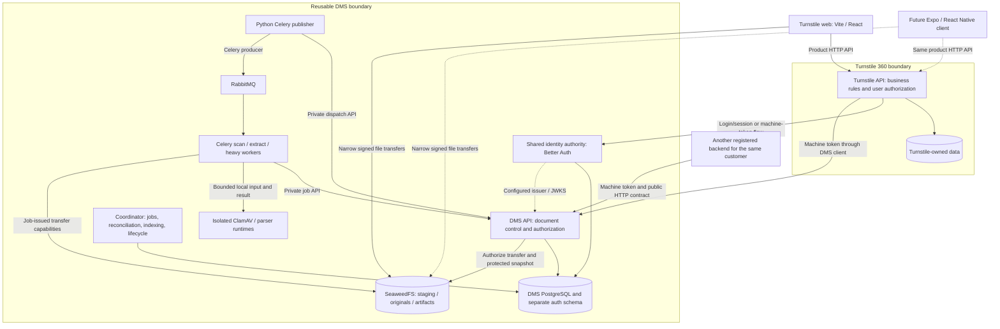
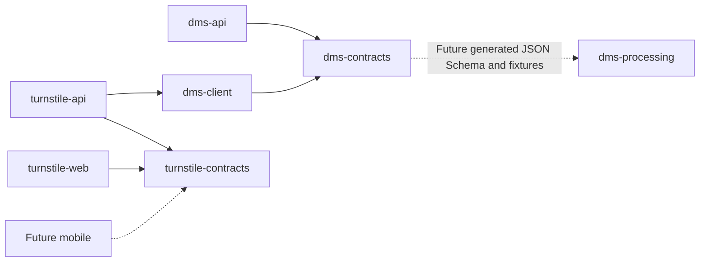
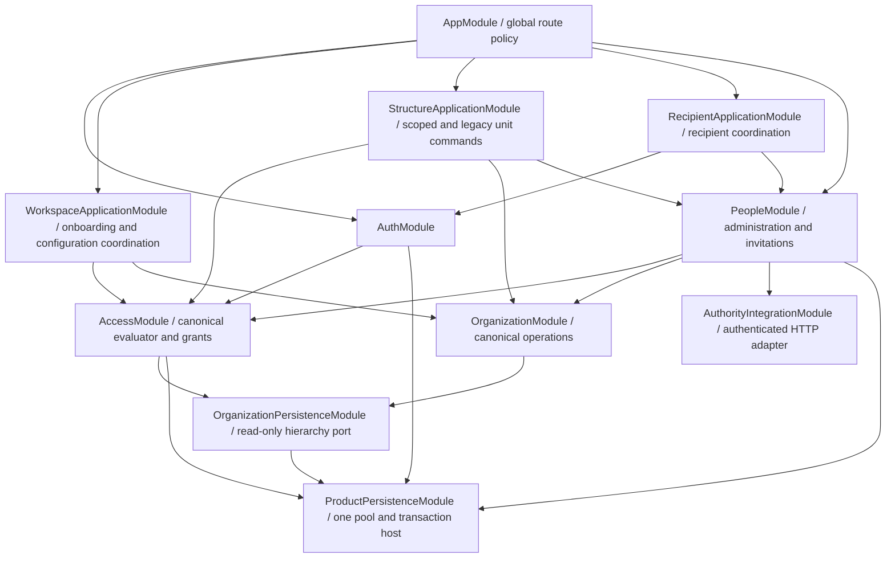
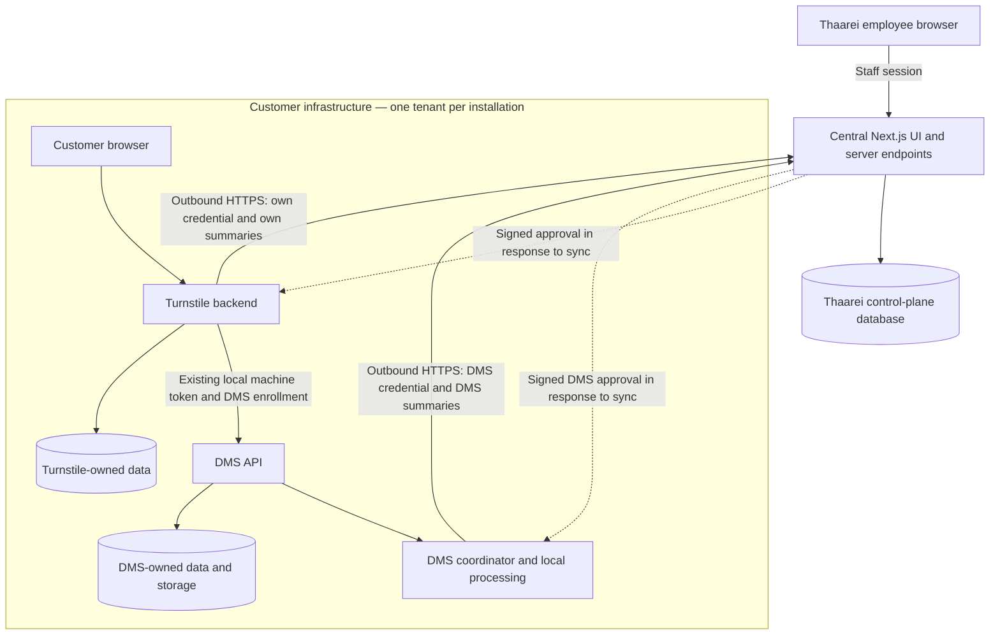
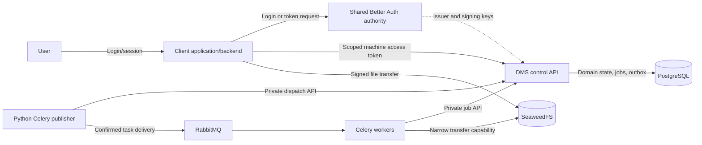
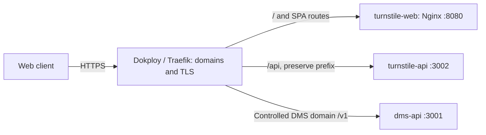

# Turnstile 360 and Thaarei DMS architecture

**Updated:** 2026-11-06

**Status:** Accepted technical design with workspace foundations implemented. The explicitly
marked Thaarei central control-plane proposal below awaits adoption.

**Owner:** Thaarei. Confidential and proprietary under [LICENSE](LICENSE).

## Documentation ownership and reading guide

The [documentation index](docs/README.md) groups plans and specifications by owning area.

This is the single technical architecture reference for the reusable Document Management
System (DMS), Turnstile 360, their shared repository, and deployment. It consolidates the
accepted DMS technical design previously held in blueprint v1.4 and the accepted workspace
and future-mobile decisions. Consolidation does not change product scope or authorize
feature implementation.

| Document                                                                                         | Owns                                                                                                                                                                                     |
| ------------------------------------------------------------------------------------------------ | ---------------------------------------------------------------------------------------------------------------------------------------------------------------------------------------- |
| [architecture.md](architecture.md)                                                               | Components, responsibilities, dependencies, data/work flows, technical contracts, selected stack, configured limits, security, deployment topology, recovery, and architecture decisions |
| [DMS product blueprint](docs/dms/headless_dms_product_blueprint_v1.md)                           | Product promise, included/deferred scope, product correctness, deployment inputs, and product decision history                                                                           |
| [DMS functionality requirements](docs/dms/headless_dms_functionality_requirements_v1.md)         | Stable FR/NFR IDs and capability dependency order                                                                                                                                        |
| [Standalone DMS implementation plan](docs/dms/dms_implementation_plan.md)                        | Requirement-mapped delivery, independent installation/integration, API explorer and standalone verification gates; planned work is not implementation                                    |
| [Thaarei control-plane specification](docs/thaarei/control-plane-specification.md)               | Proposed central client/product approval and reporting requirements; architecture proposal below and linked delivery plan remain unimplemented                                           |
| [Onboarding specification](docs/turnstile/onboarding/onboarding_specification.md)                | Accepted ONB-R01–13 product scope and acceptance; delivery packages remain in the linked implementation plans                                                                            |
| [User-management specification](docs/turnstile/user-management/user_management_specification.md) | Accepted UM-R01–22 product requirements and D01–03 decisions; the proposal preserves discovery and the linked plan sequences delivery                                                    |
| [Workspace standards](docs/standards/workspace.md)                                               | Coding, formatting, configuration, and verification conventions                                                                                                                          |
| [Workspace implementation plan](docs/workspace/workspace_implementation_plan.md)                 | Workspace setup sequence, CLI provenance, and original validation                                                                                                                        |
| [Dokploy runbook](docs/runbooks/dokploy.md)                                                      | Deployment commands and operator steps                                                                                                                                                   |
| [IN_PROGRESS.md](IN_PROGRESS.md)                                                                 | Actual implementation, verification, active work, gaps, and agent handoffs                                                                                                               |

Keep technical design changes here and link from other documents. Update affected
requirements and runbooks when behavior or deployment steps change. Manifests, lockfiles,
and deployment files record executable versions/configuration; keep this document aligned
with them. Targets and configured defaults below are requirements, not measured capacity,
production-readiness, or compliance claims.

Navigation: [status](#implementation-status), [system picture](#system-context),
[repository](#repository-and-package-dependencies), [installed stack](#installed-toolchain-and-libraries),
[Turnstile](#turnstile-application-architecture), [DMS components](#module-and-contract-boundaries),
[central proposal](#thaarei-central-control-plane-proposal), [identity](#tenancy-identity-and-authorization), [upload](#seaweedfs-storage-and-upload-protocol),
[processing](#processing-provenance-and-ai-readiness), [jobs](#durable-jobs-events-and-reconciliation),
[deployment](#development-and-current-deployment), [recovery](#backups-recovery-and-controlled-disposal).

## Implementation status

| Area                 | Current state                                                                                                                                              | Accepted target / remaining work                                                                              |
| -------------------- | ---------------------------------------------------------------------------------------------------------------------------------------------------------- | ------------------------------------------------------------------------------------------------------------- |
| DMS API              | Nest/Fastify, persisted authority, managed clients, machine guard, transactional enrollment, local-first disablement and bounded audit                     | Real client/customer provisioning, document/resource grants, storage and private job APIs                     |
| Turnstile API        | Nest/Fastify, OIDC BFF, live permissions, audited v1/v2 setup and guarded moves, protected grants and first-unit invariants                                | Document workflows and coordinated customer release                                                           |
| Turnstile web        | Login/recovery/reset, live session/readiness entry, dedicated v2 onboarding/waiting, canonical Settings and safe logout with typed configuration transport | Collapsible completed navigation and customer rollout                                                         |
| Python processing    | Installable package, identification command, reserved execution folders                                                                                    | Publisher, Celery tasks, job/transfer clients, scanner/parser supervision and sandbox enforcement             |
| Shared packages      | Typed DMS client, auth/capability DTOs, executable onboarding contracts/time-zone list and generated DMS/onboarding OpenAPI                                | Remaining feature contracts and cross-language fixtures                                                       |
| Local infrastructure | PostgreSQL, bounded Mailpit capture, RabbitMQ and SeaweedFS Compose definitions                                                                            | API PostgreSQL integration verified with disposable fixtures; broker/storage compatibility remains unverified |
| Production packaging | Four built images, isolated runtime checks and three-service Dokploy application Compose                                                                   | Production stateful/processing services and actual container DNS, deployed domains/TLS verification           |
| Quality              | Build, type, boundary, formatting, API identity/injection/runtime smoke checks configured and previously passed                                            | Business/security/processor/recovery tests as capabilities are implemented                                    |
| Mobile               | Architecture boundary only                                                                                                                                 | Expo/React Native project is deferred; no mobile application or dependencies exist                            |

AUTH-01–07 implement authentication foundations, the persisted authority, managed distinct
OAuth clients, the Turnstile BFF/user boundary, DMS machine enrollment and the typed
cross-service capability request, login/recovery UI and local operational verification.
Real deployment client registrations, document endpoints
and processing operations remain pending. A module name, folder, dependency declaration, or Compose file
does not establish a working feature. See [progress](IN_PROGRESS.md) for dated evidence;
PostgreSQL migrations, role isolation and authority/session persistence are verified for AUTH-02; application image builds and isolated runtime checks are verified in AUTH-07. Full
infrastructure compatibility, remote CI and actual Dokploy deployment remain unverified. No source/data migration has started.

## System context

Turnstile 360 is one consumer of a reusable DMS. It has its own frontend, backend, and
business data. Other trusted application backends can consume the same DMS through its
public HTTP contract without using this repository or its TypeScript packages.

### Customer deployment and application model

Each customer installation serves **exactly one customer tenant**. For example, MRR is
the tenant; Turnstile 360 is one registered application under MRR. MRR may register other
systems with the same DMS, each with its own application identity, credentials, scope
ceiling, and document ownership. Applications may live in other repositories and use
different frameworks. Their deployment location does not grant DMS access.

```text
MRR customer installation — one tenant: MRR
  Shared DMS
    Registered application: Turnstile 360 backend
      Clients: Turnstile web and future mobile
    Registered application: another MRR system backend
    Registered application: additional MRR systems as provisioned
```

Turnstile has one configured customer context per installation. Its web and future mobile
clients use the same product backend and DMS application registration; a new frontend
client does not by itself require another DMS application registration. Another independent
system requires its own registration and guarded activation. Shared tenant membership
does not grant access to another application's documents; explicit grants are required.

Another customer receives a separate installation with its own tenant configuration,
application credentials, database state, and storage namespace. Reuse the product code
and deployment definitions across customers without sharing customer data or credentials.
This product has no SaaS tenant selection, customer self-onboarding, or provisioning of
multiple customer tenants in one installation. Shared multi-customer hosting would require
an explicit future scope/architecture decision. Tenant IDs remain internal ownership,
integrity, audit, and recovery boundaries; they do not imply a multi-tenant SaaS runtime.

This diagram shows the target architecture. Arrows beyond current identity/liveness and
web entry-point behavior represent planned integrations.



Control requests pass through backends; normal file bytes transfer directly using
short-lived capabilities. Turnstile evaluates the user's business rights before calling
the DMS. The DMS independently enforces the registered application's tenant, scopes,
ownership/grants, lifecycle, and security state. A shared repository or host confers no
additional runtime trust.

## Repository and package dependencies

Existing paths below reserve ownership; empty directories are not implemented components.
Future process entry points and feature files are added with their capabilities.

```text
/
├── apps/
│   ├── dms-api/
│   │   ├── src/
│   │   │   ├── main.api.ts, bootstrap.ts, app.module.ts
│   │   │   ├── composition/               # future process composition
│   │   │   ├── infrastructure/            # current liveness controller
│   │   │   └── modules/
│   │   │       ├── platform-auth/ access/ enrollment/ audit/
│   │   │       ├── documents/ uploads/ storage/ policies/
│   │   │       └── processing/ search/ lifecycle/
│   │   ├── database/auth/{schema,migrations}/
│   │   ├── database/dms/{schema,migrations}/
│   │   └── test/
│   ├── dms-processing/
│   │   ├── src/turnstile_processing/
│   │   │   └── publisher/ tasks/ job_api/ transfers/ processors/ sandbox/
│   │   ├── tests/
│   │   └── pyproject.toml, uv.lock
│   ├── turnstile-api/
│   │   ├── src/
│   │   │   ├── main.ts, bootstrap.ts, app.module.ts
│   │   │   ├── infrastructure/ modules/
│   │   │   └── integrations/dms/
│   │   ├── database/{schema,migrations}/
│   │   └── test/
│   └── turnstile-web/
│       └── src/                           # App.tsx and main.tsx exist
│           └── app/ routes/ features/ components/ lib/ styles/
├── packages/
│   ├── dms-contracts/
│   │   ├── src/{public,internal,events,artifacts}/
│   │   └── generated/ fixtures/
│   ├── dms-client/src/
│   └── turnstile-contracts/src/
├── patches/                               # pinned dependency corrections
├── tooling/
│   ├── typescript/{base,library}.json
│   └── dependency-rules/config.cjs
├── scripts/{check-deploy,smoke-runtime,dev-container}.mjs
├── deploy/
│   ├── compose.local.yaml, compose.dev.yaml, compose.dokploy.yaml, compose.mailpit.yaml
│   ├── Dockerfile.dev, development-ports.json
│   ├── nginx/nginx.conf
│   └── artifacts/
├── tests/system/
├── .github/workflows/workspace.yml
├── docs/                                  # scope, requirements, standards, runbooks
├── compose.yaml                           # local Compose entry point
├── architecture.md
├── IN_PROGRESS.md
└── AGENTS.md
```

`apps/turnstile-mobile` is a possible future path and does not exist. `turnstile_processing`
is the current Python import name; its responsibility is reusable DMS processing.

| Package                        | Intended contents / consumers                                                                                                                    | Boundary                                                                                                                                          |
| ------------------------------ | ------------------------------------------------------------------------------------------------------------------------------------------------ | ------------------------------------------------------------------------------------------------------------------------------------------------- |
| `@thaarei/dms-contracts`       | Public DMS requests/responses, separate private job payloads, events, artifact schemas, errors/statuses; API/client and generated Python schemas | Schemas/types only; no Nest, database, Turnstile domain logic, or credentials. Keep private contracts separate from public exports as implemented |
| `@thaarei/dms-client`          | Typed HTTP calls, transport configuration, machine-token attachment, stable errors, idempotency-aware retries for trusted backends               | Depends on DMS contracts; no DMS repositories/services or Turnstile user authorization; never bundled into a frontend                             |
| `@thaarei/turnstile-contracts` | Product requests/responses, schemas, errors, pagination for Turnstile API, web, and future mobile                                                | Platform-independent; no DOM, Node-only runtime, UI framework, Nest, database, or DMS internal-job dependencies                                   |

The current manifest dependency graph is:



Internal dependencies use `workspace:*`. Packages export built `dist` files and Turborepo
builds dependencies before consumers. Applications never import another application's
source, repositories, migrations, or database tables. Contract packages cannot become a
shared business-layer or shared database package. Python interoperates through exported
language-independent contracts and the private HTTP API, without importing Nest code.

Dependency-cruiser in [config.cjs](tooling/dependency-rules/config.cjs) checks unresolved
imports, cycles, cross-application imports, framework/database coupling in contracts, and
browser/server imports. These checks cover the configured TypeScript import graph;
runtime trust, SQL ownership, Python behavior, and all future platform-specific rules
also require review and appropriate tests.

## Installed toolchain and libraries

Versions here are the repository's configured versions, not a claim about the newest
upstream release. See the [root manifest](package.json), [pnpm catalog](pnpm-workspace.yaml),
application manifests, [Python project](apps/dms-processing/pyproject.toml), and lockfiles.
The subsequent selected-technology section covers feature dependencies not yet installed.

| Area                       | Installed / configured selection                                                                 | Purpose                                                                                                   |
| -------------------------- | ------------------------------------------------------------------------------------------------ | --------------------------------------------------------------------------------------------------------- |
| JavaScript runtime         | Node 24.21.0                                                                                     | APIs, builds, CLI tools, direct `.mjs` repository scripts                                                 |
| Workspace                  | pnpm 12.16.1; Turborepo 2.11.10                                                                  | Workspace resolution, exact dependencies/lockfile, build/check/test task graph and caching                |
| TypeScript                 | 6.0.3, shared catalog                                                                            | Strict application/library compilation; compatibility pin for the installed Nest generator/compiler API   |
| API framework              | `@nestjs/common`, `core`, `platform-fastify` 12.3.2                                              | Both control/product APIs with Fastify; compatible plugins required                                       |
| Nest runtime support       | `reflect-metadata` 0.2.2; `rxjs` 7.8.1                                                           | Decorator metadata, dependency injection, framework reactive support                                      |
| Validation                 | Zod 4.6.7 in both APIs and DMS/Turnstile contracts                                               | Environment and executable shared payload/response/error validation                                       |
| Web UI                     | React / React DOM 19.3.1                                                                         | Product presentation and interaction                                                                      |
| Web design system          | shadcn 4.23.0, Base UI 1.9.0, Tailwind CSS / Vite plugin 4.3.3                                   | Owner-selected preset and source-owned UI; see [web design system](#web-design-system)                    |
| Web navigation             | React Router 8.5.1                                                                               | Client links/history, persistent workspace layout and shared unsaved-entry blocker                        |
| Web build                  | Vite 8.3.5; `@vitejs/plugin-react` 6.1.2                                                         | Frontend development server, React integration, production asset build                                    |
| API generation             | Nest CLI 12.0.11; schematics 12.0.12                                                             | CLI-generated modules/controllers/providers; no hand-built replacement for available scaffolding commands |
| JavaScript quality         | Biome 2.6.4; dependency-cruiser 18.7.0                                                           | Formatting/lint/import organization and architecture import checks; ESLint/Prettier are not configured    |
| API tests                  | Vitest 4.1.2; `@nestjs/testing` 12.3.2; `@swc/core` 1.16.21                                      | Identity tests and Fastify injection; SWC preserves legacy decorator metadata in tests                    |
| API test tooling           | Vite 8.0.0 in each API dev dependency                                                            | Test toolchain dependency, distinct from the web application's Vite pin                                   |
| Type declarations          | `@types/node` 24.19.2 at root/web and 24.0.0 in APIs; `@types/react` / `@types/react-dom` 19.3.0 | Compile-time Node/React declarations; do not add runtime behavior                                         |
| Repository YAML checks     | `yaml` 2.9.1                                                                                     | Parse deployment YAML and check build-context/Dockerfile paths                                            |
| Python runtime/build       | Python 3.13.18; uv / `uv_build` 0.13.6                                                           | Locked environment and Python source/wheel packaging                                                      |
| Python quality/tests       | Ruff 0.17.3; mypy 2.4.1; pytest 9.2.0, resolved in `uv.lock`                                     | Python format/lint/type checks; pytest available for future behavior tests                                |
| Infrastructure definitions | PostgreSQL 18.6-bookworm; Mailpit 1.33.0; RabbitMQ 4.3.7-management-alpine; SeaweedFS 4.51       | Pinned images; PostgreSQL connects through owned roles, broker/storage integration pending                |
| Application images         | Node 24.21.0-bookworm-slim; Python 3.13.18-slim; Nginx 1.30.2-alpine                             | Digest-pinned runtime/build bases in Dockerfiles; frontend uses an unprivileged Nginx process             |
| Delivery                   | Docker Compose; Linux server with Dokploy/Traefik; GitHub Actions workflow                       | Container deployment target, ingress/TLS, configured CI checks/image builds                               |

AUTH-01 adds exact pins for `better-auth`, `@better-auth/oauth-provider`,
`@better-auth/drizzle-adapter`, and the development `auth` CLI at 1.7.14;
`drizzle-orm` 0.45.4, `pg` 8.23.1, development `drizzle-kit` 0.31.11 and
`@types/pg` 8.20.0 in both APIs; `jose` 6.2.14 in DMS; `openid-client` 6.8.8,
`@fastify/cookie` 11.1.5 and `@fastify/session` 11.1.6 in Turnstile API;
client-only Better Auth/OAuth Provider 1.7.14 in web; and development `@playwright/test` 1.64.1
at root. AUTH-02 also installs `nodemailer` 10.3.1 with development `@types/nodemailer` 8.0.2,
explicit Fastify 5.12.7 in both APIs and root development `pg` 8.23.1 for isolated database
tooling. Authority/BFF and real browser-to-DMS evidence are recorded in progress; actual
deployment and customer provisioning remain separate. Python currently has no runtime dependencies.
DMS-I02 adds the contract/explorer and development-only JSON Schema tooling documented
in [its owning section](#consumer-api-contract-and-explorer-dms-i02). The S3 SDK,
Celery/processing engines, OpenTelemetry and React Testing Library remain later additions. The web design system is now selected
and installed as documented below; React Router owns web navigation. No client-state/form library, mobile library,
or Turnstile domain dependency has been added.

## Turnstile application architecture

### Web and future mobile

`turnstile-api` is the shared product backend for Vite/React and a future Expo/React Native
client. Backend services own authoritative business rules, permissions, calculations,
workflow transitions, validation, and persistence. Clients submit intended changes; the
backend authorizes and applies them, then returns the resulting domain data/outcome.

Clients own presentation, navigation, forms, display formatting, and transient UI state.
They may repeat input validation for immediate feedback or show optimistic UI; they must
handle rejection and reconcile with the server result. Responses must not depend on DOM,
React components, or a particular screen layout. Both clients use the same business
authorization and product contracts. Maintain compatibility for deployed clients,
including mobile releases that update independently of the backend.

User login is supplied by the selected identity authority; product sessions/user context
are enforced by the Turnstile backend. Web uses the planned secure session boundary.
Native login/session storage and redirects will be specified when mobile is implemented;
do not assume browser cookies, expose service secrets, or create a second business backend.

### Web design system

The Turnstile web app owns a source-based shadcn/ui design system initialized and
applied with CLI 4.23.0 using the owner-selected preset `biekTCUvD` (Maia style,
mauve base, emerald theme, red chart palette, default radius, subtle menu accent and
inverted-translucent menus). Its primitive base is Base UI, because there was no
existing primitive library to preserve. The authoritative CLI configuration is
`apps/turnstile-web/components.json`, with `base-maia`, Hugeicons and `@/` aliases.
TypeScript, Vite and dependency-boundary validation resolve the alias to the web `src`.
Boundary validation uses root `tsconfig.boundaries.json`, because its resolver plugin
interprets path aliases relative to the repository working directory.

Tailwind CSS and its Vite plugin 4.3.3 compile the existing `src/index.css`.
That file is the sole source of semantic light/dark color, typography and radius
values, mapped into Tailwind through `@theme inline`. IBM Plex Sans Variable
(body/controls) and Noto Sans Variable (headings), both Fontsource 5.3.0, are bundled
as same-origin font assets; no external font service or CSP relaxation is required.
Page layouts and brand presentation consume those same tokens. Product pages default
to light mode; dark token support is previewable without adding persisted preferences.

The web manifest pins shadcn 4.23.0 (CLI and theme CSS), `@base-ui/react` 1.9.0,
`@hugeicons/core-free-icons` 4.4.0, `@hugeicons/react` 1.1.10,
`class-variance-authority` 0.7.1, `cn` 0.5.1 and `tw-animate-css` 1.4.0.
Generated primitives live in `src/components/ui`; product compositions live in
`src/components` and owning features. The shared `ButtonLink` composes `AppLink` and the Button variant styles, preserving
anchor semantics that Base UI's non-native Button does not supply. `AppLink` uses
React Router for same-origin product navigation; auth/identity endpoints, external links,
modified clicks, downloads and new tabs retain browser navigation. Components use semantic colors and shared
variants; feature instances use classes for layout. Existing authentication and
workspace screens consume these primitives without moving business or auth authority
into presentation. No UI package is shared with contracts, APIs or future mobile.

The development-only `/design-system` catalogue renders the actual primitives and
representative states with fixture content, no account/API access and an in-memory
light/dark preview. Its import is guarded by `import.meta.env.DEV`; production builds
exclude the catalogue module and route. The [design-system guide](docs/turnstile/design-system.md)
defines designer/developer handoff, component conventions and CLI maintenance rather
than duplicating the technical design. Reviewed local adaptations retain upstream
composition while meeting Biome, explicit transition and reduced-motion conventions.
New UI/font/icon license texts ship in `public/third-party-notices.txt`; the proprietary
root LICENSE remains unchanged. This is an inventory for the additions, not a completed
audit of the assembled distribution.

### Backend composition and data ownership

Use feature-oriented Nest modules under `apps/turnstile-api/src/modules`. Keep controllers
focused on the HTTP contract, services on business use cases/policies and transaction
boundaries, and repositories on the application's own persistence. Add internal layering
only as implemented behavior needs it. Generate feature scaffolds with the Nest CLI.

```text
Web / future mobile
  -> Turnstile controller: request contract and user context
    -> Turnstile service/policy: business authorization, rules, state transitions
      -> Turnstile repository: owned business data
      -> integrations/dms: product-to-DMS translation
        -> @thaarei/dms-client -> authenticated DMS HTTP API
```

Turnstile owns its business tables/migrations under `apps/turnstile-api/database` and uses
separate runtime credentials/permissions from DMS/auth ownership. A shared PostgreSQL
host is possible; it does not grant cross-application SQL access. Physical Turnstile
database/schema naming and schemas are established during persistence implementation.

Keep document/version IDs and product reference mappings where required; the DMS owns
file bytes, security, document history, extraction, grants, and search. A file transfer
flow is: user action -> Turnstile authorization -> DMS session/capability -> client direct
transfer -> backend-mediated completion/status. Normal application operations and polling
remain through Turnstile's product API. Machine-token acquisition/caching, DMS error
translation, and bounded transport settings belong in the server integration boundary.

Business records and DMS operations cannot share one database transaction over HTTP.
Feature implementation must define idempotent linking, pending/failure outcomes, and
reconciliation for partially completed operations. Do not hold database transactions open
across file uploads or assume a DMS failure rolled back a product record.

The consumer backend checks user permissions before each document action and keeps DMS
machine credentials/enrollment keys private. An audit user identifier asserted to the DMS
does not delegate user permissions. Other applications consume the same DMS contract;
the DMS never imports Turnstile business rules.

### Onboarding implementation baseline

ONB-I01 adopted the original [onboarding specification](docs/turnstile/onboarding/onboarding_specification.md)
and technical decisions for ONB-I02–08. ONB-RD01 now adopts the redesign target from the
[dated proposal](docs/turnstile/onboarding/onboarding_design_proposal.md#redesign-recommendation-2026-11-02)
and [redesign delivery plan](docs/turnstile/onboarding/onboarding_redesign_implementation_plan.md). The existing
v1 implementation and its evidence remain in [progress](IN_PROGRESS.md); RD01 changes
requirements/technical decisions only. RD02 adds executable versioned contracts, Kolkata
compatibility and the adopted move contract. RD03 implements v2 persistence, initialization,
incomplete-only upgrades and first-unit activation/deletion guards. RD04 implements
guarded audited parent moves. RD05 implements dedicated setup/waiting layouts and
version-aware first-unit resume/review. RD06 adds the shared visual editor and confirmed
Move to/pointer/touch moves; RD07 adds completed responsive navigation and compact
Settings. RD08 supplies exact-image verification and version-aware archive/target helpers;
actual release evidence is maintained in IN_PROGRESS.md. Historical I-package descriptions below identify delivered v1 behavior;
explicit redesign targets govern subsequent implementation and coordinated release.
ONB-I02 implements the shared executable contract/time-zone foundation and product pool
composition below. The [generated OpenAPI](docs/api/turnstile-onboarding.openapi.json)
describes I03's implemented canonical storage/domain operations and authenticated
HTTP handlers. I04 implements private manager grants and backend readiness enforcement;
I05 implements the onboarding/waiting web journey; I06 implements ongoing Settings.
I07's verification composition is described below; I08 adds the private preflight and
executable release/recovery procedures. Actual deployment acceptance is tracked in IN_PROGRESS.md.
Completed v1 activation with no sites/departments remains supported. New/incomplete setup
uses v2 after the owning migrations and requires a real direct-child Site or Department. The configuration
permission is `turnstile:configuration:manage`, dependent on `turnstile:access`; it covers
core profile, time zone, units and completion, without account/access administration,
DMS operator authority or approval rights. Site/Department labels remain fixed; custom
terminology, membership and a generic settings/workflow engine are deferred. Safe parent
moves are now adopted scope; arbitrary sibling ordering and persisted canvas coordinates
remain outside this release.

#### Adopted redesign and compatibility

The server remains authoritative for lifecycle, canonical structure, live permissions
and revision. No second setup store, pool, browser completion flag or implicit bootstrap
is introduced. The minimal ordinary-user status projection remains unchanged. Detailed
setup/snapshot contracts now discriminate requirement versions 1 and 2, including completion
with the same version as its setup. Completed v1 retains its four-item requirement tuple;
v2 adds `first_unit` before `configuration_manager`. Runtime validation checks the tuple,
saved profile/root, direct-child qualification, lifecycle, revision and next step together.

New initialization uses v2. The owning migration converts only incomplete v1 rows to v2
under the fixed installation and existing configuration lock, preserving saved values,
units and business revision. Empty revision-0 rows stay `not_started`. The update guard
permits this metadata-only 1→2 transition only for the verified dedicated product migrator,
with unchanged values/completion/revision; check the database role, never a caller-set
session flag as authority. All other version updates remain forbidden. Keep forced RLS,
fixed installation checks and invoker-rights guards active; do not disable triggers or
grant runtime version-update privileges. Completed rows keep version/completion metadata
and are never converted, reinitialized or reactivated. Applied migrations 0004–0006 stay
immutable. RD03 adds generated `0007_setup_requirement_v2.sql` (allowed versions/default)
and reviewed custom `0008_setup_v2_guards.sql` (invariants and incomplete-only upgrade).
The upgrade locks the existing installation, sets transaction-local tenant context and
locks its configuration before changing requirement metadata. No context is created when
installation/setup is absent. The invoker-rights update guard permits only the direct
owning login's 1→2 change with an identical JSONB projection of every other column;
completed conversions, mixed updates and downgrades fail. Runtime retains its existing
column privileges, with no version write. RD04 will generate its own later migrations.

For v2, a qualifying unit is a saved `site` or `department` whose `parentId` is the canonical
root ID. Profile/root gaps take precedence over `structure`, then `review`; completed
setup has null next step. Completion rechecks this under the existing configuration/grant
lock. Incomplete last-unit removal returns setup to Structure. Completed v2 rejects any
deletion/move leaving zero qualifying units; completed v1 retains optional-unit policy.
Leaf/reference protection remains in force for all deletions. Optional edits and feature
outages never clear durable completion.

RD02 extends the shared generated time-zone list with explicit `Asia/Kolkata` support alongside
`Asia/Calcutta` and `UTC`, retaining exact identifier validation and stored values. It records
the pinned Node/ICU/time-zone-data source plus explicit compatibility additions in the
generator/provenance at allowlist version 2, independent of the setup requirement version.
OpenAPI is generated/validated from those same executable contracts. Event/audit timestamps
remain UTC instants, while date-only values remain dates; organization time zone supplies
business-day/display defaults without rewriting historical instants.

RD02 defines `PATCH /api/organization/units/:id/parent` for revision-checked moves, returning a
canonical snapshot. RD04 extends parent-column privileges, validated invoker-rights guards,
finite audit actions and explicit configuration-route classification; RD06 adds the
shared visual editor. RD05 separates neutral entry, dedicated setup and ordinary waiting
from the completed application layout; RD07 adds collapsible completed navigation. The
existing pool, auth/session boundaries, limits, reserved ports and deployment topology
remain in place. Compatible migrations/API/web ship together after RD08 verification;
package completion alone does not authorize applying a partial release to an installation.

#### Onboarding composition and ownership

Keep Organization and Onboarding features in Turnstile's Nest modules and product-owned
persistence. Organization owns canonical profile/root/units and configuration revision;
Onboarding exposes setup/status/completion through Organization's canonical transaction
boundary, without a second lifecycle store. Both use one product persistence module
under `infrastructure/database`. ONB-I02's `ProductPersistenceModule` exports one
`ProductPersistenceService` owning the configured pool, role/installation verification and
shutdown. It retains the same validated product environment and connection limits/timeouts.
Auth's `ProductDatabaseService` consumes that pool and owns its encrypted session store
and session/access RLS readiness checks. Preserve session encryption, installation verification,
forced RLS checks and one shutdown owner. No duplicate pool or cross-schema access.

Compose live user/local access → mutation CSRF → explicit route permissions → required
workspace readiness once at application level. AppModule now registers the existing
ApplicationAccessGuard exactly once. It invokes UserSessionGuard for the existing identity/
CSRF/permission checks, then OnboardingService.requireReady for protected workspace routes.
Auth exports authentication services; no duplicate global guard or readiness stub exists.
Onboarding exports readiness, and consumes Organization/persistence without importing Auth.
Pass authenticated actor context to use cases. Do not use circular module imports,
`forwardRef` or global lookup. Unannotated routes remain denied. Readiness exemptions
are separate from public-route metadata and cannot skip authentication/permissions/CSRF.
Default protected business routes to completed setup. Check current committed readiness
on each request; no session snapshot, browser flag or positive long-lived cache authorizes
it. Domain mutations recheck local access inside their transaction. Authority checks run
before that transaction; never hold product locks across identity or DMS HTTP.

`@thaarei/turnstile-contracts` now uses explicit Zod 4.6.7. Shared schemas/DTOs and name/key
normalization remain independent of Nest, SQL, Node-only APIs and React. Submitted names
normalize; response schemas require already-canonical names. Structural JSON Schemas are
generated from executable schemas; normalization/cross-field rules are additionally
described because JSON Schema cannot express every executable refinement. The generated
OpenAPI identifies implemented handlers and the delivered grant/readiness policy.
`pnpm check:contracts`, included in `pnpm check`,
verifies the document, references, executable examples, auth permission enumeration and
pinned time-zone list/provenance. Regenerate with `pnpm docs:turnstile-onboarding` and
`pnpm generate:turnstile-time-zones`. Existing auth DTO shape/protocol remain intact.
`ConfigurationException` projects typed domain failures through the existing HTTP filter
with their own statuses and private/no-store headers. I03 also maps the pinned Nest/Fastify
adapter's string parser exceptions to finite feature errors without exposing raw messages.
Shared accessAssignmentSchema validates strict private operator input and the manage/access
dependency. The private writer now supports manager grants with initialized-context and
last-manager protection; runtime grants remain read-only.

#### Canonical configuration persistence

ONB-I03 adds four product tables through generated migration
`0004_organization_configuration.sql` and reviewed custom migration
`0005_configuration_guards.sql`. Existing identity/auth tables and migration history are
preserved. The declarative installation definition moves to
`infrastructure/database/installation.schema.ts`, re-exported by auth's schema, so new
features depend on product infrastructure rather than auth implementation files.

| Table                          | Canonical role and integrity                                                                                                                                                                                                                                                                                                                            |
| ------------------------------ | ------------------------------------------------------------------------------------------------------------------------------------------------------------------------------------------------------------------------------------------------------------------------------------------------------------------------------------------------------- |
| `organization_configuration`   | One row per installed tenant: revision, nullable saved name/zone/root, requirement version and durable completion actor/time. Fixed installation FK, paired name/root, bounded values and completion invariants. Runtime may update delivered state, never insert/delete contexts or change tenant/version                                              |
| `organization_unit`            | Tenant/unit composite identity and tenant-aware parent/configuration references. One organization root; only non-root units store name/comparison key. Root presentation derives from the canonical profile, avoiding duplicate names. Binary `C` sibling-key uniqueness applies across Site/Department types; root identity/type/parent stay immutable |
| `configuration_create_receipt` | Tenant/key identity, actor binding, normalized-body SHA-256, original unit ID and database-time 24-hour expiry. No unit FK: deleting a leaf must preserve its retry identity. Runtime can read/insert and delete only expired rows through command-specific forced RLS; no live deletion or updates                                                     |
| `configuration_audit`          | Append-only successful initialization/configuration/completion evidence: actor kind/ID, server request UUID, finite action/field names, affected identity, revisions and database time. No profile text, submitted bodies or secrets. Runtime insert-only; inspection and retention use the owning operator                                             |

All four tables use forced tenant RLS with transaction-local context, explicit privileges
and indexes for actual parent/sibling, receipt-expiry and audit-retention lookups. Reviewed
invoker-rights triggers enforce stable root/completion identity, one-step revision updates,
immutable unit identity/type (and parent in delivered v1), supported parents, count/depth
bounds and cycle prevention. Trigger search paths are fixed; no security-definer or cross-schema function
is introduced. Semantic name/zone validation remains in shared executable contracts;
normalized responses also detect inconsistent persisted configuration.
RD03 extends the version/completion guards for the adopted policy. RD04 replaces parent
immutability for non-root units with guarded moves; root tenant/ID/type/parent remain
immutable. It adds only `parent_id` to runtime's unit-update columns, retaining name/key
privileges and forbidding identity/type changes. Guards validate the resulting subtree,
not just the moved node. No new privileged pool or broader table grant is needed.
RD03 also adds an invoker-rights unit-delete guard under the same configuration lock:
root deletion is forbidden, and completed v2 cannot lose its last qualifying child.
Configuration updates cannot set/retain v2 completion without a qualifying unit. These
checks use `23514`/`configuration_first_unit` at SQL level without changing forced RLS.
OrganizationService provides the finite HTTP domain outcomes before these SQL backstops.

RD04 adds generated `0009_unit_move_audit.sql` for the finite `unit_moved` action and
reviewed custom `0010_unit_move_guards.sql` for the parent-column grant and guard replacement.
The unit guard retains insertion/count/type rules and validates non-root parent changes
against bounded ancestor/subtree queries, including the entire resulting depth and
canonical root. Sibling-key uniqueness remains enforced by the existing index. Explicit
`VOLATILE` invoker-rights semantics let row guards see earlier changes in a multi-row
statement, so an invalid final graph rejects/rolls back the statement; see
[PostgreSQL 18 trigger visibility](https://www.postgresql.org/docs/18/trigger-datachanges.html).
Tenant RLS, existing root/configuration/delete guards and migration history are retained.

OrganizationService owns use-case rules and transaction sequencing; OrganizationRepository
owns SQL, context/grant reads, canonical projections, state/revision/audit writes
and receipts through the shared pool. OnboardingService exposes the smaller setup boundary
by consuming OrganizationService. Every read rechecks local access, and mutations recheck
both permissions after acquiring the same context lock used by the private access writer.
I04 extends the writer with permission issuance, last-manager protection and atomic access
audit without changing configuration revision. No authority/DMS HTTP occurs while locked.
The existing pool/statement timeouts bound contention; failures return controlled unavailable.

The HTTP adapter classifies only registered configuration routes, enforces JSON and the
mutation byte limit before parsing, caps serialized feature responses, and preserves
authentication/CSRF/permission error precedence after transport validation. Query fields
and actor/tenant selectors are rejected. The guard provides verified identity; request IDs
are server-generated UUIDs. A non-UUID adapter id is replaced once per request with a
generated UUID, never accepted from input or an unconfigured factory. Successful changes are audited transactionally; denied/invalid/
conflicting/unavailable HTTP attempts use bounded redacted `product.configuration`
telemetry. Auth readiness continues to describe auth, independently of feature initialization.

Private initialize/inspect/prune commands validate the owning migrator and exact existing
installation before taking the context lock. Initialization is repeat-safe and creates no
root/default profile/account/grant. Inspection returns counts and at most 100 manager IDs
and audit entries with explicit truncation. Pruning uses database time and removes at most
1,000 rows total per invocation, oldest expired audit first then expired receipts; it never
changes configuration, completion or live receipts. Counts/operator metadata are emitted
as bounded private operational output. No startup/GET bootstrap or scheduled cleanup exists.
See the [operator procedures](docs/runbooks/authentication.md#initialize-inspect-and-maintain-product-configuration).

#### Access provisioning and backend readiness

ONB-I04 adds generated migration `0006_access_assignment_audit.sql`: bounded nullable
`subject_user_id` for attributed access changes and the `enabled` audit field. Access
audit requires an operator actor and subject user; other event shapes remain unchanged.
No auth/DMS schema or runtime grant-writer privilege is introduced.

Private grant and configuration commands share `withProductOperator`, which validates
the dedicated product migrator and exact existing installation, locks installation then
configuration, and closes its pool. Grants require explicit initialization; they never
bootstrap. The writer then locks the addressed grant, preserves replacement-array
semantics, and permits the first manager. Removing/disabling a manager checks for another
enabled local access/manage holder under the same context lock used by activation.
Refusal uses exit 2 and `LAST_CONFIGURATION_MANAGER_REQUIRED`; no grant/audit changes
commit. Effective grants insert attributed audit atomically, with unchanged configuration
revision. A repeat with the same enabled/permission set is a no-op, including array order.

ApplicationAccessGuard defaults every permission-protected business route to completed
setup. `WorkspaceReadinessExempt` is separate from public metadata and is applied only
to setup/status, organization and the session endpoint; it skips only readiness. Public
auth navigation/logout/health retain their existing handler boundaries. No exempt route
acquires access implicitly, and an unannotated exempt route remains denied. Readiness
uses current product state/local access through Onboarding/Organization on every request,
without session/browser state or positive caching. Status/readiness uses one plain joined
SELECT of completion and actor grants under tenant context, so concurrent readers do not
queue on the configuration write lock. It sees committed state from that statement; an
uncommitted activation remains incomplete. Mutations/private grants retain the shared
write lock and authorization recheck. Role/installation/forced-RLS safety checks remain
current on every operation. Incomplete returns 409 `SETUP_REQUIRED`;
missing/unsafe/uninitialized persistence returns 503 `CONFIGURATION_UNAVAILABLE`.
`/api/dms/capabilities` uses the default gate after its existing permissions and before
any machine token or DMS request. Auth/session readiness remains independent of setup;
DMS outages never clear durable completion. I05–06 supply the UI, extended by RD05–07;
RD08 supplies coordinated release verification. Actual local/production acceptance is
recorded separately in IN_PROGRESS.md.

#### Onboarding web journey

ONB-I05 adds the web feature under `features/onboarding`. Workspace entry verifies the
existing live session, then current minimal status before rendering business content.
In delivered v1, managers resume Organization while required saved values are missing,
otherwise Review;
ordinary users see Waiting for setup with explicit Retry/Sign out. Known onboarding and
waiting paths redirect Home only after backend completion. Unknown paths render not-found
rather than Home. React Router links/history provide client navigation and deep links/Back,
with session/readiness checks on entry, route changes and BFCache restoration. Restoration resets
transient connection-check state; in-flight status sharing is scoped to the verified user.
I06 adds the Settings composition below.

RD05 implements the incomplete journey in a dedicated setup layout:
brand, signed-in identity, Sign out and Organization → First unit → Review progress.
`EntryLayout`/`EntryContent` own neutral entry and incomplete setup/waiting;
`WorkspaceLayout` is selected only after verified completion. Verify session/status before
selecting a layout. Initial unresolved status and unavailable configuration use neutral entry/retry content; no dashboard/sidebar/Settings mounts or
flashes. Incomplete managers entering dashboard/Settings resume the earliest saved gap;
ordinary users use waiting with Retry/Sign out, and accounts without access stay denied.
Completed users enter the application layout, including legacy root-only v1. Preserve
existing login/recovery/logout orchestration and distinguish identity expiry, configuration
unavailability and feature-specific DMS failure.

The existing typed transport now supports JSON GET/PATCH/POST/DELETE, in-memory CSRF,
explicit create keys, same-origin credentials, no-store/no-referrer, fixed deadlines and
bounded, schema-validated configuration responses/errors. It never retries mutations
implicitly. A manager snapshot joins the three owning GET projections only when their
revisions agree, with at most one bounded GET reconciliation retry. Backend services
remain authoritative; there is no local completion flag or browser grant writer.

Organization uses shared name/zone validation and the adopted finite time-zone list;
no deployment/browser zone is silently saved. RD05 suggests Indian Standard Time · Kolkata
· UTC+05:30 only when no zone is saved; explicit save confirms it and existing saved zones
always take precedence. Save and continue commits required values;
Save and exit submits only non-empty values, so it can commit valid partial progress or
preserve already-saved required values and open paused setup; an untouched empty profile
pauses without a mutation. An untouched India suggestion adopts any saved zone returned
by canonical readback; an explicitly edited zone remains a draft for comparison.
An untouched India suggestion is omitted on Save and exit;
Save and continue explicitly confirms it. Continue still reports empty required values.
Resume derives from persisted gaps. Transient drafts stay in component memory; leaving through a link asks before discarding unsaved entries.
Revision conflicts require explicit reload/comparison before a new save; unsent entries
are retained while reconciling. Duplicate sibling names remain editable with a name error.
Delivered v1 Structure starts at the canonical root, creates only fixed Site/Department
types with valid saved parents, displays ancestry and offers an optional skip. RD05 replaces
that setup surface with First unit, infers the root parent and requires a real saved direct-child
Site/Plant or Department before v2 Continue/Review. Additional/deeper units remain optional.
Save/exit can pause partial setup; it never bypasses requirements. Resume/deep links and
Back/Forward use a fresh saved snapshot with profile gaps before first-unit gaps.
If a selected parent disappears, both the selector and a new create use the saved root.
An uncertain create retains the exact normalized body/revision/key for explicit retry;
reloading current state does not silently issue a fresh key. New-entry reconciliation is
a separate deliberate action after readback for that attempt; starting another attempt
resets the readback marker. I06 adds rename/delete editors in Settings. RD05 reuses those
editors for saved setup units, so Review’s Edit first unit action supports actual corrections without a second mutation path.
First-unit Save and exit commits a non-empty valid entry before pausing, or pauses an empty
entry without a create. Uncertain retries retain that original save/exit intent and receipt key.

Delivered v1 Review displays saved profile/units and the server checklist. Activation sends the saved
revision; uncertain completion supports explicit readback/retry and opens Home only
when completion is confirmed. Authority/configuration/validation/conflict/DMS errors
retain their separate meanings. Existing session generation/check fencing and editor
unmount fencing suppress late reads/mutations after logout/navigation. Session/logout
special handling and development-only gallery boundaries remain intact. Forms compose
Base UI/shadcn Field/Input/Card/NativeSelect; shared semantic tokens, narrow layouts,
associated errors and reduced-motion behavior follow the existing design system.
RD05 replaces the customer checklist with saved organization, regional and first-unit
summaries, Edit actions and Finish setup. Technical root/permission checks remain server
invariants. Enable Finish setup only from a fresh ready saved snapshot, and open the
dashboard only after confirmed server completion. A conflict or uncertain completion disables
Finish setup until explicit saved-state readback; readback never replays the mutation.
Preserve shared dirty-editor navigation blocking, partial drafts, exact create receipts, explicit error/readback recovery and
revision/unmount/session fencing throughout the new layouts.

#### Ongoing Settings and basic structure

ONB-I06 adds completed-workspace Home/Settings navigation and four explicit manager
destinations: `/settings` (Setup overview), `/settings/organization` (organization name),
`/settings/organization/structure` (sites/departments) and `/settings/workspace` (time zone).
The current verified status gates these routes before configuration reads; ordinary users
see an access-required state and Home, while incomplete users resume onboarding/waiting.
Unknown paths still render not-found. Focus, reload, Back and persisted page restoration
reuse the session/readiness boundary. Configuration APIs continue enforcing permission
on every call; browser navigation is not an authorization boundary.

Transport, load/unmount fences, validation/error handling and profile/create editors now
live in `features/configuration`, shared with onboarding. Settings name and zone editors
submit only their own field with the captured revision, report an unchanged submission as
no change instead of a save, show confirmed saves in place,
retain drafts through recoverable errors and require deliberate reload/comparison after
a stale or uncertain write. Cancel returns to the current saved overview; unsaved link
navigation confirms discard. No browser persistence or duplicated record is added. Setup overview reads the same canonical snapshot, including saved units and
durable activation actor/time, and offers a nonblocking structure link for a root-only
organization. It does not replay activation or track recurring optional tasks.

Delivered v1 Structure reuses fixed types, parent/depth/count validation, ancestry and
exact-key create retries. A single selected non-root unit editor supports rename or explicit removal
confirmation; the root is renamed only through the organization profile. Known parents
with children cannot be removed; the backend checks current leaf usage and revision.
Other structure mutations are disabled while the selected editor is open. Duplicate names
remain editable; stale/unknown rename or delete outcomes require current saved readback
before another deliberate write. Removed units are never recreated by retry. Completion,
root identity, audit and backend invariants remain unchanged. People, approval, risk,
access administration and label overrides remain outside this feature. RD03 adds
version-specific last-unit protection; RD04/RD06 add moves and the shared visual editor.

RD06 implements `StructureEditor` for both setup and Settings, retaining the existing
create body/revision/key and partial-save recovery. The owner-requested structure UX redesign
uses `StructureTree` to compose an automatic top-down organization chart and a compact outline
from the same bounded canonical units. `structure-layout.ts` derives transient non-overlapping
card positions from visible parentage; SVG draws connections without a diagram dependency.
`StructureViewport` owns a transient transform camera: blank-surface drag, Hand/Space/middle
drag from cards, wheel/trackpad pan, pointer-anchored Ctrl/Command-wheel zoom, touch pan/pinch,
focused keyboard navigation and a fixed zoom/reset/Fit bar. Camera scale is bounded to
0.1%–200%; Fit can show the maximum-width canonical structure. Buttons, keyboard +/− and
modifier-wheel use additive 10-percentage-point steps. Modifier-wheel caps each event at
one step, accumulating small deltas to 40 normalized pixels and resetting after 160ms,
direction changes or modifier release. Direct two-finger touch pinch stays continuous.
Direct transform writes
avoid rerendering the unit tree per pan. Camera gestures never change unit coordinates,
parentage or revisions and cannot submit commands. Native Pointer Events with capture,
multi-touch ownership and blur/Escape/cancellation cleanup keep unit-move handles separate.
Keyboard focus/selection reveal hidden cards; filtering fits its visible ancestry. The
chart clips its camera surface while Compact outline retains bounded native scrolling.
Compact outline renders dense keyed rows with canonical indentation and branch guides,
aligned direct-child counts and horizontal actions. Unit types occupy a separate column
when space permits and a second name line on narrow lists; deeply nested lists retain
native canvas overflow. This presentation does not change traversal or command behavior.
Contextual Add first unit/Add below infer parent/valid types; creation and selected-unit details/actions
occupy one collapsible floating tools panel over the chart. Settings fills its available
content viewport with the canvas; a compact header replaces the repeated map heading and
large page margins. Search, the view selector and contextual actions share that panel;
chart navigation remains available on the canvas while the panel is collapsed.
Card + shortcuts open the same create form with an inferred parent; Settings also exposes
an explicit valid-parent selector for consecutive additions. The nonmodal Base UI
Collapsible keeps editors mounted while collapsed, preserving drafts and readback state.
Failed hidden writes reopen the panel. Desktop Fit/selection avoid its occupied area;
narrow widths use the full canvas behind the bounded, independently scrolling panel.
Routine confirmations are announced without a persistent visible banner; recovery actions
appear only for errors or uncertain writes. Rename offers Save/Cancel, and unused-leaf removal
names the unit and restriction explicitly. Root naming continues through the profile.
Search preserves ancestor context and distinguishes duplicate names under different
parents. Tree traversal renders a flat list of keyed unit rows with canonical depth/ancestry
connectors; the active editor occupies a stable tools-panel slot, so changing parent or collapsing tools never remounts it or loses its pending
destination/name. If readback removes an edited unit, keep its clearly labelled transient
row until explicit cancellation so draft/error/readback controls remain reachable; it
never enters canonical units or a write body. An active canonical editor and its ancestors
also stay visible when a rename/readback stops matching the current filter. Selected and
edited ancestor paths stay expanded until their context closes.
No sibling sort or persisted diagram coordinates; canonical ordering stays
comparison key then ID. Filtered dragging must not imply ordering hidden/unrelated nodes.

Move to… provides a complete click/tap/keyboard destination selector, old/new-path preview
and confirmation before submission. Pointer/touch drag uses the same command/validation
and confirmation, highlights valid targets and supports cancellation; precision dragging
is never the sole operation. Unit moves capture native Pointer Events on their handle;
the chart camera has separate surface/pinch gesture ownership and outline scrolling stays
native outside its move handle. Movement beyond a small activation
threshold identifies a gesture; pointer cancellation, Escape and invalid/outside drops
leave canonical structure unchanged. Filtering disables drag while retaining the full
Move to destination chooser. Drag status does not shift target geometry.
`UnitMoveEditor` and the typed parent PATCH helper share validation and old/new paths for
both inputs; they never optimistically rewrite units. Only server confirmation labels a move saved. Failures or
lost responses restore/read the canonical tree and preserve intended destination for
explicit reconciliation before retry. No automatic move write replay. Use current
shadcn/Base UI primitives, Hugeicons, semantic tokens, shared fonts and reduced-motion
behavior. Review pinned CLI component docs and generate missing primitives with that CLI;
avoid a heavy diagram dependency. Any needed interaction dependency requires a recorded
compatibility/license decision. Gallery examples cover empty, populated, loading, selected,
invalid/conflicting and narrow states; the development-only gallery composes the actual
presentation with inert fixture commands. No new interaction dependency is added.
Move validation indexes canonical identities, sibling keys and subtree heights once per
unit snapshot. Destination eligibility is cached across transient form/gesture changes,
and the fixed Site parent rule avoids scanning impossible Site moves.
Focused Node model tests cover subtree depth, cycles/types, sibling collisions and
version-aware last-unit removal; the disposable HTTPS `test:browser:structure` journey
checks real keyboard/pointer/touch moves, explicit readback, contention and shared setup/Settings.

#### Web navigation and scroll ownership

React Router's browser router separates account/development routes from the shared
workspace route. Router state updates are synchronous (`useTransitions: false`), so
frequent navigation and blocker dismissal do not defer subsequent form interactions. `Workspace` retains verified session/readiness state across internal
navigation. RD05 selects `EntryLayout` for neutral/setup/waiting and reserves
`WorkspaceLayout` for completed users. The completed layout owns the slim header, persistent left navigation, footer and bounded page
pane. It never keys the shell by URL. Route changes display a localized skeleton while
the session/readiness check accepts the destination, then change only the active page.
Existing page state stays mounted and hidden during that check. Settings section
navigation remains visible while its content pane waits; initial configuration reads
and retries also keep the Settings layout mounted. Onboarding retains its step navigation
while canonical reads are pending. Shared `SetupProgress` sits outside the setup scroll pane
and has a fixture-only gallery example. Form/list/card skeletons and loading announcements
live in the shared `content-loading` composition, using the generated shadcn Spinner and
Skeleton primitives. Spinner SVGs are decorative beside a single status label or action
name; reduced-motion users receive static loading indicators. Explicit readback and saves
keep existing entries visible and show a spinner on the active action. Background session
checks use a small header status rather than replacing loaded content.
Focus and the existing completed-workspace interval also revalidate without returning to
the startup skeleton. Onboarding step changes wait for a fresh canonical snapshot;
late older reads cannot replace a newer revision. APIs remain authoritative on every request.

Settings retains its canonical snapshot and compact horizontal section row between sections; only the active
editor is keyed by pathname so draft/error state cannot leak between organization and
time-zone forms. Returning from Home reloads Settings through the existing transport.
The viewport is bounded by `100dvh` and flex `min-height: 0` boundaries. The workspace
sidebar and content pane scroll independently; Settings sections use a horizontally
scrolling row at all widths. Header/navigation/footer remain outside page scrolling.
The Settings label sits above that row consistently across all sections, including
Structure and narrow screens; only Structure's content pane uses the full canvas layout.
`ScrollRegion` resets the changed content pane and moves keyboard focus there on client
navigation, while surrounding navigation retains its position. Structure uses the full
Settings content area without a second page scrollbar: its canvas and floating tools panel
own their independent native overflow. The tools panel collapses without resizing the
canvas or discarding editor state. Native overflow supplies
keyboard, wheel and touch scrolling without a second scroll library.

One `NavigationGuard` aggregates transient dirty editors, including simultaneous unit
and create forms, through React Router's blocker. Link and Back/Forward navigation ask
before discarding; cancelling leaves the route and drafts intact. Successful onboarding
saves clear their own dirty marker before client navigation. External/document link
confirmation retains its existing behavior. Auth redirects and credential exchanges use
full document navigation, and browser reset-token capture still precedes router creation.
No session, configuration or draft is persisted in browser storage.

RD05 retains that orchestration and selects dedicated setup/waiting or completed
application layout only from verified readiness. RD07 extends the completed layout: a slim
brand/account header and persistent collapsible left navigation surround independently
scrolling navigation/content. The navigation is 232px expanded or 64px collapsed, adapting at 760px and below
with a generated shadcn/Base UI Sheet overlay. Tooltip supplies icon-rail labels. Collapse preference is
transient in memory. Provide accessible names/tooltips in the icon rail, correct expanded
state, focus management and overlay close on accepted router navigation. Cancelling a
dirty-form blocker leaves the overlay and draft intact; Escape returns focus to its
trigger. Accepted navigation focuses the persistent content region, and resizing to
desktop dismisses the overlay and focuses its visible collapse control. Keep only delivered Home and
authorized Settings destinations; show available actions and honest empty states. A
root-only completed v1 organization gets a small optional unit prompt. This manager-only
Home composition reads the existing canonical projections without gating the completed
layout; ordinary users never request configuration. Unavailable reads omit the suggestion. Settings keeps
compact nested section navigation rather than a second wide sidebar. Preserve persistent
layout nodes across internal routes, content-only loading, native scroll ownership and
dirty-form protection; no account/configuration data goes into browser storage.

#### Onboarding validation and bounds

I02 contracts, I03 domain/HTTP adapters and I04 grant/readiness policy implement the bounds
below; RD02 adds the explicit Kolkata allowlist entry. These are fixed release bounds,
not new environment knobs.
Changing them later requires updating contracts and this record together.

| Boundary                                  | Adopted value/rule                                                                                                                                                                                                                                                                                                                               |
| ----------------------------------------- | ------------------------------------------------------------------------------------------------------------------------------------------------------------------------------------------------------------------------------------------------------------------------------------------------------------------------------------------------ |
| New configuration HTTP mutation body      | At most 4,096 UTF-8 bytes, JSON object with unknown keys rejected; preserve the existing 16,384-byte global Fastify ceiling for other routes                                                                                                                                                                                                     |
| Private setup/configuration command input | At most 4,096 UTF-8 bytes from stdin; strict JSON, never secrets or identity overrides in arguments                                                                                                                                                                                                                                              |
| Organization name                         | 1–160 Unicode code points after normalization; require at least one Unicode letter or number                                                                                                                                                                                                                                                     |
| Site/department name                      | 1–120 Unicode code points after the same normalization                                                                                                                                                                                                                                                                                           |
| Raw name                                  | At most 1,024 Unicode code points before normalization; reject unpaired surrogates                                                                                                                                                                                                                                                               |
| Name normalization                        | NFC, then collapse each Unicode `White_Space` run to one ASCII space and trim; reject remaining Unicode categories Cc/Cf/Cs. Preserve display case, punctuation and diacritics                                                                                                                                                                   |
| Sibling comparison key                    | Normalized display name converted with locale-independent Unicode lowercase, then NFC; compare exact keys within the same parent across both unit types. Do not strip accents or apply fuzzy matching                                                                                                                                            |
| Time zone                                 | 1–100 ASCII characters and exact member of the shared versioned allowlist: pinned Node 24.21.0 `Intl.supportedValuesOf('timeZone')`, plus `UTC` and RD02's explicit `Asia/Kolkata` compatibility addition, retaining `Asia/Calcutta`. Commit generator/list/provenance. No offsets, OS-local zone, case-insensitive matching or unlisted aliases |
| Time-zone confirmation                    | Persist only an explicitly submitted valid zone; non-null saved zone means confirmed. Browser/operator suggestions are not persisted by initialization or GET. Browser validation uses the committed list, not its own ICU enumeration                                                                                                           |
| Organization units                        | At most 500 live units including the one root; one bounded full list, no silent truncation or pagination in this release                                                                                                                                                                                                                         |
| Hierarchy depth                           | At most 8 nodes on any root-to-unit path, counting root as 1; Organization is the sole root, Site is allowed only under root, Department under root/Site/Department                                                                                                                                                                              |
| IDs                                       | Root, unit and create-retry IDs are UUIDs, normalized lowercase; actor/authority subject and private operator labels follow the existing 1–200 ASCII `[A-Za-z0-9_-]` bound                                                                                                                                                                       |
| Organization revision                     | JSON integer 0–2,147,483,647; initialized at 0, increases once per effective profile/unit/completion change; never wraps. Exhaustion makes writes unavailable pending an explicit upgrade                                                                                                                                                        |
| Field errors                              | At most 8 entries using the finite fields/reasons below; no echoed rejected values or arbitrary validation paths                                                                                                                                                                                                                                 |
| Configuration read/response               | At most 1,048,576 UTF-8 bytes, including the full bounded unit list; new browser transport enforces this limit and the existing 10-second deadline                                                                                                                                                                                               |
| Unit-create receipts                      | 24-hour recovery window from commit; at most 1,024 unexpired receipts per installation. Remove expired receipts before enforcing the limit; if still full return controlled unavailable without creating a unit                                                                                                                                  |
| Audit retention                           | 90 days for configuration/access events; explicit private maintenance only. Completion actor/time/version and current configuration are durable state, not deleted by audit retention                                                                                                                                                            |

After the raw-input bound, normalization runs before display-length/key checks. Derive
the comparison key in the shared validator and persist/compare it exactly, independent
of database/browser locale. Whitespace-only or symbol-only names are invalid. Duplicate
sibling names are rejected even when their types differ; equal names
under different parents are valid and shown with ancestry. The root's display name is
the organization name, never an independent edit. Type/identity are immutable after unit
creation; the root's parent is immutable. Non-root parent changes use only the adopted
move operation, with full subtree depth/type/cycle checks. No root endpoint, employee node,
synthetic site or label override.
Deletion requires an unused leaf and checks all currently implemented product references;
future referencing features must extend deletion/move protection before shipping. Completed
v2 also requires at least one qualifying direct-child unit after deletion or movement.

#### Onboarding HTTP and access contracts

RD04 implements the parent-change route alongside the RD03 version-aware configuration
behavior. Generated OpenAPI contract version
2.0.0 includes explicit legacy/v2 response examples and implementation status; runtime
initialization defaults to v2 after migrations. All routes below are readiness-exempt and require current
`turnstile:access`; all except workspace status also require `turnstile:configuration:manage`.
Cookie mutations preserve
exact Origin, `X-CSRF-Token` and same-origin Fetch Metadata checks. Use `private, no-store`
and `no-referrer` on feature responses, including failures. No tenant/customer/application
or actor field is accepted in public request bodies. Unknown query fields are rejected;
these read endpoints require no query parameters.

| Route                                      | Strict input and success outcome                                                                                                                                                                                                                               |
| ------------------------------------------ | -------------------------------------------------------------------------------------------------------------------------------------------------------------------------------------------------------------------------------------------------------------- |
| `GET /api/workspace/status`                | 200 `{status: 'incomplete' \| 'complete', canManageConfiguration: boolean}` for any permitted user; same minimal projection for managers, without profile, revision, administrator directory or completion actor                                               |
| `GET /api/setup`                           | 200 detailed setup projection defined below; configuration managers only                                                                                                                                                                                       |
| `POST /api/setup/complete`                 | `{expectedRevision}`; 200 current configuration snapshot after atomic completion or authorized repeat completion                                                                                                                                               |
| `GET /api/organization`                    | 200 `{revision, organization}`                                                                                                                                                                                                                                 |
| `PATCH /api/organization`                  | `{expectedRevision, name?, timeZone?}`, at least one profile field required; 200 configuration snapshot                                                                                                                                                        |
| `GET /api/organization/units`              | 200 `{revision, units}`; full bounded list with each unit's root-to-parent ancestor IDs                                                                                                                                                                        |
| `POST /api/organization/units`             | `{expectedRevision, type: 'site' \| 'department', parentId, name}` plus UUID `Idempotency-Key`; first success 201 `{configuration, unitId, replayed: false}`, identical authorized replay 200 with the same unitId, current configuration and `replayed: true` |
| `PATCH /api/organization/units/:id`        | UUID path ID and `{expectedRevision, name}` only; 200 configuration snapshot                                                                                                                                                                                   |
| `PATCH /api/organization/units/:id/parent` | RD04: UUID path ID and strict `{expectedRevision, parentId}`; 200 canonical configuration snapshot, including same-parent no-op at the current revision. No idempotency key, type/name/actor/tenant selectors or implicit write replay                         |
| `DELETE /api/organization/units/:id`       | UUID path ID and JSON `{expectedRevision}`; 200 configuration snapshot, rather than a bodyless response                                                                                                                                                        |

`organization` is `{name: string | null, timeZone: string | null, rootId: UUID | null}`.
Initial values are null. Omitted PATCH fields retain their values; submitted fields must
be valid nonempty strings, never null. A partial save may supply name or zone independently;
the first valid name save creates the root in that transaction. Root absence remains a
setup gap until name is saved. Saved required values cannot be cleared, before or after
activation. A unit needs an existing root/valid parent, not a confirmed zone.

`units` contains `{id, type: 'organization' | 'site' | 'department', parentId: UUID | null,
name, ancestorIds: UUID[]}`. Only root has null parent; ancestry excludes self and has at
most 7 IDs. Order parent before children, with siblings ordered by comparison key then
ID using deterministic code-point order, not browser locale. A configuration snapshot is
`{revision, organization, units, setup}` read consistently at one revision.

The detailed `setup` projection is `{state, requirementVersion, revision, requirements,
nextStep, completion}`. RD02 supports literal versions 1 and 2; pre-redesign strict clients
understand only 1. State is `not_started` before any effective save, `in_progress` after a save and
`completed` after activation; paused is a UI state only. Version-1 `requirements` retains
its four fixed `{id, satisfied}` entries: `organization_name`, `time_zone`, `organization_root`,
`configuration_manager`. Version 2 uses the ordered tuple `organization_name`, `time_zone`,
`organization_root`, `first_unit`, `configuration_manager`. The manager check reflects the
current verified actor, not a cross-schema account count. `first_unit` reflects a saved
Site/Department directly below the canonical root; snapshots validate this agreement.
Never validate completed v1 against the v2 tuple.

`nextStep` is `organization` while required profile/root is missing, then `structure` for
v2 missing its first unit, otherwise `review` when incomplete, or null when completed.
Not-started remains revision 0 with empty saved profile/units even after the metadata-only
version upgrade. `completion` is null or `{completedAt, completedBy, requirementVersion}`
with matching setup version, server UTC timestamp and authority subject ID; no administrator
contact directory. The existing minimal workspace-status DTO gains no version/profile fields.

| Existing surface                                                    | Classification during incomplete setup                                                                                                                                                 |
| ------------------------------------------------------------------- | -------------------------------------------------------------------------------------------------------------------------------------------------------------------------------------- |
| `GET /api`, `GET /health/live`, `GET /health/ready/auth`            | Existing public identity/liveness/auth-readiness boundaries; no setup data and no global setup gate. Auth readiness continues to describe authentication, not completed business setup |
| `GET /api/auth/login`, `GET /api/auth/callback`                     | Existing public protocol entry, transaction/PKCE/nonce checks unchanged                                                                                                                |
| `GET /api/auth/session`                                             | Authenticated, current local access, readiness-exempt; do not add setup data to or change the existing session DTO                                                                     |
| `POST /api/auth/logout`                                             | Existing special public marker with service-enforced stored CSRF/expiry/retry handling; never a generic setup bypass                                                                   |
| Authority verification/recovery/reset and signed OAuth continuation | Existing authority boundary/policy; not made public product configuration operations                                                                                                   |
| Development-only `/design-system`                                   | Existing static gallery boundary; never a production feature or gate bypass                                                                                                            |
| `GET /api/dms/capabilities`                                         | Protected workspace operation: existing DMS permission plus access and completed setup; no DMS call before the readiness check passes                                                  |
| Other protected business routes                                     | Completed setup by default, after their explicit permissions; unannotated routes stay denied                                                                                           |

Preserve auth/DMS error DTOs and their precedence. A route permission denial returns the
existing 403 before revealing readiness. Only an otherwise authorized business operation
receives 409 `SETUP_REQUIRED`. Feature errors never revoke an otherwise valid session:

| HTTP | Feature envelope                                     | Meaning                                                                                                                                                                                                                        |
| ---- | ---------------------------------------------------- | ------------------------------------------------------------------------------------------------------------------------------------------------------------------------------------------------------------------------------ |
| 400  | `{code: 'CONFIGURATION_INVALID', fieldErrors}`       | Invalid JSON/schema, unsupported changes, invalid field/parent or configured unit/depth bound                                                                                                                                  |
| 404  | `{code: 'CONFIGURATION_NOT_FOUND'}`                  | Addressed non-root unit does not exist in this installation; never reveal another installation's record                                                                                                                        |
| 409  | `{code: 'CONFIGURATION_CONFLICT', reason, revision}` | Reason is `revision`, `duplicate_name`, `unit_in_use`, `idempotency_mismatch` or RD02's `required_unit`; the last protects completed v2's final qualifying unit. Revision is current and visible only to an authorized manager |
| 409  | `{code: 'SETUP_REQUIRED'}`                           | Workspace activation required; use the permitted status endpoint to choose setup versus waiting                                                                                                                                |
| 413  | `{code: 'CONFIGURATION_TOO_LARGE'}`                  | New feature request exceeds its body bound; preserve framework status rather than converting it to an auth error                                                                                                               |
| 415  | `{code: 'CONFIGURATION_MEDIA_TYPE_UNSUPPORTED'}`     | Mutation is not JSON                                                                                                                                                                                                           |
| 503  | `{code: 'CONFIGURATION_UNAVAILABLE'}`                | Missing/unsafe schema, initialization, identity binding or configuration persistence, lock/dependency timeout, revision exhaustion or full receipt capacity; retryable, no internal diagnostics                                |

`fieldErrors` entries contain only `{field, reason}`. Field is one of `body`, `name`,
`timeZone`, `type`, `parentId`, `id`, `expectedRevision`, `idempotencyKey`; reason is one of
`required`, `invalid`, `too_long`, `unsupported`, `limit_reached`. Body-level malformed
input uses `body/invalid`; no SQL/stack traces, submitted values or raw Zod errors.
Configuration exceptions and feature parser failures need explicit mapping in I02/I04:
the current global filter maps unknown failures to `AUTH_UNAVAILABLE` and must not mask
domain errors. Auth verification/CSRF failures continue to use their existing envelopes.
Move validation uses the same finite errors: invalid/self/descendant/type relationships
map to `parentId/invalid`, subtree depth to `parentId/limit_reached`, and root movement to
`id/unsupported`; missing source/destination uses `CONFIGURATION_NOT_FOUND`. Sibling-name,
live-reference and last-required-unit conflicts use their finite conflict reasons above.
No rejected paths, names, foreign tenant data or raw database errors are returned. The
explicit route classifier applies the same body/media/response limits and privacy headers
to the new parent-change path; auth/CSRF/permission precedence remains unchanged.

The browser route map is `/` (Home), `/onboarding/organization`, `/onboarding/structure`,
`/onboarding/review`, `/onboarding/paused`, `/waiting-for-setup`, `/settings` (Setup overview),
`/settings/organization`, `/settings/organization/structure`, `/settings/workspace` (regional
defaults), plus existing auth/error/gallery paths. Preserve the literal-local-path login
return validation. After session verification, wait for current readiness before rendering
business content. Incomplete managers resume the first required step; ordinary users wait
and can explicitly Retry or sign out. A completed user visiting onboarding/waiting goes
to Home, with Settings links for managers. An incomplete manager's paused route remains
usable. Keep the literal `/onboarding/structure` route while labelling it First unit.
Structure requires a saved root; Review redirects to the earliest unmet saved requirement,
including Structure for v2. No skip/URL bypass may satisfy a missing first unit.
Ordinary users cannot open configuration routes. Unknown paths show a safe not-found state,
never an apparently active Home. Back/deep links recheck access; no mandatory polling.

#### Onboarding consistency and audit

I03 defines the schema and tenant-aware references/migrations above. Use forced RLS and
transaction-local tenant context. Runtime can write implemented configuration and insert
audit/receipts, but cannot change installation identity/grants, rewrite audit history,
run DDL or access auth/DMS schemas. Grant only privileges needed by implemented operations.

Initialization creates one empty configuration context at revision 0 under the fixed
installation. Every configuration mutation and the private access writer locks that same
context first, then affected grant/unit rows in stable ID order. This serializes local
grant checks, all revision-changing mutations and last-manager checks. Initialization
and concurrent initialization serialize on the existing product installation record;
no startup/GET creates missing context. Recheck enabled access and both permissions under
the context lock before applying an authenticated configuration mutation.

Ordinary mutations check expected revision after authorization, validate the resulting
state, and commit configuration, one new revision and audit together. Identical normalized
profile/rename saves and same-parent moves with a current revision are no-ops without
another revision/audit.
Stale ordinary saves still conflict. Root creation is inside the first name-save
transaction; profile retries reconcile via GET and cannot create a second root. Deletion
and ordinary PATCH are not replayed automatically: after an uncertain response, refetch
and reconcile before a deliberate new action.

RD04 moves acquire that same configuration lock before reading source/destination and
checking the expected revision. Validate tenant-bound existence, immutable root/type,
permitted destination type, self/descendant cycles, deepest resulting subtree path,
sibling comparison-key uniqueness and currently implemented references. Recheck completed
v2's first-unit invariant against the resulting tree. Update only the moved node's
parent; stable IDs/types and descendant parent links survive, and ancestry is derived
from canonical references. The effective move commits one revision and one `unit_moved`
audit event with affected unit ID and `parentId` changed field. No user grant/membership,
sort order or card position changes. Audit failure rolls back the move. Canonical readback
after a lost response compares the current parent before an explicit retry; a stale retry
conflicts normally and cannot create a second success event. Same-parent no-op still
requires current authorization/revision and existing source/destination.

The implemented unit references are the canonical root/parent foreign keys, create-retry
unit IDs and audit subjects. Moves preserve IDs and descendant links; a child or live
create receipt is not a reason to refuse a valid subtree move. There are no additional
business-unit references yet. Future referencing features must extend move/deletion
rules before shipping. A database reference refusal maps to finite `unit_in_use`, without
exposing SQL details. In a valid single-root tree, moving the sole direct child below
another node necessarily creates a cycle and is rejected; the explicit completed-v2
required-unit check remains a backstop. Same-parent moves require a fresh revision and
return canonical state without audit/revision changes. Rename stays name-only.

For unit creation, the caller generates one UUID `Idempotency-Key` per intended create
and retains the exact body in memory for explicit retry. Bind its receipt to tenant,
actor and normalized body including expectedRevision. Under the context lock, check an
unexpired receipt after current authorization and before revision/duplicate checks.
An identical retry returns the original unitId and a current snapshot, even if another
operation has since renamed/deleted that unit; it never restores deleted data. Key reuse
by another actor or with another body conflicts. Commit receipt/unit/revision/audit
together. The 24-hour window is a recovery guarantee, not permanent replay: after expiry
or lost client retry context, inspect current units before any new create; never blindly
issue a fresh key or automatically retry POST. Unit/depth bounds and sibling uniqueness
still apply. Expired-receipt cleanup is a bounded exception to runtime receipt immutability.

Activation checks the saved name, confirmed zone, stable root, current actor's local
manager grant and version-specific first-unit requirement at the same locked revision.
It writes one durable completion (actor, server UTC time, the configuration's requirement
version), increments revision once and inserts one audit.
An incomplete v2 profile/root-only activation returns 400 `CONFIGURATION_INVALID` with
`body/required`, without a completion, revision increment or success audit. Ordinary-user
status remains minimal; protected business calls still return 409 `SETUP_REQUIRED` before
any machine-token or DMS request until completion.
Concurrent/lost-response repeats return current snapshot and the same completion after
current authorization, without another audit/revision; once completed, a syntactically
valid stale expectedRevision does not prevent this readback. Incomplete stale activation
conflicts normally. No authority/DMS call occurs inside the transaction.

Deletion uses the same lock/revision/live-permission boundary. Reject a last-qualifying-unit
removal from completed v2 with `CONFIGURATION_CONFLICT/required_unit`; preserve leaf and
current reference checks. Before completion, valid removal changes revision/readiness
without resetting profile or root. Completed v1 retains its legacy optional-unit policy.

An enabled local manager has both access/manage permissions. `auth:set-access` rejects
manage without access and serializes against the same context. Allow the first grant;
reject an operation that would reduce a positive manager count to zero, before or after
activation. Other grants preserve their existing replacement-array semantics and do not
change organization revision. A locally eligible grant is not proof of current authority
eligibility; the verified completion actor establishes live eligibility at activation.
External suspension/reset is outside this local invariant and requires operator recovery.

Audit successful initialization, effective profile/unit changes, activation and access
changes transactionally, including operator label or verified actor ID, server request UUID,
action/outcome, affected IDs/field names, revision before/after and server time. Do not
record passwords, tokens, credentials, raw bodies, rejected values or profile text.
Denied/invalid/conflict/unavailable attempts use bounded redacted security telemetry,
not unbounded persisted payloads or successful mutation events. A failed audit insert
rolls back its state change. Private operator labels are assertions by a trusted migrator
operator, not verified authority sessions. Inspection/retention is operator-only; no audit
UI or scheduled cleanup is introduced. Audit is operational evidence, not tamper-proof storage.

#### Onboarding operations and upgrade

Retain existing role provisioning, owner migrations, fixed `db:bootstrap`, supported
authority account verification, distinct client issuance and DMS enrollment. No operation
below is implemented by ONB-I01. I03 now delivers initialize/inspect/prune and shared
grant-writer locking; I04 now delivers the grant input/policy extension:

| Command from repository root                                     | Delivered contract                                                                                                                                                                                                                                                                                                     |
| ---------------------------------------------------------------- | ---------------------------------------------------------------------------------------------------------------------------------------------------------------------------------------------------------------------------------------------------------------------------------------------------------------------- |
| `pnpm --filter @thaarei/turnstile-api setup:initialize`          | I03: stdin `{operatorId}`; read tenant/customer/application identity only from the private `.env.migrate`, verify the already bootstrapped exact installation and owning migrator, then repeat-safely create revision-0 empty context. No profile defaults, completion, users, grants or bootstrap-on-missing identity |
| `pnpm --filter @thaarei/turnstile-api setup:verify-installation` | I08: stdin `{operatorId}`; validate the dedicated migrator and exact existing fixed installation before onboarding migrations. Does not require onboarding tables or initialize any state. Emits bounded operator/time/installation metadata.                                                                          |
| `pnpm --filter @thaarei/turnstile-api auth:set-access`           | I04: extend stdin to `{operatorId, userId, enabled, permissions}` with existing subject/boolean/catalog bounds, replacement-array semantics and new manage dependency/last-manager locking. Require initialized context; no implicit bootstrap/initialization. Preserve unrelated intended permissions explicitly      |
| `pnpm --filter @thaarei/turnstile-api configuration:inspect`     | I03: stdin `{operatorId}`; owning migrator inspects fixed-installation readiness/revision/completion, manager/receipt counts, at most 100 local manager IDs and 100 latest audit entries; report truncation explicitly. No account lookup or credential output                                                         |
| `pnpm --filter @thaarei/turnstile-api configuration:prune`       | I03: stdin `{operatorId}`; owning migrator explicitly removes audit older than 90 days and expired 24-hour receipts in batches of at most 1,000 rows per invocation, using server time; never configuration, completion, live receipts or accounts                                                                     |

New operatorId uses the bounded identifier rule above. All commands validate the dedicated
product migrator's role/installation, close their private pool, and emit bounded nonsecret
JSON to stdout. Exit 0 is committed success (including repeat initialization), 1 is invalid
input/role/installation/unavailable, and 2 is a refused grant conflict with code
`LAST_CONFIGURATION_MANAGER_REQUIRED`. Failed grant changes leave all assignments intact.
No credentials are printed; no API runtime receives migrator credentials. Initialization
and successful grant output include action/time/installation IDs; grant denial is explicit,
not a silent no-op. Private inspection supplies manager IDs for operator reconciliation,
never an ordinary-user administrator directory. Retention cleanup records counts and
operator metadata; it is explicitly permitted operator maintenance of append-only history.
RD03 initialization output also includes `requirementVersion`; repeat initialization
preserves either supported version and its revision/completion. Inspection includes the
configuration's version even when incomplete, independently of completion metadata.

Fresh sequence: platform provisioning/migrations → fixed bootstrap → explicit v2 setup
initialization → verified authority account and explicit local manager grant → login/setup.
Existing installation sequence: coherent backup and compatibility check → pause affected
writers/access → reviewed additive product migrations → repeat-safe initialization only
if no context exists → verify/preserve intended manager grants and unrelated rights →
release matching API/web together → verify readiness, resume/activation where incomplete
and canonical Settings → verify the customer's actual login before removing unnecessary staff access.
For an installation predating onboarding, initialize the existing identity incomplete at
v2. For an existing incomplete v1 context, the migration upgrades requirement metadata only;
for completed v1, retain version, revision, actor/time, profile, zone and units. Neither
initialization nor the upgrade reopens completed setup. Repeat initialization preserves
either version and all existing state. Never re-bootstrap accounts/tenants, invent a unit,
rewrite saved zones or infer completion from historical activity.
Do not infer completion from accounts, sessions, enrollment or row counts. Do not deploy
the gate before usable setup and Settings. Auth identities/sessions, machine enrollment,
unrelated grants/data, ports and ingress topology remain intact.

On failure keep controlled maintenance/retry; no configured override or public recovery
admin. Restoring only an older API without the gate can reopen incomplete business access:
use a coordinated compatible API/web rollback or remain in maintenance. Retain additive
schema/committed configuration and matching keys/identity. Destructive rollback/restoration
requires a separate recovery decision. If all managers are suspended at the authority,
recover/provision and verify a named account through supported authority tools, explicitly
grant it locally, prove its real login, then remove obsolete access without crossing the
last-local-manager boundary. No cross-schema SQL or authority-role inference.

The v1 strict client/API cannot be assumed to parse v2, `structure` nextStep, the expanded
conflict enum or Kolkata. Parent-column privileges/guard changes also affect rollback.
RD08 records no verified prior rollback pair: the pre-redesign I08 API/web set is not
approved for v2/move schema and contracts. Any proposed prior immutable pair must pass
the current readiness, contract and guard checks before use;
reverting only the web or only the API is not a compatible recovery plan. Keep maintenance
and fix forward or use a verified coordinated rollback. The disposable
restore rehearsal checks exact archive preservation, allows only the incomplete-v1
metadata transition, and runs six synthetic v1 dump/restore cases covering empty, partial,
completed, Calcutta/Kolkata and root-only state before a selected target upgrade. Build matching images from the monorepo root and verify packaged
migrations/non-root runtimes; do not reset the persistent local installation to test fresh
v2. Isolated Site and Department fixtures plus a deliberate completed root-only v1 fixture
provide the browser evidence. Actual target backup/migration/administrator handover remain
separate operator actions and evidence; this baseline does not execute them.

Operator procedures are linked from the [authentication runbook](docs/runbooks/authentication.md#onboarding-release-boundary)
and [deployment runbook](docs/runbooks/dokploy.md#onboarding-release-boundary). The
[I08 release procedure](docs/runbooks/onboarding-release.md) supplies executable local
and one-off production-image commands and phase-specific recovery. Local-only helpers
capture a protected coherent backup outside the checkout, rehearse restore/migration and
preservation in a disposable PostgreSQL fixture (with isolated synthetic archive cases),
and verify the selected existing account
through supported login/setup/Settings. The clone uses generated role credentials and
an ephemeral fixture port, never the original database for restoration. Application
services remain on the reserved ports. Actual production DNS/TLS, runtime privilege and
administrator handover evidence must come from that intended deployment.
The explicit v2 transition above is limited to new/incomplete setup; future mandatory
changes need another adopted transition. Optional features never clear completion.
Broad IAM and Document Approval remain separate.

### Product functionality boundary

Kids tracking, staff, and other Turnstile business areas require the product functionality
specification before defining feature modules, workflows, screens, permissions, or tables.
Onboarding now has its own [accepted specification](docs/turnstile/onboarding/onboarding_specification.md).
The accepted [user-management specification](docs/turnstile/user-management/user_management_specification.md) and
[implementation plan](docs/turnstile/user-management/user_management_implementation_plan.md) define the next
people/access capability; its technical target follows below. Document Approval and other
business areas remain separate product work. This architecture
establishes ownership and integration patterns without inventing those features. No mobile
application, business feature code, schema or migration is added by this documentation change.

### User-management implementation target

**Accepted implementation target, 2026-11-03 (UM-I01):** the
[specification](docs/turnstile/user-management/user_management_specification.md) owns unchanged UM-R01–22 and
confirmed D01–03; the [proposal](docs/turnstile/user-management/user_management_design_proposal.md) preserves review
provenance and the [plan](docs/turnstile/user-management/user_management_implementation_plan.md) owns package
dependencies and exit criteria. UM-I02 supplies executable contracts and generated OpenAPI
for this target; UM-I03 adds staged canonical access persistence and private recovery.
UM-I04 replaces the live access consumers and normal-session context contract.
UM-I05 implements scoped structure reads/mutations, current command readback and confirmed
move impact. UM-I06 implements the separate authority service and recipient setup; UM-I07
implements invitation approvals, lifecycle and durable captured SMTP delivery through that
owning structure integration boundary. UM-I08–10 implement recipient/admin handlers and
independent UI. UM-I11 supplies the versioned release barrier, private handover/cutover
and recovery commands, exact-image inventory and isolated archive rehearsal. Actual
installation rollout and its evidence remain separate in IN_PROGRESS.md.
Existing authentication/onboarding descriptions above continue to describe the running
system until the corresponding packages replace their access readers/writers. Do not reopen feature writers incrementally against
incompatible readers. No dependency, image, host port or organization model is added here.

#### User-management ownership and effective access

Turnstile owns membership status, product roles, assignments, invitations, delivery work,
idempotency outcomes and product audit. The authority owns accounts, passwords, email
verification, bans and identity sessions. Keep subject binding immutable; email/name are
display/contact projections and never identity keys after acceptance. Obtain bounded
identity projections for product-linked subjects through authenticated HTTP or persist
their verified projection locally with refresh provenance; never expose a shared authority
directory. A removed/changed identity does not silently transfer membership to a new
account with a recycled email. Duplicate/suspension decisions use verified subject identity,
not an old contact string alone. If authority confirms a former subject is deleted and the
address now belongs to a new subject, an authorized administrator must suspend/resolve the
old membership and explicitly approve a fresh invitation; no old roles are copied and the
old subject/history remains distinct. A suspended existing subject still requires ordinary
reactivation. Public invite flows do not disclose account existence.

Introduce a product Access module for canonical access persistence/evaluation and a People
module for administration/invitation workflows; names are implementation targets, not
generated scaffolds. Reuse ProductPersistenceModule's one pool. Auth consumes Access,
never the inverse. Application composition orchestrates Access and Organization with
transaction-scoped policy interfaces; no Organization → Auth → Organization cycle or
second pool. The same evaluator serves login/session, route classification, readiness,
configuration operations, scoped units and private commands. Repository checks use the
current transaction's access and hierarchy, not a guard's old permission snapshot.

An enabled canonical membership is required before effective grants count. Suspension
overrides roles and imported legacy grants. Migrate every old `user_access` row once into
an explicit canonical legacy-grant source, preserving enabled state and exact permission
sets without inventing a role/admin assignment. Retain old rows for compatibility/recovery
inventory, but they cease to be independent authorization sources after cutover. Missing
legacy rows are normal for new role-only members. The upgraded private `auth:set-access`
updates that canonical legacy source with existing replacement semantics; enabled false
suspends all access, and enabled true reactivates subject to protected-member checks.
An explicit administration operation can retire legacy grants alongside replacement role
assignments with impact review. Ordinary role replacement must show retained legacy grants
and their remaining effective powers; it cannot promise narrowing while hiding another
grant source. Do not keep a second writable source or fall back to old flat arrays.

Each assignment couples one role to company scope or selected canonical units with an
explicit `includeChildren` boolean. `turnstile:access` is scope-neutral shell entry; it
does not make a unit role global. Other permissions declare company-only or scope-aware
applicability. Effective authorization is the union of matching permission-and-scope pairs,
not the Cartesian product of all permissions and all units. Recompute on protected requests;
an unchanged permission-name array with a changed scope is still an access change. Project
accessRevision and minimal assignment scope to clients without making client checks authority.
Use a separate actor-specific effective-access fingerprint for session fencing; the global
access revision protects impact previews, while unrelated membership edits do not churn
an unchanged actor session. Compute scope coverage on the server and send bounded anchors/
fingerprint, not the expanded hierarchy in every session.

Freeze a versioned permission catalog in `@thaarei/turnstile-contracts`: preserve existing
access/configuration/capability-read identifiers, and introduce planned people-management,
role-management, unit-read and unit-manage actions. The exact wire identifiers and starter sets are frozen below for UM-I02. Whole-company profile/zone/completion, capability checks, people and role
administration are company-only. New unit read/manage actions support company/exact/subtree
scope; manage implies read. A protected Workspace administrator includes current product
administration/configuration/unit powers, but existing capability-read remains explicit.
New catalog permissions never enter existing roles automatically. Configuration manager
retains current configuration authority; Unit manager uses scope-aware actions; Member
is shell entry only. Reject mixed company-only permissions on a unit assignment.
All four starter definitions are read-only system templates with stable reserved identities;
copy their supported permissions into a custom role to change a definition. Copying does
not copy the protected-administrator identity or bypass catalog/grant limits.

Only a current company-scope people administrator assigns, reapproves or reactivates
membership. Only a company-scope role administrator defines roles. Both operations also
require grant coverage: for every newly enabled permission/scope pair, the actor's current
grantable access covers that pair. Evaluate all existing/pending assignments affected by
a shared-role edit, including self-assignments; management permissions alone grant no
operational ceiling. Protected administrator assignment requires the protected role plus
people-management authority, preventing a custom role editor from creating that privilege.
Creating a role or adding permissions to a reusable definition requires current company-wide
coverage of each added action, with scope-neutral entry exempt from the scope check.
Changing permissions on a definition referenced by memberships or actionable invitations
also requires company people-management authority, including reductions. A role-only
administrator can manage unassigned definitions and harmless custom display changes; it
cannot change other members' effective grants through a shared definition. Assignment
writes still apply the actor's per-action/scope coverage to the proposed assignments.
Protected stable role identity/core capabilities cannot be renamed into another role,
emptied, archived or deleted. Count distinct enabled local subjects with that role, not
assignments/invitations, for the last-administrator invariant. Count current effective
company configuration managers across imported and role sources for the existing invariant.
External authority bans/deletion retain operator recovery; they are not atomically controllable
by the product. Verify replacement login before removing known external administrator access.

#### User-management permission and starter catalog

Freeze catalog version `1` and user-management API document version `1.0.0`. Catalog
availability means the owning backend behavior is implemented; UM-I02 schemas alone do
not expose new powers through the old flat command/guards. Keep installed `TURNSTILE_PERMISSIONS` and the legacy private-input schema
restricted to the original three until I03/I04 coordinate their replacement; I02 exports
the versioned feature catalog separately. Preserve the three installed identifiers. Do not add an implicit wildcard, role inheritance or future-permission grant.

| Identifier                        | Applicability | Meaning / implication                                                                                              |
| --------------------------------- | ------------- | ------------------------------------------------------------------------------------------------------------------ |
| `turnstile:access`                | Scope-neutral | Ordinary shell entry with enabled membership; no resource coverage.                                                |
| `turnstile:dms:capabilities:read` | Company-only  | Existing DMS connection/capability request, independent of administration.                                         |
| `turnstile:configuration:manage`  | Company-only  | Existing profile, regional defaults, setup and company structure; implies company unit manage/read for evaluation. |
| `turnstile:people:manage`         | Company-only  | Members, assignment/status/legacy retirement, invitations and eligible role choices.                               |
| `turnstile:roles:manage`          | Company-only  | Role definitions; referenced permission edits also require people management.                                      |
| `turnstile:units:read`            | Scope-aware   | Authorized unit records/projections; no profile/setup data.                                                        |
| `turnstile:units:manage`          | Scope-aware   | Authorized unit mutations; implies unit read at exactly the same coverage.                                         |

Implications are evaluated, not silently written into stored permission sets. Keep imported
sets exact. For new role definitions require explicit `turnstile:access`; an empty/action-
only role is invalid. There is no hidden capability-read implication. System rows carry
an immutable reserved `systemKey` and stable persisted UUID; authorization of the protected
role uses its system identity, never display name or matching permissions.

| System key / reserved display name                  | Explicit stored permission set                                                      | Assignment scope                               |
| --------------------------------------------------- | ----------------------------------------------------------------------------------- | ---------------------------------------------- |
| `workspace_administrator` / Workspace administrator | access, configuration:manage, people:manage, roles:manage, units:read, units:manage | Company only; protected identity.              |
| `configuration_manager` / Configuration manager     | access, configuration:manage, units:read, units:manage                              | Company only.                                  |
| `unit_manager` / Unit manager                       | access, units:read, units:manage                                                    | Company or units.                              |
| `member` / Member                                   | access                                                                              | Company or units; shell remains scope-neutral. |

Every abbreviated action above has the `turnstile:` prefix. Four read-only definitions
count toward the live-role cap. Copy creates a new custom UUID with `systemKey: null`;
server-selected system keys cannot be supplied by customer commands. A copied administrator
is not a protected administrator and does not count toward the protected-person invariant.

Role names reuse `normalizeConfigurationName` and `configurationNameKey`: NFC, collapse
Unicode White_Space to single spaces, trim, require a letter/number, reject remaining
Cc/Cf/Cs, preserve case/accents for display, compare lowercased NFC keys. Apply the existing
1,024-code-point raw input bound before normalization; canonical name is 1–80 code points.
Custom role keys are unique per installation, including all four reserved name keys.
Description is NFC, at most 500 code points, trimmed; allow LF for paragraphs, reject other
Cc/Cf/Cs; canonical empty description is `null`. Reject malformed Unicode first.

Pinned Better Auth `1.7.14` admin creation lowercases then validates email; email sign-in
validates and lowercases for lookup. Adopt `email.toLowerCase()` and Zod email validation,
with a 254-character input bound; reject surrounding whitespace rather than introducing a
new trim/Unicode/IDNA/provider-alias rule. Preserve submitted spelling only as bounded
contact display. No plus-tag/dot merging. Source evidence is installed
`better-auth/dist/plugins/admin/routes.mjs` (`createUser`) and
`better-auth/dist/api/routes/sign-in.mjs` (`signInEmail`), plus the configured
`authority-options.ts`; the [official documentation index](https://better-auth.com/llms.txt)
maps 1.7.x to its matching docs. Verify these pinned semantics again in I06 rather than
assuming a dependency upgrade preserves comparison behavior.

Grant-ceiling predicate: current enabled actor must have shell entry and the command's
company management action. For every affected before/after permission-and-scope pair,
prove coverage using grants that contain that same action (including documented
implications). Company covers company/exact/subtree; subtree covers exact/subtree anchored
at itself or a current descendant; exact covers only that exact unit. Several exact anchors
cover a finite exact target set, never a subtree's future descendants. Union matching
coverage across sources; never union unrelated actions with scope. Shell entry is exempt
from scope containment, not membership status. Assignment replacement checks the changed
old/new assignments, explicit source retirement checks the retired source, and suspension/
reactivation checks all retained effective sources. Unchanged independent sources remain
visible and are not silently modified. Shared permission edits check affected old/new
member and actionable invitation assignments. Reusable definition creation/additions need
company coverage for each added non-shell action, even if currently used only at one unit.

Only a protected administrator with people management may assign/remove the protected
identity. Public changes preserve at least one distinct enabled protected person and one
effective company configuration manager once each invariant is established. First verified
bootstrap is a private operator action. Local counts do not pretend to verify remote bans
atomically; operator recovery handles unusable external identities. Reject unknown catalog
versions/permissions and unit scopes containing any company-only stored permission.

#### User-management module dependencies and transition inventory

Arrows mean imports/consumption. These are target modules for the owning packages, not
scaffolding created by UM-I01. Generate modules/providers with the installed Nest CLI.



Split the hierarchy read port from the high-level Organization service so Access can use
current canonical ancestry without importing Auth, People or application coordinators.
The organization persistence layer owns its queries. Access exposes transaction-aware
policy/evaluation interfaces; higher application coordinators acquire the shared ordered
transaction and pass its client/context to Access and Organization. Organization storage
and primitives do not invoke a second transaction or authorize from a request snapshot.
No low-level service imports its controller/coordinator; no `forwardRef` cycle, duplicate
pool or cross-application database/source import. Auth handles OIDC, cookie/CSRF fencing and
typed purpose state, not invitation lifecycle. Recipient coordination checks People policy
before acceptance; Auth can return only restricted identity for invitation-purpose callback.
People owns approval invalidation/impact and mail intent; SMTP/authority HTTP run outside
product transactions. Route metadata/decorators and finite domain errors move to neutral
infrastructure/contracts so Organization no longer imports Auth's `authError` helper.

Inventory at UM-I01 (paths relative to `apps/turnstile-api/src` unless stated otherwise):

| Current consumer / writer                                                                                                      | Required owning transition                                                                                                                                         |
| ------------------------------------------------------------------------------------------------------------------------------ | ------------------------------------------------------------------------------------------------------------------------------------------------------------------ |
| `modules/auth/browser-auth/browser-auth.service.ts`: `access`, callback, authenticate and session projection                   | I04 canonical evaluator, actor fingerprint/scopes; role-only login, no flat fallback.                                                                              |
| `modules/auth/user-session/user-session.guard.ts`, `infrastructure/application-access.guard.ts`                                | I04 explicit company/resource/purpose classification and readiness policy; transaction recheck remains mandatory.                                                  |
| `modules/auth/browser-auth/oidc.service.ts`, `bff-state.ts` and encrypted `persistence/postgres-session-store.ts`              | I04/I08 typed normal versus restricted identity, bounded context and unchanged refresh/logout fencing.                                                             |
| `modules/organization/persistence/organization.repository.ts`: `status`, `transaction`, `snapshot`                             | I04 canonical status/manager authority; I05 projections and transaction coordinator, no independent grant join.                                                    |
| `modules/organization/configuration-operator.ts`: `inspect` managers/count                                                     | I03/I04 canonical distinct effective configuration managers, including role-only members.                                                                          |
| `modules/auth/set-user-access.ts`: prior/other-manager reads, upsert and operator configuration audit                          | I03 canonical legacy replacement/suspension with protected counts and new truthful access audit; retain entry command compatibility.                               |
| `modules/auth/product-database/product-database.service.ts`: `ready`; `infrastructure/database/product-persistence.service.ts` | I03/I04 access schema/capability barrier and all feature table RLS/privilege checks, not only session/user_access.                                                 |
| `modules/auth/persistence/product.schema.ts` and historical `database/migrations/0000`–`0003`                                  | Preserve migration history/old rows; I03 adds only implementing access-feature migrations and repeat-safe import.                                                  |
| Root `scripts/backup-local-onboarding.mjs`, `rehearse-local-onboarding-upgrade.mjs`, `verify-local-onboarding-release.mjs`     | I11 access-aware release inventory/backup/verification. Old flat assertions cannot certify user-management release.                                                |
| API database fixtures and root database/browser harness                                                                        | Update fixtures with their owning package; keep explicit legacy upgrade matrix and real HTTP consumers. Test-only direct legacy SQL is not a production evaluator. |

Configuration response inventory: `OrganizationService.read/save/renameUnit/moveUnit/
deleteUnit/complete` return `ConfigurationSnapshot`; `createUnit` returns it nested in the
create result, including transport replay. `OrganizationController` projects GET profile
and units but returns those full mutation results. `OnboardingController` projects GET
setup and returns full completion; `workspace/status` is minimal. The repository's
`configurationConflict` returns only code/reason/revision (not a snapshot); validation
field errors and generic failures still need scope-safe mapping. Web
`features/configuration/api.ts` composes profile/units/setup and parses every mutation as
a whole snapshot. I05 adds separate scoped DTOs and updates every success/replay/conflict/
readback path. Legacy full routes remain configuration-only and share new mutation policy;
relaxing their guard alone would expose data. I10 splits Settings/navigation/loaders.

#### User-management consistency and scoped structure

Access has a monotonic revision independent of organization revision; role/member/invitation
records also carry versions. Access changes do not replay onboarding or alter its revision.
An impact confirmation binds actor, operation digest, affected records, accessRevision,
organization revision when relevant and invitation approval/generation. It is not a grant.
Commit reacquires locks in order: fixed installation context, organization configuration
when needed, access context, then role/member/invitation/receipt rows in stable ID order.
All participating public/private/structure writers use that order. Recheck actor grants,
versions, references, approval and protected-member invariants; commit state, revision,
audit and delivery intent atomically. No SMTP/authority HTTP while holding these locks.
Stale review returns conflict and a new safe readback; never silently reapply a preview.

Use a dedicated product access-audit contract for user/operator role/member/invitation
events. The existing configuration audit's `access_changed` shape is operator-only and
must not be reused for user actions by falsifying actor kind or organization revision.
Preserve its historical events/constraints. New access audit is tenant-bound, bounded,
append-only for runtime, with truthful actor/subject IDs, finite actions and access revisions;
audit insertion failure rolls back the owning mutation. Include every new access, invitation,
receipt, delivery and audit table in forced-RLS/runtime-privilege readiness verification,
not just the existing onboarding-table safety list.

Keep deliberate cookie-generation and CSRF fencing on access changes. Validate a write's
request token against its incoming session generation before access-context rotation.
If that actor's effective context changed, refresh/fence the session and return a finite
access-context-changed conflict before business mutation. It must not treat an old token as valid for a new
cookie generation or simply disable rotation. Session readback gives the current cookie,
CSRF and access revision; the client retains drafts and requires explicit resubmission
after refresh/review rather than automatically replaying a write. Current required-action
revocation always denies. Keep session payloads bounded to assignment anchors/revision,
not expanded descendant lists or the whole catalog; unrelated actors' access changes do
not rotate every session merely because a global audit revision advanced.

Keep whole-company setup/profile routes and full configuration projections restricted.
Scoped unit routes have dedicated read/write/conflict projections: authorized units,
minimal ancestor IDs/labels needed for paths and revision tokens, with no sibling records,
hidden counts, completion actor or unrelated profile data. Enforce predicates before
pagination/counting. Not-found/forbidden projections must not disclose out-of-scope existence.
The existing structure responses cannot be reused unfiltered after a scoped mutation.

Exact-unit view/manage permits reading/renaming that unit only. Subtree coverage permits
those actions for descendants. Creating a child needs manage coverage of its parent and
coverage that includes the newly created child; exact-only access to a parent cannot create
an inaccessible child. Deleting requires manage coverage of the leaf and the affected parent
relationship, no scope/member/invitation references and all existing versioned setup guards.
Moving requires manage coverage of source, source parent, destination, resulting subtree
and relevant parent links, with minimal root relationship context only when separately
authorized by company configuration management. Never interpret ancestor breadcrumbs as
parent-management permission. Cross-boundary moves require company structure authority;
if inherited access changes, also require company people-management authority, current
grant ceilings and an access-impact confirmation. A structure-only manager cannot change
people's coverage by moving units. Same-parent no-op retains authorization/version checks.

Compute move impact for current memberships and pending invitations, including new or
removed subtree coverage. Membership permissions follow the confirmed current-hierarchy
policy; pending invitation approval becomes stale if its effective coverage changes.
Explicit anchors remain attached by stable ID. Retained assignments of suspended members
remain references until explicitly removed, for both unit and role deletion checks.
Renames do not change permissions; new
children receive the parent's enabled subtree policy. Reject deletion while live assignments
or actionable pending invitations reference the unit. Terminal invitation audit retains IDs
without pinning live units forever. Scope-only roles cannot alter protected root/type/depth,
completion or first-unit invariants. Organization/Access changes share the locks above.

#### Invitation approval, identity and delivery

Invitation lifecycle is `pending`, `needs_reapproval`, `accepted`, `cancelled` or `expired`;
delivery lifecycle is independently `queued`, `sending`, `smtp_accepted`, `failed` or
`unknown`. Store addressed normalized email, approver, approved assignments, role versions,
scope digest, approval revision, expiry and credential generation. Normalize exactly as
the pinned authority does; never merge provider-specific aliases. One actionable invitation
per normalized address/product; an active member cannot be reinvited to overwrite grants,
and a suspended member needs explicit authorized reactivation. A concurrent membership
creation conflicts and requires current administration review rather than stale replacement.

Access-affecting role/scope/email changes invalidate the old approval/generation. Loss
of approver authority invalidates outstanding approval durably; later restoration does
not revive it. Reapproval uses a current eligible administrator, rotates the link and
requires fresh recipient review. Harmless display renames may refresh labels without
changing the approved permission digest. Cancellation never deletes already accepted
membership. Acceptance versus resend/cancel/reapproval uses one locked transition and
database time; the first committed transition wins. Acceptance records one subject-bound
receipt and canonical membership/assignments. Replays return the current result/status,
never restore grants changed or suspended later. Session failure after commit does not
undo membership; retry/normal login resolves the existing subject-bound result.

Normal product login remains access-gated. Add invitation-purpose login and restricted
verified-identity state using the existing exact registered callback, encrypted BFF store,
state/nonce/PKCE and live authority check. Bind invitation ID/generation and server-side
continuation; restricted state cannot authenticate ordinary product routes or fetch setup
configuration. Acceptance is explicit CSRF/Origin-protected POST and revalidates live
identity, matching verified email, membership suspension, expiry, approval and units.
GET link previews and email scanners cannot consume or accept. Wrong-account handling
offers explicit switch/cancel with exact-parent logout; never silently sign out a different
authority session. Losing transient continuation after verification/reset is recoverable
by reopening the current invitation, without exposing secrets to returnTo or browser storage.

The sign-in and reset-password entry pages resolve a valid server-side invitation purpose
before falling back to ordinary login. Authority verification/reset callbacks remain fixed;
their redirect cannot discard the HttpOnly continuation or turn it into arbitrary returnTo.
An explicit switch clears only the applicable product/restricted state and exact current
authority parent after consent; another tab's changed identity/generation invalidates the
old acceptance attempt. Shared browser login may end, but other application memberships
and credentials are not changed.

For a genuinely new account, defer creation until the recipient explicitly submits their
display name and chosen password through an authority-owned, invitation-purpose setup
operation. A service-issued, expiring setup receipt binds the fixed product/invitation/
generation/email; it authorizes ordinary unverified account creation only, not general
signup, identity verification or existing-account password replacement. Send the existing
authority verification email, then resume invitation-purpose login/acceptance. The normal
new-user journey is invitation → name/password → verification → acceptance, without a
manual Forgot password detour. A raw password travels only to the owning authority,
never the product BFF, mail payload or retained receipt. New recipient name is NFC with
collapsed/trimmed Unicode whitespace, 1–200 code points with a letter/number and no Cc/Cf/Cs;
apply the existing 1,024-code-point raw bound. Preserve configured authority password limits
15–128 characters and existing hashing; verification/reset tokens retain their 30-minute
expiry. Existing account names/passwords are not rewritten. Creation races reconcile to the
existing account; they cannot overwrite its credentials. A prepared account may remain
after cancellation/failure, but no product membership is granted by account setup.
Existing users sign in normally; unverified/passwordless accounts from earlier provisioning
use the authority-supported verification/recovery path with guided resume.
Banned identities are never unbanned; authority outage is retryable and grants nothing.
Do not change an existing account's password, name, role or other application access.
Recipient possession of an invitation does not replace verified live authority identity.

Authority integration gets a separate privately registered confidential service client,
resource audience and minimal account-preparation/subject-projection scopes. Extend the
managed provider policy deliberately; neither browser login credentials nor the DMS machine
client/enrollment authorize these operations. Audience-bound short-lived service tokens,
live client/scope checks and fixed installation/application binding protect narrow internal
HTTP routes. Preparation is idempotent by product/invitation operation reference with
bounded receipts and create-race reconciliation; account creation may commit before mail
fails and must be inspected/reused. No arbitrary role/verified/ban/password fields, identity
directory search or browser-accessible general authority-admin endpoints. Identity display
lookup is bounded to registered product-linked subjects; public recipient responses stay
generic. Routes/identifiers are frozen below; UM-I02 encodes them before runtime handlers.

Turnstile owns an SMTP adapter for invitation mail; authority keeps verification/reset mail.
Both use the existing Mailpit transport in development and their own configured senders.
Do not import another application's mail implementation. Persist invitation generation
and delivery work atomically. A bounded database-backed drain in the owning API uses
durable claim leases across replicas, invokes SMTP outside transactions and commits results
only for the claimed generation. Startup/restart reclaims expired work; explicit resend
rotates first and never restores an old link on delivery failure. Creation request retries
reuse their result without resending. SMTP timeout after possible acceptance is `unknown`;
duplicate delivery is possible, duplicate membership activation is not. No broker or new
long-running service is required for this feature.

Credentials are random opaque values stored as digests; delivery payloads needing a
recoverable link use authenticated encryption, a dedicated validated server-only key and
bounded retention. Purge payload secrets after terminal delivery/expiry/cancellation.
The owning product process validates `TURNSTILE_INVITATION_ENCRYPTION_KEY` as a dedicated
32-byte hex key and `TURNSTILE_INVITATION_RECOVERY_EPOCH` as a random 32-byte base64url
value. Both are server-only deployment secrets; no fallback to cookie/token encryption keys.
All replicas share that recovery epoch outside restored product backups; acceptance
and delivery require the current epoch. After restore rotate it, invalidate old approval/
delivery work and explicitly reapprove/resend eligible invitations. Extend Nginx and app
no-store/no-referrer/log-redaction exclusions to invitation/continuation routes, remove
credentials from address/history after server exchange, and suppress secret-bearing traces
and screenshots. Recipient or mail tokens never enter localStorage, telemetry or audit.

#### User-management state transitions

Membership is `active` or `suspended`; absence is not a membership. Versions start at 1
and advance once per effective entity change. Canonical legacy import maps enabled true/
false exactly and retains empty/missing-access sets without inventing shell entry. Access
revision starts at 0, advances once per committed access/approval-effective change and
never advances for display-only edits or unchanged retries. Display edits still advance
their entity version. Organization revision changes only for configuration/hierarchy work;
an access-changing move advances both once. Use bounded nonnegative integers through
2,147,483,647, fail closed at exhaustion. Database time determines validity.

| Invitation source              | Command / event                                                                                  | Result and credential policy                                                                                                                |
| ------------------------------ | ------------------------------------------------------------------------------------------------ | ------------------------------------------------------------------------------------------------------------------------------------------- |
| Absent                         | Explicit approved issue                                                                          | `pending`, generation 1, approved snapshot and new expiry; one durable delivery intent, no account.                                         |
| `pending`                      | Explicit resend                                                                                  | `pending`, generation +1, new expiry; current approval/ceilings rechecked, previous credential permanently invalid.                         |
| `pending`                      | Permission/contact/selected-scope/inherited-coverage change, or approver loses authority/ceiling | `needs_reapproval`, generation +1, old approval/credential and unsent payload invalidated; no replacement mail yet.                         |
| `needs_reapproval`             | Explicit reapprove with reviewed payload                                                         | `pending`, generation +1, current approver/snapshot/new expiry and mail; no automatic revival.                                              |
| `pending` / `needs_reapproval` | Authorized cancel or explicit recipient decline of current continuation                          | `cancelled`, generation +1, no further delivery/acceptance. Decline grants no people administration.                                        |
| `pending` / `needs_reapproval` | Database expiry reached                                                                          | Effectively `expired` immediately, persisted by next locked command/maintenance; no reliance on a timer for denial.                         |
| `pending`                      | Explicit eligible matching verified acceptance                                                   | `accepted`; credential ceases authorizing transitions; one subject-bound result/membership/assignment/audit commit.                         |
| Any terminal state             | Resend/reapprove/cancel/other-subject acceptance                                                 | State conflict; accepted membership changes only through ordinary administration. Identical completed command can read its current outcome. |
| `accepted`                     | Same accepted subject repeats or normal session recovery                                         | Current membership/access/status only; never reinstall saved grants. Expired old bearer alone cannot read member state.                     |

Expired/cancelled rows do not reopen. New issue after either terminal state gets a new
invitation ID/approval and independently checks current membership and address rules.
`needs_reapproval` counts as actionable and retains live role/unit references. Automatic
invalidation persists under the source access transaction before authority restoration can
revive it. If the impacted set cannot be processed within bounded transaction/deadline,
reject the source command rather than leave partially invalidated approvals. Approval
digest covers supported explicit/effective permissions, assignment anchor coverage, role
permission versions/digests, scope digest, approver authority epoch and external recovery
epoch. A display-only role rename does not change that permission digest. New descendants
follow D01 without new consent; a move changing current effective coverage invalidates
approval. A revoked approver never becomes valid merely because their permissions return.

Delivery jobs have a separate generation-bound state machine. `queued` is claimable as
`sending` with lease/fence. A current claim becomes `smtp_accepted` only on positive SMTP
acknowledgment, `failed` on definite rejection before acceptance, or `unknown` on ambiguous
acceptance/timeout or a lost `sending` lease. Definite transient pre-acceptance failures
can requeue with delays 5, 30, 120 and 600 seconds, at most five total attempts. Ambiguous
results stop automatic retries; show unknown and require explicit resend. Expired/stale
claims cannot finalize newer work. Cancel/reapproval/expiry closes obsolete work as terminal failed with a finite
`stale_generation`, `cancelled` or `expired` reason, never SMTP acceptance. Other delivery
reasons are `smtp_rejected`, `transport_unavailable`, `attempts_exhausted`, `deadline` and
`lease_lost`; ambiguous `deadline`/`lease_lost` uses unknown, not definite failure. Purge encrypted link payload immediately after accepted,
failed-terminal, unknown, superseded or cancelled delivery, and by invitation expiry.
Retain only bounded nonsecret status afterward. A drain restart can reclaim queued work;
a lost in-flight SMTP result remains unknown, never assumed unsent.

Use one UUID Idempotency-Key per explicit command. Receipt identity is installation/actor/
key, and that UUID is the command ID used by readback. Store operation and canonical request
digest as immutable receipt attributes, not extra uniqueness dimensions: reusing a key for
another operation or payload conflicts. Replay of the same operation/digest reads the current
safe outcome without repeating mutation/mail; mismatch is conflict. Receipt expiry never
allows acceptance replay to restore grants. Keep terminal invitation/acceptance metadata
at least seven days and at most the 90-day audit window through bounded private pruning;
active membership/assignment and actor attribution remain canonical, independent of receipt
retention. No secret-bearing historical payload is needed for readback.

#### User-management planned bounds and HTTP contract

These defaults are adopted by UM-I01, not installed limits or measured capacity.
Encode them in executable contracts/environment validation with their owning packages.

| Boundary                               | Planned default                                                                                                                                                       |
| -------------------------------------- | --------------------------------------------------------------------------------------------------------------------------------------------------------------------- |
| Invitation credential / lifetime       | 32 random bytes; 7 days from explicit issuance/resend, evaluated with database time                                                                                   |
| Restricted continuation                | Existing 5-minute OIDC transaction; 10-minute verified pending identity; 30-minute server setup continuation, each bounded by parent identity and invitation validity |
| Role name/description                  | Existing Unicode name normalization/key rules; 1–80 code points for name, at most 500 for description; protected names/keys reserved                                  |
| Lists / request / response             | 25 default, 100 maximum rows, stable opaque cursor; strict JSON at most 16,384 bytes; response at most 1,048,576 bytes; product deadline 10 seconds                   |
| Role/assignment bounds                 | 128 live role definitions; 32 assignments per member/invitation; 16 unit anchors per assignment and 64 in the whole payload; existing unit/depth bounds unchanged     |
| Pending/delivery bounds                | 1,000 actionable invitations and 2,048 unfinished delivery jobs; reject safely at capacity without partial grants; terminal rows pruned separately                    |
| Product invitation issuance/resend     | 10 actions per administrator/minute and 100 per installation/hour; duplicate transport retries do not count as new issuance; persist limits across replicas           |
| Public invitation/auth-bridge requests | 10 attempts/minute per client IP and invitation digest, independently; generic errors and no account-existence disclosure; preserve existing authority limits         |
| Delivery drain                         | Batch at most 10 every 5 seconds, lease 30 seconds, at most 5 attempts with bounded backoff; SMTP operation deadline at most 10 seconds                               |
| Reconciliation/idempotency             | 24-hour create-command and authority-preparation receipt window; accepted-invitation receipt retained at least 7 days after terminal state; no replay restores grants |
| Audit and maintenance                  | Existing 90-day bounded audit policy; private prune batches at most 1,000; invitation credentials/payloads follow shorter secret-retention rules                      |

Grandfather valid migrated state above a new creation limit; never drop grants/data to fit
a cap. Deny further growth until safely reduced. Revisions never wrap and limits fail with
finite safe errors. Wire identifiers and DTO families below are frozen for browser-safe executable Zod
contracts and deterministic OpenAPI 3.1 generation in UM-I02. No route is implemented by
this table. Route/security catalog:

| Method and path                                                                                  | Policy / result family                                                                                                                                                                     |
| ------------------------------------------------------------------------------------------------ | ------------------------------------------------------------------------------------------------------------------------------------------------------------------------------------------ |
| `GET /api/people/catalog`                                                                        | Normal completed session, company people OR role management; versioned catalog/starter capabilities.                                                                                       |
| `GET /api/people/members` and `GET /api/people/members/:id`                                      | Company people management; paginated member/source/assignment summaries or detail. `id` is product member UUID, not email.                                                                 |
| `GET /api/people/eligible-roles`                                                                 | Company people management; bounded role/scope eligibility choices, no role-edit authority implied.                                                                                         |
| `PUT /api/people/members/:id/assignments`                                                        | Company people management, ceiling/impact; replace explicit assignments and optionally retire legacy source only when confirmed.                                                           |
| `POST /api/people/members/:id/suspend` and `POST /api/people/members/:id/reactivate`             | Company people management, whole-member ceiling/impact and protected counts; status result.                                                                                                |
| `GET /api/people/roles` and `GET /api/people/roles/:id`                                          | Company role management; definitions only, no member identity directory.                                                                                                                   |
| `POST /api/people/roles`                                                                         | Company role management and reusable company ceiling; create from explicit permissions or `copyFromRoleId`, never both.                                                                    |
| `PATCH /api/people/roles/:id`                                                                    | Company role management; permission change on a referenced role also requires people management and impact. Name/description-only edit is distinct.                                        |
| `DELETE /api/people/roles/:id`                                                                   | Company role management; custom unreferenced role only, protected/active references conflict.                                                                                              |
| `GET /api/people/invitations` and `GET /api/people/invitations/:id`                              | Company people management; approval/delivery/contact/assignments, never raw credential.                                                                                                    |
| `POST /api/people/invitations`                                                                   | Company people management, reviewed approval/ceiling; issue. A new-account existence query is not part of issuance.                                                                        |
| `POST /api/people/invitations/:id/resend`, `/cancel`, `/reapprove`                               | Company people management; exact current invitation version/generation and reviewed command. Reapprove may replace contact/assignments; cancel never suspends membership.                  |
| `POST /api/people/impact`                                                                        | Authorization of discriminated target command; read-only policy calculation. Referenced role-permission impact requires both powers; role-only results reveal no member identities.        |
| `GET /api/people/commands/:id`                                                                   | Current command-owning management permission and same actor; safe receipt/current-state readback, no lost credential recovery.                                                             |
| `GET /api/structure/units` and `GET /api/structure/units/:id`                                    | Normal completed identity, matching unit read/manage or company configuration; scoped list/detail plus minimal context.                                                                    |
| `POST /api/structure/units`, `PATCH /api/structure/units/:id`, `DELETE /api/structure/units/:id` | Matching current operation matrix; scoped create/rename/delete result and safe conflict.                                                                                                   |
| `POST /api/structure/move-impact` and `PATCH /api/structure/units/:id/parent`                    | Matching operation matrix; company people authority additionally required for effective access changes; version-bound move review.                                                         |
| `GET /api/structure/commands/:id`                                                                | Same actor and current resource policy; scope-safe create/mutation readback.                                                                                                               |
| `POST /api/invitations/exchange`                                                                 | Pre-auth credential + exact Origin/Fetch Metadata + JSON, bounded; establishes only protected restricted continuation with synchronizer CSRF. No acceptance/provisioning.                  |
| `GET /api/invitations/context`                                                                   | Valid restricted continuation (pre-identity or verified); safe current invitation/review/status and CSRF, no ordinary product session required.                                            |
| `POST /api/invitations/start`                                                                    | Restricted continuation + CSRF/Origin; start purpose-bound OIDC through existing exact callback, no arbitrary returnTo.                                                                    |
| `POST /api/invitations/setup`                                                                    | Restricted continuation + CSRF/Origin; narrow server preparation and one-shot authority setup handoff, no password field.                                                                  |
| `POST /api/invitations/accept`                                                                   | Restricted matching verified live identity + CSRF/Origin/current review; atomic subject-bound acceptance then ordinary session recovery.                                                   |
| `POST /api/invitations/decline`, `/cancel`, `/switch-account`, `/logout`                         | Restricted continuation + CSRF/Origin; decline cancels invitation, cancel clears flow only, switch/logout require explicit exact-current-parent consent. Logout has bounded retry outcome. |
| `POST /internal/identity/v1/invitation-preparations`                                             | Distinct service client/audience + `identity:invitation:prepare`; idempotent setup authorization for fixed product/invitation/generation/email, no immediate account creation.             |
| `GET /internal/identity/v1/invitation-preparations/:id`                                          | Same service binding/scope; reconcile preparation outcome, never return password or another product's record.                                                                              |
| `POST /internal/identity/v1/subject-projections`                                                 | Distinct service binding + `identity:subjects:read`; at most 100 product-linked subjects, no arbitrary email/name search.                                                                  |
| `POST /identity/invitation-setup/exchange`                                                       | Authority one-shot preparation receipt + exact Origin/Fetch Metadata; exchange to protected authority setup cookie/CSRF.                                                                   |
| `GET /identity/invitation-setup/context`                                                         | Authority setup continuation; generic bounded state/CSRF, no shared account-existence projection.                                                                                          |
| `POST /identity/invitation-setup/complete`                                                       | Authority setup continuation + CSRF/Origin; recipient name/password, ordinary unverified create/reconcile and verification delivery. Never reset existing credentials.                     |
| `POST /identity/invitation-setup/cancel`                                                         | Authority setup continuation + CSRF/Origin; retire this setup flow only.                                                                                                                   |

All `/api/people` and `/api/structure` routes require normal live shell identity and
completed workspace before the additional policy. No generic public or readiness exemption
is inherited from their controller. Restricted routes explicitly classify credential,
pre-identity continuation, verified continuation or logout receipt; they never populate
`request.productUser`. `GET context` changes no business/account/credential state. Browser
landing route is `/invitations/join` with opaque credential in the fragment; capture and
clear the fragment with history replacement before rendering, exchange only on explicit
POST, exclude the route from traces and keep
credential in transient memory only. Reload after losing the exchange reopens current mail;
acceptance still requires explicit review. Members/Invitations/Roles and Structure have
independent workspace routes/loaders; company configuration remains in Settings.

Existing `/api/auth/login`, `/callback`, `/session`, `/logout`, `/api/workspace/status`,
`/api/setup`, `/api/setup/complete`, `/api/organization` and `/api/organization/units`
routes keep their established policy. Extend auth login/callback only with server-held
purpose discrimination; existing exact registered callback is unchanged. Fixed `/sign-in`
and `/reset-password` resolve invitation continuation before normal access-gated entry.
Legacy company unit mutation routes retain configuration-only responses and use the same
new coordination/impact enforcement; they cannot bypass approval invalidation. Their move
contract remains unchanged and rejects moves that change effective member or actionable
approval coverage. Such moves require current impact/confirmation through the scoped
endpoint; the old endpoint cannot bypass that policy.

Owning processes validate `IDENTITY_SERVICE_CLIENT_ID`, `IDENTITY_SERVICE_RESOURCE_URL`
(exactly `${AUTH_PUBLIC_ORIGIN}/identity/services/accounts`) and fixed installation binding;
only product receives `IDENTITY_SERVICE_CLIENT_SECRET` and `IDENTITY_SERVICE_API_URL` (private
authority transport base, no credentials/query/fragment). Authority service resource is
`${AUTH_PUBLIC_ORIGIN}/identity/services/accounts` (audience
must match exactly). Register a third distinct confidential client, fixed to the existing
installation/application, with client_credentials only, no redirect/refresh/login grants,
no DMS enrollment and only the two scopes above. Keep existing five-minute service-token
lifetime, live managed-client/scope checks and replay-safe preparation receipts. Client
issuance/rotation/suspension remains a private operator command. Internal routes are not
published by Nginx/ingress; browser setup routes expose only receipt-bound authority work.
Product-linked projection requests contain `{userId, memberId, memberVersion}` assertions
from canonical imported/accepted membership records. The registered confidential product
service is trusted to assert its own membership; this is not an independent authority
query into the product database. Authority validates installation/application binding,
bounded UUID/subject assertions and purpose, then records the binding with the service
registration before projecting only those IDs. Product constructs assertions server-side
after people authorization; no browser-selected arbitrary subject array or email/name
search reaches the adapter. Preparation outcomes bind only their matched subject. Private
operator bootstrap can project one explicitly selected subject through the owning operator
path. No cross-service database query or authority admin cookie substitutes for binding.

UM-I06 implements these seven authority handlers and the server-only product adapter.
Configuration is staged: absent service configuration leaves this surface unavailable without
changing existing login/DMS readiness. Both authority service settings must be configured
together; the product additionally needs its independently generated secret and an exact
private transport origin. Its token request also uses that private transport, with the
public issuer/resource unchanged. No automatic mutation retry occurs; preparation `id` is
the caller's operation UUID, so a lost preparation response is reconciled by that known ID.
An unused authorization is replayable only with an identical canonical request digest.

Authority migrations 0002–0003 own six feature tables, separate from the 13 provider-owned
NOT RLS tables. Feature tables use FORCE RLS and installation policies for the dedicated
runtime/migrator; no tenant GUC means no rows. Runtime audit is append-only. Live managed
client/resource rows are checked under locks for each private operation and each browser
setup operation; suspension and scope removal fence already issued tokens and setup cookies.
Membership links are immutable by subject/member pair, with monotonic member versions;
deleted subjects never resolve to a new account through email reuse. Product projection
checks current company People authority and canonical member bindings before and after HTTP.

Preparation retains its result for 24 hours and authorizes setup for the lesser of invitation
expiry or 30 minutes. Higher invitation generations supersede old setup flows. A single-use
opaque receipt exchanges by explicit same-origin POST into a separate HttpOnly, SameSite=Lax
cookie (Secure and `__Host-` on HTTPS); later POSTs require its synchronizer CSRF token.
The receipt digest is indexed; recoverable receipt material is AES-256-GCM sealed with a
purpose-derived authority key and client/application/operation associated data. Setup cookie
values are stored only as digests. A lost exchange requires a new currently authorized
preparation operation; context GET never consumes a receipt or creates/changes an account.
New name/password completion calls Better Auth 1.7.14's headless `createUser` API on the exact
outer transaction connection with its adapter transaction disabled. Provider user creation,
provider password hashing/credential linking, completion receipt and finite audit commit
atomically. Only then does the existing provider verification API send its fixed `/sign-in`
callback. Mail failure returns retryable unavailable while committed receipt readback remains
completed; repeat completion never recreates an account or implicitly resends email. Existing
verified, unverified, passwordless or banned records retain their profile/credentials/flags.
Verification/recovery and invitation-purpose browser resume compose in UM-I08.

Configured limits are 16 KiB request/1 MiB product response, 100 subjects per projection,
10,000 retained preparations and immutable links, 2,000 setup sessions and 100,000 audit rows
per installation/service boundary. Budgets are committed independently: 600 installation
and 120 hashed-IP requests/minute, 20 preparations/client and exchanges/IP/minute and ten
completions/IP/minute. Token and transport timeout remain five minutes and five seconds.
Expired setup/preparation/rate rows are pruned at use; private `auth:prune-identity` uses the
authority migrator to remove at most 1,000 eligible rows per table/run, including audit older
than 90 days. Capacity exhaustion fails closed until bounded maintenance frees space.
Service credentials remain excluded from the browser, and ingress must route only the
established public authority paths; `/internal/identity/` stays private (web Nginx returns 404).

DTO families are frozen as follows; I02 supplies strict runtime schemas, exports, examples
and generated docs without claiming implemented handlers:

| Family                                 | Required fields / validation                                                                                                                                                                                                                                |
| -------------------------------------- | ----------------------------------------------------------------------------------------------------------------------------------------------------------------------------------------------------------------------------------------------------------- |
| Catalog/role                           | `catalogVersion: 1`, role UUID/version/systemKey/name/description/explicit permission set; discriminated create versus copy; custom patch has at least one field.                                                                                           |
| Scope/assignment                       | `{kind: 'company'}` OR `{kind: 'units', unitIds, includeChildren}`; assignment stable UUID, role UUID/version; unique normalized UUIDs and semantic company-action applicability. Include child units is explicit on wire; UI defaults true.                |
| Member/source                          | Member UUID, immutable `userId`, active/suspended/version, verified display with fresh/stale/deleted/unavailable provenance, all assignments and explicit legacy source. Display lookup freshness never transfers subject ownership.                        |
| Normal session                         | Preserve current user/session/CSRF fields; add access revision, actor fingerprint and bounded scope anchors/action capabilities. The compatibility permission array cannot authorize resource operations. No expanded descendants, tokens or whole catalog. |
| Restricted context                     | Discriminated pre-identity/verified/state outcome with invitation UUID/generation/version, safe review summary/digest and CSRF. No normal-session permissions or authority/service tokens.                                                                  |
| Command/impact                         | Discriminated operation, entity ID/version, expected access revision, expected organization revision where relevant, canonical requested change; opaque actor/digest-bound impact token valid at most five minutes and current versions.                    |
| Command result/readback                | Command UUID, changed/replayed flags, current entity/version/revisions and safe outcome; deleted entity tombstone. Retry gives current state, never an old serialized secret/grant snapshot.                                                                |
| Invitation/approval/delivery           | Separate finite states, invitation UUID/version/generation, normalized addressed email for admin, assignments/approval digests/expiry, current delivery status. Recipient preview omits directory/approver contact internals.                               |
| Scoped units                           | Authorized unit rows, minimal ancestor context marked non-actionable, safe revision/cursor; scoped mutation/tombstone result. No whole configuration shape nested on any outcome.                                                                           |
| Authority preparation/setup/projection | Fixed product/invitation/generation/operation IDs, normalized email, expiry and one-shot opaque setup receipt; no arbitrary role/verified/ban/password in service DTOs. Recipient password appears only in authority completion body.                       |
| Error                                  | Finite code, request UUID, optional safe field reasons, retryAfterSeconds/conflict metadata; no raw validator, SQL, SMTP, token or hidden entity data.                                                                                                      |

All admin/structure mutations require UUID `Idempotency-Key`; use it as command ID.
Every change requires expected entity version (when existing) and access revision;
hierarchy-dependent commands also require organization revision. A preview does not mutate
state; issue a server-authenticated opaque proof bound to actor, command digest, versions,
affected records, expiry and epoch. Commit verifies it under locks. New grant, replacement,
retirement, status, referenced role-permission, invitation issue/reapproval/resend and
access-changing move commands require confirmed impact. Display-only custom rename,
unreferenced role edit/delete, invitation cancel and ordinary covered unit edits need
versions but no access-impact dialog. Impacts affecting identities are visible only with
people authority. Grants never come from possession of an impact token alone.

List query keys are `cursor`, `limit` (25 default, 100 maximum), optional `search` (NFC,
trimmed, at most 120 code points); members add active/suspended status, invitations their
finite state, roles system/custom kind. Empty search is absent. Reject unknown/duplicate
query keys. Cursors bind installation, actor policy fingerprint, filter, sort and relevant
revision; stale cursors conflict rather than leaking unfiltered data. Sort roles by name
key/UUID, members by product member UUID, invitations by createdAt/UUID, scoped units by
canonical path/UUID. Paginate eligible role/anchor choices too. Totals are authorized-only.
Entity/command IDs are normalized UUIDs; authority subjects retain existing
`^[A-Za-z0-9_-]{1,200}$` validation. Whole-request anchor count is at most 64; duplicate
anchors/identical role-and-scope assignments reject, overlaps across different assignments
remain additive. No payload supplies tenant/application identity from the browser.

| HTTP      | Finite code(s) / safe response policy                                                                                                                                                                                                                                                                                                                                                                         |
| --------- | ------------------------------------------------------------------------------------------------------------------------------------------------------------------------------------------------------------------------------------------------------------------------------------------------------------------------------------------------------------------------------------------------------------- |
| 400       | `PEOPLE_INVALID`, `STRUCTURE_INVALID`, `INVITATION_INVALID_REQUEST`, existing `INVALID_AUTH_REQUEST` / `LOGIN_TRANSACTION_INVALID`; bounded field reasons required/invalid/unsupported/limit_reached, never raw input.                                                                                                                                                                                        |
| 401       | Existing `IDENTITY_REQUIRED`, `LOGIN_REQUIRED` as applicable; `INVITATION_IDENTITY_REQUIRED` for restricted identity needed.                                                                                                                                                                                                                                                                                  |
| 403       | Existing `PRODUCT_ACCESS_DENIED`, `PERMISSION_DENIED`, `CSRF_REJECTED`; `ACCESS_COVERAGE_DENIED`, `INVITATION_IDENTITY_MISMATCH`. No hidden object details.                                                                                                                                                                                                                                                   |
| 404       | `PEOPLE_NOT_FOUND`, `STRUCTURE_NOT_FOUND`; nonexistent/out-of-scope resources share projection.                                                                                                                                                                                                                                                                                                               |
| 409       | Existing `SETUP_REQUIRED`; `ACCESS_CONTEXT_CHANGED`, `PEOPLE_CONFLICT`, `STRUCTURE_CONFLICT`, `INVITATION_CONFLICT`; finite reasons revision/version/duplicate_name/reference_in_use/protected_role/last_administrator/last_configuration_manager/approval_changed/membership_exists/membership_suspended/idempotency_mismatch/impact_stale/state/required_unit. Only relevant authorized revisions/readback. |
| 410       | `INVITATION_UNAVAILABLE`; uniform invalid/expired/superseded/cancelled bearer result with no account/directory information. A valid continuation may show its safe terminal status.                                                                                                                                                                                                                           |
| 413 / 415 | `PEOPLE_TOO_LARGE` / `PEOPLE_MEDIA_TYPE_UNSUPPORTED`, parallel STRUCTURE and INVITATION codes; route-specific bound/media errors, preserving existing configuration codes on legacy routes.                                                                                                                                                                                                                   |
| 429       | `PEOPLE_RATE_LIMITED`, `INVITATION_RATE_LIMITED`; bounded Retry-After, no account-existence signal.                                                                                                                                                                                                                                                                                                           |
| 503       | `PEOPLE_UNAVAILABLE`, `STRUCTURE_UNAVAILABLE`, `INVITATION_UNAVAILABLE_RETRY`, existing `AUTH_UNAVAILABLE`, `REFRESH_IN_PROGRESS`; finite dependency/readiness/capacity/revision_exhausted reason and retryable readback, no partial successful grant.                                                                                                                                                        |

Keep existing auth/configuration HTTP codes/statuses where already established; the new
catalog cannot silently redefine them. Authority private error family uses 400
`IDENTITY_SERVICE_INVALID`, 401 `IDENTITY_SERVICE_IDENTITY_REQUIRED`, 403
`IDENTITY_SERVICE_DENIED`, 404 `IDENTITY_SERVICE_NOT_FOUND`, 409
`IDENTITY_SERVICE_CONFLICT`, 410 `IDENTITY_SETUP_UNAVAILABLE`, 429
`IDENTITY_SERVICE_RATE_LIMITED`, 503 `IDENTITY_SERVICE_UNAVAILABLE`. Authority browser
setup uses the same bounded invalid/unavailable vocabulary and existing `CSRF_REJECTED`;
existing-account create collisions stay a generic completion/recovery result. OAuth token
errors remain standard OAuth protocol errors. Validation and capacity/rate denials cannot
commit access or a successful audit event. New codes/status maps become executable in I02.

The authority-owned recipient setup POST has its own purpose-bound receipt/Origin/CSRF
policy; it is the only new browser account-creation surface and cannot be invoked through
general signup/admin paths. Issue its short-lived receipt through the private service
contract and exchange it into protected same-origin continuation; the browser never gets
an authority-service client credential. Setup receipts use the server setup-continuation
bound above and are digest/application/invitation/email/generation-bound, then subject-bound
after creation/reconciliation, with terminal replay returning
the current completion outcome rather than replacing any password.

Every route is classified explicitly; a permission-name union is never sufficient for a
resource operation. Mutations require current versions, typed impact confirmation when
needed, CSRF/Origin/Fetch Metadata for cookie authority, strict DTOs and request IDs.
Specify finite 400 validation, 401 identity, 403 permission/coverage, 404 safe not-found,
409 stale/approval/last-manager/state, 410 invalid/expired credential, 429 bounded limiting
and 503 dependency/readiness/capacity outcomes. Error/readback DTOs preserve scope privacy.
Retain existing login/refresh/logout semantics, installed setup v1/v2 and DMS independence.


Private operator command catalog (implemented foundation in I03; release rehearsal in I11): preserve
`auth:set-access` JSON replacement input/entry point. UM-I04 requires explicit canonical
access initialization and removes its former pre-import flat-grant fallback; it writes
canonical legacy sources and membership status only. Replacing permissions never un-retires a source,
and disabled status suspends every retained role/legacy source. `access:operator` supplies
`verify`, `initialize`, `inspect`, `bootstrap-administrator`, `handover-administrator`,
`retire-legacy` and `prune` operations. Bootstrap/handover take explicit subject/operator IDs and
expected access revision, requires live verified eligible authority proof through private
owning HTTP, and add the protected company assignment without removing legacy sources.
The protected stdin input includes the selected subject's short-lived userinfo login access
token; the owning authority's fixed introspection and userinfo endpoints verify its exact
client/issuer/audience, live subject and verified email before any product locks. The proof
must remain unexpired and at most ten seconds old at mutation. Handover adds the explicitly
selected successor before removing only the former subject's protected assignment. A
suspended successor requires separate status recovery. Receipt digests exclude the token,
so a fresh proof can read back the same command without storing credentials.
It never creates an identity or selects an administrator implicitly. Operator retirement/
status commands share lock order, count protections and access audit; operator authority
is explicitly deployment authority, not a fabricated ordinary user permission ceiling.
Inspect is bounded/nonsecret and verify includes access model/table safety. Prune uses
existing 90-day/1,000-row bounds. Inputs use protected stdin/environment with owning roles,
no secrets in arguments; API runtime never gets migrator credentials. Existing
configuration inspect/prune commands remain compatible and use canonical manager counts.
Migration 0025 widens only the assignment scope-key bound to 603 characters: the fixed
`units:false:` encoding plus sixteen UUIDs and fifteen commas. The public sixteen-anchor
limit is unchanged; both exact and inherited assignments fit the same persistence contract.
Authority `auth:manage-client` explicitly gains the separate service type; it does not
convert/reuse a login or DMS machine registration.

#### User-management executable contract ownership

UM-I02 owns browser-safe `people-common.ts`, `access.ts`, `people.ts` and `people-routes.ts`
in `@thaarei/turnstile-contracts`. They export the versioned catalog separately from the
installed three-action `TURNSTILE_PERMISSIONS`, strict normalized role/assignment commands,
resolved action/scope applicability, independent permission versions, membership/source
projections, invitation approval/delivery states, impact/recovery results, finite errors
and explicit route/security classification. Request role references must be resolved from
current owning storage and validated with `resolvedRoleAssignmentsSchema` before a grant;
client-supplied role definitions are never authority. No Nest/DB/server package is imported.

`accessAwareUserSessionSchema` requires current access revision, actor fingerprint and
at most 32 assignment sources plus one legacy source, keeping permissions paired with
scope and at most 64 anchors. Its permission-name summary agrees with those grant sources
and documented implications, but cannot authorize resource operations. The current
`UserSessionDto` requires `access`, and all normal session producers/readers use the
UM-I04 canonical consumer baseline. The UM-I02 optional-field bridge was temporary;
it is no longer the public session contract. Restricted invitation context
has a distinct `kind`/phase shape and cannot satisfy the ordinary schema. Recipient review
contains only approved anchor units and their ordered ancestor labels, addressed email
and current permission/scope digests; verified context must match that email and cannot
outlive its invitation. Identity/parent/expiry and grant checks still belong to live servers.

The reusable `identity-service.ts`/`identity-service-routes.ts` in `@thaarei/dms-contracts`
define fixed service purpose/audience path/scopes, bounded membership assertions, idempotent
preparation/reconciliation and receipt-bound authority setup. They do not extend the DMS
machine scope catalog or install provider policy. No service request accepts password,
role, verification, ban or arbitrary directory filters; only authority recipient completion
accepts name/password. Public completion stays generic across new/existing account races.
New setup preparation is not subject-bound until authority creation/reconciliation resolves
the subject; it is initially application/invitation/generation/email-bound, then immutable.

`PEOPLE_ROUTES` covers 37 product operations; `IDENTITY_SERVICE_ROUTES` covers seven
reusable authority operations. All paths are contract targets with explicit normal/company/
resource/credential/restricted/service/setup policy. Route path IDs and command targets
must agree. POST impact previews require cookie CSRF/Origin but no business mutation or
Idempotency-Key. The setup handoff returns a short-lived, single-purpose receipt to POST
only to `/identity/invitation-setup/exchange`, never a service token/secret. Cookie names
for these purpose continuations remain future owning configuration; generated names are
explicit targets, not installed cookies or broad public exemptions.

`pnpm docs:user-management` builds both packages and generates
[product OpenAPI](docs/api/turnstile-people.openapi.json) and
[authority OpenAPI](docs/api/identity-invitations.openapi.json) through
`scripts/generate-user-management-openapi.mjs`. A local Zod registry shares schemas with
OpenAPI references; shared responses avoid repeated snapshots. No fragment-valued JSON
Schema `$id` is emitted. Examples for every exported schema and recipient/approval/delivery
failure states validate against executable schemas; generated per-status error schemas
match finite status maps and all local references resolve. `pnpm check:contracts` checks
both new files deterministically alongside unchanged existing auth/onboarding generation.
Zod normalization/cross-field refinements are normative beyond structural JSON Schema.
HTTP adapters must enforce byte/deadline/rate limits before parsing and recheck live
permissions/versions/references/receipts under the ordered transaction. No contract table
or generated endpoint proves any corresponding handler, client registration or migration.

#### User-management release compatibility

Coordinate authority policy, API, web, migration and private commands as one capability
release. Persist access model and release capability version `1` and public feature state
`closed`/`open` in owning installation capability state. Version-aware readiness rejects
missing/wrong version, unsafe feature tables, legacy runtime SELECT or a mismatched bound
recovery epoch. Private release verification additionally checks complete legacy import. Ordinary legacy
readers cannot be made compatible by this flag; stop them and revoke their credentials/
connections at cutover. Fresh and upgraded installations keep feature writers closed until
I04/I05/I06/I07/I08/I09 integration and I11 release verification meet the dependency gates.
Only an explicit compatible operator release action opens the feature; startup never grants
roles, imports state or opens writers. A closed feature denies public people/invitation/
scoped writers with finite unavailable outcome; recipient entry and delivery claiming/sending
are also closed. It does not bypass legacy setup protection.

Preflight the exact installation, back up and rehearse restore, stop old API and
private writers, run owner migrations, import legacy sources repeat-safely, upgrade every
access reader and grant writer, provision/verify the chosen protected administrator, and
only then enable public people/invitation/scoped writers. Prove no old process/credential
can keep authorizing through the retired flat model; rotate runtime credentials/terminate
old connections if a stopped-process guarantee cannot be established. Do not assume an
old image/private CLI is compatible because the migration added tables. Rollback is only
to a tested access-aware release or an explicit coordinated restore with invitation epoch
rotation and mail quarantine. Keep fixed installation IDs, registered clients, setup
version/completion, stored zones, existing grants/suspensions, session fencing and DMS
enrollment intact. Real production email and target DNS/TLS remain separate acceptance.

`0027_user_management_release` removes runtime table/column SELECT on the retired
inventory, retains its freeze trigger and permits release metadata changes only to a
direct owning migrator session. Existing runtime security-definer commands can still
advance only the access revision. Release changes take the existing installation,
configuration and access locks and advance one revision with an operator audit/receipt.
The row binds a SHA-256 candidate inventory ID and external recovery-epoch digest;
it stores neither an invitation secret nor a credential. The lock function supports
both closed and open compatible states, without weakening tenant or privilege checks.

`access:release` is an explicit private CLI with bounded strict JSON stdin and finite
nonsecret errors. `bootstrap-administrator` uses the owning access operation after
verifying the selected normal encrypted/signed product session and live authority
identity. `verify-login` proves the current protected administrator and distinct
versioned identity-service transport; `open` additionally checks complete legacy import,
current revision, protected-person counts, full invitation configuration, candidate ID
and explicit stopped-incompatible-process acknowledgement. The versioned authority
probe reads a random absent preparation and requires the strict authenticated not-found
response; it creates no identity/preparation and adds no public readiness endpoint.
`close` works without the authority. `recover` requires a new external epoch, closes
writers, invalidates pending invitations and retires queued/sending payloads and leases
atomically, preserving accepted grants. Replaying its receipt never repeats recovery;
current or retained historical invitation epochs cannot be rebound. Old configured
epochs fail readiness, and dispatch/recipient entry require the open bound capability.

The [release runbook](docs/runbooks/user-management-release.md) owns operator sequencing.
The local-only backup/rehearsal/retirement/verifier helpers retain protected files outside
the checkout and reject a different installation/profile/port. Retirement rotates six
dedicated role passwords, terminates old connections, proves old-password denial and
installs replacement configuration while all applications remain stopped. It is never
part of startup. The isolated rehearsal invokes this same retirement primitive against
generated clone credentials and tests archived setup/grants without touching the source.
The candidate inventory binds actual authority/API/web image IDs, deployed compiled/public
package bytes, owning SQL/journals and private operation hashes. Exact-image verification
runs production entrypoints non-root/read-only without network/host ports. The selected
target verifier additionally requires the exact running images and real administrator
login. Successful isolated checks do not imply actual target rollout or stable host time.

UM-I03 stages its owning schema without changing any installed grants at migration/startup.
The ten `access_*` tables own capability/revision, membership, explicit legacy sources,
stable role definitions and permission entries, assignments and selected unit anchors,
command/impact receipts, and access audit. Every table has forced tenant RLS; runtime has
read-only access to feature state and user-only audit INSERT, with no access-history SELECT,
UPDATE/DELETE, feature writes or DDL. Private verification and persistence readiness inspect
all ten tables, ownership and runtime table/column privileges. No invitation/delivery table
is introduced in this package.

`access:operator initialize` is the explicit import boundary. Under fixed installation,
configuration and access locks it seeds the four templates and copies every legacy subject
and its exact permission set/status into one canonical source, without any role assignment.
The capability row records model `1`, closed public writes and the attributable import;
repeat initialization preserves IDs, revisions, sources and audit. Invalid historical
subjects/actions abort the entire transaction for operator reconciliation. A trigger freezes
old `user_access` rows as read-only recovery inventory after import.

UM-I03 originally fenced ordinary legacy readers after import. UM-I04 removes those
readers: normal login, sessions, readiness, route guards, configuration/setup transactions
and private inspection now use canonical access exclusively. Missing initialization/model,
unsafe feature tables or an unsafe/missing lock function fail readiness closed. Role-only
members need no recovery-inventory row; retained positive sources cannot authorize a
suspended member. Initialization remains explicit and is never performed on the existing
installation by workspace verification. Public role/assignment writers remain closed.

#### User-management consumer baseline

Auth consumes the Access repository over the existing product pool. Normal sessions require
bounded `UserAccessContext` (catalog version, access revision, actor fingerprint and at most
33 permission/scope sources with 64 selected anchors). The browser validates the complete
access-aware session. No expanded descendants, complete role definitions or OAuth credentials
are stored in its DTO. The auth OpenAPI document advances to version 2 for the mandatory
context; user-management catalog/API version 1 and existing organization DTOs retain their
own versions. Old encrypted normal sessions receive their first context only after live
identity and canonical membership verification.

Every request re-reads canonical access. Membership/source/permission/scope or affected live
ancestry changes update the fingerprint; unrelated actors and harmless role display edits
do not rotate it. Unsafe requests validate their incoming CSRF/Origin/Fetch Metadata against
the incoming cookie generation before context replacement. A changed context reloads current
state, checks identity/refresh ownership and expiry, then regenerates cookie generation and
CSRF through the pinned plugin's generation/revision compare-and-set. Regeneration caps
cookie expiry at the original verified absolute limit. Stale saves cannot
overwrite logout, refresh or another transition. The mutation receives typed 409
`ACCESS_CONTEXT_CHANGED`; the client retains drafts, fetches current session/CSRF and requires
deliberate resubmission. Safe session reads can return the updated context directly.
Unrelated revision changes update the summary without cookie/CSRF churn. Existing live
parent checks, refresh claims, idle/absolute limits and bounded logout recovery still apply.

Route metadata distinguishes company/scope-neutral permissions from explicit unit resource
policies (`action`, named path parameter and exact/subtree requirement). A flat permission
name in a session summary is not route authority. Missing/unknown policy denies; readiness
exemptions bypass only workspace activation. Whole-company configuration routes stay
company-only, separate from people or unit management. Scoped structure delivery is described below.

Configuration transactions re-read the actor and hierarchy after installation, organization
and access context locks, check enabled shell/company configuration authority, and compare
the server-derived request fingerprint before mutation. `turnstile.lock_access_context(uuid)`
is the initial narrow runtime lock capability: SECURITY DEFINER owned by the product
migrator, fixed `pg_catalog, pg_temp` search path, no PUBLIC execute, one UUID argument,
void result, and no writes or cross-application access. It requires matching transaction-local
tenant context, verifies the one installation and initialized configuration/model, and locks
those three rows in that order. Runtime receives only EXECUTE, retaining read-only feature
tables and append-only user audit. Readiness/private verify inspect its owner, path, mode,
return type and execute ACL; real database tests cover misuse and privilege isolation.

This remains a staged capability, not a mixed-image release. Pre-I03 readers still must be
stopped/revoked for the eventual coordinated cutover; public writers stay gated through the
dependent packages and I11 release verification.

#### Invitation approval and delivery implementation (UM-I07)

PeopleModule owns InvitationService, InvitationStoreService, InvitationDeliveryService and
InvitationMailService. Its composition-only global InvitationPolicyBindingsModule installs
the StructureInvitationPolicy implementation without making Access import People or creating
a module/provider cycle. Restricted recipient and ordinary People HTTP composition are implemented below in UM-I08/I09;
no public product writer flag is opened here and no invitation creates membership.

Product migrations 0017–0020 add seven installation-bound FORCE RLS tables: invitation,
immutable invitation_generation, actionable invitation_reference, invitation_delivery,
invitation_operation, invitation_rate and append-only invitation_audit. Role/unit reference
FKs pin live targets until terminal cancellation/expiry; historical JSON snapshots do not.
Runtime can write only the owning invitation tables and append finite user/system audit;
generation updates are denied and guarded even for private owning operators. Existing
Access membership, role, assignment and receipt tables retain read-only runtime grants.
Readiness verifies all feature table privileges, fixed function ownership/path/ACL and six
deferred approval fences. Capacity is 1,000 actionable invitations, 2,048 unfinished sends,
10,000 shared command receipts and 100,000 invitation audit rows; exhaustion fails closed.

An explicit issue/resend/reapprove first reserves its immutable installation/actor/UUID
operation, request digest and known authority-operation UUID under ordered installation,
configuration and Access locks. The global immutable Access receipt reserves the same
namespace used by Structure/private commands. Current company People authority, completed
workspace, role versions, action/scope ceilings, unit references and expected revisions
are checked before reservation. Only new reservations charge the durable 10/admin/minute
and 100/installation/hour issuance budget. Authority reconciliation then runs outside the
product transaction: read the known preparation first, prepare only on definite not-found,
and never blindly retry creation. The authority creates no placeholder account; its matched
subject permits a canonical local active/suspended membership conflict instead of overwriting
access. Resend/reapproval lookup uses the current product generation so an uncommitted
resend does not advance authority purpose beyond the product. A changed email is permitted
only with a strictly higher authority epoch; same-generation mismatches remain conflicts.
Only currently persisted eligible invitation operation context authorizes this lookup.

Finalization reacquires the locks and rechecks actor authority, revisions, current invitation
version/generation, membership and all grant ceilings. It atomically commits the invitation,
approved generation/snapshot, digest-only credential, live references, encrypted delivery
intent, finite audit, operation completion and one Access revision. The narrow
reserve_invitation_command and commit_invitation_command capabilities never write grants;
the immutable global receipt is not updated. The owning operation's one-shot committed_at
fence prevents repeated revision advances. Exact command replay returns the current safe
invitation, including later terminal/stale status, without another link, charge or email.
A retained preparing operation can be retried only by its currently authorized actor.

Approval permission digests include role permission versions/sets, approver authority
fingerprint and external recovery epoch; scope digests bind explicit anchors/subtree policy.
Six DEFERRABLE INITIALLY DEFERRED constraints inspect final effective grants after member,
legacy, assignment, anchor, role or permission changes. Loss of approver authority/ceiling,
protected status or approved role permissions persists needs_reapproval, increments version/
generation and purges old unsent work in that source commit. Restoration in a later commit
never revives it. Equivalent atomic grant replacement and display-only role edits do not
invalidate approval. A bounded set is all-or-nothing; audit/capacity failure rejects the
source transaction. Structure impact compares the union of effective action/scope coverage
before/after a move, hashes affected IDs/generations/snapshots and invalidates under the
same transaction. Overlapping grants and new descendants retain the established policy.

A new credential is 32 random bytes; explicit issuance/resend/reapproval sets seven-day
expiry using database time. The delivery-only recoverable JSON is AES-256-GCM encrypted
under TURNSTILE_INVITATION_ENCRYPTION_KEY with tenant/invitation/generation/recovery-epoch
associated data. No link is returned in an administrator result or stored in audit/receipts.
A read-only credential lookup requires the current pending generation, digest, approval,
expiry and external recovery epoch; it performs no account, consent or membership changes.
UM-I08 must wrap it in the restricted exchange/CSRF/IP-and-digest attempt budgets.

The API starts one bounded drain immediately and every five seconds when owning invitation
configuration is available. Replicas claim up to ten queued jobs under durable 30-second
UUID leases, then release all product locks and perform concurrent SMTP operations with a
ten-second deadline. A second current-generation/approval/epoch check precedes SMTP; a
leased CAS after SMTP fences late senders. SMTP acceptance is evidence of transport
acceptance only. Definite pre-acceptance unavailable outcomes retry after 5/30/120/600
seconds, at most five attempts. Definite rejection is terminal failed. DATA/acknowledgment
loss, ambiguous connection loss or expired send lease is unknown and never automatically
retried. A connection error labelled CONN after DATA is not proof that mail was unsent.
Resend rotates before its new SMTP work; a late old sender cannot update the new generation.
Secrets are purged on SMTP-accepted, terminal failed, unknown, supersession, cancellation
and expiry. Startup/restart reclaims queued work and marks abandoned sends unknown.
Before-shutdown stops new claims and awaits the bounded active batch before the shared
persistence pool closes; the product container has a 45-second stop grace. Finite in-memory metrics
expose batch/accepted/failed/unknown/unavailable counts without recipient, token or payload.

Owning Turnstile SMTP variables are TURNSTILE_SMTP_HOST, TURNSTILE_SMTP_PORT and
TURNSTILE_MAIL_FROM. The adapter is restricted to Mailpit/loopback capture, with STARTTLS
required in production and plaintext local/test capture. No external relay transport is
introduced. Local API forwarding reuses reserved port 23604 and the existing Mailpit;
Compose startup waits for it. The production pilot overlay reuses its existing STARTTLS CA
and capture bounds. TURNSTILE_INVITATION_ENCRYPTION_KEY and
TURNSTILE_INVITATION_RECOVERY_EPOCH are mandatory, independently generated server secrets
for this capability; missing settings leave invitation work unavailable. All replicas use
the current external epoch. After backup restore rotate it before delivery/acceptance;
maintenance retires old-epoch approvals and requires explicit reapproval/resend. Never put
these settings in Vite or a browser bundle. The web invitation landing path suppresses
access/error request logs and retains the existing no-referrer policy.

Private access:operator prune is retention-only, extending its shared 1,000-row deletion
budget to expired operations/rates and invitation audit, terminal delivery/generation/metadata
older than 90 days. It can free audit capacity without first requiring another audit insert.
Owning lifecycle maintenance/worker performs audited expiry and lease recovery after capacity
is available. Current actionable generations and accepted current approvals are preserved.
An accepted terminal parent and its one current approval are removed atomically only after
retention is due and every other FK dependent has drained; both rows count against the
budget. Bounded repeated runs drain eligible history without deleting memberships or restoring
grants. Recipient and administration behavior is described below; coordinated release and
restore acceptance remain UM-I11.

#### Restricted recipient identity and acceptance implementation (UM-I08)

PeopleModule installs only the frozen `/api/invitations/*` recipient handlers. Their
explicit credential, protected continuation or verified-recipient policies bypass the
normal member gate locally; no ordinary People administration route is opened. All other
product routes retain the canonical normal-session guard. Access and owned persistence
must already be initialized; runtime startup never provisions them. Ordinary invitation
issuance/reapproval remains completed-workspace-only. A current valid approval may finish
recipient authentication/acceptance against an initialized saved incomplete configuration;
ordinary readiness then selects existing setup or waiting. This is an accepted compatibility
invariant, not a claim that current issuance/recovery creates such approvals. Restored
old-epoch mail remains invalid, and acceptance never completes configuration.

The landing module captures a canonical opaque fragment into transient memory and removes
it from history before rendering. An explicit Review invitation action exchanges it;
scanner GETs neither consume an invitation nor prepare accounts. The exchange requires
exact Origin, same-origin Fetch Metadata when supplied and bounded JSON. Encrypted BFF
storage holds a random continuation ID, invitation/generation, credential digest, external
recovery epoch, synchronizer CSRF and a server-generated setup operation ID. No credential,
password or authority setup receipt enters returnTo, router state or browser storage.

The continuation lasts at most 30 minutes and never beyond the invitation. The existing
five-minute state/nonce/PKCE transaction and exact registered OIDC callback carry an optional
server-held invitation purpose. Normal `/api/auth/login` resolves that purpose first, so
existing sign-in, fixed verification callbacks and reset-password completion resume it.
A completed acceptance marks the purpose consumed in the same database transaction;
subsequent ordinary login uses the canonical member evaluator and cannot loop into pending
identity. Reopening the current mail link establishes a fresh continuation after loss or
expiry without creating another identity.

Restricted identity is a separate encrypted session variant, never a normal product user.
It lasts at most ten minutes, invitation/continuation validity and the actual authority
parent expiry. Every restricted identity read or mutation checks live introspection, verified
current userinfo and the exact browser authority parent over HTTP. Token expiry requires
another purpose login; this bridge never retries an uncertain refresh grant. Current
issuer/client/audience/subject/session binding, bans and changed-parent checks remain in
the owning OIDC adapter. Before acceptance, matching current verified email is necessary
in addition to immutable subject ID; a wrong account cannot accept. After acceptance,
readback/replay follows the immutable subject and current membership even if its verified
email has changed; historical contact text no longer authorizes access. Explicit switch/logout retires local identity before HTTP,
retains at most a five-minute logout retry and ends only its exact retained parent. A
new authority login in another tab is preserved. Cancel clears the flow; decline cancels
the current invitation and closes its delivery work without granting People authority.

Only explicit setup prepares a recipient-owned account handoff after current approval,
generation, expiry and session checks. The persisted setup operation is reconciled before
new preparation; a lost mutation response is never blindly retried. A second eligibility
check follows authority HTTP. The browser posts its one-shot receipt and then its chosen
name/password directly to the owning authority setup endpoints. Product HTTP accepts no
password field. New accounts remain unverified until the existing fixed verification flow
finishes; existing unverified/passwordless accounts use supported sign-in/verification/
recovery. No setup changes an existing profile, credential, role or ban. Authority epoch
updates retain the newly approved email when advancing generation, including subsequent
same-generation recipient preparations.

Recipient mutations enforce current CSRF, exact Origin, strict empty queries and the frozen
JSON body contract. HTTP request/response bounds stay 16 KiB/1 MiB and database work shares
the ten-second request deadline. Public exchange/context/mutation counters persist across replicas:
ten attempts per minute independently for the derived socket IP and credential digest.
Forwarded IP headers remain untrusted. IP rejection precedes creation of another digest
bucket; the owning path deletes at most 1,000 obsolete public minute buckets and caps live
public rate metadata at 10,000 buckets. Capacity fails closed and retries after the window.
This conservative proxy/IP behavior remains subject to target ingress acceptance.

Migration 0021 adds a FORCE RLS, runtime-read-only immutable subject-bound acceptance result;
0022 installs the fixed-search-path, non-PUBLIC narrow acceptance capability. Runtime keeps
Access tables read-only. The capability derives all assignments from current immutable
approved generation data, checks live approval/role permissions/anchors, saved configuration,
matching email/subject, recovery epoch and database time after locking. Existing active or
suspended membership is never overwritten. Access/invitation locking serializes acceptance
with cancel/resend/reapproval and source revocation. The encrypted session row is then
locked and revalidated in that same transaction, fencing concurrent cancellation, account
switch and callback generation changes without holding locks during authority HTTP.

A successful transition writes canonical member/assignments/anchors, accepted state,
subject-bound receipt, one Access revision and audit atomically, retires pending delivery
payloads and removes actionable references. The receipt persists at least seven days and
joins the bounded private pruning budget; terminal invitation history remains subject to
the existing 90-day policy. Repeated acceptance reads current membership/grants and never
reapplies the approved snapshot. Ordinary session establishment occurs after commit;
failed cookie/session persistence leaves membership and its consumed purpose recoverable
through readback, retry or ordinary login. Readiness checks cover the receipt privileges,
RLS and acceptance capability as well as the preceding invitation storage.
Promotion rebinds the regenerated normal cookie's relative lifetime to the verified
identity's remaining absolute lifetime; it never inherits the restricted continuation's
original maximum age. A concurrent replacement or expired identity prevents promotion.
Passive rejected/stale requests do not clear the browser cookie: their delayed responses
could otherwise erase a newer valid generation. Explicit logout owns cookie removal;
stale and invalid cookies remain unauthorized.

Migration 0026 preserves this recipient/setup separation in the narrow acceptance
capability without changing ordinary issuance, business readiness or epoch checks.

The public recipient entry composes existing authentication layout, fields, buttons and
feedback. Its unavailable context includes a safe optional action target so cancel/switch
remain possible after OIDC navigation when no review can be shown. Browser-facing authority
setup response projections live in Turnstile contracts; the browser still imports no DMS
contracts/client or backend package. Ordinary administration handlers and the People UI
are implemented below in UM-I09/10. Target ingress/email/installation rollout remains
a separate release package.

#### People administration implementation (UM-I09)

PeopleModule installs only the frozen `/api/people/*` administration catalog. The
AdministrationController delegates projections to AdministrationService and commands/impact/
readback to PeopleCommandsService; PeopleStoreService uses the one ProductPersistence pool.
All routes require a normal live shell session and completed setup. Member/invitation and
eligible-role routes require company People authority, role routes require company Roles
authority, and catalog/impact/readback authorize the actual operation independently. Role-only
impact results contain definitions without member or invitation identifiers. Strict DTOs,
path/operation matching, current CSRF/Origin/Fetch Metadata, UUID command keys, finite safe
errors, telemetry, 16 KiB/1 MiB limits and the ten-second request/database deadline apply.
Ordinary mutations still require the closed `public_writes_enabled` release gate; preview
and current authorized reads do not open it. Disposable tests override only the owning gate
method, with no production request or environment override.

Migration 0023 adds one current `member_display` cache row per immutable canonical member
and nullable `people_changed` metadata on new shared command receipts; historical receipts
are unchanged. Migration 0024 forces installation RLS and grants runtime CRUD only on this
display cache. Readiness verifies ownership, RLS, privileges and fixed-search-path,
non-PUBLIC helpers/capability. Runtime Access tables remain read-only; the narrow
`apply_people_command` capability checks current actor/action/scope, expected versions,
references, protected counts and receipts under installation/configuration/access locks.
Custom copies have no protected system identity; all four system templates remain immutable.
Changed member assignment pairs are checked before and after; retained independent sources
keep their IDs and do not force an unrelated grant ceiling. Legacy retirement is explicit
and separately audited. Last administrator and effective configuration-manager guards count
distinct active subjects. Effective changes advance Access exactly once with atomic audit
and immutable receipt; no-ops retain the current revision and append no change audit.

Referenced role permission edits require both management powers, including reductions;
added reusable permissions require company coverage even without references. Before/after
assignment and actionable invitation scopes must remain grantable. Shared edits inspect at
most 1,000 combined members/invitations, returning finite capacity errors beyond that bound.
Five-minute impact proofs bind the actor fingerprint, canonical command and full affected
source snapshots, current Access/organization revisions and expiry; the wire response
samples at most 100 affected IDs with exact bounded counts. Confirmation is checked again
inside the mutation transaction. Invitation preview uses the owning lifecycle candidate
check, including pending-only resend and needs-reapproval-only reapproval. Invitation
issue/reapprove/resend/cancel use the existing InvitationService, with an administration
validation callback in its final transaction. Completed reservations skip stale impact
validation under the same lock and concurrent HTTP creation returns one 201 plus a current
200 replay. Deferred invitation fences invalidate changed approvals atomically; a late audit failure
rolls back the source edit, invalidation and new command receipt. Shared command-key replay
and same-actor readback return current authorized entities or role tombstones, never saved
grants, restored membership or another delivery.

Identity refresh captures at most 100 server-selected canonical links, calls the authenticated
owning authority outside product locks, then rechecks current actor and member/user/version
bindings before saving projections. An older checked-at response cannot overwrite a newer
projection, including a confirmed deletion. Lists refresh a bounded batch and selected page; detail
refreshes its selected member. Verified displays are fresh for 60 seconds with matching
member version, otherwise stale; absent/unverified data is unavailable and confirmed deleted
subjects have an explicit deleted projection. Cache state never authorizes a subject or
automatically relinks an email. Search uses the local product-linked display index, escapes
literal wildcards and refuses incomplete name/email totals while some member lacks a
projection. A later bounded read warms another batch. Deleted cache rows retain contact
provenance privately for recycled-address checks without exposing that contact in a deleted
DTO. A confirmed deleted active former subject with the requested address (or unknown old
address) must first be suspended/resolved; fresh explicit invitation approval never copies
its roles. Reactivation of a suspended member requires a current present verified projection
outside locks, followed by the usual locked version/grant checks. Authority display outages
leave local suspension and other local Access administration usable. Lists/cursors bind
query, actor fingerprint and Access revision; display freshness remains a projection, not
an authorization snapshot. Target migration, cutover and ordinary writer opening remain
the coordinated release package.
The disposable database harness runs every owning database test file independently, with
complete failure output and a finite six-minute per-file process budget. It uses a bounded
2 GiB temporary filesystem for PostgreSQL data, asserts normal fsync/full-page-write/
synchronous-commit settings and still verifies real owned migrations, runtime privileges,
RLS, HTTP and restore behavior. These fixture settings do not change installation storage
or application transport/request deadlines. Rate-boundary fixtures seed current/next buckets
or explicit future/expired metadata rather than relying on a slow scenario finishing within
the same wall-clock minute.

#### People and scoped structure UI (UM-I10)

The completed-workspace shell composes independent `/people/members`,
`/people/invitations`, `/people/roles` and `/structure` routes. Navigation uses the live
normal session; each route loads only its owning authorized API. Permission refresh updates
the existing shell. People-only and role-only screens do not request company configuration
or structure snapshots. The permission catalog additionally projects the current organization
revision and company permissions the actor can grant, without organization data or identities.
These additive fields guide drafts; transactional backend checks remain authoritative.
Eligible role definitions and unit choices are fetched independently, with bounded paging;
unit context contains canonical ancestor paths and does not confer management access.

Completed-workspace navigation groups Members, Invitations and Roles under People & access;
Structure is a separate destination. The requested route drives visible active states in
both navigation areas while owning loaders still wait for session authorization. The old
Settings Structure URL redirects to `/structure`; the old Workspace settings URL redirects
to General settings, which edits organization name/time zone together. Setup overview
links to the canonical Structure editor. Onboarding retains its dedicated configuration
journey; company-only profile data is never loaded for scoped structure users.
Structure offers chart/outline presentations over the same authorized page and one reviewed
command flow. Read-only units open details without mutation controls. Company unit managers
can add sites under the root. New unit-scope assignments default child coverage on; saved
assignments are retained verbatim. Custom role editing selects one intended action at a
time (details, permissions, copy or deletion), preserving separate backend authorization.

Members Invite person carries a one-shot router-state compose intent to Invitations.
Only the authorized owning route opens the empty composer; it consumes the intent with
history replacement, so ordinary tab navigation/Back does not reopen a discarded draft.
It does not issue invitations, choose a role or bypass the ordinary loader/command checks.
Access inspectors use the shared Card panel variant: task header/close, independently
scrolling body and persistent action footer, with natural document scrolling on narrow
screens. Impact/recovery actions render into the same footer while the owning Review
component retains its state and idempotency key. Closing is disabled during pending or
uncertain writes; dirty close and role-action switches require deliberate discard.
Permissions are grouped by purpose with company-only/required labels. New assignments
start with no role selected. Saved invitations expose their approved roles/coverage and
lifecycle rather than an editable-looking disabled form. No authorization semantics change.

Roles and scoped Structure share a compact directory surface, search/filter/reload toolbar
and adjacent non-modal editor. Wide workspace pages use up to 82rem; at 70rem and below
the selected editor precedes its directory. Roles use the shared semantic table with
permission summaries and explicit system/protected labels; narrow screens retain role
identity/actions and expose permissions through the editor. Structure reconstructs a
nested outline from only the current authorized page and its supplied ancestor paths.
Path-only ancestors have collapse controls but no management action; collapsed units keep
their own label/action visible. Search/page changes expand the new result ancestry and do
not infer missing siblings or fetch full configuration. The unit editor selects one
rename/create/move/delete operation at a time. Both editors retain existing owning APIs,
permission gates, version capture, impact review and confirmation.

The Members directory uses compact person/status/role-and-coverage rows, with a direct
Invitations link. Selecting a member opens a saved-access overview; role editing is an
explicit separate state and membership suspension/reactivation has its own explanation
and review. Roles/permissions remain paired with each assignment's coverage, never merged
into a misleading global permission summary. Retained imported grants stay visible as an
independent company-wide source; retired sources and immutable subject IDs are secondary
account/history details. Identity freshness is separate from membership status. Saved
writes fence directory selection until fresh session/readback reloads settle. Assignment
controls stack role/coverage labels and disclose permission previews and refresh tools.

Editors keep drafts in memory, protect dirty navigation and capture saved entity versions.
Same-subject permission/session failures keep draft owners mounted but hidden and inert;
owning loaders pause and prior impact proofs are discarded. A fresh successful access check
can resume the draft, while explicit sign-out or a different subject clears it. Full document
navigation ends memory-only drafts. No permission or mutation result is inferred from retention.
After a successful mutation, a fresh session/access read drains any preceding in-flight
read before checking current state. Focus/interval checks join that refresh, and dependent
list reloads wait for it. This sequences cookie/context changes without retrying writes.
Assignment controls show actual permissions, company-only constraints and explicit child-unit
coverage. Shared-role and member/invitation changes obtain server impact proofs before an
explicit confirmation. A command keeps one idempotency key; an uncertain response offers
authorized readback and never automatically replays a write. Structure moves use their
own impact API. Loading and failures remain local to the section; authoritative confirmation
precedes refreshed saved data. The restricted invitation entry displays approved permission
and full path context and retains its separate identity/verification/acceptance boundary.
Reopening an invitation in the same document captures and removes its new fragment before
explicit exchange; an invalid new link cannot reuse an earlier credential.
Purpose generations fence stale async responses, and superseded reads abort. An in-flight
mutation settles before another explicitly requested purpose action can run, preserving
cookie transition order without replay. Recipient response streams stop at the 1 MiB bound.
No draft or invitation credential is persisted in browser storage. Sensitive route ingress
exclusions include the administration routes. The gallery examples are inert fixtures.

The disposable People browser runner uses real HTTPS, authority login, owning product HTTP,
SMTP capture and isolated databases. Its guarded test entry opens owning command services
only in that fixture; production readiness gates and installation state remain unchanged.

#### Scoped structure implementation (UM-I05)

`GET /api/structure/units` and `GET /api/structure/units/:id` use the existing Organization
repository and its one ProductPersistenceModule pool. They require normal shell identity
and completed setup, then re-read current access after installation/configuration/access
locks. The server request fingerprint fences a change between guard and repository.
The canonical bounded tree is projected directly, without returning a full profile/setup
snapshot. Exact unit read/manage covers only that unit; subtree coverage uses current
canonical parents. Shell-only access produces an empty list, while missing/out-of-scope
details have the same finite 404 without revisions or hidden fields.

Filter coverage before search, counts and pages; sort by type, normalized name key and UUID.
Opaque cursors bind organization/access revisions, actor fingerprint, normalized search
and the previous authorized unit ID. They are positions, not authorization proofs. Ancestor
context contains only needed path IDs/types/labels, marked `actionable:false`; breadcrumbs
never authorize ancestor detail or mutation. Every structure outcome uses strict scoped
contracts, request-ID errors, response byte limits and private/no-store/no-referrer headers.
Existing whole-company profile/setup routes retain configuration-only guards/projections.

Organization's StructureCommands service implements scoped create/rename/delete/move,
move-impact preview and same-actor command readback. Canonical root/type/depth/name/cycle/
required-first-unit validation is shared with the existing configuration service. Rename
needs exact manage coverage. Creation needs parent and new-child coverage; an exact-only
parent grant cannot create a child. Delete needs leaf and parent-link authority and rejects
all retained member anchors, including suspended memberships. Root relationships additionally
require company configuration management. Moves check source, source-parent, destination,
all moved units before/after and both parent links. Scope-only moves must remain inside a
single common subtree anchor; combining separate anchors is not company structure authority.
Same-parent no-ops still check authorization and both revisions, without changing tree/audit.

Access's StructureAccess service computes current effective read/manage differences for
the moved subtree using the canonical evaluator and the union of every member source.
Candidates are selected by changed ancestor anchors in one bounded SQL query; company or
overlapping grants can mask a source change. Suspended memberships have no effective powers
but retain deletion references. Impact is bounded to 1,000 candidate members; unknown or
oversized coverage rejects the command. Changing effective access requires company unit
management, company people management and current before/after action-scope ceilings.
Previews reveal only authorized counts. Five-minute opaque confirmations are stored as
hashes and bind actor/fingerprint, canonical command, current organization/access revisions,
subtree ancestry, candidate grants and the invitation policy digest. Commit recomputes this
under the shared locks and uses database time for expiry. Missing/stale/other-command proofs
conflict; no mutation is silently rebased. Explicit anchors remain attached to stable IDs.

Migrations 0015–16 extend existing Access receipts with structure operation discriminants,
terminal parent context and immutable resulting revisions, and add finite truthful
`unit_coverage_changed` audit. Receipt identity remains installation/actor/UUID across
private/people/structure operations, with collision checks against legacy configuration
create receipts in both directions. All scope-changing commits atomically persist the tree,
configuration revision/audit, invitation invalidation, command receipt and one access
revision/user-audit advance. Other structure changes advance organization revision only.
Three fixed SECURITY DEFINER functions (`save_structure_command`, `save_structure_impact`,
`commit_structure_access`) provide only these bounded operations. They use the existing
ordered lock function, transaction-local tenant, fixed search path and no PUBLIC execution.
Runtime keeps read-only Access tables and append-only user audit; no role/member grant
privilege is added. Readiness verifies all four function signatures, return types, owner,
mode, exact search path and ACL. A missing configuration value cannot pass aggregate checks.
Command storage is capped at 10,000 retained rows, with 24-hour live receipts and existing
bounded private pruning. Impact storage is capped at 1,000 rows; issuing proof removes at
most 1,000 expired rows. Capacity failures are finite and leave no partial mutation/proof.

Identical commands read current authorized state without repeating writes; a UUID reused
for another operation/body conflicts. Readback remains available while writers are closed.
A moved-out-of-scope unit returns the same 404 even after later deletion; non-company callers
receive terminal parent-authorized tombstones only for their own completed deletion.
Neither receipt nor tombstone is a new unit grant, and terminal history has no live-unit FK.
The old company move endpoint has no confirmation contract and rejects any effective member
or approval coverage change with its existing `CONFIGURATION_CONFLICT/unit_in_use` envelope.
It uses the same current impact/reference policy, so it cannot bypass people authority.
Harmless overlapping coverage and exact anchors retain ordinary legacy move behavior.

The invitation owner plugs into `StructureInvitationPolicy` through the same locked client:
actionable unit references, affected approval IDs/current generation digest and grant pairs,
and transactional invalidation. UM-I07 supplies the owning adapter described below;
pending/needs-reapproval references participate in the same transaction. PostgreSQL fixtures
exercise real invitation generations, confirmed moves and audit-failure rollback. The old
closed adapter remains a historical transition utility, not the installed binding.

Structure HTTP arms the shared ten-second deadline before guards/parsing. Server-derived
actor deadlines flow into transactions; an expired transaction destroys its dedicated
connection, including lock waits/queued acquisition, and checks time again before commit.
No late business write starts after expiry. A response lost during commit is intentionally
uncertain and reconciled through the command receipt/current readback, never automatic retry.

All public scoped writers, including impact proof issuance, remain closed behind persisted
`public_writes_enabled` until the coordinated I06–I09/I11 release dependencies are met.
Startup never opens it and there is no environment/browser bypass. Disposable tests mock
only this gate to verify real runtime SQL, policies and handlers. Browser UI and customer
rollout remain their owning later packages; the existing installation has not been migrated
or initialized by this workspace implementation.

## Selected architecture and technology

Use a modular monolith for the TypeScript control plane and shared authentication module, with independently deployed Python/Celery scanning and extraction workers. PostgreSQL owns authoritative domain state. RabbitMQ transports Celery tasks; SeaweedFS stores bytes. Keep the client application, DMS modules, Python processing code, and generated contracts in one monorepo with explicit package boundaries. Repository membership never supplies runtime trust or shared credentials.

| Layer                    | Selected default                                                                                   | Boundary / reason                                                                                             |
| ------------------------ | -------------------------------------------------------------------------------------------------- | ------------------------------------------------------------------------------------------------------------- |
| Control API              | TypeScript + NestJS, Fastify adapter                                                               | Explicit modules and dependency injection; no parser CPU work in request handlers                             |
| Validation/contracts     | Zod with generated JSON Schema and OpenAPI 3.1                                                     | One payload definition; validate exported schemas in Python                                                   |
| Database                 | PostgreSQL                                                                                         | Domain transactions, job state, outbox, audit, and initial search                                             |
| Queries/migrations       | Drizzle ORM + reviewed SQL migrations                                                              | Explicit constraints and query plans; no schema synchronization in production                                 |
| Object storage           | SeaweedFS OSS, S3 endpoint                                                                         | Owner-selected self-hosted default; small installation and distributed deployment path                        |
| Object client            | AWS SDK for JavaScript S3 client; bounded Python streaming transfers using job-issued capabilities | Explicit SeaweedFS endpoint/signing; workers need no general storage credentials                              |
| Work transport/execution | RabbitMQ OSS + Celery, JSON serialization and prefork processes                                    | Framework-managed execution/routing/retries; no custom AMQP consumer loop                                     |
| Domain coordination      | PostgreSQL-backed coordinator in the control-plane codebase                                        | Authoritative stage eligibility, result acceptance, outbox, reconciliation, indexing, and maintenance         |
| Task publishing          | Small Python publisher from the processing image, using Celery's producer API                      | Claims outbox deliveries through the private API; no hand-built Celery protocol in TypeScript                 |
| Malware scanner          | ClamAV daemon + managed signature updates                                                          | Separate security gate with explicit scan-coverage checks                                                     |
| PDF processing           | pypdfium2/PDFium                                                                                   | Native text and bounded page rendering in separate processes                                                  |
| OCR                      | Tesseract CLI; Pillow for bounded image decoding                                                   | CPU-capable, local execution; no model service required                                                       |
| Office/email text        | Apache Tika, isolated forked parser runtime                                                        | Bounded text/metadata extraction; no Office installation or converter required                                |
| Spreadsheet data         | python-calamine/Calamine; Python standard CSV parser for CSV/TSV                                   | Sheet/cell-oriented data; no formula execution or duplicate full-document parsing                             |
| Structured extraction    | Docling as an optional enabled profile with pinned, approved models                                | Layout/table artifacts only when requested and configured                                                     |
| Identity                 | Better Auth + OAuth Provider + JWT/JWKS plugins, PostgreSQL/Drizzle                                | Shared user login and machine tokens; configured external OAuth/OIDC issuer may replace the default authority |
| Authorization            | Local application ownership/grants and tenant isolation                                            | No separate policy service                                                                                    |
| Search                   | PostgreSQL FTS + GIN; pg_trgm for title/name                                                       | Avoid another durable search system                                                                           |
| Packaging                | Linux Docker Compose managed by Dokploy                                                            | Dokploy/Traefik supplies ingress and TLS; run one ingress stack                                               |
| Telemetry                | Structured logs, health endpoints, metrics, OpenTelemetry instrumentation                          | Operator-selected monitoring backend; no bundled Grafana requirement                                          |

SeaweedFS is the v1 storage backend. The DMS uses the S3 operations defined in [SeaweedFS storage and upload protocol](#seaweedfs-storage-and-upload-protocol); implementing or certifying alternative storage backends is outside v1. Use `weed mini` for the small self-hosted profile, with component separation available for an expanded deployment. [SeaweedFS small deployment](https://github.com/seaweedfs/seaweedfs/wiki/Quick-Start-with-weed-mini)

Keep RabbitMQ for durable task transport; do not choose a broker because of a storage vendor's notification protocol. Storage events are optional hints, so v1 does not depend on native SeaweedFS-to-broker integration.

Tika and Calamine are selected for the included Office/spreadsheet scope. Install Docling and its approved models only when the structured profile is enabled. Do not add Dramatiq alongside Celery, a Redis/Valkey result store, LibreOffice, OCRmyPDF/Ghostscript, PyMuPDF/MuPDF, OpenSearch, NATS, or Temporal to the selected default. Those additions are not required for the agreed functionality.

Use the NestJS Fastify adapter and compatible Fastify plugins, with exact package/container versions pinned in the implementation. Maintain the lockfile and bill of materials as part of ordinary dependency management. [NestJS adapters](https://docs.nestjs.com/techniques/performance)

The monorepo uses pnpm/Turborepo, Biome, and uv. Turnstile 360 is the consumer product: its Vite/React frontend and separate NestJS/Fastify backend live beside the reusable DMS and Python processing project. Turnstile business functionality and data migration are specified separately. The [workspace implementation plan](docs/workspace/workspace_implementation_plan.md) records setup provenance; [workspace standards](docs/standards/workspace.md) define coding rules. Workspace setup precedes capability implementation.

## Thaarei central control plane proposal

**Planning status, 2026-11-06:** The owner requests centrally approved customer deployments
and health/usage visibility from a separately hosted Thaarei application, preferably with
an integrated Next.js backend. This section proposes the technical design for that request;
it is not implemented or an amendment already applied to deployed DMS behavior. The
[specification](docs/thaarei/control-plane-specification.md) owns TCP requirement IDs and
policy decisions; the [delivery plan](docs/thaarei/control-plane-implementation-plan.md)
owns execution and acceptance gates. TCP-I01 adopts the final technical and product policy.
The earlier registry-only draft is superseded by this proposal.

### Components and deployment boundaries

Use one proposed `apps/thaarei-control-plane` Next.js App Router application: staff UI,
server-only domain services, Better Auth staff sessions and HTTP Route Handlers in one
Node container. It has its own PostgreSQL database, owning migrations/runtime roles,
SMTP configuration and protected entitlement signing key. No separate Nest API, Redis,
broker, telemetry platform, remote agent or customer inbound network access is needed
for v1. The existing DMS and Turnstile backends remain NestJS/Fastify.

Use the monorepo for code ownership but deploy the central app independently in Thaarei
infrastructure, behind Dokploy TLS. Keep build context at the repository root. Next.js is
not currently installed: select and pin a compatible maintained release and its CLI in
TCP-I01 without upgrading other applications incidentally. Retain Node/pnpm pins and
Biome. Development uses an isolated machine/environment with the reserved port bindings;
all 23600–23608 assignments in the current local stack remain intact. Define that central
environment's fixed mapping before starting it; do not share or silently replace the active
customer-stack bindings.

Proposed public packages are `@thaarei/control-plane-contracts` for platform-independent
schemas/DTOs and `@thaarei/deployment-control` for the server-only HTTP client, signed
approval verifier and bounded sync logic. The latter contains no application repositories,
Nest wiring or credentials and cannot be imported by browser code. Each product supplies
its own persistence, scheduler and summary provider. No application imports another's
source or database schema; HTTP is the only runtime integration.



Each customer is a central registry record with installations such as production/test.
Each installation has separate **deployed product** records for DMS and Turnstile, each
bound to that installation, customer tenant and product. DMS can also be sold alone.
A DMS application's local registration remains a different entity: additional customer
backends enroll with their local DMS, not with Thaarei unless they are separately managed
Thaarei products. A DMS-wide approval gates its consumers without issuing their tokens.
Replicas and restarts share the deployed product's durable identity; they are not new
installations. A genuinely separate environment needs separate product records.

### Two Linux hosts and customer configuration

The owner-confirmed topology has two independent Linux hosts: a Thaarei central host and
one customer host per installation. Containers do not span those hosts and Docker service
names resolve only inside their owning host/network. Customer runtime databases never
move to Thaarei. The central API receives reports, not access to customer databases.

| Host          | Required components                                                                                                                                    | Persistence and ingress                                                                                                                                                |
| ------------- | ------------------------------------------------------------------------------------------------------------------------------------------------------ | ---------------------------------------------------------------------------------------------------------------------------------------------------------------------- |
| Thaarei       | Next.js app with integrated endpoints, central PostgreSQL, staff SMTP integration                                                                      | Independent central auth/registry/report/audit database and signing-key recovery; own Dokploy HTTPS hostname                                                           |
| Each customer | Turnstile Vite/Nginx frontend, Turnstile Nest/Fastify backend, DMS API with local identity; DMS coordinator/transfer and installed processing services | Customer PostgreSQL with separately owned auth, DMS and Turnstile data; customer-only storage, broker, signatures and enabled workers/parsers; own Dokploy domains/TLS |

The three customer applications are not the entire DMS runtime. PostgreSQL, SeaweedFS,
RabbitMQ, coordinator/publisher/workers and scanning/parsing dependencies required by the
selected DMS profile also stay on the customer host. Separate application data ownership
currently uses separate schemas/roles in a customer PostgreSQL database; it does not
require three PostgreSQL server containers. No central shared database or cross-host
SQL integration is introduced. Provisioning/migration credentials remain private one-off
operator inputs on the owning host; never pass customer migrator URLs to the central app.

Current source anchors are [production app Compose](deploy/compose.dokploy.yaml),
[frontend server](deploy/nginx/nginx.conf), [development proxy](apps/turnstile-web/vite.config.ts),
[Turnstile auth configuration](apps/turnstile-api/src/infrastructure/auth-environment.ts),
[identity transport configuration](apps/turnstile-api/src/integrations/identity/identity-environment.ts)
and [DMS authority configuration](apps/dms-api/src/modules/platform-auth/authority-configuration.ts).
Development Vite proxies do not provide production routing. Nginx serves static assets;
Dokploy must route the APIs/authority explicitly. The committed three-app Compose is not
a complete customer distribution, and the separate I18 complete DMS distribution must be
composed into a customer product release rather than mistaken for a Turnstile release.

For the existing supported combined customer flow, use customer-owned origins, for example:

| Configuration or route           | Customer combined deployment contract                                                                                                                            |
| -------------------------------- | ---------------------------------------------------------------------------------------------------------------------------------------------------------------- |
| `AUTH_PUBLIC_ORIGIN`             | Customer Turnstile HTTPS origin, e.g. `https://turnstile.customer.example`; never the Thaarei control-plane origin                                               |
| `AUTH_MODE` on DMS               | `combined` for this established shared-origin Turnstile flow                                                                                                     |
| `AUTH_ISSUER_URL`                | That customer origin plus `/identity`                                                                                                                            |
| `AUTH_LOGIN_CALLBACK_URL`        | That customer origin plus `/api/auth/callback`; exact registered callback                                                                                        |
| `AUTH_LOGIN_CLIENT_ID` / secret  | Customer-local login client; confidential secret only in Turnstile backend                                                                                       |
| `DMS_RESOURCE_URL`               | Exact customer DMS audience, e.g. `https://dms.customer.example/v1`                                                                                              |
| `DMS_API_URL`                    | Private customer transport, e.g. `http://dms-api:3001/v1`; same logical DMS resource, not central API                                                            |
| `DMS_MACHINE_CLIENT_ID` / secret | Separate local DMS consumer identity, plus its existing registration/enrollment                                                                                  |
| `IDENTITY_SERVICE_RESOURCE_URL`  | Customer authority origin plus `/identity/services/accounts`                                                                                                     |
| `IDENTITY_SERVICE_API_URL`       | Private customer DMS origin, e.g. `http://dms-api:3001`, using its dedicated identity-service client/secret                                                      |
| Fixed installation IDs           | `INSTALLATION_TENANT_ID`, `INSTALLATION_CUSTOMER_KEY` and Turnstile's `TURNSTILE_APPLICATION_ID` match owned bootstrap; never selected from browser/report input |
| Database/secret settings         | Auth and DMS URLs/secrets stay in DMS owning processes; Turnstile URL/cookie/token/invitation keys stay in Turnstile; no runtime gets migrator credentials       |

Route customer `/` and SPA paths to `turnstile-web:8080`; give `/api` priority to
`turnstile-api:3002`; route `/identity` and its exact well-known metadata alias to
`dms-api:3001`. The customer DMS domain exposes only approved `/v1` and controlled transfer
routes. Keep `/internal/identity`, private job/operator routes and databases off public
routing; the product's private identity adapter still uses its authenticated local HTTP
service. Provision `IDENTITY_SERVICE_CLIENT_ID` separately from the login and DMS clients,
with its own secret and only `identity:invitation:prepare` / `identity:subjects:read` scopes.
The private transport must reach both `/identity/oauth2/token` and `/internal/identity/v1/*`;
registering a login callback alone does not make invitations/account projection work.
Both authorities must agree on the identity-service audience. Private HTTP transport does
not change the canonical HTTPS issuer/audience.
Customer API containers must resolve/reach their own canonical issuer over trusted TLS
through customer ingress; configure DNS/hairpin routing and CA trust explicitly. Replacing
the issuer with the central origin, localhost or a Docker service URL is not a repair.

The standalone DMS distribution uses `AUTH_MODE=standalone` and may publish its authority on
a DMS origin. Its explicit `AUTH_LOGIN_CLIENTS` policy does not by itself remove Turnstile's
current same-origin issuer/callback checks. TCP-I05/I06 must supply and test a combined
customer overlay with the above bindings; do not point the existing Turnstile BFF at a
different-origin standalone issuer without a separately reviewed auth-contract change.
The DMS-only distribution remains a separate profile. Standalone `AUTH_LOGIN_CLIENTS=[]`
provides no combined-mode login fallback: any deliberately supported standalone login
consumer needs explicit login/consent/callback/logout/verification/reset policy and actual
client provisioning. Merely adding a JSON screen policy creates no OAuth client. Qualify
both login and full invitation/account workflows in the combined customer overlay. No
user auth setting is repurposed as a central activation or staff login setting.

New product-owned central settings are a separate proposed namespace, not existing env vars:
`CONTROL_PLANE_ORIGIN` (fixed canonical HTTPS Thaarei origin), `CONTROL_PLANE_INSTALLATION_ID`,
`CONTROL_PLANE_PRODUCT_ID`, `CONTROL_PLANE_MACHINE_SECRET_FILE` and
`CONTROL_PLANE_VERIFICATION_KEYS_FILE`. Expected product type and local tenant/application
binding come from validated owning installation state. Pin approval issuer/audience/type
independently of customer OAuth. Central settings include its own public origin, database,
staff auth secret/SMTP and `CONTROL_PLANE_SIGNING_KEY_FILE`; no customer database or OAuth
secret appears there. TCP-I01 freezes names and schemas; TCP-I05/I06 wire validation,
private environment examples, explicit Compose mappings, package/runtime entrypoints and
operator commands. An env variable absent from a Compose mapping is not delivered merely
because it appears in an example file.

Persist product machine secrets in protected owner-managed host files mounted read-only
into only their reporter/setup processes. Keep plaintext out of application tables,
images, Compose text and browser builds. Setup/rotation commands durably write a candidate
file before calling Thaarei, along with its operation ID, expected credential generation
and exact binding. Serialize setup/rotation with a product-owned lock shared by reporter
and operator commands; reporter election alone does not fence private rotation commands.
Centrally compare-and-swap the expected generation, digest and binding in one transaction;
a concurrent stale rotation conflicts rather than replacing the winner. After acknowledged
replacement or authenticated recovery with that candidate, atomically promote the candidate
only if the local operation/generation still matches, then reload the reporter. API replicas need only verified decision
state and public keys; they do not need the reporter's central secret. Product databases
store credential metadata and applied-decision/report state, not a second competing copy
of the credential. Include protected files in encrypted owning-host recovery procedures.
Central verification keys are public trust configuration, provisioned out of band; the
private signing key exists only at Thaarei and in its protected recovery material.

Allow outbound DNS and HTTPS to the pinned central host only from the Turnstile reporter
and DMS coordinator. Explicitly configure and qualify that coordinator egress path in the
customer Compose overlay. The inspected coordinator already joins `default`, `storage` and
`work`; `work` is internal but `default` is not declared internal. Do not infer either no
egress or verified central DNS/TLS reachability merely from these network declarations.
Keep broker/storage/scanner/parser networks private and parser egress denied. TLS
verification stays enabled, redirects fail closed and any required corporate proxy/CA
must be explicit operator configuration. Do not relax frontend CSP/CORS or expose a
customer callback port for central reporting. Central staff URLs are not customer
login/recovery URLs. No reporter uses a caller-supplied central URL.

Keep process/dependency health independent of approval: ingress and Compose startup use
liveness/local dependency readiness, while business readiness reports approval state.
Never require approval before launching the reporter or obtaining the first approval, and
never withdraw identity/recovery/read routes merely because business readiness is 503.
Reporter activation/sync continues in pending, suspended and expired states. A backend
report is not evidence that customer Nginx, DNS, browser delivery or another service is
healthy; frontend release metadata may be supplied by the deployment manifest and must
be labelled as configured/reported, not an independently observed browser uptime check.

### Authentication and authorization boundaries

| Caller                                   | Credential and verifier                                                       | Permitted authority                                                                    |
| ---------------------------------------- | ----------------------------------------------------------------------------- | -------------------------------------------------------------------------------------- |
| Thaarei employee browser                 | Central Better Auth database-backed session; host-only Secure HttpOnly cookie | Staff role checked on every server entry; never customer administration by implication |
| Deployed Turnstile backend               | Unique central machine bearer secret, SHA-256 digest stored centrally         | Activate/sync/rotate only its product record                                           |
| Deployed DMS coordinator                 | Different unique central machine secret                                       | Activate/sync/rotate only its DMS product record                                       |
| Customer browser                         | Existing local product session                                                | Local product permissions; no direct central machine API access                        |
| Turnstile or another backend calling DMS | Existing local OAuth machine token and active DMS registration                | Existing scopes, ownership/grants and tenant checks, plus DMS installation approval    |
| Workers, publisher, storage              | Existing private local identities                                             | No central staff or product credential; local work policy still applies                |

Start staff access with explicit administrator-created accounts, verified email/password,
MFA for administrators and approvers, controlled recovery and three fixed roles: Admin,
Operator and Viewer. Admin manages staff, signing/credential recovery and suspension;
Operator maintains registry/pairing and approves deployments; Viewer reads registry and
reported status/usage. All admitted roles see the registry in v1. All may read safe audit;
credential delivery/recovery material is excluded from ordinary audit DTOs. No customer
accounts, self-signup, custom role designer or employee-directory integration is required.
SSO can replace staff login later without replacing machine identities.

Live staff disablement and role checks apply to Server Components, Route Handlers and any
Server Actions; a page redirect or cookie-presence check is not authorization. Keep origin/
CSRF checks and database-backed rate limiting; require recent MFA for approval, suspension,
credential replacement and staff grants. The native auth and domain mutation boundaries
both need protection. Use the repository's Better Auth 1.7.14 line and patch as the baseline;
qualify its Next adapter and MFA behavior before adoption, rather than importing customer
authority code. No shared cookies, auth tables or signing keys with customer deployments.

Machine endpoints reject staff cookies as credentials. Resolve scope from the authenticated
product record, not IDs in a payload. A machine cannot change approval, client identity,
product, environment, grants or any other installation. Keep HTTPS strict, bodies bounded,
responses no-store and credentials out of URLs, browser bundles, audit and logs.

### Pairing and signed approvals

Before registration, the customer operator exports a nonsecret setup manifest from the
local bootstrap command: durable local installation ID, tenant UUID, product name, local
application ID where applicable, environment label and build version. Staff uses this
manifest to register expected bindings. Contact details come from staff entry; measured
status and usage arrive only in later authenticated reports. Bootstrap and this export
work before approval; neither opens business access. Where the current schema has no
separate durable deployment ID, the implementing setup slice must persist one before
export; it must not infer identity from a transient container ID or change the existing
OAuth audience/tenant/application identity as a shortcut.

1. Staff creates the client, installation and expected deployed products. For each product,
   staff issues a random, one-use 24-hour pairing code, bound to the expected installation,
   product and tenant. Deliver it through a protected installer file; an authorized staff
   download is transient and has no customer service credentials. Keep only a digest
   centrally; never put it in a URL or ordinary browser storage.
2. A local private setup command durably persists a fresh 256-bit central machine secret,
   operation/request ID and exact binding before its first request. It submits the pairing
   code, secret and exact binding over TLS.
   Central pairing atomically consumes the code, stores only the machine-secret digest,
   binds the product and returns a nonsecret receipt. A paired product remains pending;
   it has no entitlement to run business operations yet. No general central signup exists.
3. Staff reviews the bound deployment and explicitly approves it. Approval, reason, actor,
   revision and audit commit together. Approved initial activation requires a successful
   machine sync; record first issued approval separately from first applied activation
   acknowledged by the product. Pairing is not local DMS consumer enrollment.
4. Machine sync returns a signed discriminated product decision with `state` equal to
   `approved`, `pending`, `rejected` or `suspended`. All variants contain exact issuer,
   product audience, customer/installation/local-installation/tenant/product-record IDs,
   local application binding where applicable, binding epoch, policy revision, monotonic
   `decisionSequence`, issue/not-before/expiry times and decision ID. Approved variants
   additionally carry the permitted product entitlement. No unsigned outer `status`,
   telemetry field or HTTP success may authorize product operation. Sign with a separate
   central RS256 key and explicit JWT type `thaarei-deployment+jwt`, using maintained JOSE
   tooling; this is neither a DMS access token nor a staff session.
5. Validate signature, pinned algorithm/type/issuer/audience, full binding and time bounds
   including at most seven days of validity. Initially accept a denial only while its
   signed envelope is valid; persist its verified denial/revision as durable policy after
   application. Subsequent envelope expiry never clears that denial or falls back to a
   previously approved grant. Within the current binding epoch, order by policy revision
   then decision sequence, both centrally allocated atomically. A policy transition raises
   revision; a renewal within the same revision preserves state/binding and raises sequence.
   Identical sequence/content is replay; conflicting content or state at the same revision
   is a protocol error. Reject lower ordering values and stale responses. Only a strictly
   newer signed `approved` revision can clear an applied suspension/rejection. A new epoch
   is adopted only through explicit authenticated rebind, never ordinary grant acceptance.
   Use only provisioned trusted public keys/key IDs and never fetch a token-selected URL.
6. Bootstrap/readiness/recovery stay available before approval; normal business operations
   require a valid local decision. Turnstile checks its own decision and user rights;
   DMS checks its own decision and existing caller/resource policy. Independent approval
   of Turnstile cannot bypass an unapproved DMS. No synchronous central lookup is made
   on each business request, and no network call is held inside a business transaction.

A lost pairing response is recovered with the same request ID, code, binding and locally
persisted machine secret within a 24-hour receipt window. After that receipt expires, an
authenticated sync using the candidate secret can still recover its current exact binding,
credential generation and decision, if pairing committed and that credential remains live.
This authenticates the current product; it does not replay an expired pairing code or old
grant. If that candidate is unrecognized or revoked, require staff-reviewed replacement;
never silently regenerate a secret or bind a second product. Changed inputs conflict;
replay cannot return old approval after suspension/replacement. Sync uses a durable report
ID and payload digest; identical retries preserve receipt identity and do not duplicate
usage. It can return a newer current decision, never resurrect a recorded older one.

### Proposed timing and restriction policy

The owner selected seven-day renewable approval with daily renewal on 2026-11-06.
That policy is agreed but unimplemented. Other values and the restriction exceptions below
remain proposed defaults; none are existing configured limits.

| Setting                  | Proposed value and meaning                                                                                                                                                                                   |
| ------------------------ | ------------------------------------------------------------------------------------------------------------------------------------------------------------------------------------------------------------ |
| Outbound product sync    | Every 15 minutes with jitter; one elected reporter per product installation                                                                                                                                  |
| Approval renewal         | Renew when less than 6 days remain, normally once daily                                                                                                                                                      |
| Signed approval lifetime | 7 days from issuance; no additional implicit grace after expiry                                                                                                                                              |
| Reporting freshness      | Fresh within 45 minutes; afterwards report “not recently seen,” not “down”                                                                                                                                   |
| Transport                | 5-second timeout; bounded backoff with jitter up to 15 minutes; respect Retry-After                                                                                                                          |
| Report size              | 32 KiB maximum, strict schema; numeric aggregates, no document/user payloads                                                                                                                                 |
| History                  | 90 days of report snapshots; one year of staff/security audit; review retention at TCP-I01                                                                                                                   |
| Staff session            | At most 8 hours absolute, 30 minutes idle; recent MFA within 10 minutes for sensitive changes                                                                                                                |
| Central machine rotation | Product-owned lock plus generation compare-and-swap; durable candidate/operation journal; recover by candidate-authenticated sync before atomic local promotion; old secret denied after central replacement |

Missing approval blocks initial business use. During a central outage, previously approved
products keep normal operation until their signed grant expires, including ordinary
restarts. An outage is not a signed suspension. The following read/recovery exception is
proposed for owner review; seven-day approval and daily renewal are already selected.

| Local state                                                                                                       | Business access under the proposed restriction policy                                                                                            |
| ----------------------------------------------------------------------------------------------------------------- | ------------------------------------------------------------------------------------------------------------------------------------------------ |
| Current verified approval                                                                                         | Normal operations, subject to existing user/resource rights                                                                                      |
| Naturally expired approval, or verified signed suspension, with verified prior activation for the current binding | No new business writes/uploads/processing admission; retain only already-authorized existing reads/downloads and specified recovery/safety paths |
| Pending, rejected before activation, suspended before activation, or no verified prior activation                 | No business reads or writes, even if restored document data exists                                                                               |
| Invalid incoming signature, unknown verification key or malformed response                                        | Reject the candidate without changing usable retained verified state; it creates no approval or prior-activation evidence                        |
| Corrupt/unverifiable stored decision, explicitly revoked trust key, or backward-clock error                       | Close business reads/writes and reconcile; an uncertain clock or invalid stored proof is not ordinary expiry                                     |
| Supported restore/rebind quarantine                                                                               | Close business access until explicit online reconciliation; cached history alone cannot reopen it                                                |

Eligibility for the read exception requires retained signed approval plus evidence that it
was validated and applied while valid for this exact binding/epoch. Existing documents or
an unsigned `previouslyApproved` flag are not evidence. Local identity, diagnostics,
operator-controlled backup/recovery and safety cleanup remain available without granting
business data access. Rejection is a pending-product decision; an approved product is
suspended, not silently reset to pending. Reapproval is an explicit higher revision.

Previously admitted work completes under existing generation/lease and security rules;
periodic dispatch admits no new work after restriction except safety/cleanup and completion
of already admitted work. Issued transfer capabilities retain their bounded lifetime.
Restriction never rewrites security outcomes, discards data or retroactively cancels commits.
No read exception overrides local account/application disablement, resource grants,
lifecycle, retention or security denial. Keep liveness/local dependency readiness separate
from business readiness and expose precise pending/expired/suspended/clock/recovery states.

Central suspension applies at the next successful sync, normally within 15 minutes, or
last approval expiry when disconnected. Product credential revocation prevents sync/renewal;
it does not invalidate an offline approval before expiry unless a signed denial has been
applied. Neither operation is an instantaneous remote kill switch. Ordinary registry edits
and staff disablement cannot alter product entitlement. Persist revision/sequence fences,
last trusted time and backward-clock detection across ordinary restarts; a restart or
missing cached approval never creates a fresh approval window.

### Supported restore and signing trust recovery

Cached revision/time/approval records may all roll back together in a snapshot. They cannot
prove that an intervening suspension existed. Supported restore is therefore an explicit
operator workflow, distinct from an ordinary restart:

1. On the customer host, stop opening business access and create a protected host recovery
   marker outside the database restore set before restoring data. Start in restore
   quarantine, with only diagnostics, identity, recovery and outbound reconciliation.
   Do not honor restored grants or prior-activation history to reopen business access.
2. Reconcile online with Thaarei under the existing authenticated product binding or a
   staff-reviewed replacement if credentials are stale. Obtain a fresh binding epoch,
   reconcile current approval/suspension and apply the current signed decision. Clear the
   recovery marker only through this verified flow; no unsigned `allowWrites` flag exists.
3. On the central host, stop decision issuance/approval mutation and write an external
   issuance-quarantine marker before restore. Restore the database and protected signing
   state, then reconcile against independently retained audit/decision evidence. Evidence
   exports must be stored outside the restored database snapshot and have a known recovery
   point. Incomplete evidence is not proof that a deployment remained approved.
4. When central evidence cannot establish the latest decisions, set restored products to
   recovery-pending and require explicit fresh staff approvals/rebind. Do not renew cached
   active rows by default. Reconcile binding epochs and rotate trust/signing state before
   reopening issuance. Existing customer approvals remain bounded by their original expiry;
   a disconnected customer cannot learn of central recovery immediately.

New recovery hosts start quarantined until the operator completes this handover. A normal
restart with intact state and no restore event does not require reapproval. Arbitrary
root-level/VM snapshot rollback outside this supported workflow cannot be reliably detected
by records inside that same snapshot and is outside this enforcement guarantee. Customer
root can also modify code/keys/clocks. These controls govern supported software behavior;
usage is operational evidence rather than tamper-proof billing evidence.

Routine signing-key rotation provisions new public keys first and retains normal overlap
until old approvals expire. Retain public historical key/validation metadata for prior
activation evidence after routine retirement; that does not permit new grants under a
retired key. Explicit compromise revocation invalidates its trust for business access and
requires reconciliation. A compromised signing key is different: an attacker retaining
it can forge successive seven-day grants while an offline verifier still trusts it. A
maximum grant lifetime does not independently bound that compromise. Emergency recovery
must replace the authenticated trust bundle and explicitly revoke that key on affected
installations, through a protected operator/release channel whose authority does not rely
only on the compromised entitlement key. Provision the new private key only at Thaarei;
customers receive only public trust state. A disconnected installation needs operator
trust-bundle delivery before a compromise can be addressed there. Do not promise automatic
offline emergency revocation or use a new entitlement signed solely by the compromised key
as authority to replace trust. Qualify read-only-container key reload/restart and encrypted
key/credential-file recovery in the owning-host release procedures.

### Reporting and central storage

DMS coordinator reports DMS state only; the Turnstile backend reports Turnstile state only.
Use each product's own backend stores and authoritative commit points. Reuse DMS-I18's
local operational projections once available instead of building a second DMS metrics
engine. Turnstile exposes no raw business rows to Thaarei. No direct cross-database queries,
central inbound polling of customer URLs, remote shell, command queue or central document
traffic is introduced.

The central server records received-at time; a report supplies observed-at time, report ID,
product version, applied grant revision, local approval state and a bounded self-reported
health summary. Store first activation acknowledgement, first actual activity if available,
latest contact and latest report independently of registration/approval dates. Use snapshot
fields such as active logical document count and retained original bytes for DMS, active
member count for Turnstile, and owning-product cumulative operation counts with a counter
epoch. Do not sum repeated gauges or cumulative totals, combine overlapping DMS/Turnstile
counts, use created-at as actual go-live, or infer zero usage from missing reports.

Capture uploads/processing counters once at authoritative successful publication/completion,
not on each HTTP retry or queue delivery. Counter reset/restore advances an epoch; history
labels a reset rather than producing a negative delta. Unknown/unimplemented metrics stay
null/unavailable, never fabricated zero. Store latest product status and bounded historical
snapshots; calculate stale/reporting/version alerts on reads initially, with no alert worker.
The configured product version/support policy is explicit, not a guessed security verdict.
No document names, contents, OCR text, contact/user lists, tokens or arbitrary logs are sent.

Central conceptual records are staff/auth sessions, clients, installations, product bindings,
pairing/credential digests, approval revisions/grant metadata, sync receipts, report snapshots
and append-only audit. Pruning report/audit history must never remove a current binding's
policy high-water mark, applied denial, prior-activation evidence or unfinished credential
operation state. Create actual schema/columns/indexes only with the relevant feature.
Database ownership is exclusive to the central app; customer IDs are external references,
not foreign keys across databases. Enforce client/installation/product binding integrity,
uniqueness and receipt atomicity in owning transactions. Runtime has no schema ownership,
migration credentials or audit rewrite privilege. No signing private key is stored in an
ordinary report/registry row. Use bounded pools and keep signing/transport outside long
transactions while fencing approval revision before response.

### Protocol surface and compatibility

Proposed versioned HTTP surface, independent of Next internals:

| Surface                                  | Authentication                              | Purpose                                                                              |
| ---------------------------------------- | ------------------------------------------- | ------------------------------------------------------------------------------------ |
| `/api/auth/*`                            | Native staff auth policy                    | Staff sign-in, MFA, recovery and logout                                              |
| `/api/staff/*`                           | Live staff session/role and CSRF for writes | Client/installation/product registry, approval, suspension, pairing, staff and audit |
| `POST /api/machine/v1/activate`          | Bound pairing code plus generated secret    | Pair exact expected product; returns pending state/receipt                           |
| `POST /api/machine/v1/sync`              | Product machine bearer secret               | Accept bounded summary, return receipt/server time/current signed decision           |
| `POST /api/machine/v1/rotate-credential` | Current machine secret                      | Replace only its own secret; never approval or product binding                       |
| `/health/live`, `/health/ready`          | Minimal public output                       | Central liveness/dependency readiness, without registry data                         |

Typed contracts include binding, protocol/schema version, idempotency/report identity,
signed decision state, binding epoch, policy revision/decision sequence, credential generation,
safe retry classification and health/usage snapshot fields. Bound all strings, numeric ranges and body sizes, and classify 400 invalid,
401 invalid machine identity, 403 forbidden staff action, 409 binding/revision/idempotency
conflict, 429 throttling and retryable 503 separately. A valid machine sync can succeed with
a pending/denied decision; it must not be mistaken for granted product approval. Return
no-store safe errors, never echoed credentials. Unknown/incompatible protocol versions fail
explicitly; invalid telemetry cannot erase a valid local grant. Renewal can be retried with
a minimal valid report when an optional metric is unavailable.

Allocate the decision sequence and store a signed decision against the exact current policy
revision, then recheck/fence that revision before returning it. Never label a stale active grant with a suspension or newer
revision. An already issued response can still arrive after a central suspension; the
normal sync/expiry bound applies until the product learns that newer revision. Product
persistence serializes decision application, so a delayed active response cannot overwrite
a newer suspension or epoch state that it has already applied.
Global approval is an additional gate, never a substitute for local DMS enrollment or
Turnstile permissions, and central approval cannot re-enable a locally disabled consumer.

This introduces central activation and recurring approval availability into the supported
customer distribution. It changes the earlier no-required-cloud-control expectation while
preserving headless DMS independence from Turnstile, local customer identity and tenant
isolation. Before rollout, TCP-I01 must reconcile this proposal with FR-02.10–14, FR-19,
NFR-09, standalone installation/recovery documentation and DMS-I18's distribution contract.
Existing installations require explicit coordinated registration/recovery and a staged
release; adding the new guard without that handover would lock out an operating customer.
No silent feature flag defaults or automatic changes to the current DMS branch are implied.

Technical support: [Next.js Route Handlers and backend pattern](https://nextjs.org/docs/app/guides/backend-for-frontend),
[Next.js server authorization](https://nextjs.org/docs/app/guides/authentication),
[self-hosting](https://nextjs.org/docs/app/guides/self-hosting),
[Better Auth Next adapter at v1.7.14](https://github.com/better-auth/better-auth/blob/v1.7.14/docs/content/docs/integrations/next.mdx),
[Better Auth sessions at v1.7.14](https://github.com/better-auth/better-auth/blob/v1.7.14/docs/content/docs/concepts/session-management.mdx)
and [JWT validation guidance RFC 8725](https://www.rfc-editor.org/rfc/rfc8725.html).
These support framework/security mechanisms; the approval/telemetry policy above is a
project proposal, not a framework guarantee. Exact CLI/configuration is verified at adoption.

## Module and contract boundaries

The control plane has bounded modules for identity/access, documents/versions, uploads/storage, processing coordination, search, and lifecycle/audit. Modules share database transactions where needed and do not communicate through HTTP inside the monolith.

### DMS module responsibilities

These modules exist as empty Nest CLI-generated shells. The responsibilities below are
the target design, not completed implementations. Feature controllers, services, policies,
and repositories remain within their owning module; expose explicit provider interfaces
to other modules and coordinate cross-module atomic changes in the control plane.

| Module          | Owns                                                                                                                                                                            |
| --------------- | ------------------------------------------------------------------------------------------------------------------------------------------------------------------------------- |
| `platform-auth` | Better Auth authority, login/machine/identity-service policy and narrow setup endpoints, auth persistence and signing-key integration; separate from DMS resource authorization |
| `access`        | Verified machine principal, tenant/application mapping, scope ceilings, resource grants and default-deny authorization                                                          |
| `enrollment`    | Bound enrollment-key issuance/activation/revocation and transactional nonsecret replay receipt                                                                                  |
| `audit`         | Bounded attributable audit capture and authorized audit retrieval                                                                                                               |
| `documents`     | Stable document identity, immutable revisions/current pointer, metadata, tags, references and version/history behavior                                                          |
| `uploads`       | Single-file sessions, multi-file batches/items, completion/cancellation/expiry and snapshot workflow                                                                            |
| `storage`       | SeaweedFS S3 adapter, narrowly scoped capabilities, object identity, protected snapshots and exact-object operations                                                            |
| `policies`      | Versioned format/profile policy, quotas, reservations and admission limits                                                                                                      |
| `processing`    | Stage registry, jobs/attempts/fences, result acceptance, dispatch/outbox and processing status                                                                                  |
| `search`        | Authorized metadata/FTS queries, source chunks and index-generation replacement                                                                                                 |
| `lifecycle`     | Soft deletion/restore, generation invalidation, reference-aware cleanup and recovery-aware disposal                                                                             |

### Processes and Python boundaries

| Target process / area | Responsibility / privilege boundary                                                                                                                                           |
| --------------------- | ----------------------------------------------------------------------------------------------------------------------------------------------------------------------------- |
| DMS API               | Public control/auth interfaces and private operator/dispatch/job interfaces, with distinct authentication/authorization and ingress rules                                     |
| DMS coordinator       | Same TypeScript image/codebase, separate future process composition; stage scheduling, reconciliation, indexing and lifecycle maintenance using a narrowly privileged DB role |
| `publisher/`          | Python process using the Celery producer API; claim/confirm dispatch through the private API, without general DB/object access                                                |
| `tasks/`              | Celery scan, ordinary extraction and heavy execution entry points; fixed task registry and bounded execution                                                                  |
| `job_api/`            | Private job claim, lease heartbeat, result submission and accepted-outcome handling                                                                                           |
| `transfers/`          | Bounded streaming of job-authorized inputs/results; no general storage credentials                                                                                            |
| `processors/`         | Format-specific PDF/image/OCR/Office/spreadsheet/email adapters and optional structured profile                                                                               |
| `sandbox/`            | Trusted supervision and enforced OS/container isolation for untrusted parsing; bounded local input/output and no inherited secrets                                            |

Run API and coordinator processes from the same TypeScript application image. The coordinator persists eligible stages/jobs/outbox records and owns domain reconciliation, indexing, and maintenance. A Python publisher claims due dispatch records through the private API, publishes through Celery, and records confirmed delivery. Celery owns ordinary transient execution retries; the coordinator does not run a competing retry timer for the same attempt. Multiple instances use database locking/leases; there is no assumed singleton in memory.

Celery tasks use a private authenticated job API to claim valid attempts, obtain narrow transfer capabilities, and submit outcomes. Publisher and worker identities have distinct permissions. They receive no general database credentials and cannot implement publication rules. Public routes never expose internal job/dispatch endpoints. Celery's result backend is disabled; client-visible state and accepted artifacts remain in PostgreSQL/SeaweedFS. A broker acknowledgement or Celery task state is not a DMS publication decision.

Host one Better Auth authority in a separate platform-auth module of the TypeScript API. Use a dedicated PostgreSQL `auth` schema, database role, signing-key storage, and reviewed migrations. Use the supported Better Auth Fastify integration on auth routes, preserving request/response and cookie semantics; keep session guards scoped to those routes rather than replacing DMS bearer-token guards. A community NestJS wrapper is not required. The DMS domain module validates access tokens through its configured issuer/JWKS contract; it does not query user/session tables or accept browser cookies as machine authority. Consumer applications own login/recovery screens and business-session enforcement. Preserve this boundary when deploying the same modules separately later.



Author request, response, job, and event payload schemas once. Export JSON Schema and OpenAPI from the shared contract package. Zod transformations/refinements that cannot be represented faithfully in the exported schema are excluded from shared payload definitions; semantic domain checks remain explicit application logic. CI validates the same payload fixtures in TypeScript and Python. [Zod schema export](https://zod.dev/json-schema)

Job orchestration is deterministic code over a fixed stage registry. Tenant/application profiles select allowed stages and bounded settings; clients cannot submit executable code, arbitrary processors, storage destinations, or workflow graphs.

## Tenancy, identity, and authorization

### Deployment and principals

- Every supported customer installation serves exactly one configured customer tenant with multiple independently registered applications. See the [customer deployment model](#customer-deployment-and-application-model).
- Bootstrap creates that installation's customer tenant once. Repeating bootstrap for the same tenant is safe; attempting to add or switch to a different customer tenant through normal bootstrap/configuration must fail. No public tenant creation, tenant switcher, or multi-customer provisioning is provided.
- Preserve tenant ownership and isolation checks in records, queries, tokens, and recovery. Registrations and tenant-owned records must belong to the configured installation tenant; reject a mismatched tenant rather than selecting it from request input.
- Each registered application belongs to the installation's one tenant. Deployments for different customers have separate registrations and credentials; no service registration spans customer installations.
- Validate the token signature, allowed issuer/algorithm, audience, expiry, and configured client-identity claim. Map the verified issuer/client identity to an active registration; never authorize from caller-supplied tenant/application IDs.
- Better Auth is the selected shared authority for this product deployment. Use its OAuth Provider plugin for client credentials and resource-bound access tokens, with JWT/JWKS signing; disable the standalone session-JWT issuance endpoint for this authority. Administrators provision confidential DMS machine clients limited to the client-credentials grant and their machine-scope ceilings. User-login OAuth clients are separate and are not mapped as DMS machine registrations. Disable open signup and unauthenticated dynamic client registration.
- The authority issues and rotates client credentials. Local DMS registration supplies activation, immediate disablement, tenant/application mapping, and allowed-scope ceilings. Give each application and internal worker role a separate client within the customer installation. A DMS resource server needs verification keys, not an issuer-wide signing secret.
- User login uses secure, HttpOnly session cookies through the application backend; separately deployed OAuth login clients use authorization code with PKCE. Enforce trusted origins, CSRF protection, expiry, login/recovery rate limits, operator-controlled account recovery, and session revocation. Client secrets never enter browser code. Persist signing keys and coordinate rotation across API instances; do not depend on process-local sessions or rate-limit counters in a replicated deployment.
- A client backend checks its user's business permissions, then uses a cached short-lived client-credentials access token for the DMS audience. This token represents the application, not delegated end-user rights. Direct end-user tokens, arbitrary multi-issuer federation, and user token exchange are outside the v1 DMS contract. Reported end-user identifiers are bounded audit context asserted by the application, not authorization input.
- An operator may configure a supported external OAuth/OIDC issuer, including an existing Keycloak installation, instead of running the embedded authority. Use one selected authority per deployment by default; do not deploy both systems merely because they share a repository. Keycloak is Apache 2.0, so replacement is an application/operations choice rather than a mandatory-license saving.

[Better Auth OAuth Provider](https://better-auth.com/docs/plugins/oauth-provider), [Drizzle/auth schema integration](https://better-auth.com/docs/adapters/drizzle), [Keycloak administration](https://www.keycloak.org/docs/latest/server_admin/index.html)

### Authentication chain implementation proposal

**Planning status, 2026-10-31:** Email/password with administrator-provisioned accounts
is confirmed for the first authentication release. The concrete integration below is
the researched implementation recommendation. AUTH-01–07 implement foundations, owned
persistence/native authority, managed OAuth clients, the Turnstile BFF and DMS machine
authorization/enrollment, typed cross-service capabilities and login/recovery UI. Actual deployed
operational verification remains pending; see the progress record for verification.
The ordered tasks, research evidence, dependency candidates, acceptance tests, and
remaining operator inputs are in the [authentication implementation plan](docs/authentication/authentication_implementation_plan.md).
Existing one-customer/one-tenant and application-isolation requirements remain in force.

#### Authentication configuration foundations

The pure [authority options factory](apps/dms-api/src/modules/platform-auth/authority-options.ts)
is separate from Nest wiring and enables email/password, administrator, JWT and OAuth
plugin metadata. The CLI [entry point](apps/dms-api/src/modules/platform-auth/auth.ts)
uses the owned Drizzle schema/adapter with `schemaName: 'auth'` and `transaction: true`.
It creates a lazy pool without starting Nest or an HTTP listener. `pnpm check:auth:cli`
generates all 13 plugin/core tables in a temporary folder and runs the official schema
check against the committed Drizzle definitions without contacting PostgreSQL. Retained
schemas are generated only with the installed exact-version CLI; Drizzle produces the
reviewed SQL migrations. Runtime startup never generates, pushes or applies schemas.

Each API validates its own configuration with Zod. Explicit `AUTH_PROFILE` values are
`local`, `test`, and `production` (default `local`). `NODE_ENV=production` requires the
production profile. Local/test public URLs are loopback-only; production public issuer,
origin, callback and DMS resource use HTTPS. URL credentials, wildcards, queries,
fragments, noncanonical forms and wrong paths are rejected. `DMS_API_URL` is the product's
separate server transport and may use private HTTP in production. Public identity remains
pinned to `AUTH_PUBLIC_ORIGIN` plus `/identity`, with the exact product callback at
`/api/auth/callback`; the resource path is `/v1`. No request headers select these URLs.

| Owner                     | Required configuration                                                                                                                          |
| ------------------------- | ----------------------------------------------------------------------------------------------------------------------------------------------- |
| Both APIs                 | `AUTH_PROFILE`, `AUTH_PUBLIC_ORIGIN`, `AUTH_ISSUER_URL`, `AUTH_LOGIN_CALLBACK_URL`, separate `AUTH_LOGIN_CLIENT_ID` and `DMS_MACHINE_CLIENT_ID` |
| DMS authority/access      | `AUTH_SECRET`, `AUTH_DATABASE_URL`, `DMS_DATABASE_URL`, `DMS_RESOURCE_URL`; `AUTH_SIGNING_ALGORITHM` is pinned to `RS256`                       |
| Turnstile login/session   | `AUTH_LOGIN_CLIENT_SECRET`, `TURNSTILE_DATABASE_URL`, `TURNSTILE_COOKIE_SECRET`, `TURNSTILE_TOKEN_ENCRYPTION_KEY`                               |
| Installation              | Both APIs require `INSTALLATION_TENANT_ID` and `INSTALLATION_CUSTOMER_KEY`; Turnstile also requires `TURNSTILE_APPLICATION_ID`                  |
| Recovery delivery         | DMS requires `AUTH_SMTP_HOST`, `AUTH_SMTP_PORT`, `AUTH_SMTP_MODE`, `AUTH_MAIL_FROM`; optional SMTP user/password must be supplied together      |
| Turnstile DMS integration | `DMS_MACHINE_CLIENT_SECRET`, `DMS_RESOURCE_URL`, `DMS_API_URL`                                                                                  |

Connection URLs require PostgreSQL, credentials and a named database; authority and DMS
runtime usernames must differ. Local dev preflight also checks the product role differs.
Readiness verifies the actual dedicated runtime role, its capabilities and schema boundary,
plus the configured installation record. Migration URLs are confined to private operator
processes as described below. Secret validation requires independent generated values, at least 32 characters,
16 distinct characters and no example/placeholder markers; the product token-encryption
key is 32 random bytes encoded as 64 hex characters. `AUTH_SECRET` protects authority
cookies and persisted encrypted signing material; Better Auth generates and persists
asymmetric signing keys in its owned schema. No inline signing private key or static test
client is configured. Client names in examples are not provisioned registrations.

Cookie policy is fixed to host-only HttpOnly, SameSite=Lax, path `/`; Secure follows the
validated HTTPS origin. Product cookies use `__Host-turnstile` under HTTPS and `turnstile`
on local HTTP; authority cookies use a distinct `thaarei-identity` prefix. No configurable
cookie domain, SameSite weakening, wildcard origins or global proxy trust is introduced.
Authority cookie clearing, origin/CSRF checks and safe session responses run through the
native handler. Product cookie/session routes are implemented in AUTH-04 below.

Both APIs expose `GET /health/ready/auth` outside their domain prefixes. Missing/invalid
configuration returns 503 `invalid_configuration`. DMS returns 200 after its authority
and DMS runtime-role/installation checks succeed; failed connections, role capabilities
or installation identity return 503 `database_unavailable`. Turnstile returns 200 after
its persistence check and live authenticated login-client probe succeed, or 503
`database_unavailable` / `authority_unavailable` for the relevant dependency failure.
This does not claim DMS machine enrollment or deployed login UI. SMTP is checked when requesting recovery
or verification; ordinary authority readiness does not promise mail delivery availability.
No secrets or raw validation details are returned. Identity and `/health/live` remain
available. No memory fallback, automatic accounts/clients or startup migrations are used.

Nonsecret local examples live in each API's `.env.example`, with credentials deliberately
blank. For tests, use `AUTH_PROFILE=test` with isolated, generated secrets/client IDs and
loopback URLs. For production, set `AUTH_PROFILE=production`, `NODE_ENV=production`, the
canonical HTTPS origin/issuer/callback/resource, separate backend-only credentials and
owned database URLs; private transport may differ from the resource identity. Environment
files load only in the owning API process; shell values take precedence. Runtime `.env`
files contain no migration credentials. `.env.migrate` belongs only to the owning operator
process. Turbo development tasks pass explicit owned runtime variables; Compose maps only
runtime settings to the corresponding API and never maps migration URLs to either API.

#### Owned persistence and authority handler

AUTH-02 uses one dedicated PostgreSQL installation database with separately owned `auth`,
`dms` and `turnstile` schemas. Each has its own `thaarei_<owner>_migrator` and
`thaarei_<owner>_runtime` login role with independent credentials. The explicit private
provisioning command creates these roles, revokes PUBLIC database/schema privileges and
grants CONNECT to all six roles and database CREATE only to the migrators. It refuses
existing roles and never silently rotates their passwords. Migrators have no superuser,
role-creation, database-creation or RLS-bypass attributes. Each migration history uses its
own `<owner>_migrations` schema and advisory lock. Runtime roles have no DDL, TEMP,
TRUNCATE, schema ownership, migrator membership or cross-owner schema access. Auth runtime
has CRUD on its generated tables; DMS runtime reads registration/installation identity
and updates only registration status/timestamp, with enrollment/audit privileges detailed
below; product runtime has CRUD on sessions and read-only access/identity.
No blanket default grants extend to future tables.

Auth's generated schema lives under
`src/modules/platform-auth/persistence/auth.generated.ts`; the DMS and product declarations
live in their owning feature modules. This keeps runtime schema imports within each
application's existing `src` compilation root and preserves compiled entry points.
Reviewed SQL/history lives in the reserved `database/auth/migrations`,
`database/dms/migrations` and product `database/migrations` folders. Runtime distributions
include those migrations for explicit one-off operator commands, never automatic startup.

DMS installation bootstrap inserts the configured UUID/customer key into a singleton slot
once. Repeating the same bootstrap is safe; replacing either value fails. Product bootstrap
likewise fixes its tenant/customer/application identity. Runtime roles cannot write these
records. Registrations and product access/sessions reference their local installation's
unique tenant UUID, with no cross-application SQL foreign keys. DMS registrations have
unique tenant/application and issuer/client identities and default to `pending`; AUTH-05
adds explicit enrollment/activation below. Product access defaults to disabled and is operator-owned;
no product business roles or permissions are invented. Tenant-owned tables use forced RLS
with explicit runtime/migrator policies and transaction-local `app.tenant_id`; absent or
mismatched context sees no rows. Auth tables retain Better Auth's global semantics and do
not inherit DMS RLS. Bootstrap does not provision accounts, OAuth clients or applications.

Each API owns its pools and closes them on shutdown. Pool limits default to five per pool
(maximum configured 20), with 1.5-second connection, five-second query/statement and
10-second idle timeouts. DMS uses separate auth/DMS pools; Turnstile uses only its product
pool. The product PostgreSQL store hashes session IDs and encrypts the serialized payload
with AES-256-GCM, a fresh 12-byte nonce and tenant/ID-bound authenticated data. Stored
expiry is bounded to at most eight hours; AUTH-04 below enforces idle/parent-session policy.
The store implements the pinned Fastify plugin's atomic `compareAndSet` generation contract:
a locked, live record is required for updates, and stale saves cannot recreate a destroyed
session. Expired entries are removed when read; broader retention cleanup remains an
operator follow-up. No product session middleware or public login route is activated yet.

The DMS Fastify handler mounts `/identity/*` plus the exact root OAuth metadata alias,
outside `/v1`. An explicit GET/POST allowlist covers credential/session/recovery, discovery,
JWKS and OAuth protocol endpoints. All raw operator/client-management paths, public signup
and standalone `/token` issuance return 404, including for an administrator cookie. Nest
guards are not relied upon for raw routes. Canonical configured origins construct request
URLs; request Host/forwarded headers cannot select the issuer. Untrusted forwarding headers
are replaced with Fastify's derived client IP while proxy trust remains off. Auth bodies
are limited to 16 KiB; JSON and URL-encoded requests work and duplicate form parameters
are rejected. Redirect/status/content headers and every Set-Cookie value are preserved;
auth responses use no-store and no-referrer. Server/SQL/SMTP exceptions return controlled
availability responses without raw details. Request logging for DMS and Better Auth/SMTP
debug logging are disabled to avoid recording credentials or token-bearing recovery URLs.
Frontend Nginx uses a URL-free access-log format, suppresses credential-page access/error
logging and sends no-referrer; the deployed ingress must preserve the same boundary.

Public sign-in/get-session/list-sessions/email-verification success payloads use explicit
safe field projections: session tokens, account credentials and internal authority fields
are absent. Signed OAuth continuation retains its redirect fields and verifies its signed
query. Authenticated OAuth token/introspection responses keep their protocol credentials.
The official client SDK, continuation, form-encoded code exchange and duplicate-cookie
clearing are exercised against the actual handler in integration fixtures.

The pinned OAuth Provider requires HTTPS non-loopback redirects for metadata marked
`web`; local/test confidential loopback fixtures therefore use `application_type: native`
with HTTP localhost callbacks, client authentication and PKCE. Exact registered redirect
matching is enforced even for loopback metadata, disabling implicit alternate-port matching.
This is local protocol metadata, not a mobile app or a production client registration.
AUTH-03's private provisioning uses HTTPS web metadata in production and implements the
distinct-client policy below; no real deployment client has been provisioned.

The private local account command uses Better Auth's supported server API and a bounded
JSON input stream. It permits only administrator/user roles, keeps addresses unverified,
and validates supplied passwords at 15–128 characters. Password omission supports an
invitation followed by verification and recovery. No password or token is accepted in
command arguments or printed. If delivery fails after creation, the unverified record
remains; supported verification resend can retry without bypassing verification.

SMTP uses fixed configured transport/from values and plain-text templates. Production
requires implicit TLS or STARTTLS; plain SMTP is loopback-only for local/test profiles.
Transport connections/greetings are bounded to five seconds and sockets to 10 seconds;
file/URL attachment access and SMTP debug logging are disabled. Verification and reset
links expire in 30 minutes; combined-mode callbacks remain `/sign-in` and `/reset-password`.
Standalone consumer and private-operator returns follow the DMS-I01 policy below.
Mail availability is checked before account lookup for known/unknown recovery addresses,
after rate limiting. Request-local delivery tracking also detects the pinned library's
caught background callback failures; failed sends return controlled unavailability.
Passwords remain authority-hashed, public signup is disabled, the authority cookie cache
is off, and verification/rate limits/sessions/signing keys persist in PostgreSQL.
The pinned [Better Auth database limiter patch](patches/README.md) anchors each counting
window at its first admitted request. It retains atomic enforcement and the configured
maximum; continuous readiness/introspection traffic no longer extends the same window
until an idle cooldown is forced. All authentication and endpoint limits remain enabled. Reset-token
consumption, session revocation and password writes use the adapter's real transaction;
failure injection verifies all three roll back together before one successful retry.

[Mailpit](https://mailpit.axllent.org/) is the owner's selected SMTP email catcher for
development and controlled pilot testing. Verification/recovery messages are inspected
in its web inbox; external recipient delivery requires an explicitly configured upstream
SMTP relay. Mailpit defaults to SMTP port 1025 and web UI port 8025 and supports
STARTTLS/implicit TLS. The existing DMS SMTP transport can connect without a new provider
adapter. Plain SMTP remains restricted to local/test loopback; a container-network or
production-profile pilot connection must use TLS/STARTTLS with a trusted certificate.
AUTH-07 configures development Compose and a pilot STARTTLS overlay and verifies disposable
Mailpit capture through browser flows. No persistent target inbox is deployed; the
production delivery provider remains undecided. Operator setup and command timing are
described in the authentication runbook below.

Operator commands and credential-file separation are documented in the
[authentication persistence runbook](docs/runbooks/authentication.md). This increment has
no real customer/account/client onboarding. AUTH-04 adds the BFF below; product login UI,
enrolled applications and DMS bearer authorization remain later work.

#### Managed OAuth provider and distinct clients

AUTH-03 keeps the pinned JWT plugin before OAuth Provider, with persisted RS256 keys,
`at+jwt` access-token headers and no standalone `/token` or `set-auth-jwt` output. User
access tokens target `${AUTH_ISSUER_URL}/oauth2/userinfo`; ID tokens target the login
client ID. Machine access tokens target `DMS_RESOURCE_URL`. Both access-token lifetimes,
ID-token lifetime and authorization-code lifetime are at most 300 seconds. Refresh tokens
expire after eight hours, rotate without reuse overlap and require a live parent authority
session for renewal. This adds an explicit parent-session gate because the pinned
provider's `offline_access` refresh behavior alone does not enforce that boundary.

Three managed client purposes are supported (the third is staged in UM-I06):

| Purpose                    | Grants and policy                                                                                                                                                             | Audience / scope ceiling                                                                                                 |
| -------------------------- | ----------------------------------------------------------------------------------------------------------------------------------------------------------------------------- | ------------------------------------------------------------------------------------------------------------------------ |
| Turnstile login            | Confidential `client_secret_basic`; code/refresh only; required S256 PKCE; exact configured callback and `/sign-in` logout destination; explicit first-party consent skipping | UserInfo resource only; `openid profile email offline_access`; no DMS machine scopes                                     |
| Authority identity service | Confidential `client_secret_basic`; client credentials only; fixed configured client/installation/application; no redirect/refresh/login grants or DMS enrollment             | Exact identity-service resource; `identity:invitation:prepare identity:subjects:read`; live client/resource/scope fences |
| DMS machine application    | Confidential `client_secret_basic`; client credentials only; explicit operator-assigned scopes and persisted client-resource link; no login callback                          | Exact DMS resource; current catalog is `dms:capabilities:read` and `dms:audit:read`, with live owning-route policy       |

Every authorize/token request validates a server-owned approval record, installation
ownership, purpose and resource in addition to the provider's grant, scope, secret and
redirect checks. Scope catalog growth accompanies implementation of its capability; a
scope string alone never implements an endpoint or grants document access. Explicit
resource parameters prevent audience-free token issuance. The provider additionally
enforces persisted per-client resource links. No resource/client seed runs at startup.
Local/test registrations use confidential loopback `native` metadata with exact port
matching; production uses HTTPS `web` metadata. This is protocol metadata, not a mobile app.

Client/resource administration is private. The local compiled `auth:manage-client` command
requires a verified administrator's fresh email/password authentication from bounded JSON
stdin, validates the DMS installation and uses the supported provider APIs. Public raw
management and dynamic-registration routes stay closed even to administrator cookies.
Provider privilege callbacks require both an admin identity and a private process-local
operator context; request headers cannot enable it. Client ownership is the configured
installation tenant rather than the individual operator, allowing another authorized
administrator to rotate the same application identity.

The command supports issuance, inspection, rotation, suspension/resumption and machine
scope assignment. UM-I06 adds `kind: identity_service` with only identity scopes; its configured ID cannot be overridden or reused by another purpose. Issuance creates the corresponding DMS or identity resource through the provider's API when absent;
an existing incompatible resource requires review. Credentials are provider-generated and
hashed at rest. Issuance/rotation require a new exclusive mode-0600 output file, reserved
before mutation. Stdout is an explicitly projected nonsecret JSON operator record containing
client/tenant/application identity, resource, grants, scopes and state. Caller-chosen IDs
allow multiple separately managed machine applications; configured login and machine IDs
cannot exchange purposes. Stable application UUID metadata binds the separate DMS enrollment
mapping but does not create or activate a DMS registration or grant product access.

The pinned provider invalidates the previous client secret immediately on rotation; no
grace period is assumed. Stop new token/refresh requests for that client, rotate once,
install the new backend-only credential and resume requests. A failed credential-file write
after mutation requires inspecting state and another controlled rotation. Existing signed
machine JWTs remain cryptographically valid until expiry. Suspension blocks new issuance;
immediate DMS disconnection also requires the live registration check implemented in AUTH-05.
Login/logout never globally disable an application's machine identity.

The native boundary permits POST `/identity/oauth2/end-session` for exact registered logout
destinations and keeps its GET variant closed so ID-token hints need not enter URLs.
Product logout uses server-side POST end-session with its retained signed hint, then the
supported same-origin sign-out to clear a matching or ended browser login. AUTH-05 adds DMS guards/enrollment
below; AUTH-07 implements login/recovery UI and local operational evidence. Operator commands and cutover instructions are
in the authentication runbook.

#### Turnstile BFF and user authorization boundary

AUTH-04 implements `/api/auth/login`, `/api/auth/callback`, `/api/auth/session` and
POST `/api/auth/logout` in Turnstile's auth module. Its platform-independent DTOs and
permission catalog live in `@thaarei/turnstile-contracts`; the HTTP contract is
[OpenAPI 3.1](docs/api/turnstile-auth.openapi.yaml). Login creates an encrypted five-minute
transaction bound to the signed opaque browser cookie, exact issuer/callback, state,
nonce and S256 verifier. Return paths are literal local paths without queries/encoding;
`/api` and `/identity` destinations are rejected. Callback consumes the transaction under
a row lock before the code exchange. `openid-client` 6.8.8 verifies identity, including
RS256 signatures through canonical JWKS. Discovery endpoints are pinned, redirects on
credential-bearing HTTP calls are refused, and calls time out after five seconds.
The integration follows the [pinned OIDC client's API](https://github.com/panva/openid-client/blob/v6.8.8/docs/README.md).

Only encrypted server persistence holds access/refresh/ID tokens. The callback also
checks the public authority session projection over HTTP with the matching browser
authority cookie to obtain the actual parent expiry. Product absolute expiry is the
earliest of that expiry, parent creation plus eight hours and verified authentication
time plus eight hours. Protected requests enforce a thirty-minute idle limit, verify
current token activity through authenticated introspection without a positive cache,
and check exact issuer, subject, parent session, login client and UserInfo audience.
Authority unavailability fails closed with 503 while preserving a retryable session;
inactive identity returns 401. Identity and product pools/tables remain isolated.

The global `UserSessionGuard` requires live local access plus explicit route permissions.
Unannotated product routes deny by default; only explicitly public identity/health/auth
surfaces bypass this boundary. The sole initial local permission is `turnstile:access`,
an entry gate rather than a business administrator role. `user_access.permissions` defaults
empty; enabled alone grants nothing. The private `auth:set-access` operator command uses
the product migrator and fixed installation identity; runtime credentials remain read-only
for access assignments. Authority admin roles never map to product roles. Business permissions
will be added only with their implemented features. Cookie mutations also require a matching
CSRF header, exact Origin and same-origin Fetch Metadata when supplied. Permissions/CSRF
changes regenerate the product cookie generation before the request can proceed.

The existing encrypted Fastify store now also holds transactions, refresh claims and logout
receipts. An atomic synchronous mutation checks the current cookie generation under a row
lock and increments an encrypted revision. Fastify's compare-and-set verifies both generation
and revision, preventing stale snapshot saves from replacing refreshed/revoked state.
The session plugin uses explicit saves only; an integration hook issues successfully saved
cookies using the configured canonical TLS policy even behind Dokploy's internal HTTP hop.
Host/forwarded headers cannot lower Secure or enable proxy trust. Cookies remain host-only,
HttpOnly, Lax, path `/`, with `__Host-` names on HTTPS. API responses are no-store/no-referrer;
automatic request logging and raw credential/error logging are disabled.

Refresh starts within thirty seconds of access-token expiry. A short transaction persists a
random fifteen-second ownership claim; the network grant runs after commit. The result is
accepted only while that claim, current session generation and idle/absolute bounds remain
valid. Competing instances return 503 `REFRESH_IN_PROGRESS`. A lost response, invalid/reused
refresh token or abandoned claim ends local access with 401 `LOGIN_REQUIRED`; there is no
unbounded grant retry. Requests already introspecting an older token also return the retryable
503 when another request starts or commits refresh before their final session check. They
must revalidate the current token on a subsequent request; logout and idle/absolute expiry
continue to return 401. A late result after logout is rejected and its returned refresh token
is revoked. Refresh never extends the original absolute limit.

Logout first replaces authenticated state with a five-minute unauthenticated receipt, clears
the product cookie and issues a separate opaque HttpOnly logout retry cookie. It revokes the
retained refresh token, sends the retained signed ID hint only in a server-to-server POST
body to end the exact parent (including direct API callers without an authority cookie),
then calls same-origin authority sign-out to clear an ended/matching browser cookie. It avoids
signing out a different parent established in another tab. The authority native boundary
preserves successful empty protocol responses, including revocation. Local completion and
authority completion are distinct DTO fields. An outage returns `authority: pending` with
the bounded retry deadline. The original cookie/CSRF can recover a lost response; the retry
cookie/CSRF supports subsequent attempts. Completed receipts retain only CSRF/parent identity
and status, and retry browser-cookie clearing idempotently. Machine clients are never changed.
Expired encrypted rows still require periodic operator cleanup; no scheduler is introduced.

This implements the BFF boundary using disposable fixtures. Real client/access provisioning,
Mailpit target deployment and final deployed operational verification remain separate work. Actual verification and deployment limits are recorded in [progress](IN_PROGRESS.md).

#### DMS machine authorization and guarded enrollment

AUTH-05 installs a default-deny DMS guard. Only identity, liveness and authority readiness
are explicitly public Nest endpoints; the native authority retains its separate route
allowlist. Machine requests require RS256 `at+jwt` tokens from the exact configured issuer
and exact DMS resource audience, with required `kid`, `exp`, `iat`, `jti`, `sub` and `client_id`.
Subject must equal the verified client identity; user-session and proof-bound profiles are
rejected. Lifetime and token age cannot exceed 300 seconds. JWT-selected key URLs are
rejected; JWKS comes only from the canonical issuer's `/jwks`, with redirects disabled,
a five-second fetch timeout, five-minute key cache and 30-second unknown-key cooldown.
Cookies, opaque/DPoP credentials and caller-selected tenant/application headers or query
parameters provide no machine authority.

Every normal request resolves the current DMS-owned issuer/client registration under the
fixed installation tenant and requires an active consumer, token scopes within its live
local ceiling, and explicit operation-scope metadata. Registration/status/ceiling decisions
are never cached. Publisher, scanner and extractor categories are reserved, denied these
consumer routes and have no workers in this increment. No document/resource grants are
implied by capability-read access.

The private `dms:manage-application` command uses the dedicated DMS migrator. Registration
checks the actual managed machine-client record through supported provider APIs and creates
an approved pending application. Identical registration retries preserve state; changed
bindings or policy require explicit review. Key issuance produces a random 256-bit secret
in an exclusive mode-0600 file and persists only SHA-256. Key records bind the canonical
`DMS_RESOURCE_URL` deployment identity, tenant, application, issuer and client, with a
maximum 24-hour unused lifetime. Composite foreign keys preserve these local bindings.

`POST /v1/application-enrollments` is the sole pending-consumer exception. It requires a
valid machine token, bound key, `Idempotency-Key` and a strict body containing the approved
application name. A short transaction locks the registration/key, activates the application,
consumes the key and inserts the nonsecret receipt and audit event atomically. Receipt
identity is scoped by tenant/deployment/issuer/client/operation and hashed idempotency key;
the canonical body is hashed. Identical replay returns the original receipt for 24 hours
after activation, even past the original unused-key expiry. Changed body/key returns 409;
contention returns retryable 409 with `Retry-After: 1`. Explicit key revocation or disabled
registration denies replay. No request or startup implicitly activates an application.

Disablement commits local denial and a pending issuer-suspension audit before calling the
provider's supported private suspension operation. Issuer failure returns `issuer: pending`
and exit code 2; explicit retry completes suspension while local access stays denied.
Existing JWTs immediately fail subsequent local checks. There is no local re-enable
command; provider resume alone cannot restore access. Local scope changes and provider
scope changes are separate explicit operations, and rotation preserves registration identity.

The DMS runtime may read keys/receipts, update key consumption and registration status,
and insert receipts/security events. It cannot issue/revoke keys, change identity/ceilings,
rewrite receipts or read/edit/delete audit history. All three added tenant tables use
forced RLS. Audit columns contain bounded action/outcome/actor/subject/request identities,
never arbitrary request payloads or secrets. DMS state changes and audit are transactional;
private authority account/client commands durably record an attempt before crossing into
the independent authority pool, then record completion. A pending outcome requires operator
inspection; it cannot promise atomicity across pools. Audit retention defaults to 90 days;
expired receipt/key/session cleanup remains an explicit maintenance follow-up, with no
scheduler in AUTH-05. DMS-I03 adds the separate owning resource audit API described below.

`GET /v1/capabilities` requires `dms:capabilities:read` and reports enrollment,
capability-read and, for tokens granted `dms:audit:read`, application-audit reads; formats,
profiles and languages remain empty. Shared Zod schemas
in `@thaarei/dms-contracts` author enrollment/capability/error DTOs once and export JSON
Schema. `pnpm docs:dms-auth` generates the [OpenAPI contract](docs/api/dms-auth.openapi.json).
Responses use stable error codes, server-generated request IDs and `private, no-store`;
the DMS request body limit is 16 KiB. AUTH-06 adds the typed backend client and product
adapter. Private operator steps are in the [runbook](docs/runbooks/authentication.md#register-and-enroll-a-dms-machine-application).

#### Typed machine client and cross-service capability request

AUTH-06 implements `@thaarei/dms-client` as a server-only HTTP package over the shared
DMS contracts. It exposes typed capability reads and explicit enrollment, with an injected
`MachineTokenProvider`; no caller-selected endpoint or arbitrary-header forwarding surface
is exposed. The reusable client-credentials provider retains credentials only in backend
memory and requests the exact canonical issuer token endpoint, DMS resource and sorted
scope set. It uses form-encoded `client_secret_basic`, never a machine refresh grant, and
rejects malformed token responses, non-bearer profiles, refresh/ID tokens and lifetimes
outside 1–300 seconds.

Each provider owns one immutable issuer/client/resource/scope cache partition. Acquisition
and renewal are coalesced within an API instance. Tokens renew before expiry, with a margin
of 10% of remaining lifetime capped at 30 seconds. A delayed expired-token response cannot
evict a newer cached token. There is no shared cache or cached DMS authorization decision.
Credential/configuration changes require backend restart/reload with a new provider;
registration, scope and user authority remain checked at their respective boundaries.

Transport uses only operator-configured canonical URLs, disables redirects/cookies and
referrers, and bounds each request including body consumption to five seconds and 16 KiB.
The package permits explicit per-request deadlines from 1 ms to 10 seconds for other
trusted backend consumers; Turnstile uses five seconds. Public issuer/resource URLs use
HTTPS in production; the separately configured private DMS transport may use installation
network HTTP. No request parameter or browser header changes these destinations.

DMS now distinguishes `401 MACHINE_TOKEN_EXPIRED` from other invalid credentials. Only
a capability GET receiving that exact code may invalidate/reacquire its machine token
and replay once. All other 401s, scope/status 403s, outages and enrollment failures return
without automatic retry. At default deadlines a capability call has at most two token
acquisitions and two DMS attempts (20 seconds); prior live product identity checks have
their own existing bounds. Enrollment always carries the caller-retained idempotency
key/body and requires explicit retry after an uncertain result. `DmsClientError` contains
bounded code/status/domain-code/retryability only, with no raw response, token, URL or cause.

Turnstile exposes `GET /api/dms/capabilities`, requiring both `turnstile:access` and the
separate `turnstile:dms:capabilities:read` product permission. Existing users do not gain
the latter automatically. The global guard verifies the live parent session and current
local permissions before any machine call. The integration service supplies the verified
user ID (at most 200 safe identifier characters) and a server-generated UUID as bounded
audit-attribution headers. These are consumer assertions, never DMS principals or delegated
permissions. Browser authorization, cookies and spoofed actor/tenant/request headers are
discarded at this boundary. DMS continues to authorize only its verified machine identity.

The adapter checks returned tenant/application IDs against the configured installation
and projects only `formats`, `profiles` and `languages` to a platform-independent product
DTO. These lists are empty until document capabilities exist; enrollment/operator metadata
is not exposed. Product API session responses use `private, no-store`. The
[product OpenAPI](docs/api/turnstile-auth.openapi.yaml) records this route and permission.

Machine policy denial becomes product `403 DMS_ACCESS_DENIED`; token-service, transport,
malformed response or binding failures become `503 DMS_UNAVAILABLE`. Neither ends the
product session. If the shared authority/DMS process is unavailable, the preceding live
user check fails closed with `503 AUTH_UNAVAILABLE`, retaining retryable local state;
the session endpoint cannot promise independence from that shared process. Actual user
revocation/logout still stops the product boundary before a machine call. No new schemas,
tables, roles, document endpoints or startup enrollment are introduced in AUTH-06.

#### Login/recovery UI and operational boundary

AUTH-07 adds React login, verification-resend, generic recovery, reset, session-expired,
unauthorized and unavailable states, plus the authenticated application entry. The web design-system section describes the shared presentation primitives added
subsequently. No router, account signup, IAM editor or business feature is added. Credential
entry uses the pinned Better Auth browser client and OAuth Provider client plugin on the
same authority origin. `/sign-in` begins a BFF transaction when no signed continuation is
present; the supported plugin retains the signed query and follows the provider's result.
The frontend never builds authorization callbacks or exchanges codes. Recovery links
start a fresh login transaction after completion rather than reusing stale signed context.

Reset tokens are captured in memory and removed from the URL with `replaceState` before
rendering. Password fields are cleared on submission. OAuth/service tokens, credentials,
session cookies and signed continuation material never enter browser storage. The browser
keeps only the safe session DTO and CSRF token in memory, checks current session on entry,
focus/visibility and once a minute while visible, and relies on backend authorization for
every operation. Startup renders a neutral workspace shell with static placeholders until
the current session is verified; it never renders a sign-in layout provisionally or
restores identity from browser storage. Concurrent session reads share only their pending
HTTP request, which is discarded on completion; no positive authorization cache is added.
The /auth-unavailable landing path also revalidates the current session, allowing an
already authenticated workspace to recover to the canonical root URL without starting
another login transaction. Session requests fail to an availability state during outages. Only the
latest session check may update UI state, so delayed failures cannot replace a newer
result. The unavailable workspace offers both a session retry and direct sign-in; it
rechecks once after three seconds and when the visible tab regains focus. Further retries
are explicit rather than continuous outage polling. In-flight session reads cannot
restore UI access after logout begins. Product logout uses CSRF and
the BFF's local-first retirement/authority receipt; partial or lost responses expose an
explicit bounded retry and do not claim global completion. A changed CSRF generation can
be reloaded before retry. Unauthorized users may explicitly end the current authority
login to switch accounts. Browser login/callback failures navigate to fixed safe UI states;
API callers keep the JSON error contract.

The authenticated entry exposes only the user summary and the permission-gated document
connection check. DMS unavailability retains the session; shared identity unavailability
shows a retryable session-check failure. Forms have native labels/autocomplete, keyboard
focus, bounded fields, disabled pending actions and live error/status text. The responsive
layout uses bundled same-origin fonts and needs no external images, font service or
third-party requests. Nginx adds a same-origin
CSP, `nosniff` and `no-referrer`, suppresses auth-page logs and preserves a URL-free access
format. Dokploy still owns TLS and `/api`, `/identity` and metadata routing; no global
proxy trust or wildcard origin is enabled. Actual ingress/DNS/proxy verification remains
installation-specific and must be recorded separately from disposable fixtures.

Both APIs emit fixed-schema security JSON events containing only event/outcome/status,
server request UUID and a cumulative process counter. Event labels are a fixed catalog;
counters saturate at the maximum safe integer, reset on restart and retain no per-user/IP/
URL dimensions. DMS observes credential login/rate denial, recovery, token issuance,
canonical key fetch and machine access/enrollment. Turnstile observes login, session
inactivity, logout and machine-request outcomes. This is bounded operational telemetry,
separate from durable lifecycle audit. Telemetry emission stops above a 64 KiB stdout buffer while counters continue; pending
authority logout has its own bounded outcome label. No public metrics/audit browsing route is added;
operators consume the JSON process logs. Raw library errors, headers, credentials,
email addresses, request bodies and token-bearing URLs are excluded. Test fixtures can
disable emission while inspecting counters through private IPC.

Development Compose pins Mailpit 1.33.0 by digest. `pnpm dev` starts/waits for PostgreSQL
and Mailpit; host SMTP/UI ports bind only to loopback. Capture is bounded to 200 messages,
24 hours and 1 MiB per message, version checking is disabled, and logs are quiet. Mail
storage is disposable and no relay is configured. The optional pilot
`deploy/compose.mailpit.yaml` overlay requires operator-provided certificate/key/CA files,
mandatory SMTP STARTTLS and Node CA trust, with UI access through host loopback only.
Production-profile SMTP remains encrypted even on an internal network. Mailpit captures
mail for controlled inspection; actual delivery to personal inboxes is a separate setup.

`pnpm test:browser:auth` reuses the disposable PostgreSQL provisioning harness and runs
three focused Chromium journeys against built frontend assets, separate real API processes
and Mailpit. It uses the production profile, HTTPS, a test CA and isolated test DNS rather
than changing global hosts or disabling backend TLS verification. Optional image mode uses
the production Nginx image and verifies canonical discovery from an application container.
Docker Desktop-to-WSL host-network reachability may be unavailable and is reported separately
from successful browser/image checks; actual target container DNS/TLS remains a rollout check.
Browser traces and raw failures are suppressed because they can contain signed/reset URLs;
diagnostics contain only fixed stages and safe transport/state classifications. The
runbook distinguishes this local evidence from actual Dokploy/customer verification.

#### Authority, browser session, and machine access

Keep one Better Auth authority in DMS `platform-auth`; keep document resource authorization
in DMS `access`. Use Turnstile API as a backend for frontend (BFF): the browser has an
opaque HttpOnly product-session cookie, while OAuth credentials/tokens stay server-side.
Better Auth owns passwords and its own authority session. Turnstile owns a separate
product-session record and user/application access decisions, without copying password
records or querying the authority's tables.

Recommend an authorization-code/OpenID Connect handoff with S256 PKCE between the authority
and the Turnstile backend. The user still signs in with email/password to Better Auth;
this internal protocol is not company-directory SSO or a password-grant flow. It gives
other independently developed applications the same standard login integration without
sharing browser cookies, signing secrets, database tables, or machine credentials.
The BFF is part of the existing Turnstile API, not another deployed service.

| Credential / context                                      | Holder / verifier                                                              | Authority                                                                                 |
| --------------------------------------------------------- | ------------------------------------------------------------------------------ | ----------------------------------------------------------------------------------------- |
| Email/password and Better Auth session                    | Authority login UI / Better Auth                                               | Establishes the user's identity; no automatic Turnstile or DMS permission                 |
| User authorization code, ID/access/refresh tokens         | Turnstile backend / selected OIDC client                                       | Establishes its own user session; not a credential for DMS document APIs                  |
| Opaque Turnstile session cookie                           | Browser / Turnstile API with its persistent session store                      | Authenticates product requests, subject to current user/application permissions           |
| Turnstile DMS machine client and short-lived access token | Turnstile backend / DMS issuer-JWKS verification plus live registration checks | Application access to the DMS under scopes, ownership/grants, and the installation tenant |
| One-time Thaarei enrollment key                           | Private provisioning / enrollment endpoint                                     | Activates one bound pending application; absent from ordinary requests and browser code   |

Provision separate OAuth clients for the Turnstile web login and Turnstile's DMS machine
access. The login client permits code/refresh grants and exact callbacks; it receives
no DMS machine scopes or DMS application registration. The machine client permits only
client credentials, receives an administrator-assigned scope ceiling, and maps to the
one local DMS application registration. A future mobile login would use its own public
PKCE client while retaining this same Turnstile backend and DMS machine registration.

```mermaid
sequenceDiagram
  actor User
  participant Web as Turnstile web / login UI
  participant API as Turnstile API (BFF)
  participant Auth as DMS platform-auth (Better Auth)
  participant DMS as DMS access / public API
  User->>Web: Open application
  Web->>API: Start login
  API-->>Web: Redirect to authority with state, nonce and PKCE
  Web->>Auth: Email/password sign-in on authority login page
  Auth-->>Web: Authority cookie, then authorization-code redirect
  Web->>API: Exact registered callback with code
  API->>Auth: Exchange code using verifier and confidential login client
  Auth-->>API: User tokens and verified identity
  API-->>Web: Opaque product-session cookie; no OAuth tokens
  Web->>API: Product request with cookie and CSRF protection
  API->>Auth: Check current user-token/session activity
  API->>API: Check current product access and action permission
  API->>Auth: Obtain/cache separate client-credentials DMS token
  API->>DMS: DMS operation with machine token and bounded actor context
  DMS->>DMS: Verify JWT, active registration, tenant, scopes and resource policy
  DMS-->>API: Authorized result
  API-->>Web: Product response
```

The UI for credential entry is supplied by the frontend, but passwords go to the authority
handler rather than a second password implementation in Turnstile API. A valid authority
account without Turnstile access must be denied by the product. An end-user identifier
passed to DMS is audit context asserted by Turnstile, never delegated user authority.

#### Proposed routes and deployment boundary

Prefer a single public application origin initially, with a stable authority issuer under
`/identity`. Example URLs below are configuration examples, not assigned customer domains.
This lets the existing frontend serve the login/recovery screens without cross-origin
credential requests or an extra frontend deployment. Independent applications can use
the same issuer with their own callback origins later.

| Surface                                          | Proposed public path                                                              | Owning service / policy                                                                       |
| ------------------------------------------------ | --------------------------------------------------------------------------------- | --------------------------------------------------------------------------------------------- |
| Product frontend / login and recovery UI         | `/`, `/sign-in`, `/forgot-password`, `/reset-password`                            | Vite assets served by Nginx; UI does not issue or validate credentials                        |
| Product login start, callback, session, logout   | `/api/auth/login`, `/api/auth/callback`, `/api/auth/session`, `/api/auth/logout`  | Turnstile API; explicit session/CSRF/OIDC handling                                            |
| Better Auth protocol/session endpoints           | `/identity/*`                                                                     | DMS Fastify-mounted authority handler, outside Nest's `/v1` domain prefix                     |
| Issuer discovery / keys                          | `/identity/.well-known/*`, `/identity/jwks` and required root OAuth metadata path | DMS authority; explicit ingress/handler mappings verified against the pinned release          |
| Document resource API                            | Existing controlled DMS domain, `/v1/*`                                           | Machine bearer authentication and live DMS authorization                                      |
| Operator/client administration and worker routes | Private interfaces only                                                           | Authenticated operator/role plus network restrictions; never a public catch-all admin surface |

Production issuer example: `https://platform.customer.example/identity`. DMS resource
audience example: `https://dms.customer.example/v1`. A server's private DMS transport URL
may differ from that audience, but must not change token identity or audience checks.
Canonical discovery/token/JWKS URLs must be reachable from application containers; do
not replace their issuer with Docker hostnames. Keep the actual issuer/configuration
source unique and validate expected origins, algorithms, resources and callback URLs.

Traefik routes `/identity` and the required metadata paths to DMS with priority over the
SPA; `/api` continues to route to Turnstile API. Route login UI paths to the frontend.
Nginx remains the static-file server. The native Fastify handler needs an explicit public
auth-path allowlist and private administration boundary: Nest controller guards do not
automatically protect raw Fastify routes. Preserve form-encoded token requests, JSON
login requests, response statuses/redirects and every `Set-Cookie` header separately.

Local development uses one hostname consistently: `http://localhost:23600` as public
origin, `/identity` and required metadata proxied to DMS on 3001, and `/api` proxied to
Turnstile API on 3002. The complete auth development command must run all three apps plus
PostgreSQL. Local HTTP cookie settings are explicit development settings; production uses
TLS and secure cookies. Different ports do not isolate cookies, so use distinct authority
and product cookie names. No wildcard origins or global proxy trust are enabled.

#### Session, revocation, and application authorization

Persist Better Auth sessions, verification values, signing keys and rate-limit state in
its `auth` schema. Disable its cookie session cache initially. Persist product sessions
and OAuth transaction/refresh state in Turnstile-owned persistence, with a PostgreSQL
store for the Fastify session plugin, encrypted recoverable user tokens, bounded TTLs,
and no production memory-only session store. Do not introduce Redis for this slice.

Use different host-only HttpOnly session cookies; production cookies are Secure and
SameSite=Lax, with a `__Host-` product-cookie name when its requirements are satisfied.
Use state/nonce/PKCE for login callbacks and explicit CSRF protection for cookie-authenticated
product mutations, including logout. Better Auth's origin/CSRF protection only covers
its own routes. Product responses expose a safe user/session DTO, never OAuth tokens,
session credentials, client secrets, or enrollment keys. Regenerate the product session
after login and privilege changes; enforce idle and absolute expiration server-side.

Audit native authority response shapes as well as product DTOs. Do not expose raw session
credentials in public sign-in/session JSON simply because an SDK returns them: apply a
protocol-aware response projection and verify the selected client/authorization continuation
still works. OAuth token endpoint responses remain available to their authenticated server
clients; this is not a blanket filter that removes protocol token responses.

Normal Turnstile logout destroys the local product session, revokes its server-held user
refresh authority and ends the current Better Auth login session. Prefer a supported
same-origin authority sign-out request from the login client, rather than putting an ID
token into a browser-visible logout URL. End-session invalidation may also affect other
apps linked to that same authority session; it never revokes the application's machine
client. Distinguish completed local logout from a failed/pending authority sign-out,
always clear local access, and provide a controlled retry instead of reporting both
steps successful during an authority outage. Verify the exact cookie-clear and refresh
revocation sequence, including direct API clients, in browser/API tests.

Initially check the authority's current session-bound user-token activity for protected
product requests using authenticated introspection. Also check local product access.
An authority outage must not become successful authentication; return a controlled
availability error. Verify logout, password reset, suspension and token refresh against
the exact installed release. An optimization that caches this result must first define
and test its revocation delay; it must not silently change immediate revocation claims.

DMS machine JWTs are locally verified using pinned issuer/JWKS, audience, supported
asymmetric algorithm, lifetime, access-token type and verified `client_id`. Load the
current application registration and scope ceiling on each authorized request; require
the installation tenant and current resource rights. This blocks a disabled application
even when its signed token has not expired. No browser cookie, ID token, user access
token, arbitrary tenant header, or caller-chosen storage URL substitutes for this path.

Individual machine JWTs remain valid cryptographically until expiry; credential rotation
does not retract them. Emergency response disables the local registration as well as
the issuer client. Keep token lifetime at most five minutes, key rotation overlap bounded
by token validity, and signing-key recovery documented. A cache never bypasses registration
checks. Client/secret rotation must preserve the DMS application identity and document
ownership. Logout ends user authority without globally disabling the application's
machine identity; every user-triggered DMS call still requires the product's user check.

The authority needs its own schema/migration/runtime role; Turnstile cannot read it via
SQL. DMS registration/enrollment state stays in DMS-owned persistence; product sessions
and user access stay in Turnstile-owned persistence. Preserve transaction-local tenant
context on tenant-owned tables without applying DMS RLS blindly to authority tables.

Recommended starting values for this proposal are below. New user-session limits remain
proposed policy; the existing five-minute machine-token ceiling is retained. Enforce the
absolute product expiry against the verified login time, not by extending it on refresh.

| Setting                                               | Proposed initial value                                                                    |
| ----------------------------------------------------- | ----------------------------------------------------------------------------------------- |
| Authority user session                                | 8 hours; no automatic sliding refresh initially                                           |
| Product session                                       | 30-minute idle limit and 8-hour absolute limit, never beyond its parent authority session |
| User OAuth access token / DMS machine access token    | At most 5 minutes each; distinct clients/audiences                                        |
| Authorization transaction / password-reset link       | At most 5 minutes / 30 minutes; one-time consumption                                      |
| Fresh authentication for sensitive account operations | At most 10 minutes since authentication                                                   |
| Password policy                                       | 15–128 characters, no silent truncation; authority-controlled hashing and validation      |
| Persistent session cache                              | Authority cookie cache off; no positive user-introspection cache initially                |

Because the authority and DMS routes initially share one process, an outage of that
process affects both. A DMS-domain failure with a healthy authority need not log the user
out; an unavailable authority prevents a fresh user check and returns an availability
error. Retain the browser's session cookie for retry where safe instead of converting
an infrastructure failure into invalid credentials or promising independent availability.

#### Prerequisites and completion boundary

Configuration and tests can be built before onboarding a real customer. A working chain
still requires a provisioned account, one configured tenant, two distinct OAuth clients,
a Turnstile access mapping, and an enrolled DMS application. Test fixtures may establish
that context in isolated databases; production must use supported private provisioning.
Do not bypass enrollment, publish self-signup, add a second tenant, or call auth complete
merely because the handler starts. Full document-operation authorization is tested with
each later capability; this slice establishes authentication and a real protected DMS
capability-read integration without inventing Turnstile business roles or screens.

### Thaarei enrollment and activation

An operator bootstraps the tenant/admin and provisions each intended OAuth client. A client is not granted DMS access merely because the authority issues it a token. Initial consumer activation additionally requires a high-entropy, single-use **Thaarei enrollment key** issued through supported operator tooling; there is no universal vendor secret shipped in the frontend or images.

Bind the key record to the deployment, tenant, expected issuer/client identity, expiry, and one permitted activation. Store only its digest and nonsecret audit/receipt metadata. `POST /v1/application-enrollments` requires a valid DMS-audience machine token plus `X-Thaarei-Enrollment-Key`. This is the explicit pre-registration exception: token verification and key binding apply before an active application exists; normal DMS operations still require active registration.

Consume the key, activate the one bound registration, and record audit plus a nonsecret idempotency receipt in one transaction. An authenticated identical retry returns the same registration outcome; a different client/request, expired unused key, or already-used key without the matching receipt cannot create another registration. Explicitly revoked keys fail even when a receipt exists, and a receipt never re-enables a suspended application. Default unused-key lifetime is 24 hours; a matching receipt remains available for the disclosed idempotency window. Never log the key or token.

Routine API calls require only the access token and current DMS policy; the enrollment key is not an extra header on every request. Credential rotation preserves the application registration and document ownership. Internal service identities are provisioned through private operator tooling with separate scopes. Enrollment controls initial registration; it is not a tamper-proof commercial-license mechanism against an administrator controlling the self-hosted deployment.

### Ownership and sharing

A document has one owning application. Same-tenant applications receive no access by default. The owner or tenant administrator may explicitly grant `READ`, `EDIT_METADATA`, or `ADD_VERSION` to another registered application. `READ` includes authorized original/history retrieval, extraction, and search; a reference alone provides none of these rights.

Only the owner or tenant administrator may change grants, delete/restore the logical document, or request reprocessing. API scopes are an additional ceiling, not a replacement for resource authorization. Cross-tenant grants and ownership transfer are unavailable in v1.

References are namespaced by tenant, creating application, source system, entity type, and entity ID. An application may link only within its registered source namespace and must already have access to the document. Linking or unlinking does not change ownership or grants. Applications remain responsible for business-record permissions and record existence.

Every public read and mutation checks current tenant/application/resource policy, including version history, artifacts, audit, polling, and search. Revocation stops new capabilities immediately; issued signed URLs may remain usable until expiry. Audit authorization issuance separately from actual retrieval.

Use composite tenant-aware foreign keys and uniqueness constraints. Enable PostgreSQL tenant row-level security with transaction-local tenant context and a runtime role that cannot bypass it; do not reuse an owner/superuser migration role for requests. Reset context with transaction boundaries under connection pooling. A separate narrowly privileged coordinator/maintenance role handles global job discovery and outbox scheduling and is unavailable to public request code. RLS supplements application grant checks. [PostgreSQL RLS](https://www.postgresql.org/docs/current/ddl-rowsecurity.html)

## SeaweedFS storage and upload protocol

### Required adapter contract

The SeaweedFS integration must provide SigV4 presigned PUT/GET, signed-header enforcement, exact upload-length enforcement, atomic create-only PUT, HEAD, source-conditional copy to a new key, read-after-write visibility, private bucket policies, CORS, range GET, and exact-key deletion. Implement these behaviors in the actual storage integration and cover them with its normal integration tests. Record SDK versions, endpoint style, and proxy configuration.

Use separate private staging, originals, and artifacts buckets. Upload signing credentials can only PUT into staging; they cannot read, list, copy from, or delete originals/artifacts, change ACLs, or configure buckets. Download signing credentials are read-only. The trusted snapshot coordinator can read staging and create original candidates. Parser identities cannot replace/delete originals. Maintenance deletion uses a separate identity.

Require signed `If-None-Match: *` on staging PUTs to prevent replacement and signed exact content length matching the session reservation. Browser transfers use the automatically supplied `Content-Length` for a known-size file rather than attempting to set a forbidden header in JavaScript. The actual browser, Node, and Python integrations must honor the same contract. Unbounded or overwriteable uploads are not an acceptable fallback. [SeaweedFS conditionals](https://github.com/seaweedfs/seaweedfs/wiki/S3-Conditional-Operations)

Configure authentication before exposing SeaweedFS: `weed mini` otherwise permits unauthenticated access when credentials are absent. Keep filer, volume, master, administrative, and non-S3 interfaces private. Disable or block automatic archive extraction and vendor-specific write extensions on the transfer ingress; test unsigned header/query injection. Do not expose a path that bypasses S3 authorization. [SeaweedFS authentication defaults](https://github.com/seaweedfs/seaweedfs/wiki/Quick-Start-with-weed-mini), [SeaweedFS S3 API](https://github.com/seaweedfs/seaweedfs/wiki/Amazon-S3-API)

### Implemented I04 boundary

The owning storage module uses AWS SDK for JavaScript v3 `@aws-sdk/client-s3` and
`@aws-sdk/s3-request-presigner` 3.1162.0, SigV4, mandatory explicit region and path-style
endpoints. Credentials are supplied explicitly per role; there is no environment/default
AWS credential-chain fallback. Configuration separates private S3 and public transfer
origins. Public HTTP is allowed only for explicitly enabled loopback fixtures; customer
transfer origins require HTTPS. Internal HTTP requires explicit opt-in on an isolated hop.
Transfer ingress accepts the finite standard proxy metadata headers (Forwarded,
X-Forwarded-For/Host/Port/Proto/Server and X-Real-IP), discards them before forwarding
to storage, and continues to use the socket peer for its rate limit. Signed headers
and storage extension restrictions remain enforced.

| Identity      | Exact allowed S3 object actions                  | Bucket boundary                           |
| ------------- | ------------------------------------------------ | ----------------------------------------- |
| upload        | PutObject                                        | staging                                   |
| originalRead  | GetObject (including HEAD)                       | originals                                 |
| artifactRead  | GetObject (including HEAD)                       | artifacts                                 |
| snapshot      | GetObject staging/originals; PutObject originals | private snapshot coordinator              |
| artifactWrite | PutObject                                        | artifacts                                 |
| cleanup       | DeleteObject                                     | three configured buckets, exact keys only |
| bootstrap     | installation administration                      | private explicit provisioning only        |

SeaweedFS coarse Write also permits deletion, so these roles use attached exact-action IAM
policies instead. Secret pairs and buckets must be distinct. Private ListBuckets returns an
empty authorized list for these object-only identities; bucket/object enumeration and
administration are unavailable. Public transfer ingress rejects all listing/bucket requests.
The API module initializes clients lazily for owning use cases; it neither provisions
storage at startup nor adds an unguarded capability-issuing endpoint. Admission/issuance
and resource authorization remain I05–I06; document capabilities remain unadvertised.

The optional `deploy/compose.storage.yaml` profile uses the pinned SeaweedFS 4.51 image
and a wrapper: mini's master/filer/volume listeners bind container loopback, and a separate
S3 listener in the same namespace binds only the isolated storage network. WebDAV, admin
UI and embedded IAM API are off. No backend ports are published. A separate Nest/Fastify
`main.transfer` process holds only nonsecret signer IDs and forwards permitted signed
requests unchanged to private S3. Dokploy routes the transfer hostname only to that
process. The profile uses a new volume; it does not migrate or weaken existing local
storage. Explicit local transfer binding uses reserved 23608 and fails on conflict.

Transfer paths contain only bucket/tenant UUID/application UUID/object UUID. A strict
query/header/method allowlist rejects unsigned semantic extensions, ACL/copy/archive and
multipart operations. PUT requires signed exact length/type/create-only condition; chunked
or unknown-length bodies fail before S3. Streaming preserves backpressure; files are never
buffered in the API/ingress. Limits are 50 MiB per object, PUT expiry at most 900 seconds,
GET expiry at most 120 seconds, eight active transfers, 120 requests per remote address
per minute and at most 2,048 rate-limit entries. Proxy sources share the same remote-address
budget unless separately isolated; caller-supplied forwarding headers never supply identity.
Every adapter operation and ingress forward first verifies that a direct anonymous object
probe receives 403; missing/unusable authentication fails closed even after backend restart.
Transfer responses are no-store/attachment/nosniff/sandboxed, expose only bounded transfer
headers and suppress provider error bodies. CORS uses exact configured origins, GET/PUT,
content-type/if-none-match/range and no credentials. GET permits a single byte range.

The snapshot primitive allocates a fresh unpredictable original key per attempt, requires
source ETag match and destination If-None-Match, then HEADs the private candidate. An uncertain copy/HEAD error retains its exact candidate
reference for owning-use-case cleanup. Exact
cleanup has separate credentials and accepts only validated structured object references;
there is no prefix/bucket deletion API. Domain state/CAS selection and recovery-aware
retention belong to later owning features. The [storage runbook](docs/runbooks/dms-storage.md)
describes private identity-file generation and bucket setup. `pnpm test:storage` verifies
provider and ingress behavior with disposable storage and real Node/Chromium/Python clients;
the lane is included in workspace integration. No parser/browser receives general keys.

### Assessment and publication implementation (I08)

The I08 initial matrix was `text/plain` + `secure-only`; I14 extends it with the selected
format-routed paths documented below. At the I08 boundary no other family was
advertised. Candidate destination intent is persisted before I/O; one create-only,
source-conditional snapshot is selected per upload. Failed/ambiguous copies retain their
exact references and reservations rather than retrying into an uncertain destination.
Scanner-role private APIs expose short-lived original-read capabilities under the current
attempt fence. Strict evidence records streamed SHA-256, measured size, scanner engine,
signature generation/time, coverage and namespace inspection outcomes. New publication
requires signatures at most 48 hours old, complete isolated format-specific assessment
(UTF-8 validation for the initial text path) and exact candidate/
size/declared-hash binding. Rejected and inconclusive candidates remain quarantined.
The logical pointer, availability, terminal upload state and audit/outbox are changed in
the lease-fenced PostgreSQL transaction; measured quarantine accounting is reconciled
separately without discarding retained physical bytes. Invalidation closes eligibility.

The trusted Python supervisor streams candidate bytes and ClamAV INSTREAM; an unchanged
VERSION before/after scanning binds signature evidence. Bubblewrap isolates the bounded
plain-text validator with fresh user/mount/PID/network namespaces, cleared environment,
read-only interpreter libraries and stdin-only input. No credentials, application mounts,
parser network or general storage keys are provided. Limits: 50 MiB input, 256 MiB virtual
memory, ten CPU seconds, 15 wall seconds and fixed small output. No isolation fallback.
The processing image pins Bubblewrap 0.8.0-2+deb12u1 and util-linux 2.38.1-5+deb12u3.
The optional assessment overlay pins ClamAV 1.5.1 by digest, isolates the daemon from
internet/application networks and supplies signatures through a distinct updater.
Host/container namespace compatibility must be qualified before enabling this lane;
repository/native qualification is distinct from rollout. Operational instructions are in
[the assessment runbook](docs/runbooks/dms-assessment.md).

### Authorized current-original transfer implementation (I09)

The first usable increment is secure text/plain + secure-only document transfer, not full
DMS v1 or production acceptance. GET /v1/documents/{documentId}/download returns a JSON
capability for current by default; I10 adds explicit authorized historical selection. The current
application registration/scope ceiling, owner, ACTIVE lifecycle, AVAILABLE current version
and PASSED exact protected candidate are rechecked in one owning transaction. The same SQL
predicate projects downloadable in detail/list reads. Publication/invalidation takes an
exclusive per-tenant/document advisory fence; issuing a URL holds its shared fence through
signing and audit commit. Future lifecycle/grant mutations must participate in this fence.
No new runtime publication/update privilege is introduced. Valid assessments do not expire
merely because scanner signatures age or enrichment is unavailable.

Signed original GETs last at most 120 seconds. A separate API original-read signer adds
signed response type/disposition overrides. Ingress forces attachment/octet-stream,
UTF-8/ASCII safe filenames bounded to 180 UTF-8 bytes, nosniff, private no-store and
no-referrer. It permits a single prefix/open-ended/suffix byte range and rejects listing,
unsigned extensions and multiple ranges. It logs no signed URL/body or transfer capability.
Already issued URLs remain usable until expiry after disablement/invalidation; revocation
stops new capabilities. Audit/outbox action document.download-authorized records issuance
separately from actual byte retrieval. Current history selection is deliberately closed.

The optional downloads overlay adds only the API original-read credential; deployment
preserves existing storage/project/volume bindings. Consumer capability projections include
the current installed policy's text/plain and secure-only catalog plus token-permitted
read/download/control operations. A standalone stdlib backend verifies begin/direct PUT,
completion/poll, native security publication and full SHA-256-matching GET without importing
application code. See [secure transfer operations](docs/runbooks/dms-secure-transfer.md).

### Version history and binary restoration implementation (I10)

I10 adds guarded POST documents/{id}/versions/uploads, GET versions and version status,
explicit download?versionId, and POST versions/{versionId}/restore. Mutation headers require
If-Match and Idempotency-Key. Binary numbers are allocated transactionally and never reused;
failed candidates remain separate from the highest available current pointer. Publication,
allocation/restoration, invalidation and download issuance share the canonical per-document
fence. Allocation takes usage before that fence/document row; scanner acceptance never
waits on usage, and accounting settlement follows the established usage/session order.
New-version descriptors preserve logical title/metadata. Metadata/reprocessing features
must not call binary allocation merely to change metadata or derived output.
Restore retry fingerprints bind the operation, document, expected revision, profile and
immutable source candidate. Logical title/metadata are captured once in the original
descriptor; subsequent metadata edits do not change an identical restore retry.

Historical restoration creates a normal new highest candidate under current policy,
referencing a previously published protected object; it never copies old approval. A
read-only HEAD checks existence/ETag/size, then fresh scanner work re-streams the exact
object and checks the historical SHA-256 with current signatures and format inspection.
The current available version survives pending/failed replacements; a late lower-number
success cannot displace a higher current version. History uses bounded signed per-document
number cursors and current security predicates; historical reads remain explicit.

Immutable binary_restore intents bind source candidates in the same document/application,
retain their source via composite foreign keys, and capture invalidation generations.
Candidate object IDs may repeat only through the validated reuse path. Invalidation or
negative assessment fences every version sharing those bytes, including pending materialized
restores; a stale intent cannot create fresh apparently approved work after invalidation.
A later explicit restoration can request reassessment of previously invalidated historical
bytes, while only its newly passed revision becomes available. No implicit older fallback.

REUSE admissions reserve zero additional physical storage and normal bounded scratch/work.
Measured staging/original counters remain with the retained physical source; terminal reuse
work settles with zero new bytes and releases only its own work reservation. Source-reference
foreign keys and all live candidate object references must be honored by I19's recovery-aware
collector; no physical purge or premature quota release is introduced. Each version has
at most one owning admission. Runtime can insert immutable restore intents but has no
candidate approval/job/publication mutation privilege. Only the coordinator materializes
and assesses references; no worker receives general database/storage credentials.

New-version batch manifests carry the document and expected revision but allocate nothing.
Their item is admitted/bound exactly once through the new-version upload route. Other items'
admission/cancellation cannot undo published versions. The matrix remains text/plain and
secure-only; versioning does not install a format/parser or enrichment. See the
[version operations runbook](docs/runbooks/dms-versions.md) for protected HTTP procedures.

### Upload and immutable publication

1. The consumer backend calls `POST /v1/uploads` with metadata, declared size/type, optional SHA-256, processing profile, and an idempotency key.
2. In a transaction, validate policy, reserve staging/candidate capacity, create the logical document if new, allocate a candidate revision and upload session, and persist a unique staging key. A logical document without a current version is not downloadable or searchable.
3. Return a short-lived signed single-PUT capability bound to that key, exact length, permitted content type, and create-only condition. The client uploads directly to SeaweedFS.
4. `POST /v1/uploads/{id}/complete` records completion intent and returns `202`. The reconciler independently discovers existing objects for persisted active sessions, so a missed callback cannot strand a valid upload.
5. HEAD verifies session/key identity and actual size. The coordinator creates a private, server-owned original candidate from the create-only source using a source ETag precondition and a new unpredictable destination key. Persist the chosen candidate with compare-and-swap. A retry never overwrites a candidate; abandoned copies are collected later.
6. Scan that candidate, not a mutable staging key. Stream its bytes to compute authoritative SHA-256, compare any declared hash, detect actual media type, and assess configured scan coverage. After the malware scan, use the sandbox for bounded format-specific checks: PDF/image page and dimension bounds, Office package/embedded-content rules, spreadsheet limits, and email nesting/attachment policy. Encryption, identified macros, unsupported embedded content, or incomplete required checks cannot receive a final pass. An S3 ETag is an object concurrency token, not an assumed cryptographic checksum.
7. On a security pass, a PostgreSQL transaction marks the version available, updates the current pointer only under the [version ordering rule](#versioning-deletion-and-retrieval-rules), increments the document revision, creates initial jobs, and records audit/outbox intent.
8. Publication changes database eligibility; it does not copy or rewrite the scanned bytes again. Download signing checks eligibility before issuing a URL to the same protected candidate object.
9. Schedule optional enrichment independently. Failures do not make the already-passed original unavailable. Retain actual size/hash/security evidence and clean staging only after all issued upload capabilities have expired plus the cleanup margin.

Object versioning is optional storage protection, not the v1 publication mechanism or a backup substitute. If enabled, persist and use exact storage version IDs. There is no cross-tenant content deduplication in v1.

### Multi-file batches

A batch groups independent files; it is not an archive, one combined document, or multipart transfer. `POST /v1/upload-batches` records a bounded manifest of immutable client item IDs, intended operations, and file descriptors. Manifest creation alone creates no document, reserves no physical bytes, and grants no upload authority. The normal session-creation API accepts `batchId`/`itemId` and admits each file independently when capacity is available. Each item binds to at most one upload/candidate operation; idempotent retries cannot create another document for that item.

Keep each file's upload/security/availability/processing outcome and retry guidance. Batch status exposes separate per-stage counts and a paginated item list, not an assertion that every file succeeded. A failure or admission delay in one item must not roll back successful files. Cancellation prevents new item sessions and cancels eligible pending sessions under the normal cancellation race rules; already-published documents remain intact. Closing/expiring a batch prevents new sessions and settles remaining unstarted items. Batch ownership is the creating tenant/application; grouping never changes document permissions. New-version items require the versioning capability and current access checks.

## Independent state machines and security coverage

| Concern              | States / transition rules                                                                                                 |
| -------------------- | ------------------------------------------------------------------------------------------------------------------------- |
| Upload               | `INITIATED -> OBJECT_VERIFIED -> SNAPSHOTTED -> COMPLETED`; terminal `EXPIRED`, `CANCELLED`, or `FAILED`                  |
| Security             | `PENDING -> SCANNING -> PASSED`, `REJECTED`, or `INCONCLUSIVE`; a controlled retry may reassess an inconclusive candidate |
| Version availability | `CANDIDATE -> AVAILABLE` only after `PASSED`; rejected candidates never become available                                  |
| Document lifecycle   | `ACTIVE -> SOFT_DELETED -> PURGING -> PURGED`; restore is allowed only from `SOFT_DELETED` before its deadline            |
| Processing run       | `QUEUED -> RUNNING -> SUCCEEDED`, `PARTIAL`, `FAILED`, `UNSUPPORTED`, `SKIPPED`, or `CANCELLED`                           |
| Search generation    | `PENDING -> BUILDING -> READY` or `FAILED`; failed replacement leaves the prior active generation intact                  |

A current version is a pointer to one available version, not another overloaded ready state. Upload `COMPLETED` means its version passed the security gate, even if a later revision is already current. Track the processing and indexing state separately. Terminal rejected/inconclusive uploads carry an explicit failure reason rather than appearing indefinitely pending.

A scan passes only when the file and assessed nested content satisfy configured type/size/coverage policies and the scanner reports no detection without a limit, timeout, truncation, encryption, or execution error. Record scanner engine/signature versions and time, assessed bytes, limits, and outcome. Keep `REJECTED` distinct from `INCONCLUSIVE`; neither allows publication.

Configure and test ClamAV's exceeded-limit and encryption alerts rather than accepting a nominal clean return for skipped content. Apply external deadlines in addition to scanner limits. Expose signature-age metrics and stop new publication when signatures exceed the configured freshness policy. Do not disable defensive limits to accommodate an unbounded upload. [ClamAV scanning configuration](https://raw.githubusercontent.com/Cisco-Talos/clamav/main/etc/clamd.conf.sample)

An assessment remains valid for existing available bytes until explicit reassessment/revocation or policy invalidation. The signature-freshness gate applies to new publications and historical restores; it does not automatically expire every existing document whenever signatures are updated. V1 has no periodic reassessment service or implicit assessment-age expiry. Record an explicit invalidation when a policy change requires reassessment.

Deleting, cancelling, or superseding work increments a persisted lifecycle/work generation. Every result must match the job's current attempt/lease token, version, and applicable lifecycle generation. Expired attempts cannot commit artifacts, publication, counters, or index updates. Duplicate submissions of an already-accepted result return its recorded outcome without repeating effects.

## Versioning, deletion, and retrieval rules

Allocate monotonically increasing revision numbers transactionally per document; gaps from failed candidates are allowed. Keep the last available current version while a candidate is uploaded/scanned. Binary bytes and assigned revision identity never change after creation; mutable availability, processing, and security evidence are separate records/state.

Auto-publication rule: an available candidate advances `currentVersionId` only when its revision number exceeds the current version's. If v3 passes before v2, v2 may become available in history but cannot replace v3. Enforce the comparison and pointer update in the same locked/conditional database transaction.

Restoring historical bytes creates a new highest-numbered candidate revision referencing the protected object. It goes through a current-policy security assessment before becoming available; reusing historical bytes does not imply historical signatures remain sufficient. The existing current version stays available during this assessment. Reference-aware collection protects shared historical objects.

Metadata and grant changes require the expected document revision/ETag. Downloads require current authorization, an active document, and an available version with a current security pass. Default to the current version; historical retrieval is explicit. The original filename is sanitized presentation metadata, never an object key.

Soft deletion immediately hides the document from normal listing/search/retrieval, stops new signed URLs, cancels pending work, and increments its lifecycle generation. Search still checks live lifecycle/grants even while asynchronous deindexing runs. Existing signed URLs are bounded by their expiry; immediate revocation of delivered bytes is not a v1 promise.

Restore checks the deadline, object existence/integrity, and current policy, then advances the lifecycle generation. Needed work is rescheduled under that new generation; old jobs cannot resume themselves. A restored document with an invalidated security assessment remains unavailable until reassessed. There is no restore after `PURGING` begins.

If security status later changes to rejected/inconclusive, stop new reads and hide its derived content immediately. Invalidate affected runs and apply the new assessment to every version sharing those bytes. V1 does not automatically select an older revision as a replacement current version; an authorized restore creates a new revision.

## Permission-aware discovery (I17)

POST /v1/search is a machine READ operation with a strict bounded JSON body. It provides
English PostgreSQL FTS over accepted source chunks, pg_trgm title/filename similarity and
literal substring matching, exact title/name/tags/application-owned reference filters and
string-only category/status metadata filters. No arbitrary JSON index, FTS expression,
language selector or historical text search exists. Response order is document-ID ascending;
there is no relevance/accuracy promise or unfiltered total. Limits are 1–50 (default 20),
query text 3–128 characters, snippets at most 480 characters, statement timeout two seconds.
HMAC cursors bind installation/application/filters/limit and reauthorize every live page.

Migrations 0042–0043 add forced-RLS search_generation/search_chunk, generated English
vectors with GIN, and pg_trgm in the DMS schema with title/name GIN and two explicit metadata
expression indexes. Trusted validated artifact acceptance writes immutable-stage-bound
index generations: 4,096 Unicode characters/chunk, at most 8,192 chunks/stage, original unit
ID/kind/provenance retained. Partial source or index coverage is explicit. RLS and query
predicates require live READ, active owner/caller, current available version, current epoch,
active accepted final run and matching passed source hash before any snippet/result/cursor.
Physical deindexing can lag without visibility. Original security approval remains separate.

Acceptance builds generations transactionally and existing final-stage promotion makes the
replacement visible atomically. Pending/failed work keeps the previous active result/index;
intermediate native OCR stages cannot replace the required final result. Index status is
PENDING/READY/PARTIAL/NOT_INDEXED independently of original availability and extraction
coverage. Document searchable reports an eligible active index, including empty indexes.
Existing pre-I17 artifacts remain NOT_INDEXED until explicit owner/private reprocessing;
metadata-only discovery still works for secure-only and not-yet-indexed originals. Historical
chunks are retained privately until I19 disposal. Text/snippets are untrusted data, not HTML,
policy/tool instructions or authoritative business fields. See the
[discovery runbook](docs/runbooks/dms-discovery.md) for filters, lag and independent testing.

## Results, reprocessing and optional structure (I16)

I16 introduces a tenant/application/version/source-bound processing_run with monotonic
per-version run numbers, immutable accepted-stage identity, actor-bound 24-hour replay
receipts and at most one active accepted result per version. Work jobs retain separate
identities and generations; non-scan jobs reference their run, while the scan/legacy
partial unique index remains independent. Migrations 0040–0041 force RLS, restrict grants,
bind accepted-stage provenance and fence final results/promotion. Existing evidence is
backfilled without rewriting original or artifact bytes. Runtime cannot directly write
jobs, run state or accounting, nor directly read the private extraction-stage table.
The optional compose.dms-results.yaml overlay supplies only artifact-read GET signing
credentials to the API, separately from worker artifact writes. A narrowly authorized
security-definer projection exposes only accepted metadata after
current document/version/source/security checks.

Public /processing provides signed keyset-paginated run history (1–50, default 20), active
run identity, completion versus manifest coverage and independent I17 indexStatus. /content selects the exact current or explicit version/run and returns an
untrusted-data manifest plus at most one 120-second read-only artifact capability. READ
rights, active applications/lifecycle, current available version and matching passed source
SHA-256 are rechecked under the original fence through signing and audit commit. Explicit
history never falls back; retained pre-delete run history becomes readable only after the
same version/hash is freshly available, and cannot automatically become active. Public
ExtractionArtifact v1 covers native/tabular/OCR data and optional versioned structure.
All issued outputs of one run, including abandoned attempts/native-to-OCR stages, are
bounded together to 25 MiB and remain physically charged until trusted I19 disposal.

Owner applications with current read/write API scopes and freshly authorized private
operators can request searchable or enabled structured reprocessing through the same
restricted database admission function. Shared read/add-version rights cannot do so.
The run supplies the new processing window without changing lifecycle reassessment or
contributor upload authority. The function fences lifecycle/policy/application/source/accounting,
checks current file,
profile, storage/scratch/capacity and queued-work ceilings, reserves one work slot and
256 MiB scratch, and atomically commits the run, fixed dispatch, replay identity and
attributed audit. It allocates no binary/revision. Pending or failed replacement preserves
the previous active result; only the latest eligible current-epoch accepted final stage
can switch it atomically. Immutable artifacts and attempt/generation/lifecycle fences
prevent late or duplicate replacement. Native fallback from a failed heavy stage is not
promoted as success. Index generation/promotion remains the I17 extension of this boundary.

The optional structured Docker target installs locked Docling 2.146.0, CPU-only torch
2.15.0 and torchvision 0.29.2, Heron layout revision
8f39ad3c0b4c58e9c2d2c84a38465abf757272d8 and TableFormer fast revision
fc0f2d45e2218ea24bce5045f58a389aed16dc23. A versioned SHA-256 file manifest and its pinned
canonical contract hash bind the offline safetensors/config/card bundle. Model and code
licenses/notices accompany it. The default image excludes these dependencies/models;
compose.dms-structure.yaml selects a separate heavy image tag and explicitly enables
API/coordinator/heavy support with DMS_STRUCTURE_ENABLED. Current operator policy must
also permit each PDF/image/profile pair. Disabled or unsupported pairs reject explicitly.
No language/model/tool/config selector is consumer input.

Structured PDF/image/TIFF processing runs one source page/frame per isolated process,
using PDFium for PDF input and the existing pinned English Tesseract CLI where necessary.
Docling remote services, external plugins, extra enrichment models and runtime download
paths are disabled; offline settings and a no-network secret-free namespace fail closed.
Each page has 120 seconds; the document loop has at most 480 seconds including inspection,
the outer namespace 510 seconds, with lease-aware reduction reserving 120 seconds for
output/acceptance. Native/PyTorch/BLAS threads are one. Heavy container memory is 4 GiB,
virtual-address space 8 GiB, scratch tmpfs 128 MiB, intermediate-file ceiling 100 MiB,
with the existing 50 MiB input,
100-page/frame and 25-million-pixel bounds. Mandatory scanners and ordinary extractors
retain independent identities/resources. Failed or skipped pages retain usable native
text and explicit warnings; no successful structure page means a failed replacement.

Layout/table JSON uses original page/frame indices and top-left-normalized-page boxes
(0–1 fractions of the Docling page frame), separate from OCR raster pixel coordinates.
Cells preserve text, row/column offsets/spans, header flags and nullable source boxes;
approximate layout, clipping, OCR and reading order are disclosed. Extracted content is
untrusted data, cannot choose tools or change policy/business fields, and promises no
exact table reconstruction. See the [results runbook](docs/runbooks/dms-results.md) for
consumer/private operations, packaging and offline qualification.

## English OCR and mixed pages (I15)

I15 adds English OCR for PDF pages requiring recognition and JPEG/PNG/TIFF/BMP/static WebP.
Current operator policy still gates every accepted format/profile; existing settings are
not changed. Effective capabilities include per-format OCR and English only when an
OCR-supported searchable path is enabled. secure-only omits all enrichment. Structural
assessment validates actual bounded image decoding before the independent security pass;
recognition never asserts or substitutes for malware/security approval.

Images queue document.heavy after their security pass. PDFs retain ordinary native
extraction first; acceptance atomically creates heavy work only when source pages remain
OCR-needed. Native-only/blank pages are retained without rendering or recognition. Heavy
work reuses the original source hash, immutable stage artifact kernel, identity/lease and
lifecycle fences, exact output reservation and hash/schema acceptance. It preserves native
units, recognizes selected source pages, and keeps work/scratch charged until all stages
terminate. Migration 0039 makes the authorized processing-status projection prefer an
existing current-epoch heavy job; prior native stage artifacts remain immutable history.
No I16 result/promotion/reprocessing API or I17 search surface is added here.

The processing image compiles Tesseract 5.5.4 from SHA-256-pinned source, without OpenMP,
and bundles linked codecs/notices. tessdata_fast commit
87416418657359cb625c412a48b6e1d6d41c29bd supplies checksum-verified eng/osd data; exact
SHA-256 values live in the framework-independent OCR_RUNTIME contract. Models and the
engine identity are verified in the isolated runtime, with no network or auto-downloads.
Tika OCR remains disabled. Ordinary and heavy workers have separate one-process budgets;
the heavy worker has one CPU and 1536 MiB container memory. Mandatory scanning retains its
independent workers and authority.

PDFium rendering and Tesseract/Pillow processing use a separate process per selected page,
with at most 60 seconds including rendering/orientation/recognition. The OCR document loop
is bounded to 480 seconds including inspection, and the lease-issued deadline reserves
120 seconds for output/acceptance; the outer namespace is capped at 510 seconds, 480 CPU seconds,
768 MiB virtual address space, 128 MiB tmpfs and 25 MiB output. Native/OpenMP thread ceilings
are one. Limits remain 100 PDF/TIFF pages, 25 million raster pixels, 32 KiB text and 5,000
OCR words per source unit. Rendering is 200 DPI. OSD has 15 seconds and an orientation-score
threshold of 5; recognition uses the remaining per-page budget. Unknown orientation,
low-confidence recognition, missing text, resource limits and skipped pages are explicit
partial/failure outcomes; failed pages retain usable native text and other completed pages.

Pillow applies EXIF orientation and alpha compositing before grayscale recognition.
Artifacts identify native/OCR/mixed origin, one-based page/frame indices, clockwise
rotation, raster dimensions/DPI and word boxes in top-left oriented-raster pixels. Native
PDF rectangles map through PDFium's device transform and the same raster rotation before
OCR overlap suppression. Native text is retained; OCR contributes only words outside its
occupied rectangles. Native-only text receives no invented confidence. Tesseract word
scores (0–100, low-confidence threshold 50) and its separate orientation score are reported
as engine-specific measurements, not probabilities or universal quality. Only genuinely
uniform near-white image pages are blank; missing image text remains explicit. Original
bytes are immutable and a failed OCR stage never revokes an existing security pass.

The [OCR runbook](docs/runbooks/dms-ocr.md) documents operation and coordinate conventions.
A versioned repository-owned clean-print ground-truth set with pinned font/hash measures
the accepted 10% maximum word-error target under its stated normalization and rendering
conditions. Actual qualification includes native/scanned/mixed PDFs, rotated pages, TIFF
order and model/limit failures, with CPU, per-process RSS, scratch and artifact measurements.
Its [record](docs/qualification/dms-i15-english-ocr.json) is scoped evidence, not a general
handwriting/table, multilingual or arbitrary real-world accuracy guarantee.

## Native extraction and private artifacts (I14)

I14 installs the selected bounded native/text, Office/email and tabular paths from the
[supported format matrix](#supported-format-and-capability-matrix). AdmissionFeatures now
supports those I14 families with secure-only/searchable; existing operator policies are
unchanged and actual capability discovery intersects installed support with current policy.
Image OCR, optional structured profiles, result history/reprocessing and search remain
I15–I17. The first secure text transfer profile remains supported.

Security and extraction are separate stages. The scanner requires fresh ClamAV coverage,
immutable source integrity and isolated format/structure assessment before publication.
Required structural inspection discards enrichment output (Tika uses metadata-only
traversal), so text-output limits cannot substitute for a security decision. The original
can publish before enrichment completes. A searchable pass atomically enqueues
one private document.extract job; secure-only creates none. Work accounting stays reserved
until both stages finish. Extraction failures never alter original security/availability.
Normal upload/batch projections expose independent processing outcomes; private stage
acceptance does not install the I16 consumer content or active-result promotion surface.

The Python image pins pypdfium2 5.14.0, python-calamine 0.9.1, Pillow 13.0.0, defusedxml 0.7.1,
olefile 0.47 and Tika 4.2.0 with the verified distribution SHA-512 recorded in its Dockerfile.
It copies Temurin 21.0.13 from a digest-pinned image and preserves Tika/PDFium/native notices.
Tika uses an explicit parser registry, no OCR recognizers and no fetcher/emitter plugins.
A fresh JVM is forked per ordinary task with a 384 MiB heap, bounded metadata/embedded
traversal, no network, 120-second parser deadline and one concurrent fork. PDFium runs in
separate processes. The outer parser supervisor enforces namespace isolation, no secrets,
read-only input/runtime mounts, 180 CPU seconds, 240 wall seconds, 25 MiB output, bounded
file descriptors and 768 MiB address space (4 GiB virtual space for the JVM). Containers
have a separate 1 GiB memory limit, one extraction CPU and bounded scratch/pids. Parser
namespaces have an additional 128 MiB scratch tmpfs. The independent two-process scanner
worker has a 2 GiB container limit and 384 MiB outer scratch for required structural
inspection; its at-most-two security JVMs do not consume the ordinary worker's one-fork
concurrency budget. ClamAV remains in its separate container.

Private attempt input/output routes authorize only the live extractor identity and exact
lease. Source bytes and resulting manifests bind document/version/job, work generation,
lifecycle epoch, profile/configuration/processor versions and the passed source SHA-256.
Results retain actual line/page/paragraph/slide/sheet-cell/email references. Sparse OOXML
and ODS ranges, macros/encryption, expansion and embedded counts are bounded before
conversion. Formula values are cached with unavailable expressions disclosed; no formula
recalculation, document script, markup rendering or external-resource fetch occurs. Mixed
PDF pages remain partial/OCR-needed; Office elements and omitted attachments are explicit
coverage warnings rather than invented pagination or complete-coverage claims.

Migrations 0037–0038 add a forced-RLS extraction_stage with composite job/attempt/generation
integrity, a narrow read-authorized status function and immutable accepted manifests. The
coordinator reserves exact artifact size against storage policy/capacity before issuing a
create-only, attempt-specific private PUT, streams size/hash verification outside locks,
then rechecks current identity/lease, source security and generations on acceptance.
Verified outputs move from reservation to artifact-byte usage once. Ambiguous or abandoned
issued outputs retain their reservation until I19 can prove safe disposal. No file text,
capability URL or credential is persisted in audit/outbox or sent through RabbitMQ. Consumer
and operator roles receive neither artifact-table access nor arbitrary storage authority.
The [extraction runbook](docs/runbooks/dms-extraction.md) specifies manual qualification,
coverage, private deployment and the separation from I16 results and I17 search.

## Processing, provenance, and AI readiness

### Default processing profiles

- `secure-only`: Type/policy/integrity checks and malware scan; no extraction.
- `searchable` (default for extraction-supported types): The same security gate followed by format-routed text/data extraction, selective OCR, and indexing.
- `structured` (opt-in, when installed and enabled): The same security gate followed by configured Docling layout/table extraction for PDF/images, with text and structured artifacts. Reject an unsupported profile/format combination explicitly; do not silently substitute another profile.

Profiles, format policies, and processor configurations are versioned and operator-controlled. The selected engines are PDFium, Tesseract/Pillow, Tika, and Calamine, with Docling only for the enabled structured profile. Route one primary extraction path per file/run, with only the required OCR fallback; do not run every engine on every document. Tika OCR is disabled. The structured profile reuses the selected Tesseract OCR path where needed rather than installing another automatic OCR cascade.

### Supported-format and capability matrix

All listed families require a security pass before storage becomes ordinarily retrievable. Storage acceptance, security assessment, and extraction outcomes remain separate. Previews and searchable-PDF generation are deferred for every row.

| File family / initial allowlist                        | Text/searchable path                                                 | Data/structure behavior                                                                                     |
| ------------------------------------------------------ | -------------------------------------------------------------------- | ----------------------------------------------------------------------------------------------------------- |
| PDF: native, scanned, mixed                            | PDFium native text and bounded rendering; selective Tesseract OCR    | Page/region provenance; optional configured Docling layout/tables                                           |
| JPEG, PNG, TIFF, BMP, static WebP                      | Bounded Pillow decoding/orientation and Tesseract                    | TIFF pages retain order; optional configured Docling image layout                                           |
| UTF-8 TXT and Markdown                                 | Deterministic decoding/normalization; never execute or render markup | Source line/offset references                                                                               |
| UTF-8 CSV / TSV                                        | Bounded standard-library CSV parsing and normalized search text      | Row/column data; caller-declared delimiter policy; no formula execution                                     |
| DOC/DOCX, PPT/PPTX, ODT/ODP, RTF                       | Tika body/slide text and bounded metadata                            | Logical paragraph/slide references where available; no invented rendered page numbers                       |
| XLS/XLSX/XLSB, ODS                                     | Calamine through python-calamine; normalized cell search text        | Bounded sheets/rows/cells, types and available cached values; no recalculation, macros, or layout guarantee |
| EML / MSG                                              | Tika body, selected headers, and attachment inventory                | Attachments are assessed under nesting policy; no automatic import as separate documents                    |
| Other explicitly approved industrial/proprietary types | `secure-only` when their assessment policy can be completed          | Storage/retrieval only; no implied text, CAD/PLC interpretation, or preview support                         |

The default allowlist consists of the named families; additional storage-only types require explicit operator configuration and a defined assessment policy. File detection is not parser support. Actual deployed processors/profiles and policy restrictions are exposed through `/capabilities`. [Tika format coverage](https://tika.apache.org/docs/4.2.x/formats.html), [Calamine formats](https://github.com/tafia/calamine)

Macro-enabled Office content is outside the default policy, including macro payloads disguised by a different filename. Multi-page TIFF is supported within page/frame limits; other animated image variants are rejected. Containers such as Office/email still require bounded nested-content assessment even though general archive import is deferred. Encrypted or unassessable attachments prevent publication. Embedded images/objects that are security-assessed but not text-extracted must be reflected in extraction coverage; v1 does not promise OCR of every embedded Office/email image or attachment. Clients upload an attachment separately when independent extraction/versioning is needed.

Do not decide that a page is complete merely because it contains a short text header. If mixed-content coverage cannot be established, perform bounded OCR or report `PARTIAL` with page/region warnings. Spreadsheet formulas and cached results must be distinguished when available; unavailable/stale cached data is not a recomputed result. No profile guarantees exact tables, columns, handwriting, formula results, reading order, or business fields.

PDFium is not thread-safe; parallelize with processes, not concurrent PDFium calls from multiple threads. Limit Tesseract/OpenMP threads, page render dimensions, resident memory, scratch space, and wall time. [PDFium process guidance](https://pypdfium2.readthedocs.io/en/stable/python_api.html), [Tesseract outputs](https://tesseract-ocr.github.io/tessdoc/Command-Line-Usage.html)

Run Tika with a bounded forked-JVM pool in the isolated parser runtime; constrain heap, CPU, request/output sizes, embedded-content traversal, and deadlines. Expose only the internal required parsing surface, with per-request configuration, arbitrary fetch/emitter destinations, and optional ML/OCR routes disabled. Parser network egress is denied. Tika's internal process isolation does not replace container/OS isolation or grant access to application credentials. [Tika server isolation and limits](https://tika.apache.org/docs/4.2.x/using-tika/server/index.html)

### Result contract

Return document/version/run IDs, artifact schema version, processor/configuration/model versions, source SHA-256, language, format-appropriate source-unit coverage and warnings, completion time, and index status. Source units may be PDF/image pages, slides, paragraphs, sheets/cells, text lines, or email body/attachment references. Status and quality are separate. Use engine-specific confidence only; never fabricate universal confidence or missing text.

This example is a PDF run. Other families use the same common manifest with their actual source-unit type; page counters are not imposed on spreadsheets, Office text, or email. Unit IDs are scoped to the source version/run and their index/coordinate conventions are documented.

```json
{
  "schemaVersion": 1,
  "documentId": "doc_123",
  "versionId": "ver_004",
  "processingRunId": "run_002",
  "processor": "pdf-text-ocr",
  "processorVersion": "pinned-at-build-time",
  "profileVersion": "searchable_1",
  "sourceSha256": "<sha256-of-the-scanned-original>",
  "status": "PARTIAL",
  "languages": ["en"],
  "coverage": { "unitType": "page", "attempted": 20, "completed": 19 },
  "textArtifactId": "artifact_text_001",
  "warnings": [{ "sourceUnitId": "page_12", "code": "OCR_TIMEOUT" }],
  "searchIndexStatus": "PENDING"
}
```

Reprocessing creates a new run and immutable attempt-specific artifacts without changing original bytes. The latest requested valid generation may promote a successful/partial result according to the selected profile. Keep the previous successful active extraction until that promotion; a failed replacement does not clear working search. Index replacement is generation-aware and atomic from the query's perspective.

Maintain source-unit IDs, optional OCR word boxes/layout coordinates with documented units, and reproducible source/processor/model provenance. Structured results use versioned JSON artifacts and explicit table/layout coverage; they do not silently populate authoritative business fields. Element IDs are stable within a run; do not promise unchanged IDs across different parser versions. Downstream AI features consume this contract without rewriting document identity.

All extracted text remains untrusted content for downstream AI. Document text never grants tool permissions or changes DMS policy. Authorization remains deterministic, with filtering before content reaches an AI consumer. There is no automatic cloud fallback. [OWASP prompt injection guidance](https://cheatsheetseries.owasp.org/cheatsheets/LLM_Prompt_Injection_Prevention_Cheat_Sheet.html)

## Domain data and consistency constraints

| Aggregate / record                   | Responsibility                                                                                          |
| ------------------------------------ | ------------------------------------------------------------------------------------------------------- |
| Tenant / ConsumerApplication         | Namespace, verified identity mapping, pending/active/disabled state, scopes, policies, quotas           |
| EnrollmentRecord                     | Key digest, deployment/tenant/issuer/client binding, expiry, revocation/consumption, activation receipt |
| UploadBatch / UploadBatchItem        | Creating application, bounded manifest, per-file operation identity/outcomes, closure/expiry            |
| Document                             | Stable identity, owning application, current version, mutable metadata, lifecycle/revision              |
| DocumentVersion                      | Revision identity, storage reference, size/hash/type, availability and security references              |
| StorageObject                        | Provider/bucket/key, optional storage version, role, actual bytes/hash, reference and disposal state    |
| UploadSession                        | Bound key, expected identity/size, expiry, capability expiry, reservation, snapshot, outcome            |
| DocumentReference / ApplicationGrant | External links and explicit application permissions, kept separate                                      |
| SecurityAssessment                   | Object hash, scanner/signature/policy versions, coverage, outcome, time                                 |
| ProcessingRun / Job / Attempt        | Work generation, stage, dependencies, lease/fencing, attempts, result                                   |
| ProcessingArtifact / SearchChunk     | Immutable text/data/layout output, source-unit provenance, bounded text, index generation               |
| QuotaReservation / Usage             | Transactional admission reservations and measured storage/work usage                                    |
| IdempotencyRecord                    | Operation namespace, canonical request hash, resource identity/result, expiry                           |
| AuditEvent / OutboxEvent             | Durable actor/state-change evidence and atomic publication intent                                       |

Constraints and transactions must enforce:

1. Every tenant-owned record carries `tenant_id`; composite keys/FKs prevent cross-tenant references, including grants, jobs, chunks, and audit targets.
2. The current version belongs to the same tenant/document and is available. Revision numbers are unique per document.
3. Session completion, cancellation, quota adjustment, and result acceptance use persisted state checks, not process-local locks.
4. Availability/current-pointer changes, required job creation, audit, and outbox intent commit atomically.
5. A processing attempt is uniquely bound to its job/generation; accepted artifacts cannot be replaced by a later duplicate.
6. Normal DMS idempotency keys are unique within tenant/application/operation, with a canonical request-body hash. Enrollment uses deployment/verified issuer/client/operation plus the key's bound tenant until activation supplies the application identity. Keys never deduplicate across tenants, clients, or unrelated routes.
7. Storage deletion checks every version/artifact reference, recovery window, and disposal record. Soft deletion alone does not release physical-byte usage.
8. Audit rows have bounded payloads; no bytes, extracted text, secrets, tokens, or presigned URLs. Application roles cannot silently modify past audit entries; this is not a WORM compliance guarantee.
9. Indexes follow actual access paths: tenant/owner/grant, document/revision, job state/next-attempt time, session expiry, and outbox delivery state. Avoid speculative partitioning or indexing arbitrary JSON.
10. Enrollment consumption and activation have one transactional winner for the bound issuer/client; retries cannot activate a second registration or reactivate a disabled one.
11. Batch item IDs are unique within their owning batch. Session creation binds an item once; batch aggregation never supplies permission to another document.

Better Auth owns its user, session, account, OAuth-client, token, and signing-key tables in the separate `auth` schema. DMS tenant RLS rules do not get applied blindly to global identity tables. Separate roles and explicit identity-module authorization protect that schema; DMS records store verified identity mappings rather than foreign keys into mutable session state.

## Document registry and admission foundation (I05)

DMS-I05 extends the existing DmsDatabaseService transaction boundary with owning
`document`, `document_version`, `upload_admission`, `admission_policy`,
`admission_capacity` and tenant/application usage records. Migrations 0008–0009 force RLS,
use composite tenant/application/document/version references and restrict request roles
to candidate creation and admission accounting. Runtime cannot configure policy/capacity,
settle usage, rewrite audit, publish a version or set a current pointer. Coordinator usage
reconciliation has a separate narrowly privileged role and fixed installation verification;
operator policy writes/registry inspection use fresh authority proof plus the live DMS grant.

Documents are allocated only by the upload-begin use case, never by a manifest or a policy
command. Each admission has stable document/candidate/operation UUIDs, a canonical request
hash, a tenant/application-bound idempotency hash and a 24-hour retry window. Under the
owning transaction it holds current registration/scopes, a shared policy advisory fence,
the tenant accounting lock, application accounting lock and, for another candidate, the
document row lock. Policy updates take the matching exclusive fence; no policy UPDATE
privilege is granted to requests just to obtain a read lock. Allocated version numbers are
unique and monotonic; stale expected revisions fail. Existing logical metadata is preserved.
Failed admission/issuance callbacks roll back IDs, counters, audit and outbox together.
Retries return the original current operation state and do not reactivate terminal work.

Baseline lifecycle is ACTIVE with independently PENDING binary candidates and a null
current pointer. DB checks and grants prevent availability/pointer transitions until the
security/publication feature owns them. Registry responses explicitly report unavailable
for download/search; no placeholder download/search endpoint or processing success exists.
GET `/v1/documents`, `/v1/documents/{documentId}` and `/v1/admission-policy` require
`dms:documents:read`. Lists are owner-only with limit 1–50 (default 20), descending
creation-time/UUID order and domain-separated HMAC cursors bound to current tenant/app.
Document reads emit strong quoted revision ETags. Document audit at the frozen
`/v1/documents/{documentId}/audit` additionally requires `dms:audit:read`; private operators
can inspect permitted installation document audit. Audit now has a composite document FK,
fixed document/admission actions and an explicit machine/coordinator actor kind. Human
context remains explicitly application-asserted. Cursor namespaces bind document filters;
I05 invalidates older audit cursors, which can be restarted from the first page.

Private `admission-policy-read`, revision-checked `admission-policy-set` and
`document-inspect` extend the existing operator command registry. Mutations and attributed
security evidence commit together; identical policy-update retries do not fabricate another
change. The operator DB role gains only policy insertion/settings-revision updates and
registry reads. The coordinator role gains only installation/candidate/accounting reads,
capacity observation/accounting updates and attributed audit/outbox inserts. No new
operator HTTP endpoint, auth-schema access, cross-customer provisioning or implicit
DMS operator grant is introduced.

Policy has no automatic enabled installation defaults: its absence closes admission.
Operator-configured storage/application/scratch byte budgets are required; all quota values
are safe integers capped at 1 PiB. Per-file maximum remains 50 MiB; active admissions are
at most 4/application and 16/tenant, with 100 queued work reservations/tenant and at most
25/application (or the lower configured tenant ceiling). Every admission reserves twice
declared bytes for staging/candidate storage, 256 MiB scratch and one mandatory-work slot.
Lower configured limits are supported. Existing physical bytes remain separately charged
as staging/original/artifact/retained usage; metadata is not counted as binary object usage.
Settled admissions release their upload slot/storage reservation into measured byte usage;
scan scratch/work stays reserved until trusted terminal work release. Release/settlement
are idempotent, auditable and cannot create availability. A cancelled admission cannot
release its reservation before the maximum issued capability expiry plus 60 seconds;
trusted physical measurements retain any remaining bytes as charged usage.

A private explicit capacity observer samples native storage/scratch filesystems while
holding accounting steady. Observations expire after 30 seconds and never renew on failure.
Admission subtracts existing reservations and measured usage growth since the observation;
this avoids spending a stale free-space observation twice. Storage/scratch default to a
shared capacity pool; only an explicit private declaration of physically independent pools
allows independent headroom, and matching device IDs always remain shared. Filesystem
sampling is not an OS reservation against unrelated external writers, so provisioned budgets
and host headroom remain necessary. The observer needs only a coordinator DB connection,
fixed installation identity and trusted absolute mount roots; public callers supply none.
No new scheduler/daemon starts in I05; recurring observation belongs to the coordinator.

The feature catalog is implementation-owned and empty for upload/processing in I05.
Configuring MIME/profile names does not install them: effective projection intersects the
configured catalog with verified owning implementations and their route enablement.
GET `/v1/admission-policy` is version 1 with revision 0 when unconfigured and states
not-configured/paused/not-installed/enabled. It exposes effective limits/catalogs, not
other applications' usage or private filesystem/budget data. Existing capability-response
shape/version is retained; document read scopes add only their corresponding operation
identifiers. New public write/upload/batch operations remain I06, and installed format/
security/processing claims follow their owning implementations.

Shared contracts bound metadata to 64 keys, primitive values or arrays of at most 20
values, and 16 KiB encoded JSON. The internal upload-begin envelope permits 32 KiB;
batch manifests are bounded to 256 KiB with a 260 KiB envelope. I06 applies those route
body limits when its HTTP routes ship; the existing authority/enrollment control limit
stays 16 KiB. No batch persistence is introduced in I05. The
[admission runbook](docs/runbooks/dms-admission.md) covers private policy/capacity setup.

## Soft deletion and logical restore (I13)

Owner GET document lifecycle, DELETE document and POST document restore routes implement
logical administration under the existing live machine scope/owner policy. Shared rights
confer none of these powers. Fresh private document-lifecycle-read/delete/restore commands
require the current DMS operator grant independently of authority admin status. Mutations
require strong expected revisions; restore additionally uses actor/document-bound hashed
24-hour idempotency receipts. Deleted identities have a 30-day deadline; PURGING/PURGED
cannot restore. A repeat accepted key reports current state rather than resurrecting a
subsequently deleted identity. Successful transitions append attributed audit/outbox atomically.

Migrations 0035–0036 add document/admission/version/job lifecycle generations, deadlines,
forced-RLS lifecycle_restore and lifecycle_receipt records, and append-only prior security
assessment history. The purpose-limited migrator-owned lifecycle function validates fixed
tenant, actual database session role and live owner/operator authority before state changes.
Runtime/operator receive EXECUTE rather than arbitrary publication/job/candidate UPDATE
privileges. Physical purge has no implementation or enabled transition in this increment.

Lifecycle writes first hold the public installation sharing fence exclusively, then an
installation lifecycle barrier, the original fence and document row. Coordinator transactions
hold the lifecycle barrier shared before accounting/source/job locks. This lock order lets
delete atomically cancel pending sessions/attempts/jobs, obsolete dispatches and increment
job generations without racing a result or deadlocking source locks against publication.
No physical-byte counters or object references are released by deletion. Previously issued
storage URLs retain their existing bounded lifetime.

Logical restore preserves logical/binary identities, metadata and grants. Retained versions
with a historical pass queue bounded private verification, initially unavailable under the
new document generation. A five-version coordinator selection checks exact original ETag,
size and streaming SHA-256 (50 MiB and 30-second read bounds) outside database locks, then
rechecks captured lifecycle/object generations before applying. Current installed policy,
fresh capacity, tenant/application backlog and scratch budgets gate fresh work. Prior
immutable security evidence is archived before a narrowly checked pending-state reset;
expected original SHA-256 remains immutable. Every original is freshly assessed before
current-generation download eligibility, including previously invalidated originals.

Reassessment reuses retained bytes and the existing binary version, with a fresh job
lifecycle/generation and three-execution/30-minute budget. Attempts are unique per job
generation/execution. A separate 24-hour reassessment deadline never extends original
upload/admission replay authority or issues another PUT. Shared contributors cannot control
owner-requested lifecycle reassessment. Scratch/queue reservation is separate from retained
physical usage; existing accounting settlement releases work once without double-charging
bytes. Settlement rechecks terminal jobs after source locking to avoid settling a restarted
assessment. Former results cannot commit after delete/restore, including terminal replays.

Metadata may reappear after logical activation while originals remain unavailable. Lifecycle
inspection reports bounded pending/scanning/completed/failed counts and aggregate outcome.
Missing/changed originals fail closed; transient availability/policy/capacity waits retry.
Only freshly passed current-generation versions become downloadable. A failed current
original never automatically falls back to older history. Unfinished uploads are cancelled,
not resumed into publication; a new authorized upload may allocate the next revision.
The [lifecycle runbook](docs/runbooks/dms-lifecycle.md) documents owner/operator commands,
receipt/deadline semantics, asynchronous recovery and retained accounting. I19 still owns
recovery-aware physical disposal; no installed service is migrated automatically.

## Explicit application sharing (I12)

I12 installs owner GET/PUT `/v1/documents/{documentId}/permissions` and private
`document-permissions-read`/`document-permissions-set` operator commands. PUT replaces
up to 64 distinct active same-installation consumer grants under strong If-Match,
increments the logical document revision and atomically attributes audit/outbox to the
actual actor. Empty grants revoke all. Self grants, worker/pending/disabled/unknown/foreign
targets and ownership transfer are rejected. Fresh private operator proof plus the current
DMS operator authorization is required; authority admin status alone remains insufficient.

Rights are independent: READ covers document/list/history/version/upload status and
available original capabilities; EDIT_METADATA covers logical metadata and caller-owned
reference changes; ADD_VERSION covers candidate admission and its own submitted upload
controls. API scopes remain an additional live ceiling. Audit, permissions, binary/lifecycle
restoration and reprocessing stay owner/operator-only. All implemented read queries filter
current rights before selection/pagination, and every public mutation/replay rechecks its
resource right. Future content/search surfaces must reuse this evaluator.

Migrations 0032–0034 add forced-RLS document_grant with composite tenant/document-owner
and recipient FKs plus a recipient access index. Narrow migrator-owned SECURITY DEFINER
functions evaluate tenant-bound active consumer/owner/grant eligibility without recursive
RLS, using fixed pg_catalog search_path, qualified objects and revoked PUBLIC execution.
Supplemental policies expose only granted documents and related owning rows; public
services still enforce the operation-specific right. Owner policies remain unchanged.
Operator target validation is a bounded function returning only eligible IDs while holding
registration share locks; no operator registration-update privilege is granted. Runtime
still cannot change candidate approval/publication, grants for another owner or audit rows.

A shared installation advisory fence is acquired by public transactions before registration
and resource locks. Owner/private-operator grant replacement takes it exclusively. Thus
revocation serializes with signing, reads, writes, batches and admission replays, including
SQL-filtered list pages. Per-document original fences still serialize security/publication.
Already issued bounded storage capabilities and accepted owning work retain their existing
semantics; revocation does not recall delivered bytes or delete accepted candidates.

Document, versions, candidates, storage paths and quota charges retain the owning
application. Admission separately records immutable contributor_application_id; session
batch_application_id and composite FKs bind manifests/receipts to that contributor rather
than changing document ownership. Completion receipts retain caller-scoped idempotency and tenant-aware upload FKs, with a restrictive current-control insert policy; owners can complete a contributor upload without reading its private receipts. Admission idempotency is scoped to the contributor; owner quota
and tenant capacity apply to shared admission. Only the owner or current ADD_VERSION
contributor can control a session. Batch reads retain their own descriptors but project
sessions only with live document rights; cancellation skips no-longer-controlled sessions.

References carry creating applicationId; existing values are backfilled to the owner.
Shared editors link/unlink within their own application namespace, while owners can remove
any reference. Detail retains explicit source identities and exact reference filters use
the caller namespace. References and common tenancy never confer resource rights.
The [sharing runbook](docs/runbooks/dms-sharing.md) specifies the scope/right matrix,
private commands, revocation and owner accounting behavior. No installed service is
migrated automatically by this implementation.

## Metadata, tags and references (I11)

Logical edits use PATCH `/v1/documents/{documentId}`; POST/DELETE document reference
routes link/unlink opaque source-system tuples. Existing fixed-installation/owner RLS and
live scope ceilings apply. All mutations use strong If-Match, canonical document fence
before row locking, monotonic logical revisions and atomic attributed audit/outbox.
They never call binary allocation or processing. Pending uploads retain their admitted
binary descriptors; logical edits remain on the document through publication.

Metadata remains at most 64 named keys, scalars or arrays of at most 20 scalars, strings
up to 2048 characters and 16 KiB UTF-8 encoded JSON. Title is 1–240 characters; tags are
at most 32 distinct, case-sensitive labels of 1–64 characters, without controls. PATCH
replaces supplied values and rejects unknown/empty/nested/unbounded shapes. Its envelope
is at most 32 KiB. Existing immutable filenames and binary revision descriptors are unchanged.

Each document retains at most 32 references, each with a generated UUID, namespace and
type (ASCII identifiers up to 64 characters) and opaque externalId (1–128 characters,
no controls). References live in the owning document's bounded JSON array; tenant and
registered application IDs supply the mandatory source namespace boundary. Custom source
labels are subordinate to that boundary, never global authorization identifiers. Identical
IDs across applications do not collide. Multiple tuples may link a document, and one tuple
may link several documents. No external lookup, entity validation or access grant occurs.

List supports exact case-sensitive title/filename, tag containment and complete reference
triple containment, combined with AND. GIN indexes cover tags and references; an owner/title
index covers exact title selection. No arbitrary JSON metadata query language is exposed.
Signed created-descending cursors bind every filter plus installation/application, with
50-row maximum pages. Reads are live pages rather than filter snapshots. Document detail
includes bounded metadata/references; list summaries include tags but omit metadata/references.

Migrations 0030–0031 add default-empty arrays (preserving existing documents), bounds and
indexes, audit actions and only title/metadata/tags/references UPDATE privilege to runtime.
Existing forced owner RLS remains authoritative; runtime cannot edit publication state.
The [metadata runbook](docs/runbooks/dms-metadata.md) and independent stdlib HTTP example
cover read/edit/link/unlink and conflict reconciliation. Sharing remains I12.

## Upload and batch lifecycle foundation (I06)

I06 installs the owning upload control API and bounded batch manifest lifecycle through
DMS migrations 0010–0012. `upload_session` binds one admission/candidate to one unpredictable
staging identity, the validated descriptor (including optional declared SHA-256), session
expiry and completion intent. `upload_receipt` stores namespaced canonical request hashes
and stable operation/resource IDs for completion, batch creation and closure. Signed URLs
never enter persistence, audit, outbox or telemetry. Upload begin uses the I05 receipt;
identical retries reauthorize and preserve session identity. Changed bodies conflict and
expired receipts return 410. In-flight admission contention uses retry guidance.

Implemented machine routes are POST `/v1/uploads`, GET/DELETE `/v1/uploads/{uploadId}`,
POST `/v1/uploads/{uploadId}/complete` and `/refresh`, POST `/v1/upload-batches`,
GET/DELETE `/v1/upload-batches/{batchId}`, and POST `/v1/upload-batches/{batchId}/close`.
Read routes require `dms:documents:read`; mutations require `dms:documents:write` with
current registration and owner checks inside the transaction, including every retry.
I10 now implements new-version HTTP admission and new-version manifest execution;
I06 did not install a placeholder version-write route. Manifests may
record that intended operation without granting authority or allocating a candidate.

Begin reserves capacity, allocates identities, inserts the session, binds its batch item
and authorizes a single PUT in one owning transaction. Signing failure rolls all of that
back. Only upload-role staging credentials enter the API. The API never needs snapshot,
original-write, parser or cleanup credentials. Issuance signs exact Content-Length,
Content-Type and If-None-Match `*`, bounds expiry to 900 seconds and the session deadline,
and records the maximum issued expiry for cleanup accounting. The signer calculates its
remaining lifetime after backend authentication checks. Browser code sends a known-size
Blob/File and lets the browser provide Content-Length; Node/Python send the same exact
bytes and returned headers. Retrying a PUT may return 412; inspect and complete the same
session. A fresh capability targets that same immutable staging identity, never a new file.

Completion requires an idempotency key and `{}` body, persists accepted intent and its
atomic audit/outbox record, and returns 202 with Location and Retry-After 2. Status reports
independent upload, security, candidate availability and processing fields. I06 writes only
INITIATED/EXPIRED/CANCELLED upload transitions; security remains PENDING, availability
CANDIDATE and processing NOT_SCHEDULED. No HEAD, checksum match, snapshot, assessment or
publication is implied by completion intent. The later coordinator discovers and verifies
persisted staging references independently of callbacks, then owns subsequent transitions.
No path in I06 can set a document current pointer or make a version available.

Lock order is current application authorization, operation receipt advisory fence where
needed, batch, tenant/application accounting for new admission, then session. All grouped
creation, inspection, completion, refresh, closure and cancellation hold the batch fence;
session locks are acquired in UUID order for a batch. Issuance then locks the admission
row, verifies its reservation is still RESERVED, and holds it through signing/max-expiry
recording so coordinator settlement/release cannot race a fresh capability. Cancellation may supersede accepted
completion intent while the upload remains INITIATED; a concurrent completion returns the
recorded terminal state if cancellation won first. Expiry checks use wall-clock time after
lock acquisition. Refresh and replay never revive terminal or completion-requested sessions.
Cancellation/expiry records no physical deletion and does not release reservations while
issued capabilities or retained bytes may remain; trusted cleanup/reconciliation owns that.

Batches have at most 100 unique immutable item IDs, a 24-hour start window, and 4 open
batches/application or 16/tenant. A tenant advisory fence and bounded identity-only
`upload_batch_slot` records enforce both ceilings without exposing another application's
manifest. Expired slots no longer consume open-batch capacity. Batch creation creates no
document/session or byte reservation. Each admitted item binds exactly once to an ordinary
session and descriptor; another key cannot allocate another session for that item. A failed
admission leaves the item unstarted with a bounded error/retry hint, without undoing other
items. Status counts each independent stage across the whole bounded manifest and returns
1–50 items (default 20) with an HMAC cursor bound to tenant/application/batch. Every page
reauthorizes. Closed/expired batches settle unstarted items and preserve existing sessions'
own deadlines. Cancellation additionally cancels eligible INITIATED sessions, never
logical documents or a published version. Batch close/cancel and begin cannot create an
unlisted session across their common row fence.

All five lifecycle tables force RLS. Runtime can insert owned records and change only
lifecycle/intent/binding fields; it cannot rewrite staging keys, descriptors or receipts,
settle accounting, or publish versions. Coordinator gets read-only discovery for I07;
operator inspection has grant-filtered reads and bounded attributed evidence only.
Private `upload-inspect` and paginated `batch-inspect` use fresh authority proof and the
current DMS operator grant; they never sign URLs. Batch audit has a composite owner FK;
fixed upload/batch actions and identifier-only outbox records commit with state changes.

The upload route permits 32 KiB control JSON and the batch route 260 KiB, with a separate
256 KiB manifest bound and each metadata object capped at 16 KiB. Other authority and
enrollment limits stay 16 KiB. Capabilities list installed lifecycle control/read operations
for the token's scopes; the effective format/profile catalog stays empty until the owning
security implementations are installed. No multipart, resumable or archive-import
capability is installed. See the [lifecycle runbook](docs/runbooks/dms-uploads.md) for the
backend/browser transfer protocol and the optional private storage network overlay.

## Public API and consumer contract

Use `/v1` JSON/HTTP APIs. Public response schemas and examples are part of the release, not optional follow-up documentation. This table describes the selected surface; executable OpenAPI is produced during implementation from shared schemas.

| Method                   | Endpoint                                          | Behavior                                                                                                      |
| ------------------------ | ------------------------------------------------- | ------------------------------------------------------------------------------------------------------------- |
| `POST`                   | `/application-enrollments`                        | Activate the bound consumer with verified machine token plus one-time Thaarei key; return a nonsecret receipt |
| `POST`                   | `/upload-batches`                                 | Create a bounded file manifest without granting transfer authority                                            |
| `GET`                    | `/upload-batches/{id}`                            | Authorized aggregate stage counts and paginated per-item outcomes                                             |
| `POST`                   | `/upload-batches/{id}/close`                      | Close to new sessions; settle unstarted items without undoing published files                                 |
| `DELETE`                 | `/upload-batches/{id}`                            | Cancel unstarted/eligible pending items; completed publications remain intact                                 |
| `POST`                   | `/uploads`                                        | Create a new document candidate/session; `201` with transfer capability                                       |
| `POST`                   | `/documents/{id}/versions/uploads`                | Create a new revision candidate/session                                                                       |
| `GET`                    | `/uploads/{id}`                                   | Upload, security, candidate availability, expiry, and failure details                                         |
| `POST`                   | `/uploads/{id}/complete`                          | Persist completion intent; `202` with status location                                                         |
| `POST`                   | `/uploads/{id}/refresh`                           | Reauthorize a nonterminal session and reissue bounded transfer capability                                     |
| `DELETE`                 | `/uploads/{id}`                                   | Cancel an eligible session; cannot undo completed publication                                                 |
| `GET`                    | `/documents`                                      | Authorized current document listing with bounded filters/cursor                                               |
| `GET`, `PATCH`, `DELETE` | `/documents/{id}`                                 | Read, guarded metadata update, soft delete                                                                    |
| `POST`                   | `/documents/{id}/restore`                         | Restore logical record before its deadline                                                                    |
| `GET`                    | `/documents/{id}/versions`                        | Authorized revision history and per-version status                                                            |
| `POST`                   | `/documents/{id}/versions/{versionId}/restore`    | Create a new security-gated revision from historical bytes                                                    |
| `GET`                    | `/documents/{id}/download?versionId=...`          | Short-lived capability for the current or explicit available version                                          |
| `GET`                    | `/documents/{id}/processing?versionId=...`        | Run history, active run, coverage, and indexing status                                                        |
| `POST`                   | `/documents/{id}/versions/{versionId}/reprocess`  | Create a processing run; `202`                                                                                |
| `GET`                    | `/documents/{id}/content?versionId=...&runId=...` | Authorized extraction manifest and bounded artifact capabilities                                              |
| `GET`                    | `/search`                                         | Authorized current-version search with bounded query/filter parameters                                        |
| `POST`, `DELETE`         | `/documents/{id}/references[/{referenceId}]`      | Create or remove an authorized external reference                                                             |
| `PUT`                    | `/documents/{id}/permissions`                     | Guarded replacement of same-tenant application grants                                                         |
| `GET`                    | `/audit`                                          | Current owning-application audit access with bounded pagination                                               |
| `GET`                    | `/documents/{id}/audit`                           | Owner/admin audit access with pagination                                                                      |
| `GET`                    | `/capabilities`                                   | Active format/profile/limit/language and contract capabilities                                                |

Tenant/operator bootstrap, enrollment-key issuance/revocation, OAuth-client provisioning, application disablement, and policy configuration use supported private operator tooling/admin APIs. Only the guarded enrollment operation is callable before an active consumer registration exists. Identity endpoints live under the configured auth base URL, separate from `/v1` DMS routes. Their login, token, discovery, and JWKS contracts belong to the selected authority. Client/enrollment secrets are shown only through their controlled issuance path, never stored in the DMS registration record or general API responses.

### Retry, consistency, and pagination

- Require bearer authentication and idempotency keys for enrollment, batch/session creation, completion, batch closure, restore, and reprocessing operations. Enrollment also requires its bound unused key or matching consumed-key receipt. Same key/body returns the same operation/resource identity; different body returns `409 IDEMPOTENCY_CONFLICT`. Concurrent in-progress requests receive a retryable conflict. The default idempotency window is 24 hours, disclosed to clients.
- Persist nonsecret operation results/resource IDs, not signed URLs, in the idempotency ledger. On replay, reauthorize and return current operation state; mint a fresh capability only if the same session remains eligible. An expired/cancelled session does not become active again through replay.
- A repeated storage PUT may return `412` because the create-only object already exists. The client checks the session and completes/polls the existing upload rather than treating this as permission to overwrite or create another document. Changing bytes requires a new session.
- Guard metadata, permissions, logical deletion, and restore with `If-Match`; stale revisions return `412`. Allocate version numbers under database concurrency control. Cancellation versus completion has one transactional winner; return the recorded outcome.
- `202` responses provide `Location`, a status resource, and `Retry-After`. Default client polling starts at two seconds with bounded exponential backoff and jitter. Document all terminal outcomes; no broker access is required.
- Normal GETs expose state and resource revisions, never imply immediate search readiness. Publish availability, processing, and indexing separately.
- Use keyset cursors bound to tenant/application, filters, and sort order, with a stable ID tie-breaker. Reauthorize every page. Listings are live views and do not promise a frozen multi-page snapshot during concurrent edits.
- Return stable error codes and request/trace IDs. Distinguish retryable availability errors from policy, authorization, scan-coverage, unsupported-format, concurrency, and quota errors. Follow HTTP `413` for size limits, `429` for rate/work admission, and `503` for infrastructure pressure, with retry guidance where useful.
- Capability responses use `Cache-Control: private, no-store`. No capabilities in logs, telemetry, events, or browser analytics. Browser origins and transfer headers are explicitly allowed in CORS.

Ship login/backend-session and machine-token examples, Thaarei enrollment/rotation/revocation examples, browser single-file/batch transfer through a consumer backend, a standalone backend integration, and contract fixtures validated from Python as well as TypeScript. Examples must never put service credentials or enrollment keys in browser code. SDK packaging and webhooks remain deferred.

## Authoritative work and private execution foundation (I07)

I07 owns DMS migrations 0013–0015 and the private `main.coordinator.js` process from the
DMS image. It runs its own Nest/Fastify module/listener on private container port 3003;
public API bootstrap does not import its controllers, providers or credentials. No work
route or schema enters consumer Swagger. The versioned private contract is generated
from `packages/dms-contracts/src/work.ts` into `docs/api/dms-work.contract.json` and the
Python package's identical runtime artifact. Both generations are checked for drift.

The shared authority issues explicit `work_publisher`, `work_scanner`, `work_extractor`
and `work_heavy` confidential clients with client-secret Basic, RS256 JWTs lasting at
most five minutes, one role-specific scope, and the distinct audience
`{canonical-issuer}/services/work`. The actual private API base is
`http://coordinator:3003/internal/work` on the isolated work network. Canonical issuer/JWKS
validation, exact audience/subject/client ID, token type/algorithm and scope checks apply;
private and consumer tokens are not interchangeable. Fresh DMS operators separately
`work-authorize` an approved authority client/role or `work-disable` it. The tenant-bound
`work_identity` grant is checked under a shared advisory fence on every private mutation;
operator changes take the exclusive fence. Identity-admin status and broker possession
confer no DMS work grant. Suspending an OAuth credential stops new tokens; disabling its
DMS work grant also stops already-issued token authority immediately while disabled.

`work_job` owns source upload/task identity, execution count, current generation/attempt,
retry eligibility, recovery time and the single elapsed execution budget. `work_dispatch`
is its transactional transport outbox, with a bounded leased publisher receipt;
`work_attempt` owns opaque hashed fencing tokens, claimant client, lease and hard deadline,
result hash and fixed outcome. All four work tables force RLS, are tenant-bound and owned
by the DMS migrator. Public runtime has no access. Coordinator reads work authorization
but cannot create or enable an identity; the operator role can insert an approved identity
and update only its enabled flag. Current application-status checks use a shared row lock;
coordinator gains only timestamp-column UPDATE authority to acquire that lock, never
application-status, scope, enrollment, operator-grant or auth-schema mutation authority.
No coordinator permission to publish a document/current pointer is introduced.

Owning features call the internal enqueue kernel, which holds current source policy and
creates the job, dispatch and bounded audit/outbox record atomically. There is no HTTP
job-creation, executable-name, storage-destination or subscription-management interface.
The I07 coordinator does not enqueue absent security/extraction implementations. Fixed
worker entrypoints explicitly return UNSUPPORTED/HANDLER_NOT_INSTALLED until an owning
implementation supplies a handler. I08 supplies the scanner-only evidence acceptance
transaction described above; generic job SUCCEEDED cannot imply a security pass. Only
plain-text secure-only assessment is installed; other format/enrichment capabilities stay empty.

The private publisher leases at most ten due dispatches for 30 seconds. It sends Celery
protocol 2 JSON through the fixed `document.scan`, `document.extract` and `document.heavy`
queues on the durable `dms.work` topic exchange, with persistent messages, mandatory
routing, Basic.Return handling and publisher confirms. The same ConfirmedTask producer
path wraps first publication and Celery Task.retry; no implicit binding repair or ambiguous
producer retry hides routing failures. Explicit installation provisions topology. Delivery
is recorded only after routing/confirmation. A crash before that receipt permits duplicate
transport after lease expiry, while the private claim transaction permits one active attempt.
Dispatch candidate selection excludes terminal jobs and obsolete generations before its
bounded limit, so lost delivery receipts for completed jobs cannot starve new work.

A successful claim increments the job's persisted execution count (maximum three), starts
one 30-minute budget on its first execution, and allocates a claimant-bound random lease.
Each attempt has a hard deadline of at most ten minutes within that same budget, a
90-second lease and 20-second worker heartbeats. Heartbeats cannot renew an expired lease
or extend the hard deadline. Source authorization, held mandatory-work reservation, upload state, generation, current
attempt, claimant and fence are rechecked before heartbeat/result acceptance. Repeated
identical results are idempotent; conflicting or stale results cannot commit. Security
pass fields are absent from this contract; scanner/extractor/heavy role checks are distinct.

Temporary connection/timeouts and HTTP 408/429/500/502/503/504 from production worker
transport enter the existing retry path. Authorization/content-validation failures
and direct-transfer certificate verification failures remain terminal.

Normal transient execution records RETRY_WAIT with a bounded 4–30 second jittered delay;
Celery then owns its confirmed retry publication. Reconciliation does not schedule a
second ordinary retry. It recovers a missing retry only after its recorded eligibility plus
90 seconds, or a lost attempt after lease expiry plus 30 seconds; these conditions are
rechecked under lock. A confirmed unclaimed dispatch has a ten-minute recovery deadline.
Each job allows at most three recovery generations, retaining its existing execution and
elapsed budget. Exhaustion becomes an explicit FAILED outcome. Cancellation/expiry/live
application disablement fences affected work. Per-job recovery transactions and source
lock ordering avoid retaining a batch lock while recovering a different source.

The coordinator runs bounded five-second cycles with independent failure handling for
capacity sampling, batch/session expiry, upload discovery and job recovery. A failed
filesystem observation never renews capacity or prevents unrelated lease recovery. Upload
discovery persists a 60-second lease before HEAD I/O and rechecks it/current source state
before accepting the observation. It polls exact persisted staging references without
requiring the completion callback. Matching size/type metadata advances only to
OBJECT_VERIFIED; mismatch records FAILED with a bounded reason. ETags remain opaque
concurrency tokens. Authoritative streamed hash/type, immutable snapshot selection,
security assessment and publication remain I08. No callback, HEAD or job outcome makes a
version downloadable/searchable. Cleanup/accounting release still requires trusted
physical operations after all capabilities expire; this increment does not inventory or
purge stored objects.

Python uses Celery 5.6.3 and the exact locked dependency graph. Its image installs the
locked non-editable production environment, including native wheels, rather than building
only an application wheel. Worker execution is prefork, two scan/one ordinary/one heavy
processes, prefetch one, JSON-only, late-acknowledged and without a result backend, remote
control, gossip, dynamic tasks or unbounded worker-loss requeue. Fixed tasks are the only
registered execution entries; expired attempts recover through PostgreSQL. Parser
sandboxing and native assessment runtimes remain I08.

The optional `compose.dms-work.yaml` overlay adds no host ports. Public API reaches the
work network only for the existing OAuth endpoint; coordinator has private DB/storage/work
connections. Publisher/workers have only work/broker networks, no DB or general storage
credentials. Broker management binds loopback. Explicit protected broker definitions create
separate per-role users, native queue/topic permissions, durable queues and dead-letter
bindings; publisher cannot consume, and worker credentials cannot claim another queue or
publish another role's routing key. RabbitMQ remains the existing pinned OSS image/digest.
`work-inspect` provides fresh, grant-checked bounded job/dispatch/attempt diagnostics without
lease secrets. See [the work runbook](docs/runbooks/dms-work.md) for installation, inspection
and recovery boundaries. This foundation introduces no public job API or automatic redrive.

## Durable jobs, events, and reconciliation

Use Celery over RabbitMQ with `document.scan`, `document.extract`, and `document.heavy` queues and explicit dead-letter destinations. Heavy work is OCR and enabled Docling layout/table processing. Fixed task names accept a versioned envelope containing job/dispatch IDs and generation, not file bytes or caller-selected code. Indexing, lifecycle maintenance, and stage eligibility remain in the control plane. Celery replaces custom AMQP consumption/process-pool/retry plumbing; it does not replace domain handlers or security boundaries.

RabbitMQ is at-least-once transport. Declare durable queues, persistent messages, publisher confirms, mandatory publishing, and returned-message handling for initial publication and Celery retry publication. A confirmation alone does not prove routing. The Python publisher records outbox delivery only after routing/confirmation checks; a crash before that record permits duplicate dispatch. Use Celery's producer API and task protocol, not an arbitrary JSON envelope published directly from NestJS. [RabbitMQ confirms](https://www.rabbitmq.com/docs/confirms), [Celery task protocol](https://docs.celeryq.dev/en/stable/internals/protocol.html)

Configure Celery for JSON-only accepted content, prefork execution, late acknowledgements for idempotent tasks, explicit per-queue concurrency, and a prefetch multiplier of one for long tasks. Normally a task returns after the private API accepts its result or terminal outcome; transient failure uses a confirmed Celery retry. Celery can acknowledge child-process termination even with late acknowledgement, so database reconciliation must recover the lost attempt. Do not enable unbounded worker-loss requeue loops. No Celery result store, chord-based domain workflow, or additional scheduling framework is required. [Celery task acknowledgement/retry behavior](https://docs.celeryq.dev/en/stable/userguide/tasks.html), [configuration](https://docs.celeryq.dev/en/stable/userguide/configuration.html)

The coordinator transactionally creates jobs/outbox intent; publishing occurs outside that transaction. A task claims the current job/dispatch generation through the private API. Duplicate delivery cannot create a second active attempt. Leases carry opaque fencing tokens and heartbeats; expired attempts cannot commit. Celery task IDs and retry counters do not replace persisted execution budgets or fences. On shutdown, stop taking work, finish within grace or let the attempt expire safely.

Celery is the ordinary transient-execution retry owner, using bounded exponential backoff/jitter. The private API records retry eligibility, next eligible time, and remaining attempt/elapsed budget. The reconciler recovers missing retries or lost attempts only after their recorded deadline and a recovery grace period, issuing a new fenced dispatch generation; it does not run another normal retry schedule alongside Celery. Malformed content, rejected types, and policy failures are terminal. Controlled redrive is an authorized new action against current policy/lifecycle, not blind replay of a poison message.

Internal domain events carry schema/event IDs, tenant, document/version/run identity, aggregate revision, occurred-at and trace context. They contain references, not bytes, extracted text, secrets, or capabilities. Consumers deduplicate event IDs and reject stale aggregate revisions where state order matters. A work message has a job ID and contract version, not authority to select arbitrary tenant/object destinations.

V1 internal handlers/bindings are fixed in code, not a subscription-management framework. Create delivery work only for enabled handlers; record state-change audit even when no handler subscribes. A required configured handler with a missing binding is an error. An event with no configured subscriber does not create an undeliverable outbox backlog.

The reconciler discovers expired attempts, overdue retry/dispatch recovery, incomplete sessions/batches, missing delivery, and uncommitted artifacts using bounded indexed database scans. It rechecks authoritative state and fences any recovered dispatch. Full object inventories are a slower audit tool, not the regular upload-completion mechanism.

Storage notifications may later reduce discovery latency, but they never authorize publication, replace persisted sessions, or establish exactly-once behavior. External notifications in v1 are polling only. Signed webhook delivery is a separate future contract with tenant-scoped subscriptions, replay protection, secret rotation, and delivery history.

Bound operational history: expire idempotency records after their disclosed 24-hour window, delivered outbox records after seven days, and successful attempt details after 30 days. Keep failed work until resolution or recorded operator acknowledgement, with alerts on backlog growth. Default audit retention is 90 days, configurable before release for actual requirements. Preserve version/security/artifact provenance for as long as referenced content exists; history cleanup must not remove active job, deduplication, recovery, or disposal evidence prematurely.

Retain closed/expired batch operational details for 30 days after all started upload sessions terminate; document/version records and their provenance survive independently. Expired/revoked/consumed enrollment secrets and receipts follow the disclosed replay/audit retention rules, without deleting the active registration's identity mapping.

## Limits, admission control, and performance

These are the configured v1 policy defaults, not measured maximum capacities. Operators can lower them; changes must preserve the documented scan, memory, transfer, and processing bounds. `/capabilities` publishes effective values.

| Limit / policy                               | Initial default                                                                                                                            |
| -------------------------------------------- | ------------------------------------------------------------------------------------------------------------------------------------------ |
| File size                                    | 50 MiB, single PUT only                                                                                                                    |
| PDF pages / TIFF pages                       | 100 per file                                                                                                                               |
| Multi-file batch                             | 100 items; 24-hour lifetime for starting sessions; existing sessions retain their own bounded expiry                                       |
| Open batches / manifest size                 | 4 per application, 16 per tenant; 256 KiB per manifest, with no file bytes                                                                 |
| Decoded image/render dimensions              | 25 million pixels per page/image                                                                                                           |
| Office/email nesting and expansion           | At most 5 embedded levels, 100 embedded items, and 100 MiB cumulative expanded content per file; lower engine limits still apply           |
| Spreadsheet/CSV data                         | 100 sheets and 1 million visited cells per file; 32 KiB per cell; count sparse declared ranges and fail boundedly before unsafe allocation |
| Metadata payload                             | 16 KiB; bounded keys/values/arrays                                                                                                         |
| Total extracted text/artifact output         | 25 MiB per processing run                                                                                                                  |
| Active upload sessions                       | 4 per application, 16 per tenant                                                                                                           |
| Queued enrichment jobs                       | 100 per tenant before admission backpressure                                                                                               |
| Worker concurrency, small profile            | 2 scan, 1 ordinary extraction, 1 heavy OCR/layout task; a shared CPU/RAM budget may lower these ceilings                                   |
| Tika fork concurrency, small profile         | 1 parser fork within the ordinary-extraction budget; explicit JVM heap/CPU limits                                                          |
| Extraction deadline                          | At most 60 seconds per rendered/OCR page and 10 minutes per document; Office/spreadsheet/email operations also obey the document deadline  |
| Execution recovery budget                    | At most 3 executions per job within a 30-minute execution/retry window; queue wait is reported separately                                  |
| Machine access token / unused enrollment key | At most 5 minutes / 24 hours; enrollment is single-use                                                                                     |
| Upload session / PUT capability              | 24 hours / at most 15 minutes, never beyond session expiry                                                                                 |
| Download capability                          | At most 2 minutes                                                                                                                          |
| Scanner signature age                        | At most 48 hours before publication stops                                                                                                  |
| Restore window                               | 30 days after soft deletion                                                                                                                |

Reserve declared staging and candidate-copy bytes transactionally before signing an upload. Finalize against actual bytes, release unused reservations once, and include versions/artifacts/quarantine/staging in usage accounting. Retained bytes remain charged until actually removed. Reject inaccurate sizes rather than treating reservation as permission to exceed the upload bound.

Gate uploads and processing on free storage, scratch-disk space, worker capacity, and maximum pending work. Rate-limit transfer ingress as well as metadata APIs. Never rely only on a post-upload HEAD check to enforce size. A tenant's queued-work cap applies to reprocessing too.

Use fair bounded selection across registered applications within the installation's one tenant, subject to application and tenant-wide admission/running-work limits. No cross-customer scheduler is needed. Separate scanning capacity from enrichment so long OCR jobs cannot prevent otherwise valid originals from becoming available. Limit broker prefetch and native-library threads to the available CPU/memory budget.

Measure API p50/p95, database plans/connection saturation, upload completion-to-availability, queue age, extraction/index lag, CPU-seconds/page, peak RSS, scratch usage, artifact bytes, and error/timeout rates by document class. Queue age is more useful for user experience than queue depth alone.

The demand target is **200,000 documents/month**: approximately 6,667/day and 4.63/minute over a 30-day continuous month, or 18.94/minute over 22 eight-hour working days. These are average arrivals, not measured throughput or burst limits. Record pages/file, OCR share, formats, arrival peaks, allowed backlog/processing delay, and operating hours with deployment sizing. A 200,000-page month and a 200,000-document month are different workloads.

Size CPU work using documents × pages/document × OCR fraction × measured CPU-seconds/page, divided by available processing seconds and target utilization, plus scanning/native extraction/layout/storage overhead. Bound parser/model threads and resident memory as well as Celery task count. Long work scales by adding heavy workers; a JVM/model pool must fit its own memory allocation. The small-host profile is a starting package configuration, not a guarantee for every 200,000-document mix.

The metadata latency requirement is p95 below 300 ms for normal metadata requests under the declared operating workload. Original availability, per-class processing duration, queue age, and search lag are reported separately. Ordinary product performance checks verify the configured operating mix without introducing a preliminary architecture trial. A document count alone does not require a cache or separate search cluster.

## Search and content visibility

Store bounded source-unit/chunk text with tenant, document/version, run generation, language, and page/slide/sheet-cell/line/email provenance as appropriate. Cap chunks below PostgreSQL FTS vector/position limits; do not build one unbounded vector for an entire document or spreadsheet. [PostgreSQL text-search limits](https://www.postgresql.org/docs/current/textsearch-limitations.html)

Default results include active documents' current available versions and active extraction generations only. Apply live grants, lifecycle, and security predicates inside the database query before selecting results, snippets, counts, or pagination state. Do not fetch a broad result set and filter it in application memory. Historical text search is deferred; explicit version content/history retrieval remains available.

Index title, filename, supported tags/filters, and extracted text. JSON metadata is not an unrestricted indexed schema. Use English FTS only for the initial language contract; Unicode storage alone does not establish Tamil/Hindi search quality. Additional languages require explicit tokenization and relevance tests.

Build replacement index generations without clearing active results; switch only when the permitted new generation is ready. Deleted/revoked/unsafe content disappears from query eligibility synchronously, even when physical deindexing is asynchronous. Track visible `indexStatus` and generation so consumers can distinguish an original being available from its text being searchable.

## Security and privacy controls

- Expose only the required control/auth endpoints and signed transfer ingress over TLS. Login/token/discovery/JWKS endpoints are distinct from private identity administration. Keep PostgreSQL, RabbitMQ, clamd, Tika/parser interfaces, and SeaweedFS internal interfaces private.
- Validate actual content type, filenames, file signatures, parser output, nesting/expansion limits, and processing bounds across PDF/image, Office, spreadsheet, text, and email families. Reject unsupported active content/macros and block external-link resolution, formula execution, document scripts, and remote-resource fetching. Antivirus is one defensive layer, not content sanitization.
- Default downloads to `attachment` with sanitized filenames, safe response types, and `nosniff`. Future inline previews require a separate origin without application credentials and a separate threat assessment.
- Run workers as nonroot with read-only base images, limited CPU/RAM/PIDs/scratch, restricted system calls, and explicit network policy. Separate trusted transfer/job supervision from untrusted parsers; parsers receive local files without inherited credentials or external network. A plain child process alone is not the security boundary. Enforce these constraints in the actual worker runtime; do not mount a Docker socket into a parser container.
- Scanner, publisher, ordinary extraction, and heavy-processing identities have distinct private API permissions. Broker access is private and scoped; arbitrary task publication must not become an alternate authorization path. An extraction result cannot assert a security pass or publish an original.
- Pin images/dependencies, monitor vulnerabilities, verify artifacts, and record source/model/language-pack provenance. Updates run corpus and safety regressions before promotion.
- Keep client/enrollment secrets, credentials, and capabilities out of exceptions, traces, events, audit payloads, and URL logs. Bound audit context and minimize personal data. Current deletion/cleanup rules cover text, spreadsheet, and structured artifacts; any future export includes their current authorization/provenance boundaries.
- Configure host/volume encryption and encrypted backups for the default installation, with operator-controlled keys and a tested recovery path. Require encrypted service transport across hosts or untrusted networks; document the trusted network boundary in a single-host installation. KMS integration is optional rather than a mandatory service.
- Maintain a threat model for unsigned-header injection, presigned replay, cross-app/tenant access, scanner bypass/limits, malicious PDFs/images, parser SSRF, stale jobs, and capability leakage.

## Self-hosted packaging and scale path

### Supported profiles

| Profile                        | Contents / acceptance                                                                                                                                                                               |
| ------------------------------ | --------------------------------------------------------------------------------------------------------------------------------------------------------------------------------------------------- |
| Local development              | Same SeaweedFS product and API contracts as the deployment target; isolated test data and test identity configuration                                                                               |
| Small self-hosted installation | Linux Docker Engine/Compose OSS: API with Better Auth module, coordinator, Python publisher/Celery worker roles, isolated Tika/parsers, ClamAV, PostgreSQL, RabbitMQ OSS, SeaweedFS `mini`, ingress |
| Optional structured profile    | Add pinned Docling/model artifacts and a bounded heavy-worker resource allocation; disabled capabilities are not advertised                                                                         |
| Expanded deployment            | Same application images/contracts; separate durable services and worker hosts, distributed storage/HA configured for the required recovery/availability budget                                      |

The default small profile is one host with 8 vCPU, 16 GiB RAM, and SSD-backed persistent volumes. Every profile serves the same single customer tenant; expanding workers, hosts, or durable-service availability does not add customer tenants. Explicitly allocate memory/CPU to PostgreSQL, storage, scanner, Tika JVM, API, and worker roles; optional model processing needs additional budget or lower concurrent work. The profile is not an HA or guaranteed 200,000-documents/month promise. Persistent capacity includes historical versions, temporary snapshot duplication, retained deletes, artifacts, and backup headroom. Backups must survive loss of this host. No Docker Desktop subscription, commercial broker/storage edition, hosted auth platform, or paid monitoring service is required.

Provide separate liveness, API readiness, and processing-readiness checks. Database or authorization failures block affected requests; a stale scanner or stopped extraction worker reports degraded processing and blocks its unsafe transitions without unnecessarily hiding already available originals. Alert on signature age, oldest pending job/outbox item, dead letters, backup lag, free capacity, repeated reconciliation failures, and authentication errors. Metrics endpoints are private or authenticated.

A self-hosted installation must let an operator install from the versioned Compose/environment reference, bootstrap user/admin and machine identities, issue/revoke Thaarei enrollment keys, activate applications, configure TLS/CORS/volumes/format profiles, inspect diagnostics, upload/retrieve files and batches, and perform backup/restore from the runbook. Supply supported private operator commands/APIs for client creation, scope control, credential/key rotation, suspension, account recovery, and session revocation. Consumer login/recovery screens are application functionality; a full IAM or DMS management console is not required. Do not depend on a developer workstation, cloud account, silent telemetry, or runtime model download.

Bundle/prefetch pinned Tesseract language data, the Tika distribution, and the model artifacts for any enabled Docling profile; record checksums, licenses, notices, and redistributable dependencies. Document verified offline ClamAV signature updates. An offline deployment still needs timely signature updates and does not bypass the freshness gate. Disable model auto-downloads and unapproved remote inference endpoints. [Docling offline operation](https://docling-project.github.io/docling/usage/advanced_options/)

Scale extraction workers first when CPU/memory/queue-age measurements justify it. Scale stateless API/coordinator processes with bounded database pools, then database/storage resources according to observed bottlenecks. Additional SeaweedFS volume capacity does not by itself provide metadata/master HA: use the documented multi-component topology when availability requires it. RabbitMQ quorum queues and PostgreSQL HA belong to the expanded profile; the initial installation has no HA promise. [SeaweedFS deployment path](https://github.com/seaweedfs/seaweedfs/wiki/Quick-Start-with-weed-mini), [RabbitMQ quorum queues](https://www.rabbitmq.com/docs/quorum-queues)

Upgrades use pinned manifests, reviewed SQL migrations, backups, compatible worker/event schemas, and a documented application rollback boundary. Treat destructive schema changes as a separate migration after compatible application rollout. Never run schema synchronization or unreviewed destructive migrations at startup.

## Backups, recovery, and controlled disposal

Back up PostgreSQL, including the platform-auth schema, with a tested base-backup/WAL recovery procedure. Back up both SeaweedFS object data and required filer/master metadata/configuration, using a documented consistent procedure or a verified logical object backup plus metadata manifest. Record identity/policy configuration, recoverable signing/encryption keys, enrollment/activation history, enabled processor/model configuration, and a manifest of object hashes and backup coverage. External-authority deployments also need that authority's recovery procedure. Storage replicas/versioning are not independent backups.

The small-profile recovery requirements are **RPO at most 24 hours and RTO at most 4 hours** for the documented operating data volume and hardware. These are requirements for the implemented solution, not claims about unimplemented software. Keep a seven-day database recovery window and a 30-day soft-delete restore window.

Database and object recovery must share a documented recovery point. Before exposing a restored API, verify all objects needed by the chosen database state exist in the restored store and match expected identity/hash. Do not select a newer database recovery point than object-backup coverage permits.

A disposal worker records a decision, rechecks live references/recovery policy, and performs idempotent exact-key/version deletion. No automatic bucket/volume lifecycle rule may bypass this decision for originals or committed artifacts. Account for shared objects created by historical restore. Audit both requested and completed disposal.

Physical purge is delayed beyond the restore deadline by the oldest retained database recovery horizon, object-backup lag, and a safety margin. With 30 days restore, seven days recovery history, at most one day backup lag, and one day margin, the default earliest purge is 39 days after soft deletion. Longer retained backups or delayed backup completion extend this; the backup catalog, not a hard-coded 39-day cron, determines eligibility. Unpublished staging and abandoned attempts have separate short cleanup policies after all capabilities expire.

Retained backups expire through their own documented policy; physical removal from the live store does not promise immediate erasure from every backup. A future legal hold overrides disposal and requires a separate supported governance feature.

After recovery, discard broker authority over business state: rebuild/reconcile dispatch from current PostgreSQL jobs/outbox records and reject stale generations. Run an application-level restore drill covering original/history retrieval, extraction, grants, pending work, and deletion. A green database restore command alone is insufficient.

### I19 implemented recovery and disposal boundary

The 0.19.0 small distribution implements **sealed quiesced cohorts**, not arbitrary database-only point-in-time advancement. A private short-lived Docker-operator tool uses Engine API 1.52 through the Unix socket; this is Docker-administrator authority and is absent from all long-running services. It drains writers, persists a source fence, disables the six auth/DMS application-role logins and terminates existing backends, inventories all required object sizes/hashes, runs PostgreSQL 18 `pg_basebackup` with streamed WAL and `pg_verifybackup`, and archives the stopped entire SeaweedFS `/data`, signatures and private configuration. Recovery point coverage never advances beyond the quiesced object state. Source release restores the recorded login flags and previously running services before long image export/encryption/upload. A durable fence supports explicit release after controller interruption.

Six streamed AES-256-GCM authenticated components (DB/WAL, storage, configuration, signatures, logical object inventory, pinned images) and a final encrypted version-1 manifest form a cohort. The independent 32-byte key and repository configuration are excluded from capture. A pending catalog horizon is reserved before capture, remains conservative through interrupted upload/authorization, and can be sealed with verified proof exactly once. An S3-compatible TLS repository receives immutable component keys and full ciphertext readback checks; the manifest is the last completion marker. Multipart uses at most 9,999 parts and a 5-TiB component limit. Retention is selected before capture, minimum seven days; the repository expires whole cohorts no earlier than the authenticated expiry. Independent failure-domain attestation is required in production. Explicit fixture-only repositories cannot provide disposal authority. HTTP runtime has no backup/recovery endpoint, repository credentials, key or Docker socket.

Restore requires a distinct empty project and exact image inventory. Authenticate every component before import, verify base/WAL, preserve root/auth/DMS roles and key-encryption material, then invalidate sessions, OAuth tokens, verification transactions and signing keys to establish a new JWT verification epoch. Rotate every recovered S3 signing role and IAM coherently so old storage capabilities also fail. PostgreSQL recovery state and a host wrapper marker keep HTTP and coordinator work closed. Full restored S3 inventory/hash/system-identifier verification and import of retained authenticated recovery horizons precede a fresh authority-administrator plus DMS-operator proof and explicit independent access review. The empty broker gets dispatch rebuilt from PostgreSQL with new generations, original budgets/deadlines and inactive-source cancellation; terminal jobs do not reopen. Host `up` refuses a blocked recovery. The [recovery runbook](docs/runbooks/dms-recovery.md) defines command order, key custody, failure/retry handling and measured acceptance.

Forced-RLS recovery state, immutable backup catalog and application-bound disposal intents are DMS-owned. Originals/accepted artifacts require the restore deadline plus nine days, a confirmed off-host cohort within 24 hours, no retained cohort covering the deadline, and every shared/restored reference independently permitting disposal. Durable object tombstones and advisory fences reject new original references. Private operator requests select at most 100 objects; the coordinator leases at most five for 120 seconds and retries after 60 seconds. Network calls run outside database transactions. Cleanup refuses Enabled/Suspended S3 versioning, deletes only the canonical exact key, and requires an independent authenticated absence check before atomic usage release and completion. Minimal identity/version/security/artifact provenance and tombstones survive physical disposal. PURGED is reached only when every physical reference is complete; searchable text is removed then. Unpublished terminal staging and abandoned output use capability expiry plus one day and 60-second skew grace, separately from retained originals. Terminal uploads without scanner jobs reconcile expired transfer reservations against authenticated exact-key observations; unconfirmed copy destinations are optional inventory objects until their existence is established. Binary restore retries transient storage failures, and disposal eligibility is applied before the bounded batch limit.

Bounded private history pruning retains failed/unsupported work and referenced provenance, expires upload/lifecycle/enrollment receipts one day after their disclosed expiry, unreferenced successful attempt detail after 30 days, unreferenced successful/cancelled jobs and identifier-only audit/security history after 90 days, and unreferenced terminal batch details after 30 days. Expired enrollment keys are pruned after 90 days only when no receipt depends on them; active application identity mappings remain. Referenced session/batch bindings remain provenance; pending disposal retains its application audit. The I18 attestation report is operational information only; disposal authority comes from verified cohorts. Local fixture timings qualify only the recorded fixture dataset and limits. Actual off-host survival and RPO/RTO on declared target hardware/volume remain I20 target acceptance.

## Development and current deployment

### Local development

Normal development uses Docker Compose Watch with one container per implemented
application and separate infrastructure services. The root [compose.yaml](compose.yaml)
includes the existing local infrastructure and [development overlay](deploy/compose.dev.yaml)
under the unchanged `turnstile-local` project name, preserving its named database/storage
volumes. Production continues using the separate Dokploy Compose and production Dockerfiles.
Compose owns development watching; there are no separate host Nest/Turbo development
commands. Host builds, tests and explicit operator commands remain supported.

| Command                                                  | Behavior                                                             |
| -------------------------------------------------------- | -------------------------------------------------------------------- |
| `docker compose up --build --watch`                      | Build/start the local stack and watch for source/dependency changes  |
| `pnpm dev`                                               | Convenience alias for the same Docker Compose command                |
| `docker compose ps` / `docker compose logs -f <service>` | Inspect service health and logs                                      |
| `docker compose stop`                                    | Stop development containers without removing their data              |
| `docker compose restart <service>`                       | Reload an existing service after private runtime configuration edits |
| `docker compose up -d postgres mailpit`                  | Start only prerequisites for explicit first-time auth provisioning   |

The pinned Node/pnpm [development image](deploy/Dockerfile.dev) installs dependencies
inside the image as the unprivileged node user. Host `node_modules`, build output,
private environment files and Git metadata are excluded. Builds retain monorepo-root
contexts and cached dependency layers. Application source is copied into each image;
Compose Watch synchronizes edits without mounting host dependencies or generated output.
The current watch rules require Compose 5.6.1 or later (validated installed version).
CI installs Compose 5.6.1 explicitly through the commit-pinned Docker setup action,
so runner-image updates cannot silently select an older Watch schema.

API source and shared-package changes use `sync+restart`: the affected container rebuilds
its public dependency packages/API before executing the compiled API in the foreground.
An API process exit therefore exits the service and the `unless-stopped` policy restarts
it; there is no surviving Nest watcher concealing an exited API. Frontend source uses
`sync` and Vite HMR; shared-package changes restart/rebuild its prerequisites. Manifest,
workspace/lockfile, patch and development-Dockerfile changes rebuild images and recreate
services. Branch checkouts are observed through their actual changed/deleted files; a
same-content checkout needs no restart. The browser can briefly lose API access while
services rebuild. Initial sync updates existing containers when a watch session begins.
Health checks distinguish API auth readiness from web availability; Compose waits for
PostgreSQL/Mailpit before starting dependent APIs. An unhealthy container alone does not
trigger Docker's restart policy; inspect its logs to resolve configuration/schema errors.

Each API mounts only its own private `.env` read-only, outside the build context. The
[development API entry point](scripts/dev-container.mjs) requires the local profile and
binds the API to the container interface. Development-only TCP forwarders bind loopback
inside the API containers: canonical localhost:23600 goes to `turnstile-web:5173`,
localhost:23603 goes to `postgres:5432`, authority localhost:23604 goes to `mailpit:1025`
and product localhost:23601 goes to `dms-api:3001`. This preserves the existing public issuer/resource URLs,
OAuth validation, database credentials and installation identity. Vite always uses private
API service DNS for its development proxies and binds its listener to the container
interface. Browser API requests use the current origin; no frontend API-base environment
variable is required. API settings never enter the web container. The fixed web/API/infrastructure ports are published only to host loopback for local testing. Forwarders are development-only and absent from
production entry points; Dokploy still owns production ingress/TLS.

One-time role/migration/account/client/enrollment provisioning remains explicit. Normal
startup never alters private environment files, resets accounts or migrates a database.
Existing working local settings use the documented localhost ports; other private service
ports require corresponding development routing. Private `.env` edits require a service
restart, and changes to Compose service topology require restarting the Compose command;
these files are not synced into images. Compatible branch source/dependency changes are
automatic; missing scripts/configuration, incompatible runtime pins and schema changes
still require fixing the reported error or explicitly applying reviewed migrations. End
the foreground session with Ctrl+C; named volumes are preserved. Do not use `down -v`
unless intentionally deleting local data. Python workers remain future feature work;
RabbitMQ/SeaweedFS containers are available without claiming application integration.

### Reserved local ports

Turnstile owns host TCP ports **23600–23608** on this development system. Do not assign
these ports to other applications. The bindings are fixed, not selected dynamically;
startup must fail if another process owns one. Docker's private container ports remain
standard because container namespaces isolate them from other installations.
[development-ports.json](deploy/development-ports.json) records the executable reservation;
`pnpm check:deploy` rejects drift in the Compose bindings. Changes require updating the
architecture, mappings, runtime/operator examples and registered auth URLs together.

| Service                         | Reserved host port | Private container port | Local access               |
| ------------------------------- | ------------------ | ---------------------- | -------------------------- |
| Turnstile web / shared identity | 23600              | 5173                   | http://localhost:23600     |
| DMS API                         | 23601              | 3001                   | http://localhost:23601/v1  |
| Turnstile API                   | 23602              | 3002                   | http://localhost:23602/api |
| PostgreSQL                      | 23603              | 5432                   | 127.0.0.1:23603            |
| Mailpit SMTP                    | 23604              | 1025                   | localhost:23604            |
| Mailpit inbox                   | 23605              | 8025                   | http://localhost:23605     |
| RabbitMQ AMQP                   | 23606              | 5672                   | 127.0.0.1:23606            |
| RabbitMQ management             | 23607              | 15672                  | http://localhost:23607     |
| SeaweedFS S3                    | 23608              | 8333                   | http://localhost:23608     |

The local auth origin is `http://localhost:23600`, issuer is
`http://localhost:23600/identity`, callback is
`http://localhost:23600/api/auth/callback`, and DMS audience is
`http://localhost:23601/v1`. All private local database URLs use host/forwarder port
23603 and local Mailpit SMTP uses 23604. Existing installations need their registered
redirect/logout/resource/issuer/enrollment bindings updated as a coordinated operator
configuration change; changing only the web port breaks login. Preserve IDs, credentials,
permissions, account data and enrollment state, and start a fresh sign-in afterward.
This is not a schema migration or a reason to re-provision the installation. Automated
isolated test fixtures may continue using ephemeral ports; they do not reserve host service
ports or change this manual-development contract. Production ports/domains remain governed
by the Dokploy deployment, not this development reservation.

### Standalone DMS delivery target

DMS-I01 implements explicit `AUTH_MODE=standalone` (default remains `combined`) and
`DATABASE_PROFILE=dms` private provisioning (default remains `combined`). Standalone
startup requires auth/DMS runtime configuration only, with no configured default login
callback/client or machine ID. Private client issuance requires explicit client IDs.
The foundation Compose is `deploy/compose.dms.yaml`: DMS production image, isolated
PostgreSQL volume/network and external TLS mail transport; Dokploy owns all ingress/TLS.
No product schema/container/runtime dependency or document capability is introduced.
Operator instructions and consumer integration are in the
[standalone runbook](docs/runbooks/dms-standalone.md).

`AUTH_LOGIN_CLIENTS` is a bounded server-owned array (maximum 32) of exact per-client
login/consent/callback/logout/verification/reset URLs. Production requires HTTPS;
local/test requires loopback. Credential/recovery screens share the authority origin
and are consumer-owned ingress routes; there is no cross-origin credential transport.
Managed login clients retain required S256 PKCE, confidential Basic authentication and
explicit first-party consent skipping. Persisted redirect/logout metadata must match
configured policy. Combined mode retains its configured Turnstile policy.
Provider interaction redirects become opaque browser-bound transactions for independent
consumers. The existing authority verification store records the signed query with a five-minute
expiry; only hashed transaction and browser binding form the lookup key; an authority-secret
HMAC protects the stored client/query against substitution.
GET `/identity/continue` atomically consumes it and resumes authorization internally.
Each capture reclaims up to 100 expired namespace-only continuation rows with
`FOR UPDATE SKIP LOCKED`; provider records and active transactions are preserved.
The HttpOnly SameSite=Lax binding cookie is Secure for HTTPS. Replays, missing/substituted
browser binding, expiry and removed client policy fail. No signed query is sent to an
independent consumer screen. Recovery returns match exact registered URLs; machine-only
private recovery uses the fixed `/identity/ok` return and existing reset API.

`dms.operator_authorization` stores tenant/authority-subject grants and revocation state.
Migration 0005 forces tenant RLS and excludes runtime privileges. Private
`dms:manage-operator` authenticates a verified active authority identity freshly (60-second
proof budget) on every invocation. Bootstrap/recovery require explicit maintenance
credentials and administrator self proof; assign/revoke additionally require an active
DMS operator grant. Installation creation remains exclusively `db:bootstrap`. An
installation row lock and tenant command advisory fence serialize assignment/revocation,
last-operator protection and concurrent inspection. Mutations and attributed bounded
security events commit atomically. Authority administration alone grants no document
operator powers; the explicit private recovery command is a separately authorized action.

DMS-I03 adds `audit-read` on this same private stdin interface, using the distinct
`thaarei_dms_operator` login, not migration authority. It has only schema usage, installation
and own-operator-grant reads, permitted audit reads and attributed inspection-evidence
inserts. Each invocation verifies installation identity, fresh verified authority identity
and the current tenant-bound grant; every page/retry repeats verification. Its shared
command fence prevents a supported revocation from completing during a read. Forced-RLS
operator policies independently require the active grant. No operator HTTP endpoint exists.
I05 extends this role with bounded policy writes and document inspection as described
in the admission foundation section. The private registry/schema is generated separately as `docs/api/dms-operator.contract.json`.

The owning DmsDatabaseService supplies transaction-local tenant/machine context on its
existing bounded pool. Current registration, consumer principal kind and scope ceiling are
rechecked under a shared registration lock through commit (enrollment uses UPDATE NOWAIT).
All existing protected resource handlers use this boundary in addition to the HTTP guard.
Each transaction clears and locally sets tenant, principal kind, application and actor; commit
and rollback discard context before pooled reuse. Future owning routes load current
resources/grants inside this transaction and use the resource-policy interface. Audit is
owner/operator only; a future document read grant does not imply audit permission.

Migrations 0006–0007 add forced-RLS, identifier-only `audit_event` and `outbox_intent` records
with composite tenant/application references. The implemented application-enrollment change,
audit record and outbox intent commit or roll back together; receipt replay adds no second
state-change audit/intent. Runtime cannot update/delete audit, read operator grants, assume
operator/coordinator roles or read auth SQL. Fixed action/resource fields, bounded actor and
optional explicitly application-asserted human identity prevent arbitrary audit payloads;
no file bytes, text, secrets or transfer URLs are accepted. End-user context supplies no
authority. Security telemetry stays separate from consumer-visible resource audit.

GET `/v1/audit` requires `dms:audit:read` and returns only the current consumer's application
audit. The private `audit-read` returns permitted installation application audit, optionally
filtered by application. Both use limit 1–100 (default 50), descending timestamp/UUID keyset
pagination and opaque HMAC cursors bound to tenant/principal/filter. Every page reauthorizes;
listings remain live views. Changing the authority secret invalidates outstanding cursors.
I05 adds `document.admitted` and `admission.reconciled` alongside `application.enrolled`.
GET `/v1/documents/{documentId}/audit` and the private document filter use the owning
registry and document/operator audit policy described in the I05 foundation above.

`thaarei_dms_coordinator` starts as a distinct tenant-filtered outbox reader in I03.
I05 adds the constrained capacity/accounting and audit-insert privileges described above;
registration, operator grants, auth, DDL and publication-state privileges remain absent. I03 supplies no dispatch
process or broker publication; I07 adds only the privileges/use cases it implements. Private
operator/coordinator URLs never enter long-running API environment references. Provisioning
creates these roles as NOLOGIN unless separate protected credentials are provided. Existing
installations provision just the two roles with `--dms-access-only` before owned migrations;
no automatic role provisioning, installation migration or credential rotation occurs.

The DMS must also be installable and usable without Turnstile API/web, product-owned
schemas, product secrets or a product ingress proxy. Independently registered backends
consume its public HTTP contract; the workspace TypeScript client is optional. Keep
the one-customer/multiple-application model and existing public/private trust boundaries.
This is an explicit delivery target, not a claim that the current Compose/configuration
already provides a complete standalone installation.

The [standalone DMS plan](docs/dms/dms_implementation_plan.md) sequences the remaining work.
It requires standalone authority/discovery/token routing, explicit auth/DMS-only database
provisioning, complete stateful/processing packaging and an independent-consumer test
lane. Preserve current combined-installation issuer/client bindings; changes to an
existing installation require an explicit coordinated operator procedure. Standalone
machine use must not require a consumer's user-login callback or screens. Shared-user
login acceptance separately requires a minimal independent consumer with approved
per-client login/consent continuation, redirect/logout and verification/reset destinations,
proving code/PKCE, expiry/revocation and recovery while Turnstile is absent.

Tenant-operator document administration uses private commands with fresh verified authority
identity plus explicit active DMS operator authorization bound to the installation tenant.
DMS-I01 implements private bootstrap/assignment/revocation/recovery. DMS-I03 implements
attributed paginated application audit reads; each document feature extends the same
execution context and live operator checks. Authority-admin status alone,
ordinary consumer scopes and browser sessions never supply document operator powers.
Keep maintenance credentials private, operator contracts outside consumer OpenAPI and
public machine-resource checks separate. No DMS management UI or end-user ACL model is
introduced by this operator interface.

DMS-I02 implements the generated consumer OpenAPI 3.1 artifact and protected, locally
bundled explorer on the existing DMS listener, as specified below. Private contracts
remain separate, and documentation never substitutes for endpoint authorization. Signed
file transfers remain the owning storage/upload increments; no docs service or new
host port is introduced.

### Operable standalone distribution (DMS-I18)

The selected I18 distribution uses bundled Better Auth, one customer tenant and independent
registered applications. External-authority support is not selected or claimed. Version
0.18.0 composes the implemented storage/transfer/coordinator/broker/scanner and processing
roles through `deploy/compose.dms-complete.yaml`; the structured variant adds the pinned
optional image. Dokploy owns canonical HTTPS ingress to API:3001 and transfer:8333 only.
No host ports are published. Trusted supervisors/coordinator can reach canonical TLS/JWKS;
private broker/storage/scan/work networks and offline parser namespaces retain their
boundaries. Development/testing email uses private Mailpit, including production-profile
STARTTLS verification with a trusted test CA. Customer delivery uses its configured relay.

The release builder emits exact local image IDs/archive, per-image SPDX/Syft inventories,
actual license/notice archives including JAR legal material, source-access records and a
covered-source offer using the owner's three Thaarei contacts. Lockfiles/build recipes,
model manifests and root proprietary LICENSE accompany them. Syft 1.57.0 is pinned by
archive hash. Unknown license declarations remain review items; candidate assembly is not
customer-release approval. Initialization generates distinct private database/S3/AMQP/auth
credentials and refuses an existing configuration. Runtime raw env files preserve literal
values. The target wrapper uses Docker-only private tools with stdin/protected files,
never automatic startup migration or plaintext credentials in arguments. Short-lived root
volume tools initialize ownership; long-running application, storage, broker and scanner
processes use their declared nonroot identities. All long-running services have fixed
memory/CPU/PID budgets and bounded Docker log rotation; this single host is not HA.

`/health/live` is process liveness, `/health/ready/api` checks auth and the 33 owning tables,
and `/health/ready/processing` returns only availability through a fixed configured private
coordinator origin. Missing workers/signatures/broker/capacity do not disable API reads.
Authenticated role-bound private service observations arrive every 20 seconds and expire
at 90 seconds. The coordinator checks authenticated storage access and capacity on its
normal bounded cycle; private work database readiness checks 13 tables. Signature evidence
must be at most 48 hours old, capacity observations at most 30 seconds old with the existing
50 MiB storage/256 MiB scratch reserves. Backlog age above 300 seconds and outbox age
above 120 seconds alert. Three consecutive coordinator failures alert. Backup evidence is
only an attributed private operator attestation: missing or older-than-24-hour reports
alert independently and do not prove recovery validity or block normal reads.

Migrations 0044–0045 add a six-component forced-RLS observation table, constrained
coordinator writes and live-grant operator reads/report/prune functions. No new consumer
routes or HTTP operator surface exists. The private snapshot has bounded component/alert
families and at most 32 oldest application backlogs. Dispatch ranks eligible work within
each application before the batch limit, so a busy application's queue cannot fill every
first-round slot. Eligibility still precedes the limit and dispatch does not authorize
execution. Bounded fixed-label security events include server-generated correlation and
latency buckets; supervisor logs contain only fixed endpoint/role/status/duration/request
ID. Request/response/error serializers suppress request URLs, bodies and credential-bearing
provider exception messages. Docker logs rotate at 10 MiB times three per service with a
1 MiB nonblocking buffer; downstream collection/retention remains operator-managed.

Shutdown fences new coordinator claims, stops publisher batches and drains active work
within configured grace periods. Interrupted leases are recovered through current database
authority. Private `work-redrive` creates an authorized new enrichment run from a failed
job rather than resetting old attempt budgets; it cannot approve scanner failures.
`operations-prune` uses the bounded separate I19 history-retention policies above. Required
version/security/artifact/processing provenance and disposal tombstones survive. Physical
cleanup and coherent backup/restore use the I19 boundary and recovery runbook above.

Private signing-key stage/activate uses fresh verified authority admin plus the active DMS
operator fence. RS256 private keys use the provider's encrypted storage format. Staged
public keys are prepublished for at least 60 seconds before explicit activation, which
must occur within 24 hours; retired public keys remain advertised for 24 hours, while
machine JWT lifetime remains at most five minutes. Commands return only key metadata.
There is no automatic root AUTH_SECRET replacement. Offline ClamAV imports require an
exact three-file SHA-256 manifest plus real CVD signature validation, then an atomic active
set switch preserving the previous set; freshness gates still apply.

See the [distribution runbook](docs/runbooks/dms-distribution.md) for assembly, installation,
upgrade, operational commands, source-offer material and isolated qualification. Actual
completion/evidence is tracked in IN_PROGRESS.md; target acceptance remains separate.

### Qualification and handover boundary (DMS-I20)

Release qualification binds the exact image IDs, bundle checksums, dependency/model locks,
consumer contracts and migration inventory to an immutable source fingerprint for the run.
The independent standard-library HTTP consumer has application credentials and canonical
ingress only. Private read-only queue/resource observation runs separately, with no new
consumer or operator HTTP surface. A dedicated CI lane builds/tests the standalone DMS
without starting Turnstile services.

The declared local synthetic profile measures metadata latency, original availability,
processing completion, indexing lag, admission backpressure and sampled resource usage
separately. It does not establish sustained monthly capacity or off-host survival. The
requirement ledger records automated evidence separately from manual, deployed and target
acceptance. Compatible application rollback is qualified only for an explicit previous
image/schema boundary; incompatible recovery requires the complete matching coherent
cohort. Customer rollout, capacity, legal review and accountable sign-off remain separate.
See the [handover runbook](docs/runbooks/dms-handover.md) and target acceptance template.

### Consumer API contract and explorer (DMS-I02)

The framework-independent `@thaarei/dms-contracts/public` entry owns consumer Zod
schemas, finite error/status families, the implemented route/operation/security catalog
and HTTP conventions. `/private` owns authority identity-service and reserved principal
contracts; the root barrel remains compatible for existing trusted integrations. The
public DMS client imports only `/public`, enforced by dependency checks. Owning controllers
use `DmsOperation` metadata to select existing public/enrollment/machine guard policy;
Integration tests observe every physical Fastify `/v1` route (including automatic HEAD),
then compare Nest handlers and effective guard metadata with the catalog. Health,
identity-protocol and docs routes remain separate. No future feature route is exported.

`@thaarei/dms-contracts/openapi` builds one public OpenAPI 3.1.0 document from those
schemas/catalogs. `docs/api/dms.openapi.json` is its drift-checked 1.1.0 artifact, with
relative `/` server and explicit versioned paths (including exact `/v1` service identity).
The legacy `dms-auth.openapi.json` and its `/v1` server/two paths remain compatible and
are now included in root drift checks. Public artifacts do not include private identity,
operator, job or dispatch contracts. Ajv 8.20.0/draft-2020-12 plus ajv-formats 3.0.1 check
schemas/examples and fixture parity with Zod. Development-only Python jsonschema 4.26.0
and regex 2026.9.29 check the same fixtures; regex handles exported Unicode properties.
Shared identity/request/error and generated response examples contain no real credentials.

Each versioned response has a server-generated UUID `X-Request-Id` and
`Cache-Control: private, no-store`; error envelopes retain finite code/requestId/retryable.
401 includes the Bearer challenge. 503 and `ENROLLMENT_IN_PROGRESS` include
`Retry-After: 1`; a different-body idempotency conflict does not authorize blind retry.
Enrollment retains its bounded 16–128-character idempotency key and 24-hour replay window.
Reserved resource revisions use strong quoted positive decimal ETags (up to 19 digits)
and `If-Match`. Future 202 operations must provide a status `Location` and bounded integer
`Retry-After` (1–3600 seconds), with initial two-second polling/backoff/jitter. No current
route emits a resource revision or 202; owning features implement those behaviors later.
Existing control routes retain the 16 KiB body limit; feature-specific metadata/batch
limits are introduced with their owning routes rather than permitting file bodies globally.

The explorer is `/docs` (plus trailing-slash alias), with canonical schema
`/docs/openapi.json`. The bundled UI's `/docs/json` and `/docs/yaml` aliases render the
same public document. Static/configuration routes remain under `/docs/*`. Documentation
is off by default in every profile. `DMS_DOCS_MODE=loopback` requires a loopback listener;
`controlled` explicitly permits container/remote binding under operator-controlled
ingress. Both enabled modes require a separate generated `DMS_DOCS_ACCESS_KEY` (32–256
characters, at least 16 distinct characters, no colon/newline); reuse of configured
authority or machine/login client secrets is rejected. Basic username `operator`
and that key protect the entire encapsulated docs scope, including every static asset;
production additionally requires configured HTTPS ingress. These credentials grant no
machine or DMS-operator authority. No docs account, grant or client is seeded at startup.

Pinned Fastify integrations are @fastify/swagger 9.9.3 in static mode and
@fastify/swagger-ui 6.1.3, with explicit swagger-ui-dist 5.34.0 assets/license notices.
Static mode preserves JSON Schema 2020-12/3.1 fields unchanged despite its older upstream
TypeScript document typing. Asset, configuration and schema access are covered together;
all are no-store. CSP allows self-hosted scripts/styles/fonts/connections and local/data
images, with inline style attributes only; no unsafe script, CDN or remote validator.
Only the hardened docs entries/schema and explicit static-asset allowlist are served.
Stock index/directory aliases redirect to `/docs/`; stock top-level configuration and
other wildcard paths are rejected after access checks. UI query overrides are discarded,
bearer state is memory-only, persistence is disabled
and reload clears authorization. Only implemented GETs can execute; enrollment is
read-only documentation and its key input is excluded from the authorization dialog.
A same-origin/read-only interceptor adds a browser guard; backend machine verification
and current registration/scope checks remain authoritative. No service secret is supplied
to browser code. The Scarf installation helper's script is explicitly disabled.

The [explorer/manual-testing runbook](docs/runbooks/dms-api-explorer.md) supplies private
operator-to-token/enrollment steps and HTTP-only Python-standard-library/curl examples
that explicitly ignore ambient proxies (Python ProxyHandler({}), curl --noproxy).
The standalone lane exercises the real browser and independent backend chain; with a
built image it also exercises the packaged UI and actual authenticated capability HTTP.
Docker Desktop uses private test IPC to carry browser requests to container HTTP without
publishing a new host port. This is fixture transport, not a production proxy. The
incremental [third-party notice inventory](THIRD_PARTY_NOTICES) accompanies the DMS image;
lockfiles pin integrity. Complete distribution qualification remains the owning release gate.

### Linux, Dokploy, Traefik, and Nginx

The deployment target runs the stack in containers on a Linux server managed by Dokploy.
The current [Dokploy Compose](deploy/compose.dokploy.yaml) declares only the three running
JavaScript applications. Stateful services and processing roles are added with their
capabilities; the local infrastructure file is not a complete production installation.



Give `/api` routing priority over `/` on the Turnstile domain. Nginx serves the compiled
Vite HTML/JavaScript/CSS and SPA fallback from the frontend image; Traefik owns ingress
and TLS. Nginx is inside the application container and does not proxy the product API
or require a separate host installation. Private job/operator endpoints must not become
public merely because the DMS API domain is routed; implement route-specific access and
network controls when those endpoints are introduced. Storage transfers require their
own controlled authenticated S3 ingress when implemented.

Docker build contexts are the repository root, including when Compose is under `deploy`.
Backend multi-stage builds install from the frozen lockfile, build the filtered dependency
graph, then use `pnpm deploy --prod` for isolated runtime directories. Runtime images use
nonroot users. The Python image packages the processing CLI, which currently exits and
is absent from long-running Compose services. Future worker/coordinator commands must
use compatible images/contracts with explicit resources and shutdown behavior.

The application Compose exposes container ports without publishing host ports or running
another Traefik. Configure Dokploy domains/networks, secrets and environment mapping
explicitly. Keep databases, brokers, scanner/parser endpoints and internal SeaweedFS
interfaces private. Persistent data and off-host backups must survive app redeployment.
See the [Dokploy runbook](docs/runbooks/dokploy.md) for operator steps; the complete target
profile, sizing, upgrades and health semantics are defined above.

## Engineering and verification architecture

Shared TypeScript configuration is in `tooling/typescript`: strict mode, checked indexed
access, exact optional properties, override/return/fallthrough checks and strict property
initialization. Node applications/packages use ESM/NodeNext with explicit `.js` relative
imports; Vite uses bundler resolution. ES2023 is the emitted JavaScript target, separate
from the TypeScript compiler version. TypeScript 6.0.3 is intentional; moving to another
compiler major requires compatible Nest generators/builds.

Biome owns JavaScript/TypeScript format/lint/import checks; Python uses Ruff and strict
mypy. Keep Nest injected classes as runtime value imports for decorator metadata; the
Biome type-import rule is disabled for those APIs. Contract semantic/domain validation
remains in backend use cases even when schemas are shared. Detailed coding conventions
are maintained in [workspace standards](docs/standards/workspace.md).

The `.cjs` dependency-rule file selects CommonJS only for that tool's configuration.
The `.mjs` files in `scripts` are directly executable Node ESM checks, with no extra
TypeScript runtime/build. Neither directory is an application service. `check-deploy.mjs`
parses YAML and checks Dockerfile paths, while `smoke-runtime.mjs` starts compiled API
entry points on temporary ports, checks identity/liveness over HTTP, then stops them.
`pnpm check:boundaries` first builds the contracts and DMS client through Turborepo's
dependency graph, then resolves their public `dist` exports for dependency validation.
The same command therefore works before a full application build on a fresh checkout.

The [CI workflow](.github/workflows/workspace.yml) installs pinned tools/locked dependencies,
runs Biome/boundary/TypeScript/Python/deployment checks, builds all seven projects, runs
API/Python entry-point tests, Fastify injection and compiled-runtime smoke checks, and
validates both Compose files with the pinned supported Compose release. A separate matrix
builds the four application images and the shared development image.
Adding this workflow does not prove remote execution or container/deployment success.

Onboarding verification reuses the owned migration/bootstrap, real PostgreSQL/Fastify
and production-profile HTTPS/STARTTLS authentication harnesses. The full browser suite
exercises root-only activation, waiting/resume, Settings and existing auth. A separate
fresh disposable installation exercises activation with a retained site and nested
department, DMS-outage stability and Settings after API restart; it never resets durable
completion. Both modes use the same credential/session implementation. Real SQL lock
barriers verify a queued activation rechecks a revocation that commits ahead of it, and
contending unit edits preserve one revision/audit and original completion/identity.
Fixture scenarios respect the authority's production rate-limit windows; no test bypass
is added to runtime authorization. `test:images:onboarding` accepts built API/web tags and
checks packaged migrations/private commands, unconfigured fail-closed API access and web
deep links/security headers in non-root read-only containers without host bindings,
credentials or external network. Nginx browser-image mode verifies actual bundled assets
under CSP; the optional canonical-container TLS probe reports unavailable networking
separately. Local Compose Watch checks preserve private configuration and persistent data.
Commands are in the [authentication runbook](docs/runbooks/authentication.md#browser-operation-and-release-verification);
actual commands/results and target limitations belong in [progress](IN_PROGRESS.md).

Turborepo orchestrates project tasks and dependency-first builds; dev/live tasks are
uncached. Python remains a uv-managed project exposed to Turbo through its package task
wrapper. Generated JSON Schema/OpenAPI and cross-language fixtures will be validated in
CI as contracts are introduced. Add real UI, security, storage, concurrency, processing,
recovery and load coverage with their implemented behavior and requirements.

Liveness currently proves process response only. Future readiness separates API
dependencies from processing capability. A scanner/enrichment outage must report its
degraded state and block unsafe transitions without hiding already authorized available
originals. Structured logs exist at the server boundary; application metrics, trace
instrumentation and operational dashboards are planned, not completed telemetry.

## Architecture maintenance and details still to define

The accepted DMS component choices, policies and defaults are defined in this file.
Implementation must still supply exact feature dependency/model versions, runtime
configuration and operator commands. Do not silently add services or advertise disabled
profiles. Record reasons for material product, security, cost or compatibility changes
here and in the affected product requirements; routine implementation choices do not
require a new architecture-selection exercise.

| Detail                                                                                                    | Established when                                                            |
| --------------------------------------------------------------------------------------------------------- | --------------------------------------------------------------------------- |
| Additional Turnstile capabilities, roles/screens/data models and migration source                         | Their product scope is agreed; onboarding baseline is defined above         |
| Executable contract schemas/OpenAPI, private route paths, operator commands and DB migrations             | Their DMS capability is implemented in requirement order                    |
| Concrete auth integration, cookie/origin/proxy settings and production issuer/client configuration        | Shared identity and the product login boundary are implemented              |
| Native auth, secure session storage, redirects and release compatibility                                  | Mobile work is explicitly authorized                                        |
| Production domains, stateful-service topology/roles, isolated parser enforcement and resource allocations | Deployment capabilities and the documented workload are configured/verified |
| Storage conditional/header enforcement, actual parser coverage, capacity and restore objectives           | Integration, security, workload and recovery verification are performed     |

This consolidation preserves the selected architecture and does not add business features,
database changes, mobile code or migration. Actual completion/verification stays in
[IN_PROGRESS.md](IN_PROGRESS.md); product requirements retain their stable IDs.

| Date       | Architecture record                                                                                                                                                                                                                                                                                                                                                                                                                                                                                                                                       |
| ---------- | --------------------------------------------------------------------------------------------------------------------------------------------------------------------------------------------------------------------------------------------------------------------------------------------------------------------------------------------------------------------------------------------------------------------------------------------------------------------------------------------------------------------------------------------------------- |
| 2026-11-04 | Standalone DMS delivery explicitly requires auth/DMS-only installation, direct authority routing, independent machine and user-login acceptance, private tenant-operator authorization and a protected generated-schema API explorer. Delivery gates are in the DMS plan; document/processing implementation and target deployment remain pending.                                                                                                                                                                                                        |
| 2026-11-03 | ONB-CHART-NAVIGATION adds a transient whiteboard camera with surface/Hand/Space/middle pan, wheel pan, anchored modifier-wheel zoom, touch pinch and fixed keyboard-accessible zoom/reset/Fit controls. Separate gesture ownership preserves confirmed unit moves and canonical automatic positions; Compact outline retains native scrolling. No dependency, API or database changes.                                                                                                                                                                    |
| 2026-11-03 | ONB-OUTLINE-UX renders Compact outline as dense canonical hierarchy rows with aligned metadata, leading branch controls/guides and horizontal actions. Responsive type placement and bounded deep-list overflow preserve existing commands, editor identity, chart geometry and backend contracts.                                                                                                                                                                                                                                                        |
| 2026-11-02 | ONB-STRUCTURE-POLISH expands the chart to the available Settings viewport and consolidates operations into one collapsible nonmodal floating panel. Base UI keepMounted preserves drafts/recovery; errors reopen hidden editors, routine success uses quiet announcements, and valid-parent selection supports consecutive additions. The canvas and tools own separate native overflow, with no contract/schema, dependency or deployment changes.                                                                                                       |
| 2026-11-02 | ONB-STRUCTURE-UX replaces repeated action-heavy cards with an automatic top-down chart, SVG connections, transient zoom/Fit and a responsive contextual inspector. Creation and selected-unit actions share the focused panel; canonical CRUD/move contracts, recovery, permissions, limits and deployment are unchanged. No diagram dependency, persistent coordinates or schema is added.                                                                                                                                                               |
| 2026-11-02 | ONB-RD08 adds exact image migration/contract checks, v1 archive round trips and version-aware local verification. Protected backups record image/role/journal inventory. Completed v1 and saved values survive owning migrations; no prior I08 pair is approved for v2/move rollback. Actual local release and production acceptance remain in IN_PROGRESS.md.                                                                                                                                                                                            |
| 2026-11-02 | ONB-RD06 implements one connected-card/outline structure editor for setup and Settings, contextual parent/type inference, inline CRUD, canonical selection/search and confirmed Move to/pointer/touch moves. Flat stable row keys retain pending edits across parent changes; typed revision-bound moves require explicit readback after uncertain/conflicting writes, with no optimistic tree or replay. Native Pointer Events add no dependency; filtered dragging is disabled and last-unit/reference protections remain authoritative on the backend. |
| 2026-11-02 | ONB-RD05 adds dedicated neutral/setup/waiting entry layouts selected after verified session/readiness, persistent setup progress and saved-gap Organization/First unit/Review guards. An unsaved India suggestion, implicit-root first-unit create/save/exit with exact retry receipts, reused unit correction controls and business-only Review/Finish setup preserve canonical state and draft/readback fencing. Completed navigation, visual moves and coordinated rollout remain RD06–08.                                                             |
| 2026-11-02 | ONB-RD04 adds generated 0009 audit action and custom 0010 parent privilege/guard migrations plus a revision-checked, live-manage/CSRF-protected parent-change route. Canonical subtree/ancestry, type/root/tenant/depth/name validation, preserved references/completion, no-op/readback semantics and atomic move audit retain the existing lock/pool/RLS boundary. Visual moves/layouts and coordinated rollout remain RD05–08.                                                                                                                         |
| 2026-11-02 | ONB-RD03 adds generated 0007 and reviewed custom 0008 migrations: v2 default/allowed versions, owning-login metadata-only incomplete-v1 upgrade, canonical first-unit projection, locked activation and completed-v2 last-unit deletion protection. Completed v1 and saved values/revisions survive. Private output and generated API status are version-aware; runtime privileges, forced RLS, pools and limits remain. Moves/layouts and coordinated target release remain RD04–08.                                                                     |
| 2026-11-02 | ONB-RD01 adopts versioned v2 first-unit setup with completed-v1 preservation, explicit Kolkata compatibility, guarded audited parent moves, dedicated setup/waiting and completed collapsible navigation. Existing pools, limits, auth and deployment topology remain. Contracts, migrations, handlers, layouts and coordinated verification/release remain RD02–08; adoption changes documentation only.                                                                                                                                                 |
| 2026-11-02 | ONB-RD02 implements executable v1/v2 setup/completion and first-unit/snapshot agreement, strict move payloads and the finite required-unit conflict, explicit versioned Kolkata/Calcutta/UTC generation and generated OpenAPI 2.0.0 with validated legacy/v2 examples and a planned move handler. Existing runtime initialization/readiness remains v1 until RD03; persistence, moves, UI and target rollout remain subsequent work.                                                                                                                      |
| 2026-11-01 | ONB-I07 extends the existing real PostgreSQL/Fastify/HTTPS harnesses with queued revocation/activation and unit contention, a separate fresh structured-onboarding path, DMS-outage completion readback, and isolated production API/web packaging/runtime checks. Compose Watch verification preserves existing installation state; coordinated target release remains I08.                                                                                                                                                                              |
| 2026-11-02 | ONB-I08 adds a private existing-installation preflight plus local-only protected backup, isolated restore/upgrade preservation rehearsal and supported account/setup release verification. Production-image one-off migration/grant/handover/recovery commands share the existing roles, network and fixed identity. Actual local versus production acceptance remains in IN_PROGRESS.md.                                                                                                                                                                 |
| 2026-11-01 | ONB-I06 adds manager-only canonical Settings, original activation overview, shared configuration transport/profile/create editors and explicit non-root rename/leaf removal with revision and uncertain-response readback. Home/document connection and auth boundaries remain; full-chain acceptance and target release follow in I07–08.                                                                                                                                                                                                                |
| 2026-11-01 | ONB-I05 adds guarded web readiness entry, typed configuration transport, partial save/exit/resume, optional structure with explicit create retries, review/activation and ordinary waiting. Session/logout fencing and the design system remain; Settings and coordinated release follow in I06–08.                                                                                                                                                                                                                                                       |
| 2026-11-01 | ONB-I04 implements strict attributed private grants, shared owning operator verification, initialized-context/last-manager locking and atomic access audit; one application guard enforces current readiness after identity/CSRF/permissions, with explicit configuration/session exemptions and default business gating. UI and coordinated release remain later work.                                                                                                                                                                                   |
| 2026-11-01 | ONB-I03 implements canonical organization/setup state, optional units, bounded create receipts and transactional audit with forced RLS/restricted privileges; guarded HTTP handlers, private initialization/inspection/pruning and grant-writer lock coordination preserve auth and installation identity. Configuration provisioning/business gate remain I04; UI and target release remain later work.                                                                                                                                                  |
| 2026-11-01 | ONB-I02 implements executable configuration contracts, pinned shared time zones and generated contract-only OpenAPI/drift checks; ProductPersistenceModule owns the single runtime pool/shutdown and Auth retains encrypted sessions/RLS readiness. AppModule owns the existing guard. Configuration grant/readiness policy remains I04; domain schema/handlers remain I03.                                                                                                                                                                               |
| 2026-11-01 | ONB-I01 adopts the onboarding specification and root-only/private-provisioning baseline, bounded validation/HTTP/error contracts, configuration permission, revision/retry/audit policy, shared-pool composition and coordinated upgrade/operator contracts. Executable schemas, commands, grants, tables and runtime gate remain ONB-I02–08 work.                                                                                                                                                                                                        |
| 2026-10-31 | Consolidated blueprint v1.4 technical sections, workspace boundaries, selected/installed stack, Turnstile web/future-mobile design, and deployment picture into this file; prior product decisions remain in the blueprint history                                                                                                                                                                                                                                                                                                                        |
| 2026-10-31 | Owner clarified exactly one customer tenant per installation, multiple independent application registrations, separate customer installations, and no SaaS/multi-customer provisioning; retained tenant integrity and application isolation                                                                                                                                                                                                                                                                                                               |
| 2026-10-31 | AUTH-02 implements separate database ownership/migrations, forced tenant policies, persisted native authority, safe response projection, private verified-account provisioning, controlled SMTP recovery and encrypted product session storage; BFF/enrollment/client provisioning remain later increments                                                                                                                                                                                                                                                |
| 2026-10-31 | AUTH-03 implements managed code/PKCE login and client-credentials machine policies, distinct resource audiences, private provider-backed issuance/rotation/suspension and nonsecret records; fixture protocol/rotation/restart/CLI tests verify behavior, while real provisioning remains pending                                                                                                                                                                                                                                                         |
| 2026-10-31 | AUTH-04 adds the persisted OIDC BFF, live parent/local permission guard, default-deny route policy, CSRF, bounded fenced refresh, recoverable logout and private product-access assignment; real provisioning, DMS machine/enrollment and UI remain later work                                                                                                                                                                                                                                                                                            |
| 2026-10-31 | AUTH-05 adds default-deny machine verification and live local policy, bound transactional enrollment/receipts, local-first disablement, narrowed runtime privileges and bounded audit; shared schemas generate the minimal protected DMS OpenAPI contract; typed cross-service consumption remains AUTH-06                                                                                                                                                                                                                                                |
| 2026-10-31 | AUTH-07 implements minimal login/recovery/session UI, bounded redacted security telemetry, Mailpit dev/pilot STARTTLS configuration and Nginx CSP/privacy; three production-profile browser journeys and four image builds/runtime checks pass. Actual Dokploy/customer rollout and canonical container DNS/TLS remain unverified.                                                                                                                                                                                                                        |
| 2026-10-31 | AUTH-06 implements the typed server DMS client, coalesced resource/scope-bound token cache, bounded transport/expiry-only read replay and product-permission-protected capability adapter; separate-process PostgreSQL fixtures verify real machine authorization and session-preserving failures; UI/deployed operational evidence remain AUTH-07                                                                                                                                                                                                        |
| 2026-10-31 | AUTH-01 adds exact auth dependency pins, CLI-loadable pure plugin options, validated local/test/production configuration, unavailable auth readiness and dependency-aware local auth development; persistence/routes/provisioning remain AUTH-02 onward                                                                                                                                                                                                                                                                                                   |
| 2026-10-31 | Owner selected email/password first; added researched authentication-chain implementation proposal with separate browser/user and machine trust, BFF/OIDC sessions, provisioning prerequisites and verification plan; implementation remains pending                                                                                                                                                                                                                                                                                                      |

## Ownership and distribution

The selected solution must run as a commercial B2B product without mandatory paid commercial licenses or hosted subscriptions. Prefer permissive licenses for application-linked libraries. Open source still has license conditions; paid-license avoidance is not a promise of no attribution, source-availability, or redistribution obligations. RabbitMQ and the separately run ClamAV are explicit service-level copyleft exceptions, with their obligations retained.

| Selected component                       | Upstream license / distribution treatment                                                                                                                                        |
| ---------------------------------------- | -------------------------------------------------------------------------------------------------------------------------------------------------------------------------------- |
| Better Auth and OAuth Provider           | MIT; retain notices; no hosted/enterprise product required                                                                                                                       |
| Celery                                   | BSD-3-Clause; selected instead of LGPL-3.0-or-later Dramatiq                                                                                                                     |
| SeaweedFS OSS                            | Apache-2.0; use the OSS distribution and supported OSS features                                                                                                                  |
| PostgreSQL                               | PostgreSQL License; preserve required notices                                                                                                                                    |
| pypdfium2 / PDFium                       | Apache-2.0 or BSD-3-Clause wrapper; BSD-style PDFium plus bundled dependency licenses; include the complete binary notices                                                       |
| Tesseract / selected tessdata_fast data  | Apache-2.0; retain engine and language-artifact provenance/notices                                                                                                               |
| Pillow                                   | MIT-CMU in the current upstream release; inventory the pinned release and its codec/font dependencies                                                                            |
| Apache Tika / python-calamine / Calamine | Apache-2.0 / MIT / MIT respectively; inventory the packaged Java/native transitive dependencies                                                                                  |
| Optional Docling                         | MIT code; separately approve and pin every model/data artifact and runtime dependency                                                                                            |
| RabbitMQ OSS                             | MPL-2.0; preserve notices and applicable covered-source availability when distributed                                                                                            |
| ClamAV daemon                            | GPL-v2; preserve notices and fulfill corresponding-source/distribution requirements; communicate through its daemon protocol rather than linking proprietary code with libclamav |

Do not bundle proprietary/commercial-only editions or models with noncommercial/research-only restrictions. PyMuPDF/MuPDF and a Ghostscript-based conversion pipeline are excluded from the default; their stronger-copyleft/commercial alternatives are unnecessary for the selected paths. Grafana is operator-supplied if desired, rather than a bundled AGPL dependency. This preference does not imply copyleft software prohibits commercial use, nor does container separation remove distribution obligations.

As ordinary implementation/release work, pin package/image/model versions and hashes, retain a software bill of materials, and ship `THIRD_PARTY_NOTICES`, license texts, and required covered-source access/offer materials with customer distributions. Inventory TypeScript/Python dependencies, OS/JVM/native libraries, image codecs/fonts, OCR data, scanner signatures, and models, including optional profiles. Check hosted operation and customer redistribution separately; do not label the full stack license-free from top-level project licenses alone. Thaarei-owned application code and documentation are confidential and proprietary under the repository LICENSE; no open-source license is granted for that material. Third-party components retain their own licenses. I18 assembles candidate inventories and notices; complete customer-redistribution review remains an I20 release gate.

[Better Auth license](https://github.com/better-auth/better-auth/blob/main/LICENSE.md), [OAuth plugin license](https://github.com/better-auth/better-auth/blob/main/packages/oauth-provider/package.json), [Celery license](https://github.com/celery/celery/blob/main/LICENSE), [Dramatiq license](https://dramatiq.io/license.html), [PDFium build licenses](https://github.com/pypdfium2-team/pypdfium2#licensing), [MPL distribution guidance](https://www.mozilla.org/en-US/MPL/2.0/FAQ/), [ClamAV linking/license guidance](https://docs.clamav.net/manual/Development/libclamav.html#license), [Docling code/model licenses](https://github.com/docling-project/docling#license)

## Official implementation references

References carried forward from the accepted blueprint, where they were recorded as reviewed on 2026-10-30–31. This documentation consolidation does not revalidate upstream pages or select new dependency versions. Links to `latest`, `current`, default branches, and project wikis may change. Record pinned artifact versions in the actual implementation. These sources support documented capabilities and technical rules; they are not performance results or a distribution-wide license audit for this product.

- [SeaweedFS OSS project and licence](https://github.com/seaweedfs/seaweedfs)
- [SeaweedFS small deployment and authentication defaults](https://github.com/seaweedfs/seaweedfs/wiki/Quick-Start-with-weed-mini)
- [SeaweedFS S3 capability list](https://github.com/seaweedfs/seaweedfs/wiki/Amazon-S3-API)
- [SeaweedFS conditional operations](https://github.com/seaweedfs/seaweedfs/wiki/S3-Conditional-Operations)
- [NestJS HTTP adapters](https://docs.nestjs.com/techniques/performance)
- [Zod JSON Schema export](https://zod.dev/json-schema)
- [Drizzle SQL migrations](https://orm.drizzle.team/docs/migrations)
- [Better Auth OAuth Provider, machine clients, scopes, and resource verification](https://better-auth.com/docs/plugins/oauth-provider)
- [Better Auth Drizzle adapter and auth schema](https://better-auth.com/docs/adapters/drizzle)
- [Better Auth Node handler integration](https://better-auth.com/docs/integrations/express) and [community-maintained NestJS integration](https://better-auth.com/docs/integrations/nestjs)
- [OAuth client credentials](https://www.rfc-editor.org/rfc/rfc6749.html#section-4.4) and [current security practices](https://www.rfc-editor.org/rfc/rfc9700.html)
- [PostgreSQL row security](https://www.postgresql.org/docs/current/ddl-rowsecurity.html)
- [PostgreSQL full-text search](https://www.postgresql.org/docs/current/textsearch.html) and [limits](https://www.postgresql.org/docs/current/textsearch-limitations.html)
- [RabbitMQ delivery acknowledgements and publisher confirms](https://www.rabbitmq.com/docs/confirms)
- [RabbitMQ quorum queues](https://www.rabbitmq.com/docs/quorum-queues)
- [Celery tasks, retries, and acknowledgement behavior](https://docs.celeryq.dev/en/stable/userguide/tasks.html)
- [Celery message protocol](https://docs.celeryq.dev/en/stable/internals/protocol.html) and [configuration](https://docs.celeryq.dev/en/stable/userguide/configuration.html)
- [ClamAV scanning configuration](https://raw.githubusercontent.com/Cisco-Talos/clamav/main/etc/clamd.conf.sample)
- [pypdfium2 API and process/thread constraints](https://pypdfium2.readthedocs.io/en/stable/python_api.html)
- [Tesseract CLI and output formats](https://tesseract-ocr.github.io/tessdoc/Command-Line-Usage.html)
- [Tesseract license](https://github.com/tesseract-ocr/tesseract/blob/main/LICENSE) and [tessdata_fast license](https://github.com/tesseract-ocr/tessdata_fast/blob/main/LICENSE)
- [Pillow license](https://pillow.readthedocs.io/en/stable/about.html#license)
- [Tika format coverage](https://tika.apache.org/docs/4.2.x/formats.html), [isolated server configuration](https://tika.apache.org/docs/4.2.x/using-tika/server/index.html), and [license](https://github.com/apache/tika/blob/main/LICENSE.txt)
- [Calamine formats/license](https://github.com/tafia/calamine) and [python-calamine license](https://github.com/dimastbk/python-calamine/blob/master/LICENSE)
- [OWASP file upload controls](https://cheatsheetseries.owasp.org/cheatsheets/File_Upload_Cheat_Sheet.html)
- [OWASP prompt injection controls](https://cheatsheetseries.owasp.org/cheatsheets/LLM_Prompt_Injection_Prevention_Cheat_Sheet.html)
- [Docling supported formats](https://docling-project.github.io/docling/usage/supported_formats/) and [offline/model configuration](https://docling-project.github.io/docling/usage/advanced_options/)
- [PostgreSQL license](https://www.postgresql.org/about/licence/), [RabbitMQ OSS licensing](https://www.rabbitmq.com/), and [Grafana licensing](https://grafana.com/licensing/)
- [PyMuPDF/MuPDF licensing](https://pymupdf.readthedocs.io/en/latest/about.html#license-and-copyright)
